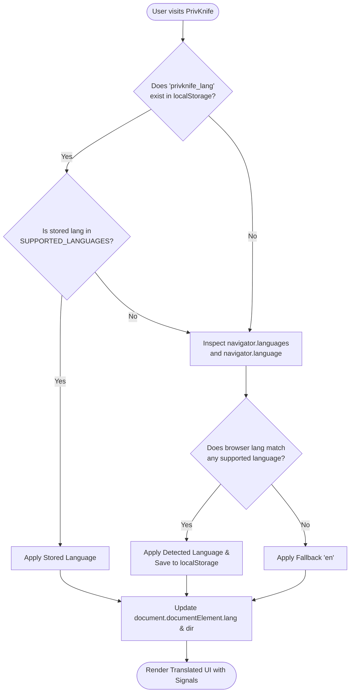

# PrivKnife — Multi-Language (i18n) Architecture Specification

> **Document Version**: 1.0.0  
> **Target Framework**: Angular 22 (Standalone Components & Signals)  
> **Status**: Approved Blueprint / Architecture Design  
> **Scope**: Global internationalization engine, OS language auto-detection, header language switcher, and zero-touch extensibility for future languages.

---

## 1. Executive Summary & Mission Alignment

PrivKnife is an entirely client-side, zero-server Swiss Army Knife web application. Consistent with the core philosophy **"Privacy by Architecture, Not by Policy"**, internationalization (i18n) must operate **100% locally in browser memory**:

1. **Zero Cloud Translation APIs**: Translations are pre-compiled and bundled into static local chunks. No user text or UI strings are sent to third-party translation endpoints (e.g., Google Translate API, DeepL).
2. **Zero Telemetry**: Language selections and locale preferences are saved strictly in `localStorage` without analytics beacons.
3. **Plug-and-Play Extensibility**: Adding a new language (e.g., Chinese `zh`, French `fr`, German `de`, Portuguese `pt`) in the future must require **zero modifications** to component logic, routing, or existing templates. A new language is simply registered in the dictionary registry.
4. **Ultra-Lightweight & Lazy Loaded**: The initial bundle must not be burdened with large dictionaries. Locale files are loaded dynamically on demand via standard ES dynamic imports (`import(...)`).
5. **Seamless Signal Reactivity**: Changing the language from the UI updates all templates, tool titles, descriptions, and notifications instantly **without page reloads**.

---

## 2. Target Languages & Rollout Plan

### 2.1. Initial Release (Phase 1)
- **English (`en`)** *(Default / Base)*: Global lingua franca; primary fallback for all keys.
- **Spanish (`es`)**: Second most spoken native language globally (>500M speakers); covers Latin America and Spain.

### 2.2. Future Languages (Phase 2 & Beyond)
Prepared in the registry architecture for zero-friction addition:
- **Simplified Chinese (`zh-CN` / `zh`)**: >1.1B speakers.
- **French (`fr`)**: >300M speakers.
- **German (`de`)**: Key European tech & privacy-conscious demographic.
- **Portuguese (`pt` / `pt-BR`)**: >250M speakers.
- **Japanese (`ja`)**: High desktop utility demand.
- **Arabic (`ar`)**: Right-to-Left (RTL) layout support pre-architected.

---

## 3. Locale Detection & Storage Algorithm

When a user visits PrivKnife, the application determines the active locale through a deterministic 3-tier priority ladder:



### 3.1. Priority Ladder Details
1. **Tier 1: Explicit User Preference (`localStorage`)**
   - Key: `'privknife_lang'`
   - If the user previously changed the language via the header menu, their choice is always honored.
2. **Tier 2: OS & Browser Language Auto-Detection**
   - Read `navigator.languages || [navigator.language]`
   - Normalize language tags:
     - `'es-ES'`, `'es-419'`, `'es-MX'`, `'es-AR'` &rarr; map to `'es'`
     - `'en-US'`, `'en-GB'`, `'en-AU'` &rarr; map to `'en'`
     - `'zh-CN'`, `'zh-TW'`, `'zh-HK'` &rarr; map to `'zh'`
   - If a match is found in `SUPPORTED_LANGUAGES`, activate it immediately.
3. **Tier 3: Graceful Default Fallback**
   - Default to `'en'` if no supported match is detected.

### 3.2. DOM & Document Synchronization
Upon language resolution or language change:
- `document.documentElement.lang = currentLanguage.code;`
- `document.documentElement.dir = currentLanguage.direction;` (`'ltr'` or `'rtl'`)
- Re-compute application `<title>` and `<meta name="description">`.

---

## 4. Header Language Switcher UI & UX Specification

### 4.1. Visual Placement
The language selector is placed in the global `<app-header>` directly to the left of the Light/Dark mode toggle button.

```
+-------------------------------------------------------------------------------+
| 🇨🇭 PrivKnife  Private In-Browser Toolkit     [🛡️ 100% In-Browser] [🌐 EN ▾] [☀️ Light] |
+-------------------------------------------------------------------------------+
```

### 4.2. UI Design & BEM Styling
- Follows DAW-2 BEM namespace guidelines:
  - Block: `.c-lang-selector`
  - Elements: `.c-lang-selector__button`, `.c-lang-selector__menu`, `.c-lang-selector__item`, `.c-lang-selector__flag`, `.c-lang-selector__label`
  - Modifiers: `.c-lang-selector__item--active`, `.c-lang-selector--open`
- Compact dropdown / native styled select button:
  - Displays a globe icon (`🌐`), the 2-letter uppercase ISO code (e.g., `EN`, `ES`), and a subtle chevron (`▾`).
  - Clicking opens a floating modal/popover menu displaying each available language with its **native name** and flag emoji:
    - 🇺🇸 **English** (`en`)
    - 🇪🇸 **Español** (`es`)
    - *(Future: 🇨🇳 **简体中文**, 🇫🇷 **Français**, 🇩🇪 **Deutsch**)*
  - Showing native names ensures that a Spanish or Chinese speaker who encounters the page in English can immediately identify their language.

### 4.3. Accessibility (WCAG 2.1 AA)
- Semantic `<button aria-haspopup="listbox" [attr.aria-expanded]="isOpen()">`
- Keyboard navigable: `ArrowDown`, `ArrowUp`, `Enter`, `Escape`.
- `aria-label="Select application language / Seleccionar idioma"`.

---

## 5. System Architecture & Technical Design

### 5.1. Directory Structure

```
src/app/core/i18n/
├── index.ts                     # Public API exports (I18nService, TranslatePipe, types)
├── types.ts                     # LanguageDefinition, TranslationSchema, TranslationKey
├── languages.config.ts          # Central registry of supported languages
├── i18n.service.ts              # Signal-based translation & detection engine
├── translate.pipe.ts            # Angular standalone pipe for template strings
└── locales/                     # Lazy-loaded locale translation modules
    ├── en.ts                    # English dictionary (source of truth schema)
    ├── es.ts                    # Spanish dictionary
    └── (future: zh.ts, fr.ts)   # Drop-in new languages without code refactoring
```

### 5.2. Language Definition Interface (`types.ts`)

```typescript
export interface LanguageDefinition {
  code: string;            // ISO 639-1 code ('en', 'es', 'zh')
  name: string;            // English name ('Spanish')
  nativeName: string;      // Native name ('Español')
  flag: string;            // Emoji flag or icon ('🇪🇸')
  direction: 'ltr' | 'rtl';// Text directionality
}
```

### 5.3. Registry Configuration (`languages.config.ts`)

```typescript
import { LanguageDefinition } from './types';

export const SUPPORTED_LANGUAGES: LanguageDefinition[] = [
  {
    code: 'en',
    name: 'English',
    nativeName: 'English',
    flag: '🇺🇸',
    direction: 'ltr',
  },
  {
    code: 'es',
    name: 'Spanish',
    nativeName: 'Español',
    flag: '🇪🇸',
    direction: 'ltr',
  },
  // Future languages are plugged here with ZERO architectural changes:
  // { code: 'zh', name: 'Chinese', nativeName: '简体中文', flag: '🇨🇳', direction: 'ltr' },
  // { code: 'fr', name: 'French', nativeName: 'Français', flag: '🇫🇷', direction: 'ltr' },
];

export const DEFAULT_LANGUAGE_CODE = 'en';
```

### 5.4. Translation Schema Structure (`locales/en.ts`)

Translations are structured hierarchically with full TypeScript type inference:

```typescript
export const en = {
  common: {
    inBrowserBadge: '100% In-Browser',
    privacyBadge: '🛡️ 100% In-Browser • Never Leaves Your Device',
    download: 'Download',
    copy: 'Copy',
    copied: '✓ Copied!',
    reset: 'Reset',
    clear: 'Clear',
    cancel: 'Cancel',
    processing: 'Processing...',
    done: 'Done',
    error: 'Error',
    dropFilesPrompt: 'Drop your files here, or browse',
    themeLight: '☀️ Light',
    themeDark: '🌙 Dark',
  },
  header: {
    tagline: 'Private In-Browser Toolkit',
    languageSelectAria: 'Select language',
  },
  home: {
    heroTitle: 'Consolidated Everyday Tools.',
    heroSubtitle: 'No Backend Servers. Zero Telemetry. 100% Client-Side.',
    searchPlaceholder: 'Search 29+ private tools (PDF, images, 3D, crypto, dev)...',
    categories: {
      all: 'All Tools',
      privacy: 'Privacy & Security',
      documents: 'Documents & PDF',
      media: 'Media & Graphics',
      audioVideo: 'Audio & Video',
      dev: 'Developer Utilities',
      '3d': '3D Printing & CAD',
    },
    filterCount: '{count} tools available',
  },
  footer: {
    mission: 'PrivKnife runs completely in your web browser with zero server data ingestion and zero analytics tracking.',
    privacyNotice: 'Privacy by Architecture, Not by Policy.',
  },
  tools: {
    // Localized metadata for all 29 tools
    exifStripper: {
      name: 'EXIF & Privacy Metadata Stripper',
      description: 'Remove GPS coordinates, camera models, and private metadata from photos before sharing online.',
    },
    tableTentMaker: {
      name: 'Foldable Table Tent & Counter Sign Maker',
      description: 'Generate double-sided inverted PDF table tents with QR codes for menus, events, and WiFi signs.',
    },
    // ... all 29 tools
  },
};

export type TranslationSchema = typeof en;
```

---

## 6. The Reactive i18n Service Engine (`i18n.service.ts`)

### 6.1. Core Service Responsibilities
1. **Dynamic Chunk Loading**:
   - Asynchronously loads translation dictionaries using dynamic imports:
     ```typescript
     private async loadDictionary(langCode: string): Promise<Record<string, any>> {
       switch (langCode) {
         case 'es':
           return (await import('./locales/es')).es;
         case 'en':
         default:
           return (await import('./locales/en')).en;
       }
     }
     ```
2. **Signal Reactivity**:
   - `currentLang`: Signal storing active `LanguageDefinition`.
   - `translations`: Signal holding the current dictionary object.
   - `isLoading`: Signal for asynchronous locale loading states.
3. **Robust Dot-Notation Key Resolution & Fallback**:
   - `t('home.heroTitle')` resolves nested object paths.
   - If a key is missing in `'es'`, the engine automatically falls back to `'en'` seamlessly so the UI never displays broken tokens or empty labels.
4. **Parameter Interpolation**:
   - `t('home.filterCount', { count: 29 })` interpolates `{count}` into `29`.

### 6.2. Template Integration

#### Via Angular Standalone Pipe (`translate.pipe.ts`):
```html
<h1>{{ 'home.heroTitle' | translate }}</h1>
<p>{{ 'home.filterCount' | translate:{ count: 29 } }}</p>
```

#### Via Direct Service Injection in Components:
```typescript
@Component({ ... })
export class MyComponent {
  private readonly i18n = inject(I18nService);

  readonly title = computed(() => this.i18n.t('tools.exifStripper.name'));
}
```

---

## 7. Zero-Touch Extensibility Workflow for New Languages

To add any future language (e.g., German `de` or Chinese `zh`), a developer or contributor only follows 2 simple steps:

1. **Step 1: Create Locale File**:
   Create `src/app/core/i18n/locales/de.ts` and translate the keys (conforming to `TranslationSchema`).
2. **Step 2: Add Entry in `languages.config.ts`**:
   Add `{ code: 'de', name: 'German', nativeName: 'Deutsch', flag: '🇩🇪', direction: 'ltr' }`.
   Register the dynamic import in `i18n.service.ts`.

**Zero other files need to be touched**:
- Header selector updates automatically via `@for (lang of supportedLanguages; track lang.code)`.
- Detection ladder automatically recognizes `de-DE` from OS.
- All templates reactively update.

---

## 8. SEO & Search Engine Optimization Strategy

1. **Alternate Language Annotations**:
   Provide standard `<link rel="alternate" hreflang="es" href="/?lang=es">` guidelines for static deployment.
2. **Dynamic Meta Synchronization**:
   When language changes:
   - Synchronize document `title` with localized tool names.
   - Update `<meta name="description">` with localized descriptions.
3. **Client-Side URL Optional Parameter**:
   Support optional `?lang=es` query parameter for direct sharing or search bot crawling, while falling back gracefully to local storage.

---

## 9. Implementation Roadmap & Milestones

| Milestone | Deliverable | Scope |
|-----------|-------------|-------|
| **Phase 1: Foundation** | Core i18n Infrastructure | Types, `SUPPORTED_LANGUAGES`, `en.ts` dictionary, dynamic loader engine, Signal-based `I18nService`, and `TranslatePipe`. |
| **Phase 2: Header UI** | Language Selector Component | Language picker next to Theme toggle in `<app-header>`, auto-detection logic, `localStorage` persistence. |
| **Phase 3: Catalog & Home** | Spanish Localization | `es.ts` dictionary covering Header, Footer, Home hero, search, category tabs, and all 29 tool titles & descriptions. |
| **Phase 4: Tool Shells** | Core Tool UI Strings | Common tool controls (Dropzone, download buttons, copy feedback, clear queue, privacy badges) localized across the suite. |
| **Phase 5: Verification** | Test Suite & Privacy Guard | Unit tests for OS language detection, fallback chains, interpolation, and zero-telemetry assertion. |

---

## 10. Quality Assurance & Verification Standards

1. **Unit Test Coverage**:
   - Test OS detection with mock `navigator.languages = ['es-MX', 'es']`.
   - Test fallback when a key does not exist in Spanish dictionary.
   - Test parameter interpolation: `{count}` replacement.
   - Test localStorage persistence and retrieval.
2. **Zero Exfiltration Verification**:
   - Assert that changing languages produces `0` HTTP network requests to external servers (only internal dynamic import chunks).
3. **Full Build Check**:
   - Verify `ng build` produces clean lazy chunks for `es.ts` and `en.ts` without bundle bloat.
