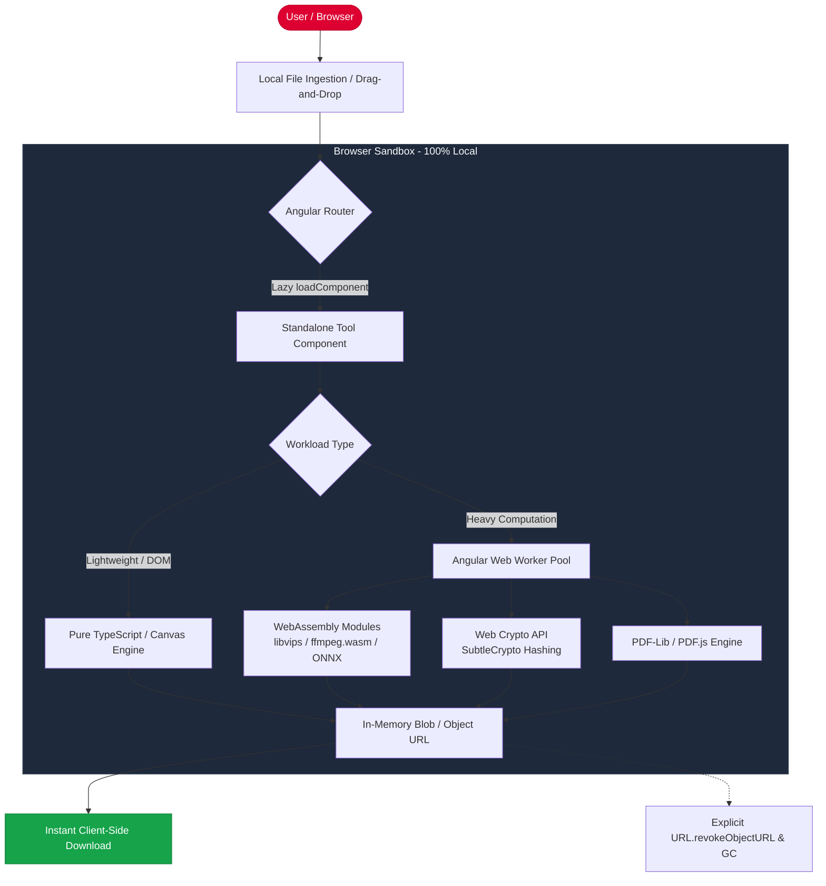

# PrivKnife 🇨🇭 🛡️

> **The Private, In-Browser Swiss Army Knife of Web Utilities.**  
> Zero servers. Zero telemetry. Zero data collection. 100% client-side execution.

[](LICENSE)
[](#-the-privknife-manifesto)
[-orange.svg)](#-architecture--performance)
[%20%7C%20WASM-dd0031.svg)](#-styling--design-system-sass--bem)
[](#-key-features)

---

## 🧭 Table of Contents

- [Overview](#-overview)
- [The PrivKnife Manifesto](#-the-privknife-manifesto)
- [Key Features](#-key-features)
- [Tool Suite & Catalog](#-tool-suite--catalog)
  - [Privacy & Security](#1-privacy--security)
  - [PDF & Document Management](#2-pdf--document-management)
  - [Image & Visual Media](#3-image--visual-media)
  - [Audio & Video Processing](#4-audio--video-processing)
  - [Developer & Data Utilities](#5-developer--data-utilities)
  - [3D Modeling & Physical Fabrication](#6-3d-modeling--physical-fabrication)
- [Styling & Design System: SASS + BEM](#-styling--design-system-sass--bem)
  - [BEM Nomenclature & Namespaces](#bem-nomenclature--namespaces)
  - [6-Layer SASS Architecture](#6-layer-sass-architecture)
- [Architecture & Performance](#-architecture--performance)
- [Project Structure](#-project-structure)
- [Getting Started](#-getting-started)
- [Adding a New Tool](#-adding-a-new-tool)
- [Security & Privacy Auditing](#-security--privacy-auditing)
- [Contributing](#-contributing)
- [License](#-license)

---

## 💡 Overview

**PrivKnife** is inspired by two core ideas:
1. **Private**: Absolute respect for user privacy, confidentiality, and data sovereignty.
2. **Swiss Army Knife**: A versatile, multi-purpose toolkit packing dozens of essential utilities into a single, intuitive interface.

Every day, millions of people use online converters, PDF editors, image compressors, and data formatters. Most of these services upload sensitive documents, private photos, contracts, and confidential code to opaque third-party servers, logging IP addresses and harvesting personal information.

**PrivKnife solves this by running 100% client-side.** Built on **Angular** with reusable components styled through a structured **SASS** architecture following the **BEM methodology**, PrivKnife executes complex computations entirely inside your browser using modern web standards — including **WebAssembly (WASM)**, **Web Workers**, the **Web Crypto API**, **HTML5 Canvas**, and the **Web Audio API**. Your files never leave your machine because there is no backend server to receive them.

---

## 🛡️ The PrivKnife Manifesto

```
   ┌──────────────────────────────────────────────────────────────┐
   │                    THE PRIVKNIFE PROMISE                     │
   │                                                              │
   │   1. NO SERVER UPLOADS     — All files stay on your machine. │
   │   2. ZERO TELEMETRY        — No trackers, no ad beacons.     │
   │   3. ZERO LOGGING          — We cannot read what you do.     │
   │   4. OPEN SOURCE (MIT)     — Every line of code is auditable.│
   │   5. OFFLINE CAPABLE       — Works without internet access.  │
   └──────────────────────────────────────────────────────────────┘
```

1. **Privacy by Architecture, Not by Policy**: Privacy policies can change; architecture cannot lie. PrivKnife has no database, no ingestion endpoints, and no server-side processing queues.
2. **Client-Side First**: If a utility cannot run safely inside the browser or sandboxed worker, it does not belong in PrivKnife.
3. **No Paywalls on Basic Needs**: File conversion, redaction, compression, and formatting should be accessible to everyone without subscriptions or watermarks.

---

## ✨ Key Features

- 🔒 **Zero-Knowledge Architecture**: Files are ingested via the browser's File API, processed in memory/Web Workers, and saved directly back to disk.
- ⚡ **Multi-Threaded Performance**: Heavy processing (video trimming, image compression, PDF flattening) runs in background Web Workers, keeping the Angular UI silky-smooth at 60 FPS.
- 🎨 **Modular SASS & BEM Design System**: Fully scalable, predictable design system following modular SASS layers (`01_utilities` to `06_global`) and BEM prefixes (`c-` for components, `l-` for layout areas, `g--` for global modifiers).
- 🧩 **Reusable Angular Standalone Components**: Built with Angular's modern Standalone Component model, Signals for reactive state, and lazy routing for instant page loads.
- 📴 **Offline & PWA Ready**: Once cached by the Service Worker, the entire toolkit operates completely offline — even on an airplane or in air-gapped environments.
- 🌐 **Static Hosting Anywhere**: Deployable as a static asset bundle to Cloudflare Pages, GitHub Pages, Vercel, Netlify, or run locally via `localhost` or Docker.

---

## 🧰 Tool Suite & Catalog

The tools developed in PrivKnife originate from the detailed specifications in the [`Documents/`](file:///home/deivision/Projects/Programming/PrivKnife/Documents) directory.

### 1. Privacy & Security
| Tool | Output Deliverable | Browser Engine / Tech | Privacy Status |
| :--- | :--- | :--- | :--- |
| **EXIF & Privacy Metadata Stripper** | Sanitized `.jpg` / `.png` | `piexifjs`, Canvas API, File API | 🟢 100% Client-Side |
| **PDF Redaction & Anonymizer** | Flattened, sanitized `.pdf` | `PDF.js`, Canvas 2D Redaction | 🟢 100% Client-Side |
| **Cryptographic Hash & UUID Batch Generator** | Bulk SHA-256, MD5, SHA-512, UUIDv4 | `window.crypto.subtle` (Web Crypto API) | 🟢 100% Client-Side |

### 2. PDF & Document Management
| Tool | Output Deliverable | Browser Engine / Tech | Privacy Status |
| :--- | :--- | :--- | :--- |
| **PDF Merger, Splitter & Page Organizer** | Reordered, merged, or split `.pdf` | `pdf-lib`, `PDF.js` | 🟢 100% Client-Side |
| **Instant Client-Side Invoice & Receipt Maker** | Clean vector `.pdf` invoices | `jspdf`, `pdfmake`, `localStorage` | 🟢 100% Client-Side |
| **Markdown to Academic / Tech PDF Cheatsheet** | Multi-column styled cheatsheet `.pdf` | `marked.js`, `highlight.js`, `html2pdf.js` | 🟢 100% Client-Side |
| **Custom Printable Graph & Dot Grid Paper** | Precision vector grid / dot `.pdf` | `jspdf` vector lines, margin math | 🟢 100% Client-Side |
| **Avery Barcode & Label Sheet Generator** | Grid-aligned sticker sheet `.pdf` | `JsBarcode`, `jspdf` | 🟢 100% Client-Side |
| **Foldable Table Tent & Counter Sign Maker** | Print-ready A4/Letter `.pdf` with fold marks | `jspdf`, SVG DOM renderer | 🟢 100% Client-Side |

### 3. Image & Visual Media
| Tool | Output Deliverable | Browser Engine / Tech | Privacy Status |
| :--- | :--- | :--- | :--- |
| **Batch Image Compressor & WebP Converter** | Compressed `.webp` / `.jpg` in `.zip` | Canvas API, WASM (`libvips`/`squoosh`), `JSZip` | 🟢 100% Client-Side |
| **App Icon & Favicon Suite Generator** | Complete bundle (`.ico`, Apple touch, Android, `manifest.json`) | Canvas API, `JSZip` | 🟢 100% Client-Side |
| **App Screenshot Mockup Studio** | 3D device frame `.png` with angle shadow | `Three.js` / Canvas 2D compositing | 🟢 100% Client-Side |
| **Social Share (Open Graph) Card Maker** | 1200x630 `.png` / `.webp` + HTML tags | HTML5 Canvas API, SVG rendering | 🟢 100% Client-Side |
| **Automated Background Removal** | Transparent `.png` cutout | ONNX Runtime Web (`WASM` / `WebGPU`) | 🟢 In-Browser AI (Client-Side) |

### 4. Audio & Video Processing
| Tool | Output Deliverable | Browser Engine / Tech | Privacy Status |
| :--- | :--- | :--- | :--- |
| **Video to GIF & Clip Trimmer** | Animated `.gif` / trimmed `.mp4` | `ffmpeg.wasm`, Web Workers | 🟢 100% Client-Side |
| **Audio BPM, Pitch & Key Tap Detector** | Real-time BPM readout + tap metronome | Web Audio API `AudioContext` | 🟢 100% Client-Side |
| **Subtitles Timestamp Shifter & SRT/VTT Converter** | Re-synced `.srt` / `.vtt` file | Regex time parsing, HTML5 File API | 🟢 100% Client-Side |
| **Spotify Code & Soundwave Art Maker** | Scalable `.svg` / printable `.pdf` / `.3mf` | Web Audio API, SVG rendering | 🟢 100% Client-Side |

### 5. Developer & Data Utilities
| Tool | Output Deliverable | Browser Engine / Tech | Privacy Status |
| :--- | :--- | :--- | :--- |
| **CSV / Excel to JSON, SQL & Markdown Converter** | Formatted text / `.sql` / `.json` export | `PapaParse`, pure JS parsing | 🟢 100% Client-Side |
| **Robots.txt & XML Sitemap Builder** | Formatted `robots.txt` / `sitemap.xml` | `DOMParser`, `XMLSerializer`, Blob download | 🟢 100% Client-Side |
| **CSS Mesh Gradient & Glassmorphism Code Maker** | Copy-ready CSS / modern utility classes | Canvas shader / CSS backdrop-filter | 🟢 100% Client-Side |
| **Color Palette Extractor & Contrast Checker** | Palette `.ase` / `.json` + WCAG report | `ColorThief`, Canvas pixel sampling | 🟢 100% Client-Side |
| **Universal Event & .ics Calendar Linker** | `.ics` file + Google/Outlook URLs | Pure JS String / Blob API, RFC 5545 | 🟢 100% Client-Side |
| **HTML Email Signature Generator** | Raw HTML + Rich-text clipboard copy | DOM Table renderer, Clipboard API | 🟢 100% Client-Side |

### 6. 3D Modeling & Physical Fabrication
| Tool | Output Deliverable | Browser Engine / Tech | Privacy Status |
| :--- | :--- | :--- | :--- |
| **3D QR Stand & Keychain Generator** | Dual-color `.3mf` / `.stl` + `.png` | `Three.js`, `three-bvh-csg`, `qrcode` | 🟢 100% Client-Side |
| **Custom Cookie Cutter & Stamp 3D Maker** | Dual-part cutter/stamp `.stl` / `.3mf` | `ClipperLib` (2D offset), `Three.js` extrude | 🟢 100% Client-Side |
| **Parametric Desk Wedge & Nameplate Maker** | Multi-color `.3mf` with layer presets | `Three.js` CSG, `FontLoader` text extrusion | 🟢 100% Client-Side |

---

## 🎨 Styling & Design System: SASS + BEM

PrivKnife's styling strictly adheres to the Web Interface Design theory taught in [DAW-2 Web Interface Design Theory](https://github.com/david13penalver/DAW-2/tree/master/Web%20Interface%20Design/First%20Evaluation/Theory) and [logongas.es DIW](https://logongas.es/doku.php?id=clase:daw:diw:start).

### BEM Nomenclature & Namespaces

Classes are categorized into clear functional prefixes:

| Prefix | Type | Purpose | Example |
| :--- | :--- | :--- | :--- |
| **`c-`** | **Component** | Reusable visual blocks and widgets | `.c-button`, `.c-button--primary`, `.c-card`, `.c-dropzone`, `.c-badge` |
| **`l-`** | **Layout** | Positioning containers (Flexbox/Grid). Controls **only** placement and area dimensions (never colors/fonts). | `.l-page`, `.l-columns`, `.l-extremo`, `.l-columns--3`, `.l-columns__area` |
| **`g--`** | **Global Modifier** | Global utility modifiers for spacing, alignment, and display overrides | `.g--margin-4`, `.g--margin-bottom-6`, `.g--text-center`, `.g--hidden` |

#### BEM Layout Rule: The "Area" Pattern
Layout classes (`.l-*`) strictly adhere to the father-child area rule:
- A layout block consists of the main container and child areas (`&__area` or `&__area-YYYY`).
- Areas handle positioning, margins, and grid placement.
- Visual components (`.c-*`) are placed inside or attached to areas:
```html
<div class="l-extremo">
    <div class="l-extremo__area-izquierda c-button">Upload File</div>
    <div class="l-extremo__area-derecha c-button c-button--primary">Download Clean PDF</div>
</div>
```

### 6-Layer SASS Architecture

Global styles and design tokens reside in `src/styles/` following a clean, modular structure:

```
src/styles/
├── 01_utilities/
│   ├── _css-variables.scss     # CSS custom properties (--color-primary, --spacing-md)
│   ├── _sass-variables.scss    # SASS variables ($font-main, $palette-map)
│   ├── _functions.scss         # SASS calculation functions (getBorderSize, contrastRatio)
│   └── _mixins.scss            # Reusable mixins (@mixin box-shadow, @mixin responsive)
├── 02_base/
│   ├── _reset.scss             # Modern CSS reset
│   ├── _typography.scss        # Base typography, font scales, and headings
│   └── _override.scss          # External library overrides (if any)
├── 03_layout/
│   ├── _l-page.scss            # Primary page shell and header/main/footer layout
│   ├── _l-columns.scss         # Responsive grid columns generator
│   └── _l-extremo.scss         # Flexbox split-alignment layout
├── 04_components/
│   ├── _c-button.scss          # Reusable button styles (.c-button, .c-button--primary)
│   ├── _c-dropzone.scss        # Drag-and-drop file upload zone
│   ├── _c-card.scss            # Tool cards and container panels
│   ├── _c-input.scss           # Form inputs, sliders, toggles
│   ├── _c-badge.scss           # Privacy badge, status tags
│   └── _c-preview.scss         # Canvas / PDF / side-by-side comparison viewers
├── 05_pages/
│   └── (Empty by convention; page-specific one-off styles are avoided)
├── 06_global/
│   ├── _g--margin.scss         # Spacing helpers (.g--margin-4, .g--margin-bottom-6)
│   ├── _g--padding.scss        # Padding helpers (.g--padding-4)
│   └── _g--display.scss        # Display utilities (.g--flex, .g--grid, .g--hidden)
└── main.scss                   # Central aggregator compiling all layers
```

---

## 🏗️ Architecture & Performance

PrivKnife operates as a pure client-side Single Page Application (SPA) powered by **Angular Standalone Components**.



### Memory Management & Concurrency
- **Non-blocking UI**: Intensive tasks run inside background Web Workers.
- **Garbage Collection Hygiene**: Blobs and Object URLs (`URL.createObjectURL`) are systematically revoked upon download or component destruction (`ngOnDestroy`).
- **Dynamic Standalone Chunking**: Every tool is an isolated Angular standalone component loaded on demand via router `loadComponent`.

---

## 📁 Project Structure

```
PrivKnife/
├── Documents/                           # 29 MicroSaaS specification guides (.docx & .xlsx)
├── src/
│   ├── app/
│   │   ├── core/                        # Core services (workers, privacy guards, storage)
│   │   │   ├── privacy/                 # CSP validation & memory sanitizers
│   │   │   ├── workers/                 # Web Worker bridge service
│   │   │   └── utils/                   # Download triggers, file formatters
│   │   ├── components/                  # Reusable UI Angular standalone components
│   │   │   ├── button/                  # <app-button> (.c-button)
│   │   │   ├── dropzone/                # <app-dropzone> (.c-dropzone)
│   │   │   ├── preview/                 # <app-split-preview> (.c-preview)
│   │   │   ├── progress/                # <app-progress-bar> (.c-progress)
│   │   │   └── badge/                   # <app-badge> (.c-badge)
│   │   ├── layout/                      # Application shell
│   │   │   ├── header/                  # Navigation bar & privacy indicator
│   │   │   └── footer/                  # Footer & open-source links
│   │   ├── tools/                       # Tool implementations by domain
│   │   │   ├── privacy/                 # EXIF stripper, PDF redactor, Hash generator
│   │   │   ├── documents/               # PDF organizer, invoice maker, cheatsheets
│   │   │   ├── media/                   # Image compressor, favicon suite, mockups
│   │   │   ├── audio-video/             # Video to GIF, BPM detector, subtitle shifter
│   │   │   ├── dev/                     # CSV converter, robots.txt, CSS gradients
│   │   │   └── 3d/                      # QR stand, cookie cutter, nameplate
│   │   ├── app.routes.ts                # Angular router configuration (lazy routes)
│   │   ├── app.component.ts             # Root standalone component
│   │   └── app.config.ts                # Application configuration & providers
│   ├── styles/                          # 6-Layer SASS Design System (BEM)
│   │   ├── 01_utilities/                # CSS variables, SASS variables, functions, mixins
│   │   ├── 02_base/                     # Reset, typography, overrides
│   │   ├── 03_layout/                   # Layout containers (_l-*.scss)
│   │   ├── 04_components/               # Component stylesheets (_c-*.scss)
│   │   ├── 05_pages/                    # Page-specific styles
│   │   ├── 06_global/                   # Global modifier utilities (_g--*.scss)
│   │   └── main.scss                    # SASS main bundle
│   ├── assets/                          # Static assets, icons, WASM binaries
│   ├── index.html                       # Application shell HTML with strict CSP
│   └── main.ts                          # Angular bootstrap
├── angular.json                         # Angular CLI configuration
├── AGENTS.md                            # AI Agent Operating Manual & SASS/BEM Guidelines
├── README.md                            # Project documentation
├── tsconfig.json                        # TypeScript configuration
└── package.json                         # Dependencies & npm scripts
```

---

## 🚀 Getting Started

### Prerequisites
- [Node.js](https://nodejs.org/) (v18.13.0 or higher recommended)
- [Angular CLI](https://angular.dev/tools/cli) (`npm install -g @angular/cli`)

### Installation
```bash
# Clone the repository
git clone https://github.com/david13penalver/PrivKnife.git
cd PrivKnife

# Install dependencies
npm install
```

### Running Locally
```bash
# Start local development server
ng serve
# or
npm start
```
Open your browser at `http://localhost:4200/`.

### Building for Production
```bash
# Compile and build production static bundle
ng build --configuration production
```
The output will be generated inside `dist/priv-knife/browser/`.

### Deploying
Because PrivKnife produces a 100% static client-side bundle:
- **Cloudflare Pages**: Connect GitHub repo with build command `npm run build` and publish directory `dist/priv-knife/browser`.
- **GitHub Pages**: Deploy `dist/priv-knife/browser` using GitHub Actions.
- **Vercel / Netlify**: Connect repository with static Angular build preset.

---

## 🛠️ Adding a New Tool

Every tool in PrivKnife follows a standardized contract:

1. **Check the Specification**: Inspect the guide in [`Documents/<Tool Name>/`](file:///home/deivision/Projects/Programming/PrivKnife/Documents).
2. **Implement Pure Logic (`engine.ts`)**: Pure TypeScript functions with zero UI dependencies.
3. **Offload Heavy Work (`worker.ts`)**: If processing takes >50ms, run inside a Web Worker.
4. **Build Angular Standalone Component (`<tool-slug>.component.ts`)**:
   - Use reusable UI components (`<app-dropzone>`, `<app-button>`, `<app-progress-bar>`).
   - Use BEM nomenclature (`.c-*`, `.l-*`, `.g--*`).
5. **Register in Router (`app.routes.ts`)**:
   ```typescript
   {
     path: 'tools/exif-stripper',
     loadComponent: () => import('./tools/privacy/exif-stripper/exif-stripper.component')
       .then(m => m.ExifStripperComponent)
   }
   ```
6. **Clean Up Memory**: Revoke object URLs in `ngOnDestroy()`.

Refer to [`AGENTS.md`](file:///home/deivision/Projects/Programming/PrivKnife/AGENTS.md) for full architecture standards and agent implementation workflows.

---

## 🔍 Security & Privacy Auditing

Anyone can verify PrivKnife's privacy claims in seconds:

1. Open **Developer Tools** (`F12` or `Ctrl+Shift+I`).
2. Navigate to the **Network** tab.
3. Select any tool (e.g. *EXIF Stripper*, *PDF Merger*, or *Image Compressor*) and drop a sensitive file.
4. Observe the network traffic: **Zero outgoing data payloads, zero API requests, zero telemetry calls.**

PrivKnife enforces a strict Content Security Policy (CSP) blocking unauthorized external network connections.

---

## 🤝 Contributing

Contributions are welcome! If you want to contribute:
1. Ensure your tool adheres strictly to the **100% Client-Side** privacy principle.
2. Follow the Angular standalone component and **SASS + BEM** design standards documented in [`AGENTS.md`](file:///home/deivision/Projects/Programming/PrivKnife/AGENTS.md).
3. Open an issue or submit a pull request describing your improvements.

---

## 📄 License

This project is open source and available under the [MIT License](LICENSE).

Copyright (c) 2026 David Peñalver.
