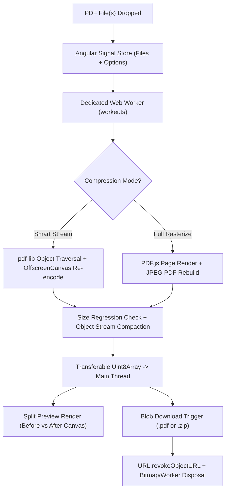

# Client-Side PDF Compressor & Image Downsampler

# Technical Specification & Architecture Blueprint

> **Spec Number**: 103  
> **Slug**: `pdf-compressor`  
> **Category**: `documents`  
> **Inspired By**: iLovePDF — *Compress PDF*  
> **Target SEO Keyword**: `compress pdf online free no upload client side reduce pdf file size`  
> **Route**: `/tools/pdf-compressor`  
> **Architecture**: 100% Client-Side Single Page Application (Zero Server Ingestion, Zero Telemetry)

---

## 1. MVP Generation Prompt (`/create-web-micro-saas`)

```text
/create-web-micro-saas

Act as a Principal Frontend Engineer and UX Architect. Build a high-performance, 100% client-side Angular Standalone tool for PrivKnife called "Client-Side PDF Compressor & Image Downsampler".

TECHNICAL CONSTRAINTS & STACK:
1. Pure Client-Side Architecture: Zero backend endpoints, zero server uploads. All PDF stream inspection, image decoding, downsampling, and PDF reassembly MUST run entirely in the browser.
2. Core Technologies: pdf-lib (already installed), pdfjs-dist (already installed), OffscreenCanvas / HTML5 Canvas (JPEG/WebP re-encoding), Web Workers.
3. Thread Safety: All PDF parsing, raster downsampling, and recompression MUST execute inside a dedicated Web Worker (`worker.ts`) with real-time progress reporting (`onProgress(percent, stage)`) to keep the Angular UI at 60 FPS (Directive 3).
4. Memory Hygiene: Explicitly close `ImageBitmap` instances (`.close()`), zero out temporary canvas dimensions (`width = 0; height = 0`), revoke every `ObjectURL`, and terminate idle workers on `ngOnDestroy` (Directive 4).
5. Export Deliverables: Size-reduced `.pdf` document (and `.zip` archive when batch-compressing multiple PDFs) with detailed byte-savings metrics.

KEY FEATURES & USER INTERACTION:
- Compression Presets: Extreme (72–96 DPI / 0.50 JPEG quality), Recommended (150 DPI / 0.72 quality), Low Compression / Print Safe (220–300 DPI / 0.88 quality), plus Custom DPI & quality sliders.
- Compression Modes:
  1. Smart Stream Optimization (default): Preserves selectable vector text and fonts while selectively re-encoding embedded raster `XObject` images and stripping redundant metadata/thumbnails/object streams.
  2. Full Rasterize Mode (optional fallback for scanned/heavy-vector PDFs): Renders pages via PDF.js at target DPI and rebuilds compact JPEG-backed PDF pages.
- Live Visual Split Comparison: Side-by-side before/after page preview with zoom toggle so users verify legibility before downloading.
- Privacy & Local Execution Assurance: Prominent trust badge reading "🛡️ 100% In-Browser • Never Leaves Your Device".
- Zero Ad Placeholders: Clean, distraction-free workspace using PrivKnife BEM (`c-`, `l-`, `g--`) SASS design tokens.
```

---

## 2. Concept Overview & Value Proposition

Users frequently need to shrink multi-megabyte scanned contracts, tax returns, resumes, or portfolios to satisfy email attachment limits (10 MB / 25 MB) or government portal caps (2 MB / 5 MB). Legacy online PDF compressors force users to upload confidential documents to remote Ghostscript servers. **Client-Side PDF Compressor & Image Downsampler** solves this entirely inside browser RAM using `pdf-lib` object-stream compaction and `OffscreenCanvas` image re-encoding.

### Elevator Pitch
> "Shrink bloated PDFs by up to 80% directly inside your browser—preserving crisp vector text while downsampling heavy embedded images, with zero server uploads and zero file count limits."

### Core Value Drivers
1. **Zero-Trust Confidentiality**: Financial statements, medical scans, and signed NDAs never leave client memory (Directive 1).
2. **Vector Text Preservation**: Unlike naive canvas-only compressors that destroy searchable text, Smart Stream Optimization targets embedded image XObjects while keeping text selectable and crisp.
3. **Transparent Before/After Inspection**: Instant byte-savings meter (`14.2 MB → 1.8 MB, -87%`) paired with side-by-side visual quality inspection.
4. **Unlimited Batch Processing**: Compress one or multiple PDFs sequentially in a Web Worker without artificial daily quotas.

---

## 3. Technical Feasibility, Dependencies & Difficulty Score

### Difficulty Score: 6.5 / 10 (Moderate-High — PDF XObject stream traversal, FlateDecode image handling, and memory-safe OffscreenCanvas downsampling)

| Architectural Component | Implementation Technology | Installed in Repo? | Client-Side Feasibility |
|---|---|---|---|
| PDF Structure & Object Compaction | `pdf-lib` (`useObjectStreams: true`) | Yes (`^1.17.1`) | 100% In-Browser |
| Page Preview & Raster Fallback | `pdfjs-dist` | Yes (`^6.4.299`) | 100% In-Browser |
| Image Downsampling & Re-Encoding | `OffscreenCanvas` / `createImageBitmap` | Native Browser API | 100% In-Browser (Worker-safe) |
| Batch Packaging | `jszip` | Yes (`^3.10.2`) | 100% In-Browser |
| Off-Thread Compute | Dedicated Web Worker (`worker.ts`) | Native Browser API | Non-blocking 60 FPS UI |

### Known Technical Nuances & Mitigations
- **Non-JPEG / CMYK Embedded Images**: PDFs can store images with `FlateDecode`, `JBIG2Decode`, or `DeviceCMYK` color spaces that `createImageBitmap` cannot decode directly.
  - *Mitigation*: In Smart Stream mode, inspect `/Filter` and `/ColorSpace` on each `PDFRawStream` XObject. Directly re-encode `DCTDecode` (JPEG) RGB/Grayscale streams and raw RGB `FlateDecode` buffers; safely skip unsupported `JBIG2`/`CCITT` masks without corruption. Offer **Full Rasterize Mode** via `pdfjs-dist` when Smart Stream yields < 10% savings (e.g., complex vector CAD plots or CMYK scans).
- **Size Regression Guard**: If re-encoding an already tiny image increases its byte length, retain the original stream unchanged.
- **Large File Guardrail**: Warn users when total input exceeds 100 MB; process pages sequentially and release bitmaps per page to avoid OOM tab crashes.

---

## 4. Competitive Landscape & Market Positioning

| Feature / Metric | PrivKnife (`pdf-compressor`) | iLovePDF / Smallpdf | Adobe Acrobat Pro |
|---|---|---|---|
| **Privacy / Ingestion** | **100% Local Browser RAM** | Remote Cloud Server Upload | Local Desktop App |
| **File Size / Daily Limits** | **Unlimited (RAM-bound)** | Strict free-tier caps | Paid subscription ($19.99/mo) |
| **Text Preservation** | **Smart Stream + Optional Raster** | Server Ghostscript | Full Preflight Optimizer |
| **Before/After Visual Diff** | **Instant Split Preview** | Download first to inspect | Manual inspection |
| **Metadata Stripping Option** | **Built-in Toggle** | Limited | Manual sanitize |

---

## 5. Functional Requirements & Processing Algorithms

### 5.1. Compression Modes
1. **Smart Stream Optimization (`smart_stream`)**:
   - Load PDF with `PDFDocument.load(bytes, { updateMetadata: false })`.
   - Iterate `pdfDoc.context.enumerateIndirectObjects()` to find `PDFRawStream` entries where `/Subtype === /Image`.
   - Filter out soft-masks (`/SMask` targets) and tiny icons (`width < 64 && height < 64`).
   - Compute target pixel dimensions using `targetDpi` relative to rendered scale or `maxImageDimensionPx`.
   - Decode image into `ImageBitmap`, draw onto `OffscreenCanvas` (optionally applying grayscale conversion via canvas filter if `convertToGrayscale: true`), encode as JPEG with `jpegQuality`.
   - **Regression Check**: Only replace stream bytes and set `/Filter: /DCTDecode`, `/Width`, `/Height`, `/BitsPerComponent: 8`, `/ColorSpace` if `newBytes.length < originalBytes.length`.
   - Strip `/Info` metadata, embedded XMP streams, and page thumbnails if `stripMetadata: true`.
   - Save with `pdfDoc.save({ useObjectStreams: true, addDefaultPage: false })`.
2. **Full Page Rasterize (`rasterize_pages`)**:
   - Render each page using `pdfjs-dist` at `scale = targetDpi / 72`.
   - Convert canvas to JPEG (`jpegQuality`), create a new `PDFDocument` preserving original page point dimensions (`width`, `height`), and embed the JPEG image full-bleed.
   - Display a clear notice that Full Rasterize mode converts selectable text to images.

### 5.2. Presets
| Preset | Mode | Target DPI | Max Image Edge | JPEG Quality | Strip Metadata |
|---|---|---|---|---|---|
| `extreme` | `smart_stream` (or `rasterize_pages` toggle) | 96 DPI | 1200 px | `0.50` | `true` |
| `recommended` | `smart_stream` | 150 DPI | 1800 px | `0.72` | `true` |
| `high_quality` | `smart_stream` | 240 DPI | 2800 px | `0.86` | `false` |
| `custom` | User-selected | 72–300 DPI | 800–4000 px | `0.25–0.95` | User-selected |

### 5.3. Edge Cases
- **Encrypted / Password-Protected PDF**: Detect `EncryptedPDFError`, emit typed error message guiding the user to the PDF Password Unlocker (`pdf-password-security`).
- **Already Optimized Text-Only PDF**: If output size >= input size, notify the user ("Document is already optimally compressed — keeping smallest version") and return original bytes.
- **Corrupted Stream**: Gracefully skip malformed individual XObjects and log count in `CompressionReport.skippedObjects`.

---

## 6. UI/UX Layout Specification (BEM Architecture)

- **Localization (`i18n`)**: All labels, presets, stages, and errors defined under `tools.pdfCompressor.*` in both English (`en`) and Spanish (`es`).
- **Responsive Layout**: 2-column `.l-columns--2` on desktop (`>= 960px`), stacked single-column on mobile (`320px–959px`) with zero horizontal overflow (`min-width: 0`).
- **Accessibility**: Radio group for presets with `role="radiogroup"`, range sliders with `aria-valuetext` (e.g., `"72% JPEG quality"`), live `aria-live="polite"` progress announcements, minimum `44×44px` touch targets.

```html
<div class="l-page">
  <header class="l-page__header c-header">
    <div class="c-header__title-group">
      <h1 class="c-header__title">{{ t('tools.pdfCompressor.name') }}</h1>
      <p class="c-header__subtitle">{{ t('tools.pdfCompressor.description') }}</p>
    </div>
    <app-badge variant="privacy" />
  </header>

  <div class="l-columns l-columns--2">
    <section class="l-columns__area c-card">
      <div class="c-card__header"><h2 class="c-card__title">Upload & Compression Settings</h2></div>
      <div class="c-card__body">
        <app-dropzone accept="application/pdf,.pdf" [multiple]="true" />
        <!-- Preset cards (Extreme / Recommended / High Quality / Custom) -->
        <!-- Custom sliders: Target DPI, JPEG Quality, Grayscale toggle, Strip Metadata toggle, Rasterize fallback toggle -->
        <app-progress-bar />
      </div>
      <div class="c-card__footer l-extremo">
        <button class="l-extremo__area-izquierda c-button c-button--outline">Reset</button>
        <button class="l-extremo__area-derecha c-button c-button--primary">Compress PDF</button>
      </div>
    </section>

    <section class="l-columns__area c-card">
      <div class="c-card__header"><h2 class="c-card__title">Size Savings & Quality Preview</h2></div>
      <div class="c-card__body">
        <!-- Savings summary banner: Original Size -> Compressed Size (-XX.X%) -->
        <!-- Page selector + Before/After split visual preview (.c-preview__split) -->
      </div>
      <div class="c-card__footer l-extremo">
        <button class="l-extremo__area-derecha c-button c-button--primary">Download Compressed PDF</button>
      </div>
    </section>
  </div>
</div>
```

---

## 7. Technical Architecture & Client-Side Pipeline



### Resource Hygiene Guidelines
- Transfer `ArrayBuffer` via `postMessage(payload, [buffer])` to avoid doubling peak RAM usage.
- Call `bitmap.close()` immediately after drawing each XObject image onto `OffscreenCanvas`.
- Revoke preview and download `ObjectURL`s on new file drop, Reset, and `ngOnDestroy`.
- Terminate the worker cleanly inside `ngOnDestroy`.

---

## 8. Input/Output Data Contracts (TypeScript Interfaces)

```typescript
export type CompressionPreset = 'extreme' | 'recommended' | 'high_quality' | 'custom';
export type CompressionMode = 'smart_stream' | 'rasterize_pages';

export interface PdfCompressorOptions {
  preset: CompressionPreset;
  mode: CompressionMode;
  targetDpi: number;               // 72..300
  maxImageDimensionPx: number;     // 800..4000
  jpegQuality: number;             // 0.25..0.95
  convertToGrayscale: boolean;
  stripMetadata: boolean;
  removeThumbnails: boolean;
}

export interface PdfCompressionMetrics {
  originalBytes: number;
  compressedBytes: number;
  savedBytes: number;
  savingsPercent: number;
  pageCount: number;
  imagesOptimized: number;
  imagesSkipped: number;
  usedOriginalFallback: boolean;
  durationMs: number;
}

export interface PdfCompressorFileResult {
  fileName: string;
  outputFileName: string;
  blob: Blob;
  metrics: PdfCompressionMetrics;
}

export interface PdfCompressorResult {
  success: boolean;
  files: PdfCompressorFileResult[];
  bundleZipBlob?: Blob;            // Populated when >1 PDF compressed
  error?: string;
}
```

---

## 9. Security, Sandboxing & Verification Acceptance Criteria

- **Directive 1 (Zero Server Ingestion)**: Automated Vitest spec spies on `globalThis.fetch` and `XMLHttpRequest.prototype.open` and asserts `0` calls during single and batch compression.
- **Directive 2 (Zero Telemetry)**: No remote fonts, no CDN worker URLs (`pdfjs-dist` worker bundled locally via Angular assets under `'self'`).
- **Directive 3 (Thread Safety)**: All heavy image re-encoding runs inside `worker.ts` with progress events emitted per image/page.
- **Directive 4 (Memory Hygiene)**: Component test verifies `URL.revokeObjectURL` is called on Reset and `ngOnDestroy`, and worker `.terminate()` is invoked.
- **Directive 5 (Lazy Loading)**: Loaded exclusively via `loadComponent` in `app.routes.ts`.
- **Functional Test Vectors**:
  1. Synthetic PDF containing an uncompressed 1200×1200 bitmap image -> verifies `compressedBytes < originalBytes` and valid `%PDF-` header.
  2. Minimal text-only PDF -> verifies text remains extractable in `smart_stream` mode and size regression guard prevents file bloat.
  3. Encrypted/malformed bytes -> returns structured `success: false` error without unhandled rejection.
