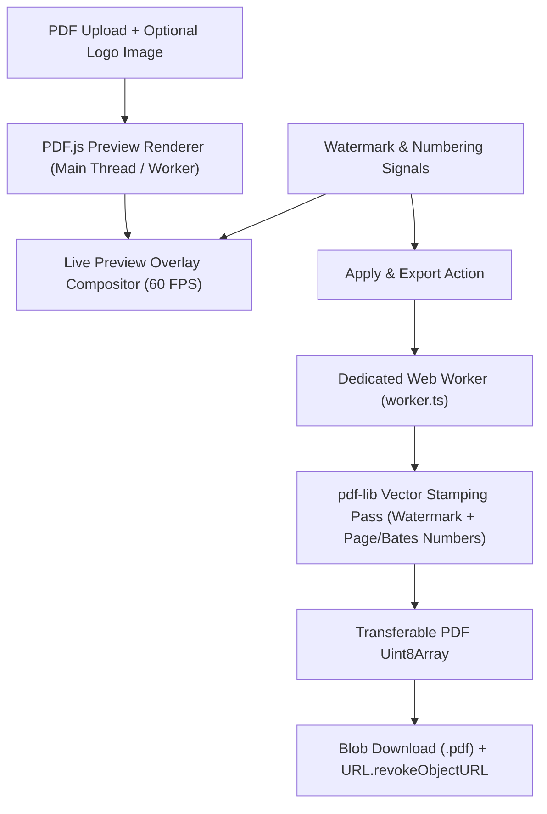

# PDF Watermark, Page Numbers & Bates Stamper

# Technical Specification & Architecture Blueprint

> **Spec Number**: 104  
> **Slug**: `pdf-watermark-numbering`  
> **Category**: `documents`  
> **Inspired By**: iLovePDF — *Add Watermark* + *Add Page Numbers*  
> **Target SEO Keyword**: `add watermark to pdf online free client side page numbers bates stamping`  
> **Route**: `/tools/pdf-watermark-numbering`  
> **Architecture**: 100% Client-Side Single Page Application (Zero Server Ingestion, Zero Telemetry)

---

## 1. MVP Generation Prompt (`/create-web-micro-saas`)

```text
/create-web-micro-saas

Act as a Principal Frontend Engineer and UX Architect. Build a high-performance, 100% client-side Angular Standalone tool for PrivKnife called "PDF Watermark, Page Numbers & Bates Stamper".

TECHNICAL CONSTRAINTS & STACK:
1. Pure Client-Side Architecture: Zero server uploads, zero remote fonts. All PDF vector stamping and preview compositing execute strictly in client browser memory.
2. Core Technologies: pdf-lib (already installed), pdfjs-dist (already installed), HTML5 Canvas for interactive placement preview.
3. Thread Safety: Execute multi-page PDF stamping inside a Web Worker (`worker.ts`) for documents > 10 pages, streaming per-page progress to Angular Signals (Directive 3).
4. Memory Hygiene: Revoke all generated preview/download ObjectURLs and release PDF.js document proxies (`loadingTask.destroy()`) on file replacement, reset, and `ngOnDestroy` (Directive 4).
5. Export Deliverables: Stamped vector `.pdf` preserving original selectable text and crisp typography.

KEY FEATURES & USER INTERACTION:
- Dual Tab / Combined Workflow: Apply Watermarks, Page Numbers, and/or Legal Bates Numbering in a single non-destructive pass.
- Text & Image Watermarks: Configurable text (e.g., "CONFIDENTIAL", "DRAFT"), PNG/SVG logo upload, 3×3 anchor grid or tiled diagonal mosaic pattern, rotation (-180° to +180°), opacity (5%–100%), font family, color, and layer order (over content vs. under content).
- Page & Bates Numbering: Customizable format templates (`Page {n} of {total}`, `{n}`, `CASE-2026-{bates:6}`), starting number, facing-pages mirrored margins (odd/even swap), skip first N pages (e.g., cover page), and page range filter (`1-5, 8, 12-end`).
- Live WYSIWYG Preview: Real-time canvas overlay over actual PDF pages with page navigation.
- Privacy & Local Execution Assurance: Prominent trust badge reading "🛡️ 100% In-Browser • Never Leaves Your Device".
```

---

## 2. Concept Overview & Value Proposition

Legal teams, freelancers, architects, and students constantly need to stamp "DRAFT" or "CONFIDENTIAL" watermarks onto proposals, insert clean page numbers onto combined manuscripts, or apply sequential **Bates numbering** (`EXH-000001`) for discovery packets. Uploading legal briefs or unreleased contracts to cloud PDF tools violates client confidentiality. **PDF Watermark, Page Numbers & Bates Stamper** combines iLovePDF's *Add Watermark* and *Add Page Numbers* plus professional Bates stamping into one instant, offline-capable studio.

### Elevator Pitch
> "Stamp vector watermarks, custom page numbers, and legal Bates identifiers onto any PDF in milliseconds—with live WYSIWYG preview and 100% zero-upload privacy."

### Core Value Drivers
1. **Zero-Trust Confidentiality**: Contracts, legal exhibits, and financial drafts remain exclusively on the user's device.
2. **True Vector Stamping**: Text watermarks and numbering are embedded as crisp PDF vector drawing instructions via `pdf-lib`, keeping file sizes minimal and zoom sharpness infinite.
3. **All-in-One Stamping Pass**: Combine a tiled watermark, header Bates code, and footer page numbering in a single export without re-processing the PDF three times.
4. **Precision Page Targeting**: Support custom page ranges (`2-10, 15`), skip cover sheets, and automatically mirror inner/outer margins for duplex book printing.

---

## 3. Technical Feasibility, Dependencies & Difficulty Score

### Difficulty Score: 4.5 / 10 (Moderate — PDF coordinate-origin math, rotated page box handling, and tiled pattern placement)

| Architectural Component | Implementation Technology | Installed in Repo? | Client-Side Feasibility |
|---|---|---|---|
| Vector PDF Stamping & Embedding | `pdf-lib` (`StandardFonts`, `drawText`, `drawImage`, `degrees`) | Yes (`^1.17.1`) | 100% In-Browser |
| Live Page Rendering | `pdfjs-dist` | Yes (`^6.4.299`) | 100% In-Browser |
| Interactive Overlay Preview | HTML5 Canvas 2D / SVG Overlay | Native Browser API | 60 FPS instant feedback |
| Off-Thread Stamping | Dedicated Web Worker (`worker.ts`) | Native Browser API | Non-blocking for 200+ page docs |

### Known Technical Nuances & Mitigations
- **Rotated Pages & Non-Zero CropBox Origins**: Many scanned PDFs carry `/Rotate 90` or non-zero `CropBox` offsets `(x0, y0)`.
  - *Mitigation*: Read `page.getCropBox()` and `page.getRotation().angle` for every page so anchor positions (`top-left`, `center`, `bottom-right`) map identically to what the user sees in the PDF.js preview.
- **Unicode Characters in Standard Fonts**: `pdf-lib`'s built-in `StandardFonts` (Helvetica, Times, Courier) only support WinAnsi encoding.
  - *Mitigation*: Validate input characters against WinAnsi; gracefully sanitize/warn or support optional embedded subset font bytes bundled locally in assets if non-Latin scripts are entered.
- **Underlay vs. Overlay Layering**: Drawing a watermark *behind* opaque white scanned backgrounds hides it; therefore default to `layer: 'over'` with adjustable opacity (`0.20` default) and explain `layer: 'under'` works best on transparent vector documents.

---

## 4. Competitive Landscape & Market Positioning

| Feature / Metric | PrivKnife (`pdf-watermark-numbering`) | iLovePDF | Adobe Acrobat |
|---|---|---|---|
| **Privacy / Ingestion** | **100% Client-Side** | Remote Server Upload | Local Desktop |
| **Combined Watermark + Numbering** | **Single Pass** | 2 Separate Tools & Uploads | Separate Dialogs |
| **Legal Bates Numbering** | **Built-in Free** | Not available | Acrobat Pro only |
| **Tiled Mosaic Watermark** | **Configurable Spacing & Angle** | 3×3 Grid only | Manual workaround |
| **Cost** | **100% Free** | Freemium / Paid | Paid Subscription |

---

## 5. Functional Requirements & Processing Algorithms

### 5.1. Page Range Parser (`parsePageRange`)
- Accepts strings like `"all"`, `"odd"`, `"even"`, or `"2-5, 8, 12-end"` against `totalPages`.
- Deduplicates and sorts 1-based page indices; rejects out-of-bounds syntax with friendly inline validation errors.

### 5.2. Watermark Stamping Algorithm
- **Single Placement**: Map 9-point anchor grid (`top-left` through `bottom-right`) using `(cropBox.x, cropBox.y, cropBox.width, cropBox.height)` minus configurable `marginPt`. Compute centered text bounding box `(font.widthOfTextAtSize, font.heightAtSize)` and rotate around the anchor center.
- **Tiled Mosaic**: Generate a staggered grid spanning `-diagonal` to `+diagonal` around page center with configurable `tileGapX` / `tileGapY` so diagonal rotations leave zero unwatermarked corners.
- **Image Watermark**: Accept `.png` or `.jpg` (rasterize `.svg` via sanitized canvas to PNG first), scale proportionally by `imageScalePercent` of page width, apply `opacity` and `rotationDeg`.

### 5.3. Page Numbering & Bates Stamping Algorithm
- Template token interpolation:
  - `{n}`: Logical page number (`startNumber + sequenceIndex`)
  - `{total}`: Total numbered pages or total document pages (configurable)
  - `{bates:N}`: Zero-padded sequential Bates number (`batesPrefix + String(batesStart + sequenceIndex).padStart(N, '0') + batesSuffix`)
- **Facing Pages Mode**: When enabled, swaps `left` and `right` anchor alignments on even-numbered pages for book/duplex binding.
- Optional subtle background pill (white rectangle behind text) so numbering remains legible on dark/scanned margins.

---

## 6. UI/UX Layout Specification (BEM Architecture)

- **Localization (`i18n`)**: Keys under `tools.pdfWatermarkNumbering.*` (`en`, `es`).
- **Controls Panel**:
  - Accordion/Tab switchers: **Watermark** (enable toggle + Text/Image mode, 3×3 position grid, Tiled mode, opacity, rotation, color, font) and **Page & Bates Numbers** (enable toggle + template preset, Bates prefix/digits, start index, facing-pages mirror, skip cover pages, page range).
- **Preview Panel**:
  - Real-time PDF.js page canvas with crisp CSS/Canvas overlay reflecting every slider change instantaneously (`< 16ms`) without re-running `pdf-lib` on every keypress.
  - Prev / Next page stepper + page counter (`Page 1 of 12`) to verify skipped cover pages and facing-page mirroring.

---

## 7. Technical Architecture & Client-Side Pipeline



### Resource Hygiene Guidelines
- Destroy previous `PDFDocumentProxy` when loading a new PDF or on `ngOnDestroy`.
- Revoke any uploaded watermark logo preview `ObjectURL` and exported PDF `ObjectURL`.
- Terminate `worker.ts` on teardown.

---

## 8. Input/Output Data Contracts (TypeScript Interfaces)

```typescript
export type AnchorPosition =
  | 'top-left' | 'top-center' | 'top-right'
  | 'middle-left' | 'center' | 'middle-right'
  | 'bottom-left' | 'bottom-center' | 'bottom-right';

export interface WatermarkConfig {
  enabled: boolean;
  kind: 'text' | 'image';
  text: string;
  fontFamily: 'helvetica' | 'times' | 'courier';
  fontSizePt: number;
  colorHex: string;
  opacity: number;              // 0.05..1.0
  rotationDeg: number;          // -180..180
  layout: 'single' | 'tiled';
  anchor: AnchorPosition;
  tileGapPt: number;
  layer: 'over' | 'under';
  imageBytes?: Uint8Array;
  imageMimeType?: 'image/png' | 'image/jpeg';
  imageScalePercent: number;    // 5..100
  marginPt: number;
}

export interface PageNumberingConfig {
  enabled: boolean;
  mode: 'page_numbers' | 'bates';
  template: string;             // e.g. "Page {n} of {total}" or "DOC-{bates:6}"
  anchor: 'top-left' | 'top-center' | 'top-right' | 'bottom-left' | 'bottom-center' | 'bottom-right';
  startNumber: number;
  skipFirstPages: number;
  mirrorFacingPages: boolean;
  fontFamily: 'helvetica' | 'times' | 'courier';
  fontSizePt: number;
  colorHex: string;
  marginPt: number;
  opaqueBackdrop: boolean;
}

export interface PdfWatermarkNumberingOptions {
  pageRange: string;            // "all" | "odd" | "even" | "1-5, 8"
  watermark: WatermarkConfig;
  numbering: PageNumberingConfig;
}

export interface PdfWatermarkNumberingResult {
  success: boolean;
  blob: Blob;
  fileName: string;
  fileSize: number;
  pagesStamped: number;
  totalPages: number;
  error?: string;
}
```

---

## 9. Security, Sandboxing & Verification Acceptance Criteria

- **Directive 1 & 2**: Zero network requests verified via `fetch`/`XHR` spies; no external Google Fonts requests.
- **Directive 3**: Multi-page stamping executes in `worker.ts` with progress callbacks.
- **Directive 4**: Full cleanup of `ObjectURL`s, `PDFDocumentProxy`, and Worker in `ngOnDestroy`.
- **Directive 5**: Lazy-loaded Angular Standalone Component via `loadComponent`.
- **Functional Test Vectors**:
  1. `parsePageRange("1-3, 5, 7-end", 9)` returns `[1, 2, 3, 5, 7, 8, 9]`.
  2. Tiled text watermark + Bates numbering (`EXH-{bates:5}`, `startNumber: 42`, `skipFirstPages: 1`) on a 3-page PDF stamps pages 2 and 3 as `EXH-00042` and `EXH-00043` while leaving page 1 untouched.
  3. Rotated 90° page preserves visual bottom-right placement of page numbers.
  4. Image watermark PNG with alpha transparency embeds cleanly without black background artifacts.
