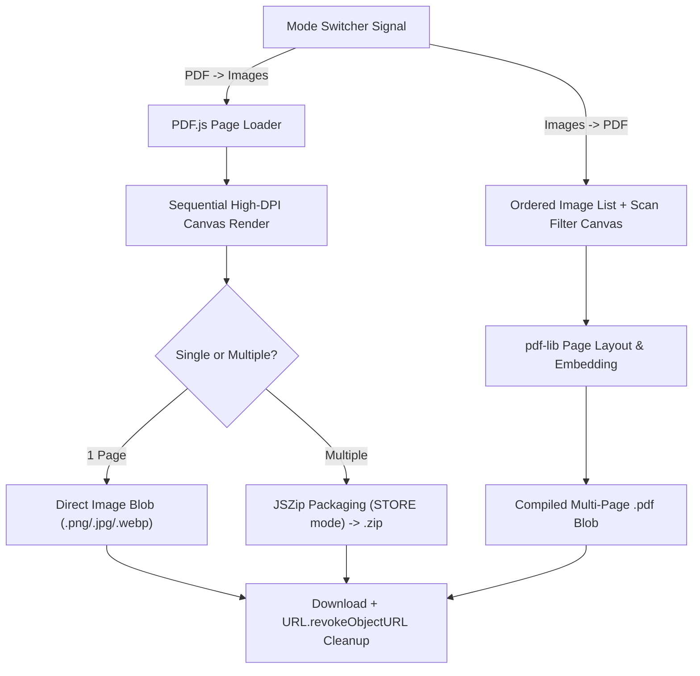

# PDF to Images & Images to PDF Studio

# Technical Specification & Architecture Blueprint

> **Spec Number**: 105  
> **Slug**: `pdf-image-converter`  
> **Category**: `documents`  
> **Inspired By**: iLovePDF — *PDF to JPG* + *JPG to PDF* + *Scan to PDF*  
> **Target SEO Keyword**: `pdf to jpg png webp converter images to pdf client side no upload`  
> **Route**: `/tools/pdf-image-converter`  
> **Architecture**: 100% Client-Side Single Page Application (Zero Server Ingestion, Zero Telemetry)

---

## 1. MVP Generation Prompt (`/create-web-micro-saas`)

```text
/create-web-micro-saas

Act as a Principal Frontend Engineer and UX Architect. Build a high-performance, 100% client-side Angular Standalone tool for PrivKnife called "PDF to Images & Images to PDF Studio".

TECHNICAL CONSTRAINTS & STACK:
1. Pure Client-Side Architecture: Zero backend endpoints, zero server uploads. All PDF rasterization, image normalization, EXIF orientation correction, and PDF compilation run strictly in client memory.
2. Core Technologies: pdfjs-dist (already installed), pdf-lib (already installed), jszip (already installed), HTML5 Canvas / OffscreenCanvas, Web Workers.
3. Thread Safety: Batch PDF page rendering and multi-image PDF compilation execute asynchronously with per-item progress callbacks and cancellation support to keep the UI at 60 FPS (Directive 3).
4. Memory Hygiene: Revoke every thumbnail and download `ObjectURL`, clear temporary canvases after each page export, destroy PDF.js document proxies, and release `ImageBitmap` objects immediately (Directive 4).
5. Export Deliverables:
   - Mode A (PDF → Images): Individual `.png` / `.jpg` / `.webp` downloads or a single `.zip` archive of selected/all pages at configurable DPI (72–300 DPI).
   - Mode B (Images → PDF): Multi-page `.pdf` combining JPG, PNG, WebP, or GIF images with drag-and-drop ordering, rotation, page size presets (A4, US Letter, Fit-to-Image), margins, and optional scan-enhancement filters (B&W Document / Auto-Contrast).

KEY FEATURES & USER INTERACTION:
- Bidirectional Mode Switcher: Seamless toggle between "PDF → Images" and "Images → PDF".
- PDF → Images: Thumbnail grid with multi-select (All / None / Custom Range), output format (`PNG`, `JPG`, `WebP`), DPI selector (`72`, `150`, `200`, `300 DPI`), JPEG/WebP quality slider, and optional "Extract Embedded Images Only" vs "Render Full Pages".
- Images → PDF: Multi-image upload, drag-and-drop / keyboard reorder buttons, per-image 90° rotation, page size (`Fit to Image`, `A4`, `US Letter`, `Legal`), orientation (`Auto`, `Portrait`, `Landscape`), margin presets (`None`, `Small`, `Standard`), and Document Scan Cleanup filter (contrast boost + grayscale for phone photos of receipts/notes).
- Privacy & Local Execution Assurance: Prominent trust badge reading "🛡️ 100% In-Browser • Never Leaves Your Device".
```

---

## 2. Concept Overview & Value Proposition

Converting PDFs to shareable slide images or bundling scanned receipts, ID cards, and whiteboard photos into a clean PDF are two of the highest-volume document workflows on the web. **PDF to Images & Images to PDF Studio** unifies iLovePDF's *PDF to JPG*, *JPG to PDF*, and *Scan to PDF* into one zero-upload studio with high-DPI rendering, WebP support, and phone-scan enhancement.

### Elevator Pitch
> "Turn any PDF into crisp 300 DPI PNG/JPG/WebP images—or combine and reorder photos into a print-ready PDF—instantly in your browser with zero file uploads."

### Core Value Drivers
1. **Zero-Trust Privacy**: Passports, receipts, invoices, and private photos are never sent to cloud servers.
2. **Bidirectional Utility**: One consistent workspace covers both export directions without switching tools.
3. **High-DPI Print Fidelity**: Supports up to 300 DPI rasterization and lossless PNG or modern WebP output.
4. **Mobile Scan Enhancement**: Built-in grayscale & adaptive contrast boost turns phone camera photos of paper documents into legible, printer-friendly PDF pages.

---

## 3. Technical Feasibility, Dependencies & Difficulty Score

### Difficulty Score: 4.5 / 10 (Moderate — High-DPI canvas memory bounds, WebP-to-PNG transcoding for `pdf-lib`, and EXIF orientation normalization)

| Architectural Component | Implementation Technology | Installed in Repo? | Client-Side Feasibility |
|---|---|---|---|
| PDF Page Rasterization | `pdfjs-dist` | Yes (`^6.4.299`) | 100% In-Browser |
| Multi-Page PDF Assembly | `pdf-lib` | Yes (`^1.17.1`) | 100% In-Browser |
| ZIP Archive Packaging | `jszip` | Yes (`^3.10.2`) | 100% In-Browser |
| Image Decode, Rotate & Scan Filter | `createImageBitmap`, HTML5 Canvas / `OffscreenCanvas` | Native Browser API | 100% In-Browser |

### Known Technical Nuances & Mitigations
- **Canvas Pixel Cap at 300 DPI**: Rendering an A1 poster PDF at 300 DPI can exceed browser maximum canvas dimensions (`16,384 px` or `268M px`).
  - *Mitigation*: Enforce a safe max edge clamp (`maxCanvasDimension = 8192`) and warn the user if the requested DPI was auto-clamped for oversized architectural sheets.
- **WebP / AVIF / EXIF-Rotated Inputs for `pdf-lib`**: `pdf-lib` natively embeds only raw PNG and JPEG bytes and does not apply EXIF orientation tags automatically.
  - *Mitigation*: Decode every user image via `createImageBitmap(file, { imageOrientation: 'from-image' })`, render through Canvas applying user rotation and optional scan-cleanup filter, and output clean JPEG/PNG bytes for `pdf-lib`.
- **Sequential Page Disposal**: In PDF → Images batch export, render one page at a time, encode to Blob, append to `JSZip`, and immediately zero the canvas so peak RAM stays flat even on 100-page PDFs.

---

## 4. Competitive Landscape & Market Positioning

| Feature / Metric | PrivKnife (`pdf-image-converter`) | iLovePDF | OS Built-in Print/Preview |
|---|---|---|---|
| **Privacy / Ingestion** | **100% Client-Side** | Remote Cloud Upload | Local |
| **Output Formats** | **PNG, JPG, WebP + ZIP** | JPG only on free web | Manual one-by-one |
| **Custom DPI (72–300)** | **Exact DPI Selector** | Fixed Standard / High | Limited |
| **Scan Contrast Cleanup** | **Built-in Filter** | Mobile app only | Manual external edit |
| **Batch Limits** | **Unlimited** | Capped on free tier | Manual |

---

## 5. Functional Requirements & Processing Algorithms

### 5.1. Mode A: PDF → Images
1. Load PDF via `pdfjs-dist`, render low-res thumbnails (`scale = 0.35`) lazily for the selection grid.
2. Allow selecting individual pages, toggling Select All / Deselect All, or specifying a range string.
3. For each selected page:
   - Compute viewport at `scale = dpi / 72` (clamped to safe max canvas edge).
   - Fill white background when outputting `image/jpeg` (to prevent black alpha regions on transparent PDFs).
   - Render page onto canvas, call `canvas.convertToBlob({ type, quality })` (or `toBlob`).
   - Naming convention: `<baseName>-page-<001>.<ext>`.
4. If 1 page selected, allow direct single-image download; if >1 page, bundle all images in a `.zip` via `JSZip` with `STORE` compression (since PNG/JPG/WebP are already compressed, avoiding wasted CPU cycles!).

### 5.2. Mode B: Images → PDF
1. Accept multiple images (`image/jpeg`, `image/png`, `image/webp`, `image/gif`).
2. Maintain ordered Signal list of `ImagePageItem` (`id`, `file`, `rotationDeg`, `scanFilter`, `thumbnailUrl`).
3. Support drag-and-drop reordering AND accessible "Move Up" / "Move Down" / "Rotate 90°" / "Remove" buttons for keyboard & touch users.
4. Page Geometry Engine:
   - `fit_to_image`: Create PDF page matching `(imgWidth * 72 / 96, imgHeight * 72 / 96)` with optional margin.
   - Standard paper (`a4`: `595.28 × 841.89 pt`, `letter`: `612 × 792 pt`, `legal`: `612 × 1008 pt`): Resolve orientation (`auto` picks landscape when `imgWidth > imgHeight`), center image inside safe printable rectangle `(pageW - 2*margin, pageH - 2*margin)` preserving aspect ratio (`contain`).
5. **Document Scan Filter (`scanFilter`)**:
   - `none`: Preserve original color image.
   - `enhanced_color`: Mild S-curve contrast boost (`1.25x`) and white-point lift.
   - `bw_document`: Convert luminance to crisp high-contrast grayscale/thresholded paper look ideal for receipts and contracts.

---

## 6. UI/UX Layout Specification (BEM Architecture)

- **Localization (`i18n`)**: All UI strings under `tools.pdfImageConverter.*` (`en`, `es`).
- **Mode Tabs**: Accessible `role="tablist"` switching between **PDF → Images** and **Images → PDF** without losing state until explicit Reset.
- **Responsive Grid**: Thumbnail grid uses CSS Grid `repeat(auto-fill, minmax(140px, 1fr))` with `min-width: 0` and touch-friendly action buttons (`>= 44px`).

---

## 7. Technical Architecture & Client-Side Pipeline



### Resource Hygiene Guidelines
- Every thumbnail `ObjectURL` is tracked in a `Set<string>` and revoked individually on item removal and globally on Reset / `ngOnDestroy`.
- Clear rendered canvas buffers (`canvas.width = 0; canvas.height = 0`) after every page conversion.

---

## 8. Input/Output Data Contracts (TypeScript Interfaces)

```typescript
export type ConverterDirection = 'pdf_to_images' | 'images_to_pdf';
export type OutputImageFormat = 'image/png' | 'image/jpeg' | 'image/webp';
export type PageSizePreset = 'fit_to_image' | 'a4' | 'letter' | 'legal';
export type PageOrientation = 'auto' | 'portrait' | 'landscape';
export type ScanFilterPreset = 'none' | 'enhanced_color' | 'bw_document';

export interface PdfToImagesOptions {
  format: OutputImageFormat;
  dpi: number;                      // 72 | 150 | 200 | 300
  quality: number;                  // 0.5..1.0 (for JPEG/WebP)
  selectedPages: number[];          // 1-based page numbers
  transparentBackground: boolean;   // PNG/WebP only
}

export interface ImagePageInput {
  id: string;
  fileName: string;
  bytes: Uint8Array;
  mimeType: string;
  rotationDeg: 0 | 90 | 180 | 270;
  scanFilter: ScanFilterPreset;
}

export interface ImagesToPdfOptions {
  pageSize: PageSizePreset;
  orientation: PageOrientation;
  marginPt: number;                 // 0 | 18 | 36 | 54
  jpegQuality: number;              // 0.6..0.95
  outputFileName: string;
}

export interface PdfImageConverterResult {
  success: boolean;
  blob: Blob;
  fileName: string;
  fileSize: number;
  mimeType: string;
  itemCount: number;
  warnings?: string[];
  error?: string;
}
```

---

## 9. Security, Sandboxing & Verification Acceptance Criteria

- **Directive 1 & 2**: Zero network calls verified during both PDF → Images and Images → PDF conversions.
- **Directive 3**: Long page sequences yield progress callbacks and support user cancellation mid-batch.
- **Directive 4**: Verified revocation of all thumbnail and download `ObjectURL`s on item deletion, mode reset, and `ngOnDestroy`.
- **Directive 5**: Standalone component lazy-loaded via `loadComponent`.
- **Functional Test Vectors**:
  1. 3-page synthetic PDF -> renders pages `[1, 3]` to PNG ZIP -> verifies ZIP contains exactly 2 valid PNG files (`89 50 4E 47` magic bytes).
  2. 2 synthetic images (landscape 800×400 + portrait 400×800) with `pageSize: 'a4'`, `orientation: 'auto'` -> verifies output PDF has page 1 in landscape (`841.89 × 595.28`) and page 2 in portrait (`595.28 × 841.89`).
  3. 90° rotation + `bw_document` scan filter produces valid non-empty PDF without throwing.
