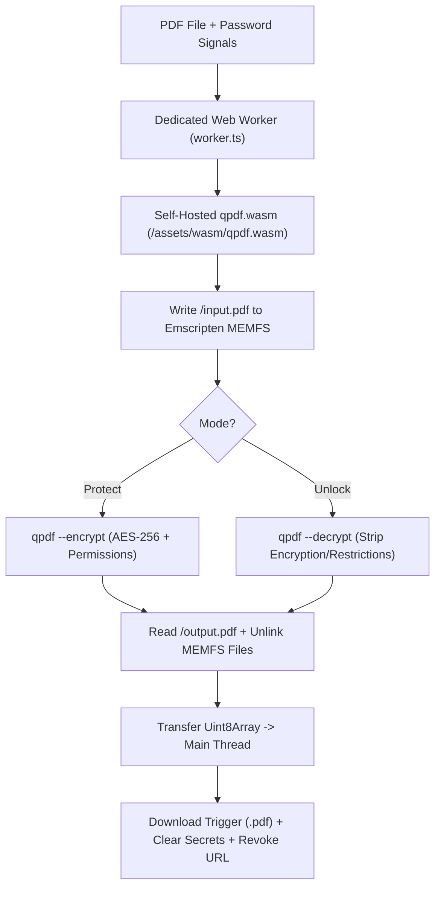

# PDF Password Protector & Unlocker

# Technical Specification & Architecture Blueprint

> **Spec Number**: 106  
> **Slug**: `pdf-password-security`  
> **Category**: `documents`  
> **Inspired By**: iLovePDF — *Protect PDF* + *Unlock PDF*  
> **Target SEO Keyword**: `protect pdf with password online free unlock pdf client side aes 256`  
> **Route**: `/tools/pdf-password-security`  
> **Architecture**: 100% Client-Side Single Page Application (Zero Server Ingestion, Zero Telemetry)

---

## 1. MVP Generation Prompt (`/create-web-micro-saas`)

```text
/create-web-micro-saas

Act as a Principal Frontend Engineer and Security Architect. Build a high-performance, 100% client-side Angular Standalone tool for PrivKnife called "PDF Password Protector & Unlocker".

TECHNICAL CONSTRAINTS & STACK:
1. Pure Client-Side Architecture: Zero server uploads, zero password transmission. Both the PDF file and the user's secret password MUST remain exclusively in ephemeral client browser RAM.
2. Core Technologies: Self-hosted WASM build of QPDF (`@neslinesli93/qpdf-wasm` or bundled `qpdf.wasm` asset served strictly from `'self'`) running inside a dedicated Web Worker (`worker.ts`), plus `pdfjs-dist` (already installed) for pre/post inspection.
3. Strict CSP Compliance: The `.wasm` binary MUST be bundled into Angular static assets (`src/assets/wasm/`) so it loads strictly under `script-src 'self' 'wasm-unsafe-eval'` and `connect-src 'self' blob: data:` with zero external CDN fetches.
4. Thread Safety & Memory Hygiene: Run all QPDF WASM encryption/decryption inside `worker.ts`; overwrite password buffers and clear Angular password Signals on reset and `ngOnDestroy`; revoke all ObjectURLs (Directives 3 & 4).
5. Export Deliverables: AES-256 encrypted `.pdf` (Protect Mode) or decrypted/unrestricted `.pdf` (Unlock Mode).

KEY FEATURES & USER INTERACTION:
- Protect Mode: Set User (Open) Password and/or Owner (Permissions) Password, choose AES-256 encryption, configure granular permission flags (Allow Printing, Allow Copying/Text Extraction, Allow Editing/Annotations, Allow Form Filling), and inspect live password strength/entropy meter.
- Unlock Mode: Detect whether an uploaded PDF is encrypted; strip owner restrictions (print/copy locks) automatically if no open password is required, OR decrypt a password-protected PDF when the user enters the valid password.
- Security Inspection Card: Displays current encryption state (Unencrypted / RC4-128 / AES-128 / AES-256) and permission flags before and after processing.
- Privacy & Local Execution Assurance: Prominent trust badge reading "🛡️ 100% In-Browser • Never Leaves Your Device".
```

---

## 2. Concept Overview & Value Proposition

Asking a user to upload a confidential PDF *and* type its password into a third-party cloud website (like legacy online PDF unlockers) is a textbook security anti-pattern. **PDF Password Protector & Unlocker** solves this fundamentally by running a self-hosted WebAssembly compilation of **QPDF** completely inside a local Web Worker. Neither the document nor the passphrase ever touches a network socket.

### Elevator Pitch
> "Lock sensitive PDFs with military-grade AES-256 encryption—or unlock your own password-protected PDFs—100% offline in your browser without ever sharing your password with a server."

### Core Value Drivers
1. **True Zero-Knowledge Security**: Passwords and plaintext PDF bytes stay isolated in ephemeral browser memory and are cleared on exit.
2. **Standards-Compliant AES-256 (PDF 2.0 / ISO 32000-2)**: Output files open natively in Adobe Acrobat, macOS Preview, Chrome, Firefox, and iOS/Android viewers.
3. **Granular DRM / Permission Controls**: Independently permit or restrict high-res printing, text copying, accessibility screen-reading, and form filling.
4. **Honest Ethical Guardrails**: Explicitly designed to decrypt documents the user already owns/has the password for (no brute-force password cracking).

---

## 3. Technical Feasibility, Dependencies & Difficulty Score

### Difficulty Score: 7.0 / 10 (High — Self-hosted QPDF WASM worker bundling under strict CSP and Emscripten virtual filesystem memory cleanup)

| Architectural Component | Implementation Technology | Installed in Repo? | Client-Side Feasibility |
|---|---|---|---|
| PDF Encryption / Decryption Engine | Self-hosted `qpdf-wasm` (`qpdf.wasm` in `assets/wasm/`) | New dev/runtime dependency (bundled locally) | 100% In-Browser (WASM) |
| Encryption Metadata Detection | `qpdf --show-encryption` / `pdfjs-dist` | `pdfjs-dist` installed | 100% In-Browser |
| Password Strength Estimator | Pure TS Shannon Entropy + Character Class Analyzer | Pure TypeScript | 100% In-Browser |
| Off-Thread Execution | Dedicated Web Worker (`worker.ts`) | Native Browser API | Non-blocking 60 FPS UI |

### Known Technical Nuances & Mitigations
- **Emscripten MEMFS Cleanup**: QPDF WASM reads/writes files inside an in-memory Emscripten filesystem (`/input.pdf`, `/output.pdf`). If files are not unlinked after each run, RAM leaks across operations.
  - *Mitigation*: Wrap every WASM invocation in a `try { ... } finally { FS.unlink('/input.pdf'); FS.unlink('/output.pdf'); }` block and terminate/recycle the worker on `ngOnDestroy`.
- **Self-Hosted WASM Under Strict CSP**: Default npm WASM wrappers sometimes try to fetch `.wasm` from unpkg/jsDelivr, which violates PrivKnife's `connect-src 'self' blob: data:`.
  - *Mitigation*: Copy `qpdf.wasm` via `angular.json` asset glob into `/assets/wasm/qpdf.wasm` and pass `locateFile: () => '/assets/wasm/qpdf.wasm'` explicitly.
- **Wrong Password Handling**: QPDF exits with non-zero exit code (`2`) when an incorrect password is supplied. Catch exit status cleanly and display a clear localized "Incorrect password" error without crashing the worker instance.

---

## 4. Competitive Landscape & Market Positioning

| Feature / Metric | PrivKnife (`pdf-password-security`) | iLovePDF / Smallpdf | Desktop QPDF CLI |
|---|---|---|---|
| **Password Never Sent Over Network** | **Guaranteed (0 bytes sent)** | Sent in HTTPS POST to cloud | Local |
| **Encryption Standard** | **AES-256 (R6)** | AES-128 / AES-256 | AES-256 |
| **Granular Permissions UI** | **Full Checkbox Matrix** | Open password only | Complex CLI flags |
| **Zero Installation** | **Instant Web App** | Web App | Terminal setup required |

---

## 5. Functional Requirements & Processing Algorithms

### 5.1. Encryption Inspection (`inspectEncryption`)
- When a PDF is dropped, inspect encryption metadata in the worker without mutating the file:
  - `isEncrypted: boolean`
  - `requiresUserPassword: boolean` (true if opening requires a password; false if only owner restrictions exist)
  - `algorithm`: `'none' | 'RC4-40' | 'RC4-128' | 'AES-128' | 'AES-256'`
  - `permissions`: current print/modify/extract flags (when readable).

### 5.2. Protect Mode (`protectPdf`)
- Validate non-empty `userPassword` OR `ownerPassword` (if only `userPassword` is provided, optionally auto-generate a strong random `ownerPassword` via `crypto.getRandomValues` so permissions cannot be bypassed).
- Construct QPDF CLI arguments strictly from validated enums/sanitized options (never shell-interpolated; passed as `string[]` `callMain` argv):
  - `['--encrypt', userPassword, ownerPassword, '256', '--print=' + printFlag, '--modify=' + modifyFlag, '--extract=' + extractFlag, '--accessibility=y', '--', '/input.pdf', '/output.pdf']`
- Return encrypted bytes and clear password variables from memory.

### 5.3. Unlock Mode (`unlockPdf`)
- If `requiresUserPassword` is true, require non-empty password input.
- Invoke `callMain(['--password=' + password, '--decrypt', '/input.pdf', '/output.pdf'])`.
- Verify resulting bytes open cleanly with `isEncrypted === false`.

---

## 6. UI/UX Layout Specification (BEM Architecture)

- **Localization (`i18n`)**: Keys under `tools.pdfPasswordSecurity.*` (`en`, `es`).
- **Mode Switcher**: Two clear tabs — **Protect PDF (Lock)** and **Unlock PDF (Decrypt)**.
- **Security Controls**:
  - Password inputs with show/hide visibility toggle (`aria-pressed`), confirm-password match check in Protect Mode, and color-coded entropy meter (`Weak / Fair / Strong / Excellent`).
  - Permission toggle switches (`Allow High-Res Printing`, `Allow Text Copying`, `Allow Annotations & Forms`).
  - Explicit "Clear Password & File" reset button.

---

## 7. Technical Architecture & Client-Side Pipeline



### Resource Hygiene Guidelines
- Unlink `/input.pdf` and `/output.pdf` inside `finally` after every WASM call.
- Zero out password Signal values (`password.set('')`, `confirmPassword.set('')`) on Reset and `ngOnDestroy`.
- Never persist passwords to `localStorage`, `sessionStorage`, or URL query parameters.

---

## 8. Input/Output Data Contracts (TypeScript Interfaces)

```typescript
export type PdfSecurityMode = 'protect' | 'unlock';
export type PdfPrintPermission = 'full' | 'low' | 'none';
export type PdfModifyPermission = 'all' | 'annotate' | 'form' | 'assembly' | 'none';

export interface PdfEncryptionInfo {
  isEncrypted: boolean;
  requiresUserPassword: boolean;
  algorithm: 'none' | 'RC4-40' | 'RC4-128' | 'AES-128' | 'AES-256' | 'unknown';
  pageCount?: number;
}

export interface PdfProtectOptions {
  userPassword: string;
  ownerPassword: string;
  keyLength: 128 | 256;
  allowPrint: PdfPrintPermission;
  allowModify: PdfModifyPermission;
  allowExtractText: boolean;
  allowAccessibility: boolean;
}

export interface PdfUnlockOptions {
  password: string;
}

export interface PdfPasswordSecurityResult {
  success: boolean;
  mode: PdfSecurityMode;
  blob?: Blob;
  fileName?: string;
  fileSize?: number;
  resultingInfo?: PdfEncryptionInfo;
  errorCode?: 'WRONG_PASSWORD' | 'ALREADY_UNENCRYPTED' | 'INVALID_PDF' | 'WASM_LOAD_ERROR';
  error?: string;
}
```

---

## 9. Security, Sandboxing & Verification Acceptance Criteria

- **Directive 1 & 2**: Zero external network calls (only same-origin `/assets/wasm/qpdf.wasm` fetch allowed; zero calls to external domains; zero file bytes transmitted).
- **Directive 3**: All WASM calls execute off-main-thread in `worker.ts`.
- **Directive 4**: Verified MEMFS unlinking, password Signal clearing, `URL.revokeObjectURL`, and worker termination on `ngOnDestroy`.
- **Directive 5**: Lazy-loaded via `loadComponent`.
- **Functional Test Vectors**:
  1. Encrypt synthetic plaintext PDF with AES-256 password `"PrivKnife-Test-2026!"` -> verify `inspectEncryption()` reports `isEncrypted: true`, `algorithm: 'AES-256'`.
  2. Attempt unlock with wrong password -> verify clean `errorCode: 'WRONG_PASSWORD'` with no worker crash.
  3. Unlock same PDF with correct password -> verify decrypted PDF opens cleanly in `pdf-lib` with identical page count.
  4. Verify `localStorage` and `sessionStorage` remain untouched after encryption/decryption.
