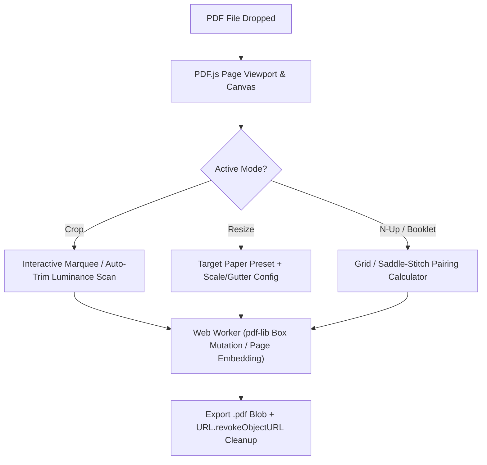

# PDF Margin Cropper, Resizer & N-Up Booklet Maker

# Technical Specification & Architecture Blueprint

> **Spec Number**: 107  
> **Slug**: `pdf-cropper-booklet`  
> **Category**: `documents`  
> **Inspired By**: iLovePDF — *Crop PDF*  
> **Target SEO Keyword**: `crop pdf pages online free client side resize a4 letter n-up booklet pdf`  
> **Route**: `/tools/pdf-cropper-booklet`  
> **Architecture**: 100% Client-Side Single Page Application (Zero Server Ingestion, Zero Telemetry)

---

## 1. MVP Generation Prompt (`/create-web-micro-saas`)

```text
/create-web-micro-saas

Act as a Principal Frontend Engineer and UX Architect. Build a high-performance, 100% client-side Angular Standalone tool for PrivKnife called "PDF Margin Cropper, Resizer & N-Up Booklet Maker".

TECHNICAL CONSTRAINTS & STACK:
1. Pure Client-Side Architecture: Zero server uploads. All visual crop-box calculation, auto-whitespace detection, page rescaling, and N-Up / booklet imposition run completely inside the browser.
2. Core Technologies: pdf-lib (already installed), pdfjs-dist (already installed), HTML5 Canvas for interactive draggable crop marquee and whitespace scanning, Web Worker (`worker.ts`) for large document imposition.
3. Thread Safety: Auto-margin scanning across multi-page PDFs and N-Up booklet page imposition execute off-main-thread with progress updates (Directive 3).
4. Memory Hygiene: Destroy PDF.js document proxies, zero temporary scanning canvases, revoke all ObjectURLs, and terminate workers on `ngOnDestroy` (Directive 4).
5. Export Deliverables: Cropped, resized, or N-Up / saddle-stitch booklet `.pdf` with intact selectable vector text.

KEY FEATURES & USER INTERACTION:
- Visual Interactive Cropper: Draggable 8-handle crop rectangle overlaid on a live PDF.js canvas with numeric margin inputs (mm / in / pt), "Auto-Trim Whitespace" button, and apply scope (Current Page / All Pages / Odd & Even Mirrored Margins / Custom Range).
- Page Size Normalizer: Scale mixed-dimension PDF pages (e.g., screenshots + A4 + Letter) to uniform A4, US Letter, A5, or Legal sheets with fit/fill alignment and optional gutter margin for binding.
- N-Up & Booklet Imposition Mode: Arrange 2-up, 4-up, or 6-up pages per sheet (great for lecture slides/handouts) with optional cut lines, OR automatically reorder pages into printable saddle-stitch booklet signatures (`[N, 1], [2, N-1], ...`) padded to multiples of 4.
- Privacy & Local Execution Assurance: Prominent trust badge reading "🛡️ 100% In-Browser • Never Leaves Your Device".
```

---

## 2. Concept Overview & Value Proposition

Scanned books often have ugly black scanner borders; academic papers have giant white margins that waste e-reader screen space; downloaded mixed invoices come in mismatched sizes; and printing slide decks wastes paper without 2-up/4-up layout. **PDF Margin Cropper, Resizer & N-Up Booklet Maker** upgrades iLovePDF's *Crop PDF* with precision auto-margin trimming, uniform paper scaling, and true saddle-stitch booklet imposition—100% client-side.

### Elevator Pitch
> "Visually crop PDF margins, auto-trim scanner borders, standardize page sizes to A4/Letter, or generate printable 2-up handouts and fold-ready booklets—100% locally in your browser."

### Core Value Drivers
1. **Non-Destructive Vector Precision**: Sets exact PDF `CropBox` / `MediaBox` geometry or embeds scaled `PDFEmbeddedPage` objects so vector text and crisp graphics never degrade.
2. **One-Click Auto-Trim Whitespace**: Scans page pixel luminance to compute the tightest non-white bounding box plus customizable breathing padding.
3. **E-Reader & Print Ready**: Supports Odd/Even mirrored crop boxes for scanned two-page book spreads and automatic saddle-stitch booklet imposition.
4. **Zero-Trust Privacy**: Private books, legal filings, and financial statements stay strictly inside local RAM.

---

## 3. Technical Feasibility, Dependencies & Difficulty Score

### Difficulty Score: 5.5 / 10 (Moderate — Coordinate mapping between PDF bottom-left origin and Canvas top-left origin, rotated pages, and booklet signature math)

| Architectural Component | Implementation Technology | Installed in Repo? | Client-Side Feasibility |
|---|---|---|---|
| PDF Box Cropping & Page Embedding | `pdf-lib` (`setCropBox`, `setMediaBox`, `embedPage`) | Yes (`^1.17.1`) | 100% In-Browser |
| Live Page Canvas & Auto-Trim Scan | `pdfjs-dist` + Canvas `getImageData` | Yes (`^6.4.299`) | 100% In-Browser |
| Off-Thread Imposition | Dedicated Web Worker (`worker.ts`) | Native Browser API | Non-blocking 60 FPS UI |

### Known Technical Nuances & Mitigations
- **True Clip vs. Soft CropBox**: Setting only `CropBox` hides content outside the crop in viewers, while keeping cropped objects inside the file (important privacy note!).
  - *Mitigation*: Clearly indicate that `CropBox` cropping is non-destructive and add an optional "Hard Clip / Sanitize Outside Crop" toggle that warns users when sensitive content lies in margins (or points to `pdf-redaction`).
- **Rotated Page Coordinate Mapping**: PDF pages with `/Rotate 90`, `180`, or `270` rotate visual edges relative to raw media coordinates.
  - *Mitigation*: Normalize visual crop rectangles `(top, right, bottom, left)` through a tested rotation matrix helper `visualRectToPdfCropBox(visualRect, mediaBox, rotationDeg)` covered by unit tests for all 4 quadrants (`0°`, `90°`, `180°`, `270°`).
- **Saddle-Stitch Booklet Padding**: Booklets require page counts divisible by 4. Automatically insert blank pages at the end when `pageCount % 4 !== 0` and preview the exact front/back sheet pairing table (`Sheet 1 Front: [8 | 1]`, `Sheet 1 Back: [2 | 7]`).

---

## 4. Competitive Landscape & Market Positioning

| Feature / Metric | PrivKnife (`pdf-cropper-booklet`) | iLovePDF Crop PDF | Adobe Acrobat / InDesign |
|---|---|---|---|
| **Privacy / Ingestion** | **100% Client-Side** | Remote Server Upload | Local Desktop |
| **Auto-Trim Whitespace** | **Built-in Pixel Bounding Scan** | Manual drag only | Acrobat Pro Preflight |
| **Odd/Even Mirrored Book Crop** | **1-Click Toggle** | Not supported | Complex dialog |
| **N-Up & Saddle-Stitch Booklet** | **Built-in Imposition Engine** | Not available | Print driver dependent |
| **Cost** | **100% Free** | Freemium | Paid Subscription |

---

## 5. Functional Requirements & Processing Algorithms

### 5.1. Auto-Trim Whitespace Algorithm
1. Render target page (or union of sampled pages) via `pdfjs-dist` at `scale = 1.0` (`72 DPI`) onto an offscreen canvas.
2. Scan RGBA pixels to find `minX`, `maxX`, `minY`, `maxY` where pixel luminance `L = 0.299R + 0.587G + 0.114B < whiteThreshold` (default `245`).
3. Expand bounding box by `paddingPt`, clamp to `[0, pageWidth] × [0, pageHeight]`, and update the interactive crop marquee signals.

### 5.2. Mode 1: Visual Crop (`crop`)
- Convert visual crop margins `{ top, right, bottom, left }` (in `pt`, converted from `mm` or `in` as chosen) into exact PDF coordinates relative to existing `CropBox`.
- Support scope: `'current'`, `'all'`, `'odd_even_mirrored'`, or custom page range.
- Update both `page.setCropBox(...)` and `page.setMediaBox(...)` so every viewer and printer honors the exact trimmed dimensions.

### 5.3. Mode 2: Uniform Page Resizer (`resize`)
- Create a new `PDFDocument`. For each source page, embed via `outDoc.embedPage(srcPage)` and draw centered inside target paper dimensions (`A4`, `Letter`, `Legal`, `A5`) using `contain` or `cover` scaling plus optional binding gutter offset.

### 5.4. Mode 3: N-Up & Saddle-Stitch Booklet (`nup` / `booklet`)
- **N-Up (`2-up`, `4-up`, `6-up`)**: Compute grid `(cols, rows)` on target sheet (Landscape for 2-up, Portrait/Landscape for 4-up/6-up), embed source pages into grid cells with optional hairline dashed cut-marks and cell spacing.
- **Booklet (`booklet`)**:
  - Pad total page count `P` up to `N = Math.ceil(P / 4) * 4`.
  - For sheet `s = 0 .. (N/4 - 1)`:
    - Front sheet (Landscape): Left = `N - 2*s`, Right = `2*s + 1`
    - Back sheet (Landscape): Left = `2*s + 2`, Right = `N - 2*s - 1`
  - Embed each non-blank page into left/right halves with configurable spine creep/gutter margin.

---

## 6. UI/UX Layout Specification (BEM Architecture)

- **Localization (`i18n`)**: Keys under `tools.pdfCropperBooklet.*` (`en`, `es`).
- **Workspace**:
  - Top mode tabs: **Crop Margins**, **Resize Pages**, **N-Up / Booklet**.
  - Interactive pointer/touch-draggable crop overlay (`PointerEvent` with `setPointerCapture`) + keyboard arrow nudging (`1pt` / `Shift+Arrow = 10pt`) for WCAG accessibility.
  - Unit switcher (`mm` / `in` / `pt`) updating numeric inputs reactively via Angular `computed()`.

---

## 7. Technical Architecture & Client-Side Pipeline



---

## 8. Input/Output Data Contracts (TypeScript Interfaces)

```typescript
export type CropBookletMode = 'crop' | 'resize' | 'nup' | 'booklet';
export type MeasurementUnit = 'pt' | 'mm' | 'in';

export interface MarginInsetsPt {
  top: number;
  right: number;
  bottom: number;
  left: number;
}

export interface PdfCropConfig {
  insetsPt: MarginInsetsPt;
  scope: 'all' | 'current' | 'odd_even_mirrored' | 'range';
  currentPage: number;
  pageRange: string;
  autoTrimPaddingPt: number;
  whiteThreshold: number;       // 200..254
}

export interface PdfResizeConfig {
  targetPaper: 'a4' | 'letter' | 'legal' | 'a5' | 'custom';
  orientation: 'auto' | 'portrait' | 'landscape';
  customWidthPt?: number;
  customHeightPt?: number;
  scaleMode: 'contain' | 'stretch' | 'no_scale';
  gutterMarginPt: number;
}

export interface PdfNupBookletConfig {
  pagesPerSheet: 2 | 4 | 6;
  targetPaper: 'a4' | 'letter';
  sheetOrientation: 'auto' | 'portrait' | 'landscape';
  outerMarginPt: number;
  cellGapPt: number;
  drawCutGuides: boolean;
  readingDirection: 'ltr' | 'rtl';
}

export interface PdfCropperBookletOptions {
  mode: CropBookletMode;
  crop: PdfCropConfig;
  resize: PdfResizeConfig;
  nup: PdfNupBookletConfig;
}

export interface PdfCropperBookletResult {
  success: boolean;
  blob: Blob;
  fileName: string;
  fileSize: number;
  outputPageCount: number;
  impositionMap?: Array<{ sheet: number; side: 'front' | 'back'; pages: Array<number | null> }>;
  error?: string;
}
```

---

## 9. Security, Sandboxing & Verification Acceptance Criteria

- **Directive 1–5**: Zero network requests, off-main-thread imposition, full `PDFDocumentProxy` & `ObjectURL` disposal, lazy route loading.
- **Functional Test Vectors**:
  1. `visualRectToPdfCropBox` verified across `0°`, `90°`, `180°`, and `270°` rotated pages.
  2. Saddle-stitch imposition for a 6-page PDF produces 4 landscape sides (`2` physical duplex sheets) with sequence `[null, 1]`, `[2, null]`, `[6, 3]`, `[4, 5]` (padded to 8).
  3. 4-up imposition on a 5-page PDF produces exactly 2 output sheets.
  4. Invalid crop insets (`left + right >= pageWidth`) are rejected cleanly with validation feedback rather than producing degenerate negative-width PDFs.
