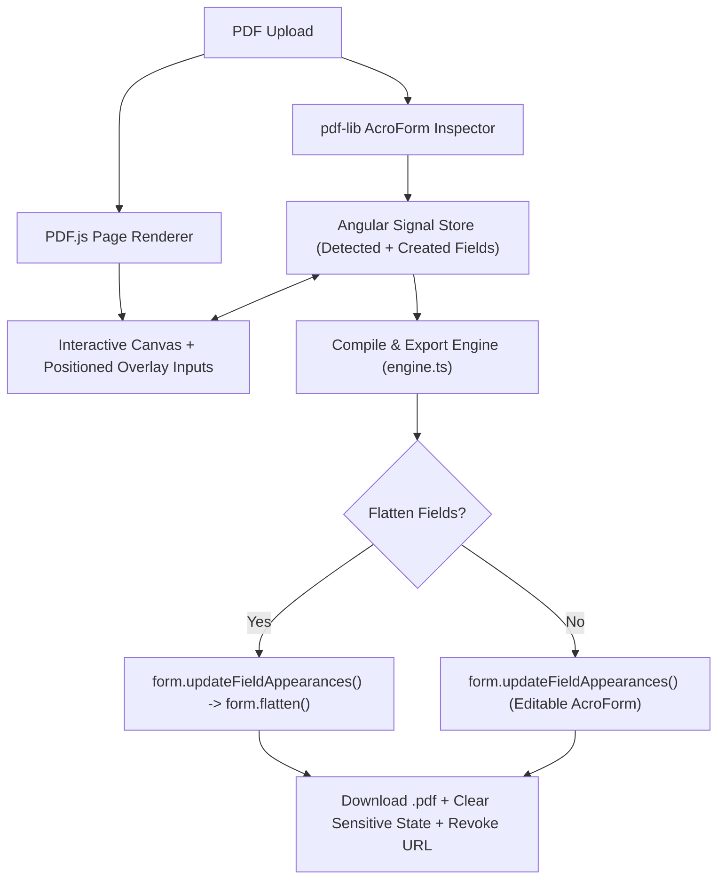

# Interactive PDF Form Filler, Creator & Flattener

# Technical Specification & Architecture Blueprint

> **Spec Number**: 108  
> **Slug**: `pdf-form-studio`  
> **Category**: `documents`  
> **Inspired By**: iLovePDF — *Edit PDF* (Forms & Annotations)  
> **Target SEO Keyword**: `fill pdf form online free client side create fillable pdf flatten acroform`  
> **Route**: `/tools/pdf-form-studio`  
> **Architecture**: 100% Client-Side Single Page Application (Zero Server Ingestion, Zero Telemetry)

---

## 1. MVP Generation Prompt (`/create-web-micro-saas`)

```text
/create-web-micro-saas

Act as a Principal Frontend Engineer and UX Architect. Build a high-performance, 100% client-side Angular Standalone tool for PrivKnife called "Interactive PDF Form Filler, Creator & Flattener".

TECHNICAL CONSTRAINTS & STACK:
1. Pure Client-Side Architecture: Zero server ingestion. Tax forms (W-9, 1040), HR onboarding packets, medical intake forms, and rental applications stay strictly inside local browser memory.
2. Core Technologies: pdf-lib (`PDFForm`, `PDFTextField`, `PDFCheckBox`, `PDFRadioGroup`, `PDFDropdown` — already installed), pdfjs-dist (already installed) for crisp page rendering and widget annotation coordinates.
3. Thread Safety: Serialize form embedding/flattening cleanly without blocking UI interaction; keep live form field overlays reactive at 60 FPS with Angular Signals (Directive 3).
4. Memory Hygiene: Destroy PDF.js document proxies, revoke all ObjectURLs, and zero out sensitive form field values from Signal state on Reset and `ngOnDestroy` (Directive 4).
5. Export Deliverables:
   - Filled Editable `.pdf` (retains AcroForm fields for further edits),
   - Filled Flattened `.pdf` (`form.flatten()` — locks answers permanently into static vector graphics so recipients cannot alter them),
   - JSON Form Data Export/Import (`.json` key-value snapshot for reusable form templates).

KEY FEATURES & USER INTERACTION:
- Auto-Detect Existing AcroForm Fields: Automatically discovers every text box, multiline textarea, checkbox, radio button group, and dropdown in an uploaded PDF, rendering accessible interactive HTML inputs positioned directly over the PDF canvas AND in a structured Sidebar Field Inspector (ideal for mobile/keyboard users).
- Form Creator Mode: Click or drag on any flat/non-fillable PDF to place new interactive AcroForm fields (Text Field, Checkbox, Dropdown, Radio Group) with configurable field name, font size, alignment, multiline toggle, and default value.
- Flatten & Lock Toggle: One-click option to burn filled field values permanently into page content streams (`form.flatten()`).
- JSON Autofill Export/Import: Export filled field values to a local `.json` file and re-import them later to pre-fill recurring forms without storing anything on a server.
- Privacy & Local Execution Assurance: Prominent trust badge reading "🛡️ 100% In-Browser • Never Leaves Your Device".
```

---

## 2. Concept Overview & Value Proposition

PDF forms carry some of the most sensitive personal data people ever type: SSNs, bank routing numbers, home addresses, medical histories, and tax declarations. Uploading a filled government or HR form to a cloud "Edit PDF" website exposes raw PII to third-party servers. **Interactive PDF Form Filler, Creator & Flattener** gives users full Acrobat-class AcroForm filling, creation, and flattening directly inside the browser with zero network transmission.

### Elevator Pitch
> "Fill out existing PDF forms, turn flat PDFs into interactive fillable AcroForms, or flatten completed applications permanently—100% privately inside your browser."

### Core Value Drivers
1. **Absolute PII Protection**: Tax, legal, and medical form entries never leave the user's device and are never cached in remote databases.
2. **Dual Interaction Model**: Edit fields directly on the visual PDF page canvas OR via a clean, accessible sidebar form list (making complex multi-field forms effortless on mobile screens!).
3. **Create Fillable Forms Without Acrobat**: Add real standards-compliant PDF AcroForm fields (`Text`, `Checkbox`, `Dropdown`, `Radio`) to flat PDFs exported from Word/Canva/Figma.
4. **Tamper-Proof Flattening**: Permanently flatten form fields into vector PDF text before emailing contracts or official applications.

---

## 3. Technical Feasibility, Dependencies & Difficulty Score

### Difficulty Score: 6.5 / 10 (Moderate-High — AcroForm widget coordinate mapping across pages, XFA fallback notice, and interactive field placement)

| Architectural Component | Implementation Technology | Installed in Repo? | Client-Side Feasibility |
|---|---|---|---|
| AcroForm Inspection, Filling, Creation & Flattening | `pdf-lib` (`getForm()`, `createTextField()`, `createCheckBox()`, `createDropdown()`, `flatten()`) | Yes (`^1.17.1`) | 100% In-Browser |
| Page Rendering & Widget Rect Extraction | `pdfjs-dist` (`page.getAnnotations()`) | Yes (`^6.4.299`) | 100% In-Browser |
| Interactive Overlay & Sidebar Sync | Angular Standalone Signals + Reactive Inputs | Yes (`^22.1.0`) | 60 FPS |

### Known Technical Nuances & Mitigations
- **XFA Dynamic Forms**: Legacy Adobe LiveCycle XFA forms are not standard AcroForms and cannot be modified by `pdf-lib`.
  - *Mitigation*: Detect `/XFA` entries in `pdfDoc.catalog` on load and present a clear non-crashing banner explaining that dynamic XFA forms must be printed to static PDF before adding new fields.
- **Duplicate Field Names & Multi-Widget Radio Groups**: Multiple visual widgets can share one AcroForm field name (e.g., radio buttons or mirrored signature/name fields).
  - *Mitigation*: Key state by canonical field `name` while indexing individual widget rectangles `(pageIndex, rect)` so editing one updates all mirrored occurrences seamlessly.
- **Unicode Characters in Appearance Streams**: `pdf-lib`'s default `updateFieldAppearances()` uses Helvetica WinAnsi.
  - *Mitigation*: Catch encoding errors gracefully per field and fall back to safe ASCII normalization warning or bundled Unicode font subset when non-Latin glyphs are typed.

---

## 4. Competitive Landscape & Market Positioning

| Feature / Metric | PrivKnife (`pdf-form-studio`) | iLovePDF / DocHub | Adobe Acrobat Pro |
|---|---|---|---|
| **PII Privacy** | **100% In-Browser Zero Upload** | Remote Cloud Storage | Local Desktop |
| **Fill Existing AcroForms** | **Canvas + Accessible Sidebar** | Canvas only | Full Desktop |
| **Create Real AcroForm Fields** | **Built-in Free** | Paid / Static text only | Paid Subscription |
| **Flatten Filled Forms** | **1-Click Built-in** | Often flattens forcibly | Manual Preflight |
| **Local JSON Data Re-use** | **Export / Re-import `.json`** | Cloud account required | FDF/XFDF export |

---

## 5. Functional Requirements & Processing Algorithms

### 5.1. Field Discovery (`inspectPdfForm`)
1. Load PDF with `pdf-lib` (`ignoreEncryption: false`). Check for `/XFA` dictionary.
2. Call `pdfDoc.getForm().getFields()`. For each field:
   - Determine type: `PDFTextField`, `PDFCheckBox`, `PDFRadioGroup`, `PDFDropdown`, `PDFOptionList`.
   - Extract current value, read-only status, multiline flag, max length, and option list.
   - Extract widget rectangles (`widget.getRectangle()`) and resolve page index via `pdfDoc.getPages()` reference matching.
3. Convert PDF bottom-left widget coordinates into normalized percentage coordinates `(xPct, yPct, wPct, hPct)` relative to each page's `CropBox` so HTML form overlays align cleanly at any zoom level or viewport width.

### 5.2. Form Creation (`addCustomFields`)
- Allow switching to **Add Field Mode** and selecting a field tool (`Text`, `Multiline Text`, `Checkbox`, `Dropdown`, `Radio`).
- Clicking/dragging on the rendered page inserts a `NewFormFieldSpec` with unique auto-incremented name (`field_1`, editable by user), position, size, and styling.
- On export, create each new field via `form.createTextField(...)`, `form.createCheckBox(...)`, etc., call `.addToPage(page, { x, y, width, height, borderWidth, backgroundColor })`, and apply initial values.

### 5.3. Export & Flatten Pipeline (`compileFormPdf`)
1. Apply all edited field values to existing fields and create/populate newly added fields.
2. Call `form.updateFieldAppearances(embeddedFont)`.
3. If `options.flatten === true`, call `form.flatten()` so values become permanent page content and interactive widget dictionaries are removed.
4. Save bytes and return `.pdf` Blob.

---

## 6. UI/UX Layout Specification (BEM Architecture)

- **Localization (`i18n`)**: Keys under `tools.pdfFormStudio.*` (`en`, `es`).
- **Dual-Pane Layout**:
  - **Left / Top Sidebar**: Mode switcher (`Fill Fields` vs `Create Fields`), searchable Field List showing all detected/created fields with completion counter (`7 / 12 filled`), JSON import/export buttons, and Flatten toggle.
  - **Right / Main Viewport**: Zoomable PDF page viewer with interactive positioned inputs, drag-to-move / resize handles in Create Mode, and page navigation bar.
- **Mobile Accessibility**: On screens `< 768px`, default focus to the structured Sidebar Field List with a "Preview Page" toggle so mobile users never struggle with tiny pinched PDF boxes.

---

## 7. Technical Architecture & Client-Side Pipeline



---

## 8. Input/Output Data Contracts (TypeScript Interfaces)

```typescript
export type PdfFieldKind = 'text' | 'textarea' | 'checkbox' | 'radio' | 'dropdown';

export interface PdfWidgetPlacement {
  pageIndex: number;            // 0-based
  x: number;                    // PDF points
  y: number;
  width: number;
  height: number;
}

export interface PdfFormFieldModel {
  id: string;
  name: string;
  kind: PdfFieldKind;
  isNew: boolean;
  readOnly: boolean;
  required: boolean;
  value: string | boolean;
  options?: string[];           // Dropdown / Radio choices
  fontSizePt?: number;
  maxLength?: number;
  placements: PdfWidgetPlacement[];
}

export interface PdfFormCompileOptions {
  flatten: boolean;
  fontFamily: 'helvetica' | 'times' | 'courier';
  outputFileName: string;
}

export interface PdfFormStudioResult {
  success: boolean;
  blob: Blob;
  fileName: string;
  fileSize: number;
  fieldsPopulated: number;
  fieldsCreated: number;
  flattened: boolean;
  error?: string;
}
```

---

## 9. Security, Sandboxing & Verification Acceptance Criteria

- **Directive 1–5**: Zero network exfiltration verified; zero `localStorage` persistence of form values (sensitive PII must never linger in browser storage); full cleanup on Reset and `ngOnDestroy`; lazy route loading.
- **Functional Test Vectors**:
  1. Synthetic PDF with `TextField`, `CheckBox`, and `Dropdown` -> `inspectPdfForm()` detects all 3 with exact page coordinates.
  2. Populate values and export with `flatten: false` -> reloading output in `pdf-lib` confirms updated field values remain editable.
  3. Export with `flatten: true` -> reloading output confirms `getFields().length === 0` while output bytes contain rendered appearance streams.
  4. Add a new `TextField` + `CheckBox` to a flat blank PDF -> reloading output confirms 2 new valid AcroForm fields exist on page 0.
