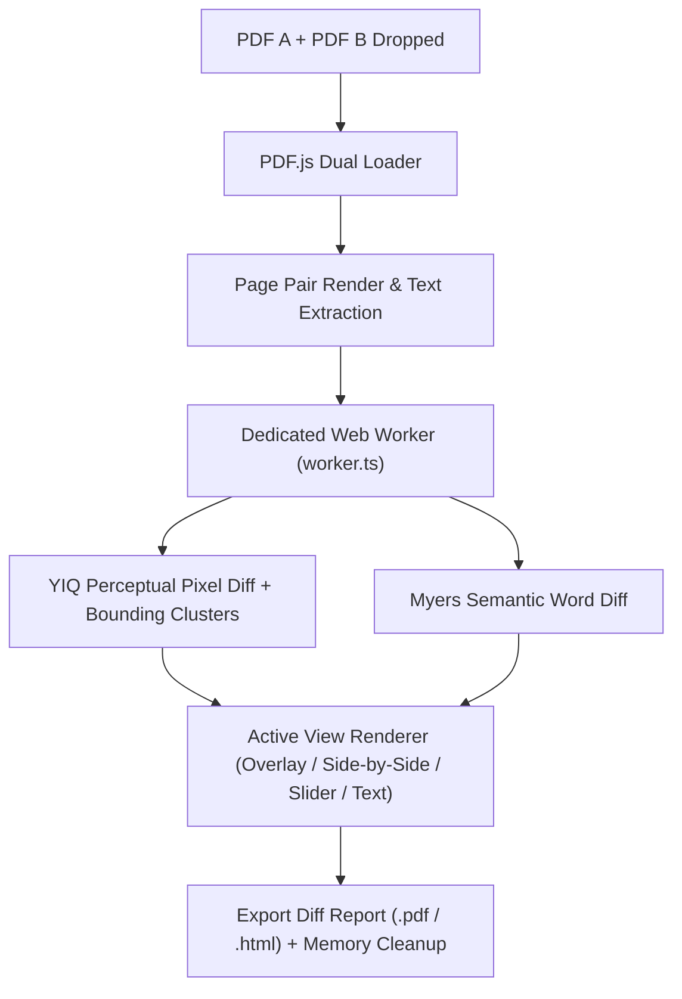

# Visual PDF Comparison & Overlay Diff Tool

# Technical Specification & Architecture Blueprint

> **Spec Number**: 109  
> **Slug**: `pdf-visual-compare`  
> **Category**: `documents`  
> **Inspired By**: iLovePDF — *Compare PDF*  
> **Target SEO Keyword**: `compare two pdf files online free client side visual diff overlay contract compare`  
> **Route**: `/tools/pdf-visual-compare`  
> **Architecture**: 100% Client-Side Single Page Application (Zero Server Ingestion, Zero Telemetry)

---

## 1. MVP Generation Prompt (`/create-web-micro-saas`)

```text
/create-web-micro-saas

Act as a Principal Frontend Engineer and UX Architect. Build a high-performance, 100% client-side Angular Standalone tool for PrivKnife called "Visual PDF Comparison & Overlay Diff Tool".

TECHNICAL CONSTRAINTS & STACK:
1. Pure Client-Side Architecture: Zero backend endpoints, zero document uploads. All PDF rasterization, pixel-level visual differencing, and extracted text diffing execute strictly inside client browser memory.
2. Core Technologies: pdfjs-dist (already installed) for page rendering and structured text extraction, pure TypeScript perceptual pixel-diff engine (YIQ color-distance / pixelmatch-compatible algorithm) + Myers text diff engine running in a Web Worker (`worker.ts`), HTML5 Canvas, jspdf (already installed) for optional PDF Diff Report export.
3. Thread Safety: Execute multi-page pixel diffing and text diffing inside `worker.ts` with per-page progress streaming so comparing 50-page contracts stays at 60 FPS (Directive 3).
4. Memory Hygiene: Release per-page `ImageData` buffers immediately after computing diffs, destroy both `PDFDocumentProxy` instances, revoke all ObjectURLs, and terminate workers on Reset and `ngOnDestroy` (Directive 4).
5. Export Deliverables: Interactive synchronized Side-by-Side / Visual Overlay / Curtain Slider / Text Diff view, plus exportable Visual Diff Report (`.pdf`) and Summary Report (`.html` / `.txt`).

KEY FEATURES & USER INTERACTION:
- Dual Dropzone Input: Upload Original PDF (Version A) and Revised PDF (Version B) with instant page-count mismatch warnings and manual page-offset alignment.
- Four Comparison Views:
  1. Visual Overlay Diff: Composites Version A (red channel tint) and Version B (cyan/green tint) so unchanged pixels stay neutral gray while shifted layouts, altered figures, or edited signatures pop immediately.
  2. Highlight Mask View: Highlights changed bounding clusters in vibrant magenta/amber over a dimmed base page with adjustable pixel-sensitivity threshold.
  3. Synchronized Side-by-Side & Split Curtain Slider: Pan/zoom synchronized across both PDFs with an interactive before/after divider.
  4. Semantic Text Diff View: Word-level additions/deletions extracted from `pdfjs-dist` text layers (ignoring reflow/whitespace optionally) for rapid legal contract redlining.
- Change Navigation Bar: Jump directly to "Next Changed Page" with per-page change percentage badges (`Page 4: 1.8% visual diff, 3 text changes`).
- Privacy & Local Execution Assurance: Prominent trust badge reading "🛡️ 100% In-Browser • Never Leaves Your Device".
```

---

## 2. Concept Overview & Value Proposition

Lawyers redlining contracts, engineers reviewing updated CAD/architectural blueprints, and designers checking print proofs need to catch subtle edits—like a changed decimal digit, altered clause, or shifted diagram—between two PDF versions. Sending confidential pre-signature contracts or proprietary schematics to a cloud "Compare PDF" tool poses severe IP and NDA risk. **Visual PDF Comparison & Overlay Diff Tool** delivers instant visual pixel-diff *and* semantic text-diff completely inside browser RAM.

### Elevator Pitch
> "Spot every altered word, changed number, and shifted graphic between two PDFs in seconds—with visual overlay diff, curtain slider, and semantic text redlining 100% locally in your browser."

### Core Value Drivers
1. **Zero-Trust Contract & Blueprint Safety**: Both PDFs stay isolated inside local browser memory (Directive 1).
2. **Catches Both Visual AND Textual Edits**: Text diff catches reworded clauses even across line reflows; visual overlay catches altered logos, charts, signatures, and CAD dimensions that text-only tools completely miss.
3. **Rapid Change Triage**: Automatically scans all pages and flags only the pages that changed, letting users jump straight to differences instead of manually eyeballing 60 unchanged pages.
4. **Shareable Audit Evidence**: Export a clean visual diff `.pdf` report highlighting only modified pages and change statistics.

---

## 3. Technical Feasibility, Dependencies & Difficulty Score

### Difficulty Score: 6.0 / 10 (Moderate-High — Fast perceptual YIQ pixel diffing in Web Worker, spatial text-line reconstruction, and synchronized dual-canvas pan/zoom)

| Architectural Component | Implementation Technology | Installed in Repo? | Client-Side Feasibility |
|---|---|---|---|
| Dual PDF Rendering & Text Extraction | `pdfjs-dist` (`getTextContent()`, `render()`) | Yes (`^6.4.299`) | 100% In-Browser |
| Pixel Overlay & Perceptual Diff | Pure TS YIQ Pixel Diff Algorithm (`worker.ts`) | Pure TypeScript (0 external deps) | 100% In-Browser (~20ms/page) |
| Word-Level Text Diff | Pure TS Myers Diff (reusing Diff Checker pattern) | Pure TypeScript | 100% In-Browser |
| Diff Report Export | `jspdf` / `pdf-lib` | Yes (`^4.2.1` / `^1.17.1`) | 100% In-Browser |

### Known Technical Nuances & Mitigations
- **Mismatched Page Dimensions**: Version B may have slightly different margins or page sizes than Version A.
  - *Mitigation*: Render both pages onto canvases sized to `max(widthA, widthB) × max(heightA, heightB)` pinned to top-left (with white padding), and flag dimension mismatch in the page summary badge.
- **Anti-Aliasing Noise**: Subpixel font anti-aliasing can cause false positives if comparing raw RGB equality.
  - *Mitigation*: Use NTSC YIQ perceptual color delta threshold (`deltaYIQ > maxDelta`) plus anti-aliasing neighbor suppression and expose a user-adjustable **Sensitivity Slider** (`Strict` / `Balanced` / `Relaxed`).
- **Memory Bounds on 100+ Page Comparisons**: Never cache full-resolution `ImageData` for all pages simultaneously. Compute compact summary metrics (`changedPixelRatio`, `changedClusters`) per page during scan, and only hold full-resolution rendered diff canvases for the currently active page (plus ±1 prefetch).

---

## 4. Competitive Landscape & Market Positioning

| Feature / Metric | PrivKnife (`pdf-visual-compare`) | iLovePDF Compare PDF | Draftable / Acrobat Compare |
|---|---|---|---|
| **Privacy / Ingestion** | **100% In-Browser Zero Upload** | Remote Cloud Upload | Paid Desktop / Cloud SaaS |
| **Visual Overlay + Text Diff** | **Both Modes Included** | Premium tier required | Enterprise Pricing |
| **Sensitivity & Ignore-Whitespace Controls** | **Fully Tunable** | Fixed | Limited |
| **Exportable Diff Report** | **Free `.pdf` & `.html`** | Paid / Watermarked | Paid |

---

## 5. Functional Requirements & Processing Algorithms

### 5.1. Visual Overlay & Pixel Diff Algorithm (`computeVisualDiff`)
1. Receive `ImageData` A and `ImageData` B normalized to equal `(W, H)`.
2. For each pixel `(x, y)`:
   - Compute perceptual YIQ squared color difference `delta = 0.5053*dY² + 0.299*dI² + 0.1957*dQ²`.
   - If `delta <= threshold`:
     - *Overlay Mode*: Output desaturated luminance blended `0.35` alpha on white so unchanged content provides clean visual context.
   - If `delta > threshold`:
     - Increment `changedPixelCount`.
     - *Overlay Mode*: Colorize pixels darker in A (removed) as **Crimson Red (`#DC2626`)** and darker in B (added) as **Emerald/Cyan (`#059669`)**; mutually changed non-white pixels as **Amber/Magenta (`#D97706`)**.
     - *Highlight Mask Mode*: Accumulate into a coarse `16×16` grid to merge neighboring changed pixels into clean highlight bounding boxes.
3. Compute `changePercent = (changedPixelCount / (W * H)) * 100`.

### 5.2. Semantic Text Diff Algorithm (`computeTextDiff`)
1. Extract text items per page via `page.getTextContent()`.
2. Sort items by reading order (top-to-bottom Y bucket within line height tolerance, then left-to-right X) and reconstruct lines.
3. Normalize whitespace if `ignoreWhitespace: true` and lowercase if `ignoreCase: true`.
4. Run Myers word-level diff producing `Array<{ type: 'equal' | 'added' | 'removed'; text: string }>`.

### 5.3. Export Diff Report
- Generate a `.pdf` report containing a cover summary table (File A, File B, Total Pages, Modified Pages, Overall Change %) followed by the visual overlay images of modified pages only (or all pages if selected).

---

## 6. UI/UX Layout Specification (BEM Architecture)

- **Localization (`i18n`)**: Keys under `tools.pdfVisualCompare.*` (`en`, `es`).
- **Toolbar**:
  - View mode segmented control: `Visual Overlay`, `Side-by-Side`, `Curtain Slider`, `Text Diff`.
  - Filter toggle: `Show Changed Pages Only`.
  - Prev/Next Change buttons (`Alt+Left` / `Alt+Right`) and Sensitivity slider.
- **Page Strip**: Scrollable horizontal/vertical page index with green dot (identical) or amber/red dot (changed %) for instant navigation.

---

## 7. Technical Architecture & Client-Side Pipeline



---

## 8. Input/Output Data Contracts (TypeScript Interfaces)

```typescript
export type CompareViewMode = 'overlay' | 'side_by_side' | 'curtain_slider' | 'text_diff';

export interface PdfCompareOptions {
  viewMode: CompareViewMode;
  renderScale: number;            // 1.0..2.0
  pixelSensitivity: number;       // 0.05..0.5 (YIQ threshold)
  ignoreWhitespace: boolean;
  ignoreCase: boolean;
  pageOffsetB: number;            // Shift alignment if cover page inserted/removed
  showChangedOnly: boolean;
}

export interface PageDiffSummary {
  pairIndex: number;              // 1-based
  pageA: number | null;
  pageB: number | null;
  hasVisualDiff: boolean;
  hasTextDiff: boolean;
  visualChangePercent: number;
  textAdditions: number;
  textDeletions: number;
  dimensionMismatch: boolean;
}

export interface PdfVisualCompareResult {
  success: boolean;
  totalPairs: number;
  changedPageCount: number;
  summaries: PageDiffSummary[];
  reportBlob?: Blob;
  reportFileName?: string;
  error?: string;
}
```

---

## 9. Security, Sandboxing & Verification Acceptance Criteria

- **Directive 1–5**: Zero network requests verified; worker offloads pixel & text diffing; full destruction of both `PDFDocumentProxy` instances and ObjectURLs on Reset and `ngOnDestroy`; HTML diff report strictly escapes extracted PDF text (or sanitizes via DOMPurify) to prevent XSS!
- **Functional Test Vectors**:
  1. Identical synthetic PDF passed as A and B -> `changedPageCount === 0`, `visualChangePercent === 0`, `textAdditions === 0`, `textDeletions === 0`.
  2. PDF B changes a single price (`"$1,000"` → `"$1,500"`) on page 2 of a 3-page PDF -> flags only page 2 as changed in both Visual and Text diff modes.
  3. PDF A has 2 pages and PDF B has 3 pages -> cleanly marks pair 3 as added page (`pageA: null, pageB: 3`) without crashing.
  4. Malicious `<script>alert(1)</script>` text inside a PDF is escaped safely in HTML report and Text Diff DOM.
