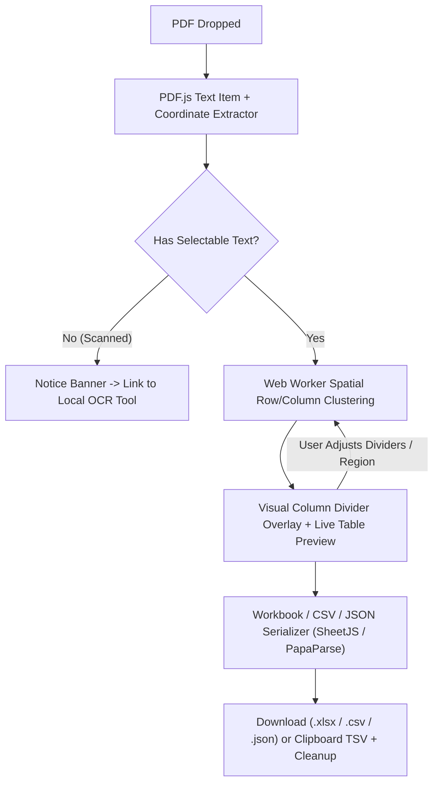

# PDF to Excel, CSV & JSON Table Extractor

# Technical Specification & Architecture Blueprint

> **Spec Number**: 110  
> **Slug**: `pdf-table-extractor`  
> **Category**: `documents`  
> **Inspired By**: iLovePDF — *PDF to Excel*  
> **Target SEO Keyword**: `pdf to excel converter online free client side extract tables pdf to csv xlsx`  
> **Route**: `/tools/pdf-table-extractor`  
> **Architecture**: 100% Client-Side Single Page Application (Zero Server Ingestion, Zero Telemetry)

---

## 1. MVP Generation Prompt (`/create-web-micro-saas`)

```text
/create-web-micro-saas

Act as a Principal Frontend Engineer and Data Architect. Build a high-performance, 100% client-side Angular Standalone tool for PrivKnife called "PDF to Excel, CSV & JSON Table Extractor".

TECHNICAL CONSTRAINTS & STACK:
1. Pure Client-Side Architecture: Zero server uploads. Bank statements, financial ledgers, expense reports, lab results, and price lists stay strictly inside local browser memory.
2. Core Technologies: pdfjs-dist (already installed) for exact glyph bounding-box and vector line extraction, xlsx / SheetJS (already installed) for multi-sheet `.xlsx` generation, papaparse (already installed) for RFC-4180 CSV export, Web Worker (`worker.ts`) for spatial table clustering.
3. Thread Safety: Execute spatial X/Y clustering, column boundary detection, and `.xlsx` workbook serialization inside `worker.ts` with per-page progress callbacks (Directive 3).
4. Memory Hygiene: Destroy `PDFDocumentProxy`, release parsed text-item arrays after export, revoke all ObjectURLs, and terminate workers cleanly on Reset and `ngOnDestroy` (Directive 4).
5. Export Deliverables: Multi-sheet Excel workbook (`.xlsx`), RFC-4180 `.csv`, structured `.json`, or clipboard TSV (paste directly into Excel/Google Sheets).

KEY FEATURES & USER INTERACTION:
- Automatic Spatial Table Detection: Clusters PDF text runs by Y-coordinates (rows) and X-projection histograms / vector grid lines (columns) without requiring slow OCR on digital PDFs.
- Interactive Visual Column & Region Editor: Overlay detected table bounding box and draggable vertical column-divider lines directly on the PDF page preview so users can add/move/delete column splits or crop out headers/footers with pixel accuracy.
- Multi-Page Merge Mode: Toggle between "Merge All Pages into One Table" (automatically stripping repeated table header rows!) or "Separate Sheet Per Page/Table" in `.xlsx`.
- Smart Data Type Coercion: Optionally parse currency (`$1,234.56`), percentages (`12.5%`), and ISO/US/EU dates into native Excel numeric/date cells instead of raw strings.
- Scanned PDF Detection: If a page has 0 selectable text items, display a helpful non-blocking notice directing the user to PrivKnife's Local OCR tool (`/tools/local-ocr-text-extractor`).
- Privacy & Local Execution Assurance: Prominent trust badge reading "🛡️ 100% In-Browser • Never Leaves Your Device".
```

---

## 2. Concept Overview & Value Proposition

Accountants, analysts, researchers, and small business owners constantly receive tabular data locked inside PDFs (vendor invoices, quarterly earnings tables, municipal budgets, bank reports). Cloud "PDF to Excel" converters require uploading proprietary financial data to remote servers and often mangle columns with no way to adjust splits before downloading. **PDF to Excel, CSV & JSON Table Extractor** combines automated X/Y spatial table detection with interactive visual column dividers—100% locally in the browser.

### Elevator Pitch
> "Extract clean, editable Excel spreadsheets, CSVs, and JSON tables from any digital PDF—with visual column-divider tuning and zero financial data ever leaving your device."

### Core Value Drivers
1. **Zero-Trust Financial Privacy**: Sensitive ledgers, payroll tables, and invoices never touch external servers.
2. **Visual Column Correction**: Unlike black-box converters, users can drag, add, or remove column split lines directly over the PDF preview and watch the live table preview update instantaneously.
3. **Multi-Page Table Consolidation**: Automatically merges tables spanning dozens of PDF pages into one continuous spreadsheet while deduplicating repeated column headers.
4. **Direct Spreadsheet Paste**: One-click "Copy as TSV" lets users paste extracted rows straight into Excel, LibreOffice Calc, or Google Sheets.

---

## 3. Technical Feasibility, Dependencies & Difficulty Score

### Difficulty Score: 6.5 / 10 (Moderate-High — Spatial X/Y clustering, wrapped multi-line cell heuristics, and interactive PDF overlay column guides)

| Architectural Component | Implementation Technology | Installed in Repo? | Client-Side Feasibility |
|---|---|---|---|
| Text Coordinates & Geometry Extraction | `pdfjs-dist` (`getTextContent()`, `getOperatorList()`) | Yes (`^6.4.299`) | 100% In-Browser |
| Excel Workbook Export | `xlsx` (SheetJS) | Yes (`^0.18.5`) | 100% In-Browser |
| CSV Serialization | `papaparse` (`Papa.unparse`) | Yes (`^5.7.0`) | 100% In-Browser |
| Spatial Clustering Engine | Pure TS Projection-Profile Algorithm (`worker.ts`) | Pure TypeScript | 100% In-Browser |

### Known Technical Nuances & Mitigations
- **Borderless vs. Ruled Tables**: Some PDFs have explicit drawn horizontal/vertical lines, while many modern reports use pure whitespace alignment.
  - *Mitigation*: Support a hybrid detection engine: extract text bounding boxes `(x, y, width, height)`, build an X-axis occupancy projection histogram to discover whitespace gutters (`columnBoundaries`), and allow manual click-to-add / drag-to-adjust vertical dividers on the preview canvas.
- **CSV Formula Injection Protection**: Extracted PDF cells starting with `=`, `+`, `-`, `@` could trigger formula execution when opened in Excel.
  - *Mitigation*: Include a security toggle (`sanitizeFormulas: true` by default for CSV/XLSX) that prefixes dangerous leading characters or stores them strictly as string literals unless numeric coercion applies (e.g., negative numbers like `-42.50` remain valid numbers!).
- **Scanned Image-Only PDFs**: `getTextContent()` yields 0 items on image-only scans. Detect `totalTextItems === 0` immediately and guide the user cleanly to `/tools/local-ocr-text-extractor`.

---

## 4. Competitive Landscape & Market Positioning

| Feature / Metric | PrivKnife (`pdf-table-extractor`) | iLovePDF PDF to Excel | Tabula (Desktop Java) |
|---|---|---|---|
| **Privacy / Ingestion** | **100% Client-Side Browser** | Remote Server Upload | Local Desktop |
| **Interactive Column Split Tuning** | **Visual Draggable Dividers** | None (Black Box) | Region only |
| **Output Formats** | **`.xlsx`, `.csv`, `.json`, TSV Clipboard** | `.xlsx` only | `.csv` / `.tsv` / `.json` |
| **Zero Installation** | **Instant Web App** | Web App | Requires Java Runtime |
| **Cost** | **100% Free** | Paid / Strictly Capped | Free |

---

## 5. Functional Requirements & Processing Algorithms

### 5.1. Spatial Row & Column Clustering (`extractTablesFromTextItems`)
1. Filter text items within the active selection region `(regionX0, regionY0, regionX1, regionY1)` (defaults to full page minus optional header/footer ignore bands).
2. **Row Clustering**:
   - Sort items descending by baseline `y` (PDF origin bottom-left).
   - Group consecutive items into the same row when `|y_i - rowBaselineY| <= rowTolerancePt` (default `0.45 * medianFontHeight`).
3. **Column Boundary Discovery (Auto Mode)**:
   - Project each item's horizontal span `[x, x + width]` onto a 1pt-resolution boolean occupancy array across the region width.
   - Identify contiguous unoccupied whitespace gutters wider than `minColumnGapPt` (default `6pt`).
   - Place auto-detected column splitters at gutter midpoints.
4. **Cell Assignment**:
   - For each row, assign every text item to the column bin containing its horizontal center `x + width / 2`.
   - Join multiple items within the same cell ordered by `x` with smart spacing (insert space when gap exceeds `0.2 * fontSize`).
5. **Multi-Page Header Deduplication**:
   - When `mergeAllPages: true` and `stripRepeatedHeaders: true`, compare the first non-empty row of pages `2..N` against page 1's header row (case-insensitive normalized string match) and omit exact duplicates.

### 5.2. Numeric & Currency Type Coercion
- When `detectNumericTypes: true`:
  - Parse clean numbers (`1,234.56`, `-500.00`, `(125.40)` accounting negatives) and currency values (`$49.99`, `€120,50` based on locale decimal preference) into JS `number` values for `.xlsx` and `.json`.

---

## 6. UI/UX Layout Specification (BEM Architecture)

- **Localization (`i18n`)**: Keys under `tools.pdfTableExtractor.*` (`en`, `es`).
- **Split Workspace**:
  - **Left Panel**: PDF page preview with draggable crop rectangle (region of interest) and interactive vertical blue column-divider lines (`Click ruler to add column`, `Drag to move`, `Double-click / Delete key to remove`).
  - **Right Panel**: Live editable HTML data table preview showing row/column counts, header toggle (`First row is header`), numeric coercion toggle, and export toolbar (`Download .xlsx`, `Download .csv`, `Download .json`, `Copy TSV`).

---

## 7. Technical Architecture & Client-Side Pipeline



---

## 8. Input/Output Data Contracts (TypeScript Interfaces)

```typescript
export interface PdfTextToken {
  text: string;
  x: number;
  y: number;
  width: number;
  height: number;
  pageIndex: number;
}

export interface TableRegionRect {
  x: number;
  y: number;
  width: number;
  height: number;
}

export interface PdfTableExtractorOptions {
  pageRange: string;                  // "all" | "1-5"
  rowToleranceFactor: number;         // 0.25..0.8
  minColumnGapPt: number;             // 2..30
  manualColumnSplitsX?: number[];     // Overrides auto column boundaries
  region?: TableRegionRect;           // Optional crop region
  firstRowAsHeader: boolean;
  mergeAllPages: boolean;
  stripRepeatedHeaders: boolean;
  detectNumericTypes: boolean;
  decimalSeparator: '.' | ',';
  sanitizeCsvFormulas: boolean;
}

export interface ExtractedTable {
  pageIndex: number;
  headers: string[];
  rows: Array<Array<string | number>>;
  columnSplitsX: number[];
}

export interface PdfTableExtractorResult {
  success: boolean;
  tables: ExtractedTable[];
  isScannedFallbackNeeded: boolean;
  blob?: Blob;
  fileName?: string;
  fileSize?: number;
  mimeType?: string;
  error?: string;
}
```

---

## 9. Security, Sandboxing & Verification Acceptance Criteria

- **Directive 1–5**: Zero network requests verified; spatial clustering & `.xlsx` serialization offloaded to `worker.ts`; full `PDFDocumentProxy` & `ObjectURL` disposal; lazy route loading.
- **CSV / Excel Injection Safety**: Cells beginning with `=HYPERLINK(...)` or `+cmd|` are neutralized when `sanitizeCsvFormulas: true` while genuine negative numbers like `-145.20` remain numeric.
- **Functional Test Vectors**:
  1. Synthetic 2-page PDF with 4 aligned columns (`Date`, `Description`, `Qty`, `Amount`) and repeated header on page 2 -> `mergeAllPages + stripRepeatedHeaders` produces 1 unified table with exact row count and parsed numeric amounts.
  2. Manual `manualColumnSplitsX` cleanly re-partitions columns without re-parsing the PDF file.
  3. Empty/image-only PDF sets `isScannedFallbackNeeded: true` gracefully without throwing.
  4. Exported `.xlsx` bytes re-parsed by `XLSX.read()` match exact headers and cell values.
