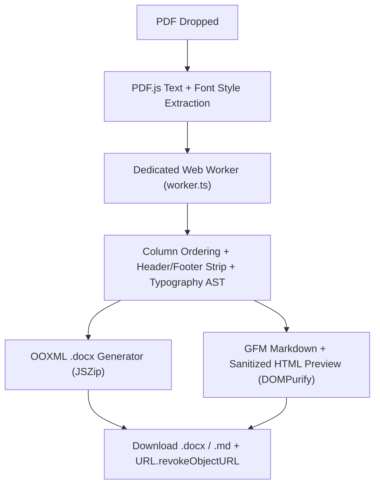

# PDF to Word (DOCX) & Markdown Layout Converter

# Technical Specification & Architecture Blueprint

> **Spec Number**: 111  
> **Slug**: `pdf-to-word-markdown`  
> **Category**: `documents`  
> **Inspired By**: iLovePDF — *PDF to Word* + *PDF to Markdown*  
> **Target SEO Keyword**: `pdf to word docx converter online free client side pdf to markdown no upload`  
> **Route**: `/tools/pdf-to-word-markdown`  
> **Architecture**: 100% Client-Side Single Page Application (Zero Server Ingestion, Zero Telemetry)

---

## 1. MVP Generation Prompt (`/create-web-micro-saas`)

```text
/create-web-micro-saas

Act as a Principal Frontend Engineer and Document Processing Architect. Build a high-performance, 100% client-side Angular Standalone tool for PrivKnife called "PDF to Word (DOCX) & Markdown Layout Converter".

TECHNICAL CONSTRAINTS & STACK:
1. Pure Client-Side Architecture: Zero backend endpoints, zero document uploads. All PDF typography analysis, heading/paragraph/list reconstruction, OOXML `.docx` generation, and Markdown serialization execute completely in client browser memory.
2. Core Technologies: pdfjs-dist (already installed) for text runs, font metrics, and embedded image extraction; jszip (already installed) for lightweight pure-TS OOXML `.docx` packaging (or `docx` npm library); DOMPurify (already installed) for safe live HTML preview sanitization; Web Worker (`worker.ts`) for multi-page document reconstruction.
3. Thread Safety: Execute font-histogram clustering, paragraph reflow, and `.docx` ZIP packaging inside `worker.ts` with per-page progress callbacks (Directive 3).
4. Memory Hygiene: Destroy `PDFDocumentProxy`, release temporary extracted image buffers, revoke all ObjectURLs, and terminate workers on Reset and `ngOnDestroy` (Directive 4).
5. Export Deliverables: Editable Microsoft Word / LibreOffice Writer `.docx` document, clean GitHub-Flavored Markdown `.md` (ideal for LLMs, Obsidian, Notion, docs), and plain `.txt`.

KEY FEATURES & USER INTERACTION:
- Semantic Structure Reconstruction: Automatically infers `H1`/`H2`/`H3` headings from font-size histograms, detects bold/italic spans from PDF font descriptors, groups wrapped lines into flowing paragraphs, preserves bulleted/numbered lists, and inserts page breaks optionally.
- Dual-Format Instant Preview: Toggle between **Rich Document Preview** (sanitized HTML mirroring the `.docx` layout) and **Clean Markdown Preview** (editable raw `.md` with 1-click Copy to Clipboard for AI/notes workflows).
- Header/Footer Auto-Strip: Optionally detect and remove repeated running headers, footers, and page numbers across multi-page PDFs so converted Word/Markdown prose flows cleanly.
- Embedded Image Extraction: Option to embed detected raster figures into the `.docx` (or bundle `.md` + `images/` inside a `.zip`).
- Privacy & Local Execution Assurance: Prominent trust badge reading "🛡️ 100% In-Browser • Never Leaves Your Device".
```

---

## 2. Concept Overview & Value Proposition

Converting PDFs into editable Word documents (`.docx`) is one of the single most searched document utilities on the web—and converting PDFs into clean Markdown (`.md`) has surged in demand for developers, researchers, and knowledge workers feeding notes into Obsidian, Notion, or documentation repos. Cloud converters force users to upload resumes, manuscripts, and legal briefs to remote servers. **PDF to Word (DOCX) & Markdown Layout Converter** reconstructs clean, editable `.docx` and `.md` files 100% locally in the browser.

### Elevator Pitch
> "Convert PDFs into clean, editable Word (`.docx`) documents or structured Markdown (`.md`)—complete with headings, lists, and paragraph reflow—100% locally with zero uploads."

### Core Value Drivers
1. **Zero-Trust Confidentiality**: Resumes, contracts, and unpublished manuscripts never touch a cloud server.
2. **True Paragraph Reflow (Not Broken Line Breaks)**: Intelligently stitches hard-wrapped PDF lines back into editable paragraphs while preserving headings, bullets, and bold/italic emphasis.
3. **Dual Deliverable Value**: Exports standards-compliant OOXML `.docx` (compatible with Word, Google Docs, LibreOffice) AND crisp GFM `.md` for knowledge bases.
4. **Noise Removal**: Automatically strips repetitive running headers, footers, and isolated page numbers across multi-page reports.

---

## 3. Technical Feasibility, Dependencies & Difficulty Score

### Difficulty Score: 6.5 / 10 (Moderate-High — Typography hierarchy inference, multi-column reading order detection, and standards-compliant OOXML `.docx` packaging)

| Architectural Component | Implementation Technology | Installed in Repo? | Client-Side Feasibility |
|---|---|---|---|
| PDF Typography & Glyph Stream Parser | `pdfjs-dist` (`getTextContent({ includeMarkedContent: true })`) | Yes (`^6.4.299`) | 100% In-Browser |
| OOXML `.docx` Builder | Pure-TS OOXML generator + `jszip` (already installed, zero bloat!) | `jszip` (`^3.10.2`) | 100% In-Browser |
| Live Preview Sanitization | `dompurify` + `marked` | Yes (`3.4.16` / `^18.1.0`) | 100% In-Browser |
| Off-Thread Layout Engine | Dedicated Web Worker (`worker.ts`) | Native Browser API | Non-blocking 60 FPS UI |

### Known Technical Nuances & Mitigations
- **Multi-Column Academic / Newsletter Layouts**: Naive Y-sorting scrambles two-column PDFs by reading left-column line 1 + right-column line 1 as one sentence.
  - *Mitigation*: Run a vertical whitespace-gutter split check per page: if > 65% of lines split cleanly around a central vertical gutter `[0.42W .. 0.58W]`, process Left Column top-to-bottom first, then Right Column top-to-bottom.
- **Valid OOXML XML Escaping**: Unescaped `&`, `<`, `>`, or illegal XML 1.0 control characters (`\u0000`–`\u0008`, `\u000B`, `\u000C`, `\u000E`–`\u001F`) extracted from PDFs corrupt `.docx` files in Microsoft Word.
  - *Mitigation*: Implement a strict `escapeXmlText()` sanitizer stripping illegal XML control chars and escaping all 5 XML entities, verified by unit tests.
- **Scanned Image-Only PDFs**: Detect 0 text items and display an immediate link to PrivKnife's Local OCR tool (`/tools/local-ocr-text-extractor`).

---

## 4. Competitive Landscape & Market Positioning

| Feature / Metric | PrivKnife (`pdf-to-word-markdown`) | iLovePDF PDF to Word | Cloud AI Parsers |
|---|---|---|---|
| **Privacy / Ingestion** | **100% Client-Side RAM** | Remote Cloud Server | Remote Cloud API |
| **Output Formats** | **`.docx`, `.md`, `.txt` (+ Markdown Copy)** | `.docx` only | `.md` only (paid tokens) |
| **Running Header/Footer Strip** | **Configurable Auto-Strip** | Often leaves broken text boxes | Partial |
| **Multi-Column Reading Order** | **Auto 2-Column Gutter Detection** | Server layout engine | Varies |
| **Cost** | **100% Free** | Freemium / Paid | Paid API |

---

## 5. Functional Requirements & Processing Algorithms

### 5.1. Typography & Structure Reconstruction Pipeline (`reconstructDocumentAst`)
1. **Font-Size Body Baseline**: Compute character-weighted mode of font sizes across the document (`bodyFontSize`, e.g., `11pt`).
   - `fontSize >= bodyFontSize * 1.6` → `Heading 1`
   - `fontSize >= bodyFontSize * 1.3` → `Heading 2`
   - `fontSize >= bodyFontSize * 1.12` (or bold standalone line) → `Heading 3`
2. **Inline Style Detection**: Inspect `styles[item.fontName]` font family strings for `Bold`, `Heavy`, `Black` and `Italic`, `Oblique` to preserve inline `**bold**` and `*italic*` runs.
3. **Running Header/Footer Stripping** (when enabled on >= 3-page docs): Identify lines in the top 10% or bottom 10% of pages whose normalized text (digits replaced with `#`) repeats on >= 60% of pages, and exclude them.
4. **Paragraph & List Merging**:
   - Detect list markers (`^([•●▪◦\-*]|\d+[.)]|[a-zA-Z][.)])\s+`).
   - Join consecutive body lines into one flowing paragraph when vertical gap `<= 1.45 * lineHeight`, previous line doesn't end with hard paragraph break heuristic (significantly shorter than column width), and next line isn't indented/list-prefixed.
   - Re-join hyphenated end-of-line word breaks (`"docu-" + "ment"` → `"document"`) when `dehyphenateWords: true`.

### 5.2. OOXML `.docx` Packaging (`buildDocxBlob`)
- Assemble valid Open Packaging Convention ZIP archive containing:
  - `[Content_Types].xml`
  - `_rels/.rels`
  - `word/_rels/document.xml.rels`
  - `word/styles.xml` (clean typography styles for `Normal`, `Heading1`, `Heading2`, `Heading3`, `ListParagraph`)
  - `word/numbering.xml` (bullet and decimal list definitions)
  - `word/document.xml` (generated from `DocumentBlock[]` AST with proper `<w:p>`, `<w:r>`, `<w:rPr><w:b/><w:i/></w:rPr>`, and optional `<w:br w:type="page"/>`).

### 5.3. Markdown Serialization (`buildMarkdown`)
- Render `Heading1..3` as `#`, `##`, `###`; lists as `- ` / `1. `; inline bold/italic runs cleanly; optional `---` horizontal rule page dividers.

---

## 6. UI/UX Layout Specification (BEM Architecture)

- **Localization (`i18n`)**: Keys under `tools.pdfToWordMarkdown.*` (`en`, `es`).
- **Configuration Controls**:
  - Output Mode / Preview Tabs: `Word (.docx) Preview`, `Markdown (.md)`, `Plain Text (.txt)`.
  - Toggles: `Auto-Detect 2-Column Layout`, `Strip Running Headers & Footers`, `Dehyphenate Line Breaks`, `Insert Page Breaks`, `Preserve Bold & Italic`.
- **Actions**: `Download .docx`, `Download .md`, `Copy Markdown`, `Reset`.

---

## 7. Technical Architecture & Client-Side Pipeline



---

## 8. Input/Output Data Contracts (TypeScript Interfaces)

```typescript
export interface InlineTextRun {
  text: string;
  bold: boolean;
  italic: boolean;
  code?: boolean;
}

export type DocumentBlock =
  | { type: 'heading'; level: 1 | 2 | 3; runs: InlineTextRun[]; pageIndex: number }
  | { type: 'paragraph'; runs: InlineTextRun[]; pageIndex: number }
  | { type: 'list_item'; ordered: boolean; marker: string; runs: InlineTextRun[]; pageIndex: number }
  | { type: 'page_break'; pageIndex: number };

export interface PdfToWordMarkdownOptions {
  pageRange: string;
  detectMultiColumn: boolean;
  stripHeadersFooters: boolean;
  dehyphenateWords: boolean;
  preserveInlineStyles: boolean;
  includePageBreaks: boolean;
}

export interface PdfToWordMarkdownResult {
  success: boolean;
  blocks: DocumentBlock[];
  markdown: string;
  plainText: string;
  docxBlob?: Blob;
  wordCount: number;
  headingCount: number;
  isScannedFallbackNeeded: boolean;
  error?: string;
}
```

---

## 9. Security, Sandboxing & Verification Acceptance Criteria

- **Directive 1–5**: Zero network requests verified; worker offloads AST reconstruction & `.docx` ZIP creation; DOMPurify strictly sanitizes all HTML preview strings before Angular binding; full cleanup on Reset and `ngOnDestroy`; lazy route loading.
- **Functional Test Vectors**:
  1. Synthetic PDF with 24pt Title, 14pt bold Subtitle, 11pt body paragraph, and bullet list -> AST detects `H1`, `H2`, `paragraph`, and `list_item` accurately.
  2. Exported `.docx` Blob opens as a valid ZIP containing `[Content_Types].xml`, `_rels/.rels`, `word/styles.xml`, and well-formed XML in `word/document.xml`.
  3. Special XML characters (`A & B < C > "D"`) and control byte `\u0007` are escaped/stripped cleanly so `DOMParser` parses `word/document.xml` with zero `parsererror` nodes.
  4. XSS payload (``) inside PDF text is safely neutralized in HTML preview.
