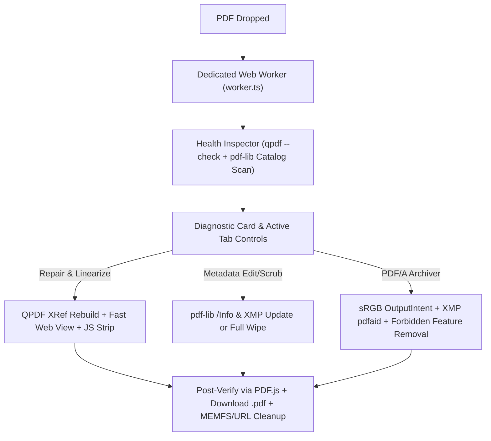

# PDF Structural Repair, Metadata Editor & PDF/A Archiver

# Technical Specification & Architecture Blueprint

> **Spec Number**: 113  
> **Slug**: `pdf-repair-metadata`  
> **Category**: `documents`  
> **Inspired By**: iLovePDF — *Repair PDF* + *PDF to PDF/A*  
> **Target SEO Keyword**: `repair corrupted pdf online free client side edit pdf metadata pdf a converter`  
> **Route**: `/tools/pdf-repair-metadata`  
> **Architecture**: 100% Client-Side Single Page Application (Zero Server Ingestion, Zero Telemetry)

---

## 1. MVP Generation Prompt (`/create-web-micro-saas`)

```text
/create-web-micro-saas

Act as a Principal Frontend Engineer and Document Standards Architect. Build a high-performance, 100% client-side Angular Standalone tool for PrivKnife called "PDF Structural Repair, Metadata Editor & PDF/A Archiver".

TECHNICAL CONSTRAINTS & STACK:
1. Pure Client-Side Architecture: Zero server uploads. Damaged PDFs, confidential archival records, and metadata scrubbing execute strictly inside local browser RAM.
2. Core Technologies:
   - Self-hosted `qpdf-wasm` (`/assets/wasm/qpdf.wasm` — shared asset with Spec 106 under strict `'self'` CSP) for XRef table reconstruction, broken trailer recovery, and linearization (Fast Web View);
   - `pdf-lib` (already installed) for Document Info & XMP Metadata inspection/editing/wiping, plus page-level structural rebuild fallback;
   - `pdfjs-dist` (already installed) for visual post-repair integrity verification and optional archival sRGB flattening.
3. Thread Safety: Execute all QPDF structural recovery, linearization, and PDF/A archival packaging inside a dedicated Web Worker (`worker.ts`) with stage progress updates (Directive 3).
4. Memory Hygiene: Unlink Emscripten MEMFS temporary files inside `finally` blocks, destroy PDF.js proxies, revoke all ObjectURLs, and terminate workers on Reset and `ngOnDestroy` (Directive 4).
5. Export Deliverables:
   - Repaired & Linearized `.pdf` (rebuilt XRef table, fixed stream lengths, Fast Web View),
   - Metadata-Edited or Privacy-Scrubbed `.pdf` (clean Info dictionary + XMP),
   - Archival PDF/A-ready `.pdf` (embedded sRGB OutputIntent ICC profile, normalized XMP `pdfaid:part` / `pdfaid:conformance` metadata, flattened transparency/annotations, zero external links/JavaScript).

KEY FEATURES & USER INTERACTION:
- Structural Health Diagnostic Card: Upon dropping a PDF, inspect and report: PDF Version, XRef integrity status, Linearization status, Embedded JavaScript/Launch Action security warnings, Encrypted status, Page Count, and full Metadata table (`Title`, `Author`, `Subject`, `Keywords`, `Creator`, `Producer`, `CreationDate`, `ModDate`).
- Mode 1 — Structural Repair & Linearize: Automatically recovers broken XRef tables, truncated trailers, or malformed object lengths via QPDF reconstruction (with fallback page-by-page `pdf-lib` salvage), plus optional Fast Web View (`--linearize`) and dangerous JavaScript/OpenAction stripping.
- Mode 2 — Metadata Inspector, Editor & Scrubber: Edit all standard PDF metadata fields cleanly OR click "Scrub All Hidden Metadata" (wipes `/Info`, `/Metadata` XMP XML, `/PieceInfo`, and embedded author fingerprints in one click).
- Mode 3 — Archival PDF/A-2b Packaging: Embeds a compact standard sRGB ICC OutputIntent, injects compliant PDF/A XMP metadata, strips forbidden archival features (JavaScript, audio/video annotations, unembedded external actions), and renders an Archival Compliance Checklist showing every check passed.
- Privacy & Local Execution Assurance: Prominent trust badge reading "🛡️ 100% In-Browser • Never Leaves Your Device".
```

---

## 2. Concept Overview & Value Proposition

Corrupted PDFs (broken XRef offsets, truncated downloads, malformed generator streams) refuse to open in strict viewers or government submission portals. Meanwhile, legal archives, universities, and tax authorities increasingly require **PDF/A archival compliance** and clean metadata without hidden author/software fingerprints. **PDF Structural Repair, Metadata Editor & PDF/A Archiver** delivers structural recovery, metadata hygiene, and archival preparation 100% locally in the browser—sharing the self-hosted `qpdf.wasm` asset with Spec 106.

### Elevator Pitch
> "Repair broken PDFs, inspect or wipe hidden document metadata, linearize for fast web viewing, and package archival PDF/A files—100% locally in your browser with zero uploads."

### Core Value Drivers
1. **Zero-Trust Recovery**: Damaged tax returns, signed deeds, and proprietary reports are salvaged locally without uploading them to mystery repair sites.
2. **Real Structural Diagnostics**: Shows users *exactly* what was wrong (e.g., broken XRef table, trailing garbage bytes, hidden `/JavaScript` action, author metadata leak) and what was fixed.
3. **One-Click Metadata Privacy Scrub**: Strips hidden `Author`, `Creator` (e.g., internal username/OS), `Producer`, and raw XML XMP blocks cleanly.
4. **Honest Archival Packaging**: Clearly documents every PDF/A conformance step performed (sRGB OutputIntent, XMP `pdfaid` schema, script/action removal, font/raster archival mode) without misleading claims.

---

## 3. Technical Feasibility, Dependencies & Difficulty Score

### Difficulty Score: 7.5 / 10 (High — Self-hosted QPDF recovery flags, XMP XML construction, embedded sRGB ICC OutputIntent profile, and graceful handling of unrecoverable binary corruption)

| Architectural Component | Implementation Technology | Installed in Repo? | Client-Side Feasibility |
|---|---|---|---|
| Structural XRef Repair & Linearization | Self-hosted `qpdf-wasm` (`/assets/wasm/qpdf.wasm`, shared with Spec 106) | Bundled local WASM asset | 100% In-Browser |
| Metadata Inspection / Editing / XMP | `pdf-lib` (`getTitle`, `setTitle`, `catalog.delete(PDFName.of('Metadata'))`) | Yes (`^1.17.1`) | 100% In-Browser |
| Post-Repair Verification & Archival Render | `pdfjs-dist` | Yes (`^6.4.299`) | 100% In-Browser |
| Compact sRGB ICC Profile | Bundled open-source tiny sRGB ICC binary (`~3 KB` constant in `engine.ts`) | Pure TypeScript asset | 100% In-Browser |

### Known Technical Nuances & Mitigations
- **Severely Truncated / Non-PDF Files**: If a file is missing the entire page tree or is actually a renamed `.docx`/`.jpg`, no tool can resurrect nonexistent bytes.
  - *Mitigation*: Run a 2-tier recovery pipeline:
    1. Tier 1: `qpdf --warning-exit-0 --qdf` / standard rebuild + `--linearize` (recovers broken XRef, incorrect `/Length`, missing `%%EOF`, stray leading/trailing garbage bytes).
    2. Tier 2 (Fallback): `PDFDocument.load(bytes, { ignoreEncryption: true, throwOnInvalidObject: false })` copying salvageable pages into a fresh PDF container.
    3. If both fail, return a transparent diagnostic explaining the exact structural failure (e.g., `"Missing %PDF header — detected PNG signature"`).
- **PDF/A Font Embedding Guarantee**: PDF/A strictly requires all fonts to be embedded. Some source PDFs rely on unembedded system fonts (`Helvetica`/`Times` standard-14).
  - *Mitigation*: Offer two honest PDF/A modes:
    - **Vector PDF/A Packaging** (embeds sRGB OutputIntent, writes ISO 19005-2 XMP `pdfaid` packet, strips forbidden `/JavaScript`/`/AA`/`/OpenAction`, checks font embedding flags and warns if unembedded fonts are detected).
    - **Guaranteed Archival Raster-Vector Flattening (PDF/A-2b Strict)** (renders pages at 300 DPI sRGB + preserves optional invisible OCR/text alignment or clean flat archival pages when source PDF has unembedded fonts or broken transparency groups).

---

## 4. Competitive Landscape & Market Positioning

| Feature / Metric | PrivKnife (`pdf-repair-metadata`) | iLovePDF (Repair + PDF/A) | VeraPDF / Acrobat Preflight |
|---|---|---|---|
| **Privacy / Ingestion** | **100% Client-Side WASM** | Remote Cloud Upload | Local Desktop Install |
| **Structural Repair + Linearize** | **QPDF WASM + Diagnostic Report** | Black-box Repair | Manual CLI / Paid |
| **Metadata Editor & Privacy Scrubber** | **Full Field Editor + 1-Click Wipe** | Not available | Acrobat Pro only |
| **Hidden JS / Malware Action Removal** | **Built-in Sanitizer** | Not exposed | Manual Preflight |
| **Cost** | **100% Free** | Freemium / Paid | Paid Subscription |

---

## 5. Functional Requirements & Processing Algorithms

### 5.1. Structural & Security Diagnostic (`inspectPdfHealth`)
- Detect `%PDF-x.y` header offset (flag leading junk bytes if offset > 0) and trailing `%%EOF` marker.
- Run `qpdf --check` inside `worker.ts` capturing warnings/errors cleanly.
- Scan catalog and page dictionaries for security/archival hazards: `/JavaScript`, `/JS`, `/OpenAction`, `/AA` (Additional Actions), `/Launch`, `/EmbeddedFiles`.
- Extract all `/Info` dictionary fields and raw XMP `/Metadata` stream size.

### 5.2. Repair, Sanitize & Linearize Pipeline (`repairAndLinearizePdf`)
1. Strip any leading garbage bytes before `%PDF-` if detected.
2. Run QPDF rebuild (`['--warning-exit-0', ...(linearize ? ['--linearize'] : []), '/input.pdf', '/repaired.pdf']`).
3. Load repaired bytes in `pdf-lib`:
   - If `stripActiveContent: true`, delete `/OpenAction`, `/AA`, and `/Names/JavaScript` from catalog.
   - Apply metadata edits (or full wipe of `/Info` + `/Metadata` XMP when `scrubAllMetadata: true`).
4. Verify output opens cleanly in `pdfjs-dist` and report recovered page count + warnings resolved.

### 5.3. Archival PDF/A-2b Packaging (`packagePdfA`)
1. Run structural normalization & active-content stripping (`/JavaScript`, `/OpenAction`, `/AA`, `/Sound`, `/Movie`).
2. Attach a standards-compliant `/OutputIntents` array to the PDF catalog referencing a `/GTS_PDFA1` OutputIntent dictionary with embedded sRGB ICC stream (`/N 3`).
3. Generate and attach a valid RDF/XMP `/Metadata` stream containing `pdfaid:part="2"` and `pdfaid:conformance="B"`, synchronized with `/Info` fields (`dc:title`, `dc:creator`, `xmp:CreateDate`).
4. Produce a structured `ArchivalComplianceChecklist` detailing every verified rule.

---

## 6. UI/UX Layout Specification (BEM Architecture)

- **Localization (`i18n`)**: Keys under `tools.pdfRepairMetadata.*` (`en`, `es`).
- **Layout**:
  - Top **Diagnostic Summary Strip**: Status badge (`Healthy` / `Recoverable Issues Found` / `Corrupted`), PDF Version, Page Count, XRef Status, Active Script Alert.
  - Three focused tabs: **Repair & Linearize**, **Metadata Editor / Scrubber**, and **PDF/A Archiver**.
  - Detailed **Action Log / Compliance Checklist** displaying every repair step or archival rule checked before download.

---

## 7. Technical Architecture & Client-Side Pipeline



---

## 8. Input/Output Data Contracts (TypeScript Interfaces)

```typescript
export type RepairToolMode = 'repair' | 'metadata' | 'pdfa';

export interface PdfMetadataFields {
  title: string;
  author: string;
  subject: string;
  keywords: string;
  creator: string;
  producer: string;
}

export interface PdfHealthReport {
  pdfVersion: string;
  pageCount: number;
  isLinearized: boolean;
  isEncrypted: boolean;
  hasXrefWarnings: boolean;
  hasJavaScriptOrActions: boolean;
  leadingGarbageBytes: number;
  metadata: PdfMetadataFields;
  rawXmpBytes: number;
  qpdfDiagnostics: string[];
}

export interface PdfRepairMetadataOptions {
  mode: RepairToolMode;
  linearizeFastWebView: boolean;
  stripJavaScriptAndActions: boolean;
  scrubAllMetadata: boolean;
  metadataOverrides: PdfMetadataFields;
  pdfaConformance: '2b_vector' | '2b_strict_flattened';
  pdfaFlattenDpi: 200 | 300;
}

export interface ArchivalCheckItem {
  id: string;
  labelKey: string;
  passed: boolean;
  detail?: string;
}

export interface PdfRepairMetadataResult {
  success: boolean;
  blob?: Blob;
  fileName: string;
  fileSize: number;
  repairedWarningsCount: number;
  archivalChecklist?: ArchivalCheckItem[];
  error?: string;
}
```

---

## 9. Security, Sandboxing & Verification Acceptance Criteria

- **Directive 1 & 2**: Self-hosted `/assets/wasm/qpdf.wasm` only; zero external network calls verified.
- **Directive 3 & 4**: All QPDF and archival operations run inside `worker.ts`; Emscripten MEMFS unlinked in `finally`; all ObjectURLs and workers cleanly disposed on `ngOnDestroy`.
- **Directive 5**: Standalone component lazy-loaded via `loadComponent`.
- **Functional Test Vectors**:
  1. Synthetic PDF with 32 bytes of leading garbage prepended before `%PDF-1.7` and a corrupted XRef offset -> Repair mode produces a clean, valid PDF readable by both `pdf-lib` and `pdfjs-dist`.
  2. Metadata Scrub on PDF containing `Author: "John Doe"`, `Creator: "Microsoft Word"` -> reloading output confirms all `/Info` strings are empty and `/Metadata` XMP stream is removed.
  3. PDF containing an `/OpenAction` JavaScript dictionary -> `stripJavaScriptAndActions: true` removes `/OpenAction` and reports `"Passed"` on active-content check.
  4. PDF/A Archiver output contains `/OutputIntents` with `/GTS_PDFA1` and valid XMP containing `pdfaid:part>2<` and `pdfaid:conformance>B<`.
