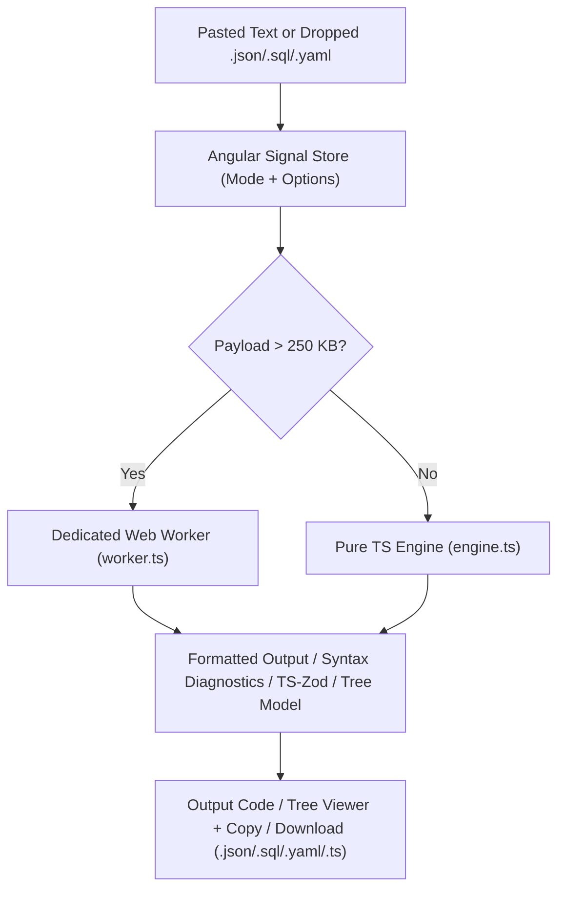

# JSON, SQL & YAML Formatter, Validator & Type Generator

# Technical Specification & Architecture Blueprint

> **Spec Number**: 114  
> **Slug**: `json-sql-formatter`  
> **Category**: `dev`  
> **Inspired By**: Coddy.tech — *JSON Formatter* + *SQL Formatter*  
> **Target SEO Keyword**: `json formatter validator sql beautifier yaml converter typescript interface generator client side`  
> **Route**: `/tools/json-sql-formatter`  
> **Architecture**: 100% Client-Side Single Page Application (Zero Server Ingestion, Zero Telemetry)

---

## 1. MVP Generation Prompt (`/create-web-micro-saas`)

```text
/create-web-micro-saas

Act as a Principal Frontend Engineer and Developer Tools Architect. Build a high-performance, 100% client-side Angular Standalone tool for PrivKnife called "JSON, SQL & YAML Formatter, Validator & Type Generator".

TECHNICAL CONSTRAINTS & STACK:
1. Pure Client-Side Architecture: Zero server requests. Proprietary API payloads, production SQL queries, database schemas, and Kubernetes/CI YAML manifests stay strictly inside local browser memory.
2. Core Technologies: Pure TypeScript JSON/YAML/SQL formatter & validator engines (or lightweight client-side `sql-formatter` + `yaml` browser bundles), Web Worker (`worker.ts`) for multi-megabyte JSON/SQL payloads.
3. Thread Safety: Offload formatting, validation, JSONPath querying, and TypeScript/Zod schema inference for payloads > 250 KB to `worker.ts` so typing stays locked at 60 FPS (Directive 3).
4. Memory Hygiene: Clear large string buffers on Reset, revoke download ObjectURLs immediately, and terminate workers on `ngOnDestroy` (Directive 4).
5. Export Deliverables: Formatted/minified `.json`, `.sql`, `.yaml`, or generated TypeScript interfaces (`.ts`) / Zod validation schemas (`.ts`), plus 1-click Copy to Clipboard.

KEY FEATURES & USER INTERACTION:
- Three Language Modes (Unified Studio):
  1. **JSON Studio**: Pretty-print (2/4 spaces or tabs), Minify, Sort Keys Alphabetically, Exact Line/Column Syntax Error Diagnostics, Interactive Collapsible Tree Viewer, JSONPath Query Evaluator (`$.users[*].email`), Convert JSON ↔ YAML, and 1-Click TypeScript Interface / Zod Schema Generator.
  2. **SQL Studio**: Multi-dialect SQL Beautifier & Minifier (`Standard SQL`, `PostgreSQL`, `MySQL`, `SQLite`, `T-SQL`, `BigQuery`), configurable Keyword Casing (`UPPERCASE` / `lowercase` / `Preserve`), Indentation style, and Logical Operator newline alignment.
  3. **YAML Studio**: Format, Validate with exact line/column error pointer, and Convert YAML ↔ JSON cleanly.
- Sample Data Loader: Instant realistic JSON, SQL, and YAML examples for rapid exploration.
- Privacy & Local Execution Assurance: Prominent trust badge reading "🛡️ 100% In-Browser • Never Leaves Your Device".
```

---

## 2. Concept Overview & Value Proposition

Developers format JSON API responses, complex SQL queries, and YAML configs dozens of times per day. Pasting production customer JSON records, internal database queries, or Kubernetes secrets into ad-heavy online formatters risks leaking confidential schemas and PII to third-party logging proxies. **JSON, SQL & YAML Formatter, Validator & Type Generator** delivers a fast, zero-telemetry developer workbench that also generates ready-to-paste TypeScript interfaces and Zod schemas locally.

### Elevator Pitch
> "Beautify, minify, validate, and query JSON, SQL, and YAML—or generate strict TypeScript interfaces and Zod schemas—instantly inside your browser with zero payloads ever touching a server."

### Core Value Drivers
1. **Zero-Trust Production Data Safety**: API tokens, customer JSON payloads, and internal SQL table schemas stay 100% local (Directive 1).
2. **Pinpoint Error Diagnostics**: Highlights exact line and column numbers for trailing commas, unquoted keys, or malformed YAML indentation.
3. **Instant JSON → TypeScript & Zod**: Eliminates tedious boilerplate by inferring nested interfaces, optional nullable fields, and array union types directly from sample JSON.
4. **Multi-Dialect SQL Formatting**: Cleanly formats CTEs (`WITH`), joins, window functions, and parameterized placeholders (`$1`, `:id`, `?`) across PostgreSQL, MySQL, SQLite, and T-SQL.

---

## 3. Technical Feasibility, Dependencies & Difficulty Score

### Difficulty Score: 4.5 / 10 (Moderate — Multi-dialect SQL tokenization, recursive TS/Zod type inference, and collapsible tree virtualization)

| Architectural Component | Implementation Technology | Installed in Repo? | Client-Side Feasibility |
|---|---|---|---|
| JSON Parse, Sort, Minify & JSONPath | Native `JSON.parse` + Pure TS JSONPath & Tree Engine | Native / Pure TS | 100% In-Browser |
| SQL Beautifier / Minifier | `sql-formatter` (lightweight zero-backend browser ESM) or Pure TS Lexer | New lightweight npm pkg (tree-shaken) | 100% In-Browser |
| YAML Parser / Serializer | `yaml` (browser ESM) or Pure TS subset | New lightweight npm pkg | 100% In-Browser |
| TypeScript & Zod Type Generator | Pure TS AST Structural Type Merger | Pure TypeScript | 100% In-Browser |
| Large Payload Worker | Dedicated Web Worker (`worker.ts`) | Native Browser API | 60 FPS on >5 MB JSON |

### Known Technical Nuances & Mitigations
- **Huge JSON Tree DOM Freeze**: Rendering 50,000 DOM nodes for a 5 MB JSON array freezes the main thread.
  - *Mitigation*: Collapse nodes beyond depth `2` by default, paginate array slices over 100 items ("Show next 100 items"), and keep raw text output in a lightweight `<pre>`/`<textarea>`.
- **Prototype Pollution on Untrusted Keys**: JSON payloads containing `"__proto__"` or `"constructor"` keys can corrupt naive JS object merging during recursive type inference.
  - *Mitigation*: Use `Object.create(null)` / `Map<string, InferredType>` throughout key sorting and TypeScript/Zod schema generation.
- **SQL String & Comment Preservation**: Never uppercase SQL keywords inside `'single-quoted string literals'` or `-- line comments` / `/* block comments */`. Ensure lexer tokenizes strings and comments strictly before casing keywords.

---

## 4. Competitive Landscape & Market Positioning

| Feature / Metric | PrivKnife (`json-sql-formatter`) | Coddy.tech / JSONLint | Online SQL Formatters |
|---|---|---|---|
| **Privacy / Zero Logging** | **100% Client-Side CSP Contained** | Browser / Analytics | Often server-logged POST |
| **JSON + SQL + YAML Unified** | **3-in-1 Studio + Converters** | Separate single-purpose pages | SQL only |
| **TypeScript & Zod Inference** | **Built-in Instant Export** | Not available | Not available |
| **JSONPath Query Evaluator** | **Live Filter Bar** | Not available | N/A |

---

## 5. Functional Requirements & Processing Algorithms

### 5.1. JSON Processing & Key Sorting
- Parse input; on `SyntaxError`, extract exact `(line, column)` offset and display a caret pointer snippet.
- Optional recursive `sortKeysAlphabetically` using `localeCompare` with safe `Map` construction.
- Support indentation (`2 spaces`, `4 spaces`, `tab`) and single-line `minify`.

### 5.2. Recursive TypeScript & Zod Schema Generator (`inferSchemaFromJson`)
1. Walk JSON values recursively producing an `InferredNode` (`string`, `number`, `boolean`, `null`, `array<T>`, `object<fields>`, `union<...>`).
2. When inspecting an array of objects, merge object schemas across all elements: keys absent in some items are marked `optional: true`; conflicting types become union types (`string | number | null`).
3. Format clean PascalCase nested `export interface Root { ... }` declarations OR `export const RootSchema = z.object({ ... })` definitions with proper identifier quoting for hyphenated keys (e.g., `"content-type": string`).

### 5.3. JSONPath Lightweight Evaluator (`evaluateJsonPath`)
- Support root `$`, dot/bracket property access (`.a.b`, `['foo-bar']`), array index (`[0]`, `[-1]`), wildcard (`[*]`, `.*`), and recursive descent (`..id`).

### 5.4. SQL Multi-Dialect Formatting
- Format clauses (`SELECT`, `FROM`, `WHERE`, `JOIN`, `GROUP BY`, `ORDER BY`, `WITH`) with configurable `keywordCase`, `indentStyle`, and dialect-specific quoting (`` ` `` for MySQL, `"` for PostgreSQL, `[...]` for T-SQL).

---

## 6. UI/UX Layout Specification (BEM Architecture)

- **Localization (`i18n`)**: Keys under `tools.jsonSqlFormatter.*` (`en`, `es`).
- **Workspace**:
  - Mode Tabs (`JSON`, `SQL`, `YAML`) + Quick Action Bar (`Format`, `Minify`, `Validate`, `Sort Keys`, `Copy`, `Download`, `Load Sample`, `Clear`).
  - Dual Split Panes (`.l-columns--2`): Left Monospace Input Editor (with line numbers & file drop support for `.json`/`.sql`/`.yaml`) and Right Multi-View Output Panel (`Formatted Code`, `Interactive Tree`, `TypeScript`, `Zod`, `YAML / JSON Convert`).
  - Inline JSONPath bar above Output when in JSON mode.

---

## 7. Technical Architecture & Client-Side Pipeline



---

## 8. Input/Output Data Contracts (TypeScript Interfaces)

```typescript
export type FormatterLanguage = 'json' | 'sql' | 'yaml';
export type SqlDialect = 'sql' | 'postgresql' | 'mysql' | 'sqlite' | 'tsql' | 'bigquery';
export type JsonOutputView = 'formatted' | 'minified' | 'tree' | 'typescript' | 'zod' | 'yaml';

export interface JsonSqlFormatterOptions {
  language: FormatterLanguage;
  indentType: '2spaces' | '4spaces' | 'tab';
  sortJsonKeys: boolean;
  jsonOutputView: JsonOutputView;
  jsonPathQuery: string;
  rootTypeName: string;
  sqlDialect: SqlDialect;
  sqlKeywordCase: 'upper' | 'lower' | 'preserve';
  sqlMinify: boolean;
  yamlOutputMode: 'yaml' | 'json';
}

export interface SyntaxDiagnostic {
  valid: boolean;
  message?: string;
  line?: number;
  column?: number;
}

export interface JsonSqlFormatterResult {
  success: boolean;
  diagnostic: SyntaxDiagnostic;
  outputText: string;
  parsedValue?: unknown;
  stats: {
    inputBytes: number;
    outputBytes: number;
    lineCount: number;
    durationMs: number;
  };
}
```

---

## 9. Security, Sandboxing & Verification Acceptance Criteria

- **Directive 1–5**: Zero network calls verified; large payload formatting offloaded to `worker.ts`; full ObjectURL and worker cleanup on `ngOnDestroy`; lazy route loading; safe `Map`-based traversal immune to `__proto__` pollution.
- **Functional Test Vectors**:
  1. Malformed JSON `{"a": 1,}` returns `diagnostic.valid === false` with exact line/column.
  2. JSON array `[{"id": 1, "name": "A"}, {"id": 2, "name": null, "tag": "x"}]` generates TypeScript interface with `id: number; name: string | null; tag?: string;` and matching Zod schema.
  3. SQL query with keyword inside string literal `select 'from where' as txt from users` uppercases SQL keywords while leaving `'from where'` untouched.
  4. Round-trip JSON → YAML → JSON preserves exact nested structures and types.
