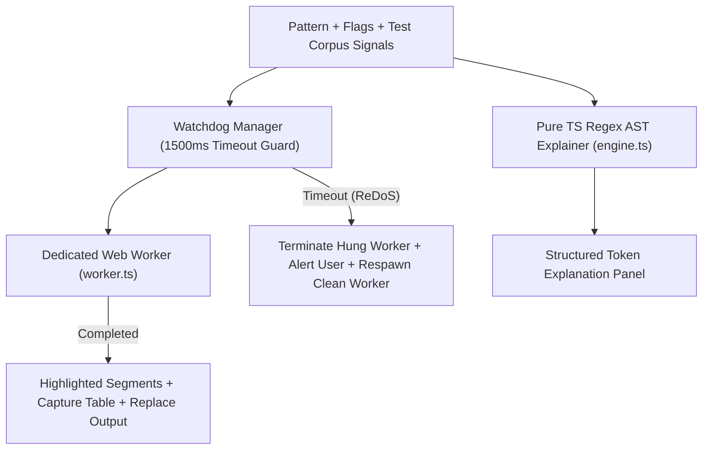

# Interactive Regex Tester, Debugger & Explainer

# Technical Specification & Architecture Blueprint

> **Spec Number**: 115  
> **Slug**: `regex-tester-debugger`  
> **Category**: `dev`  
> **Inspired By**: Coddy.tech — *Regex Tester*  
> **Target SEO Keyword**: `regex tester debugger explainer online free client side javascript regexp redos safe`  
> **Route**: `/tools/regex-tester-debugger`  
> **Architecture**: 100% Client-Side Single Page Application (Zero Server Ingestion, Zero Telemetry)

---

## 1. MVP Generation Prompt (`/create-web-micro-saas`)

```text
/create-web-micro-saas

Act as a Principal Frontend Engineer and Compilers/Developer Tools Architect. Build a high-performance, 100% client-side Angular Standalone tool for PrivKnife called "Interactive Regex Tester, Debugger & Explainer".

TECHNICAL CONSTRAINTS & STACK:
1. Pure Client-Side Architecture: Zero backend endpoints, zero telemetry. Log lines, customer data samples, and custom validation patterns stay 100% inside local browser RAM.
2. Core Technologies: Native JavaScript `RegExp` engine executed inside an isolated, **timeout-protected Web Worker (`worker.ts`)** (prevents catastrophic backtracking / ReDoS from freezing the browser tab!), plus a pure TypeScript Regex Tokenizer & Human-Readable AST Explainer.
3. Thread Safety & ReDoS Protection: Execute all regex matching and substitution inside `worker.ts` with a configurable execution watchdog timeout (default `1500ms`). If catastrophic backtracking occurs, terminate the hung worker automatically, spawn a fresh worker, and warn the user with a ReDoS diagnostic alert (Directive 3).
4. Memory Hygiene: Terminate workers on watchdog timeout, Reset, and `ngOnDestroy`; revoke exported snippet/test-report ObjectURLs immediately (Directive 4).
5. Export Deliverables: Copy-ready code snippets (`JavaScript`, `TypeScript`, `Python`, `Go`, `Java`), Replace preview output (`.txt`), and Match extraction export (`.json` / `.csv`).

KEY FEATURES & USER INTERACTION:
- Live Pattern & Flags Bar: Monospace `/pattern/flags` input with interactive toggle pills for `g` (global), `i` (ignoreCase), `m` (multiline), `s` (dotAll), `u` (unicode), and `d` (indices).
- Real-Time Highlighted Test Corpus: Color-coded match spans (alternating subtle accents for adjacent matches) + hover tooltips showing match index, byte offset `[start..end]`, and captured groups.
- Capture Group & Named Group Inspector: Structured table listing every match, numbered groups (`$1`, `$2`), and named groups (`(?<year>\d{4})`).
- Live Replace / Substitution Tab: Supports `$1`, `$<name>`, `$&`, and `$$` replacement tokens with instant live diff/output preview.
- Token-by-Token Plain-English/Spanish Explainer: Pure-TS Regex AST tokenizer that explains every quantifier, character class, lookahead/lookbehind, anchor, and backreference cleanly.
- Built-in Curated Cheat Sheet & Pattern Library: One-click loadable patterns (ISO Date, Email RFC subset, IPv4/IPv6, Semantic Version, JWT, Hex Color, Credit Card Luhn format, URL).
- Privacy & Local Execution Assurance: Prominent trust badge reading "🛡️ 100% In-Browser • Never Leaves Your Device".
```

---

## 2. Concept Overview & Value Proposition

Developers routinely test regular expressions against real server logs, customer emails, API keys, or production text snippets. Pasting sensitive logs into cloud regex testers risks leaking PII to analytics or accidental "Save & Share" public URLs. Even worse, testing an unoptimized nested quantifier like `(a+)+$` in naive main-thread regex testers freezes the entire browser tab! **Interactive Regex Tester, Debugger & Explainer** combines zero-upload privacy, automatic Web Worker ReDoS timeout protection, token-by-token explanation, and multi-language code export.

### Elevator Pitch
> "Write, debug, explain, and test regular expressions against real logs privately in your browser—with built-in ReDoS freeze protection, capture-group inspection, live replacement, and multi-language code generation."

### Core Value Drivers
1. **Zero-Trust Log Privacy**: Never accidentally upload or share sensitive server logs or PII strings.
2. **Browser Freeze Immunity (ReDoS Guard)**: Catastrophic backtracking patterns are terminated safely inside a watchdog-monitored Web Worker after 1.5s without hanging the UI.
3. **Educational Token Explainer**: Breaks down cryptic patterns (`(?<=@)[a-z0-9.-]+`) into clear, hierarchical English/Spanish explanations.
4. **Actionable Match Extraction**: Export all matched values and capture groups straight to `.json` or `.csv`, or copy ready-to-paste code in JS/TS/Python/Go.

---

## 3. Technical Feasibility, Dependencies & Difficulty Score

### Difficulty Score: 5.0 / 10 (Moderate — Watchdog-guarded Web Worker pool for ReDoS termination, zero-length match loop guard, and pure-TS Regex AST explainer)

| Architectural Component | Implementation Technology | Installed in Repo? | Client-Side Feasibility |
|---|---|---|---|
| Regex Execution & Replace | Native `RegExp` inside Watchdog Web Worker | Native Browser API | 100% In-Browser (ReDoS-safe) |
| Pattern Tokenizer & AST Explainer | Pure TypeScript Recursive-Descent Parser | Pure TypeScript | 100% In-Browser |
| Highlighted Text Overlay | Pure Angular `@for` segment renderer (zero `innerHTML` XSS risk!) | Angular Signals | 60 FPS |
| Code Snippet Generator | Pure TS Formatter (JS, TS, Python, Go, Java) | Pure TypeScript | 100% In-Browser |

### Known Technical Nuances & Mitigations
- **Infinite Loop on Zero-Length Matches**: A pattern like `a*` or `^` with the `g` flag matches empty strings at the same `lastIndex` infinitely if not incremented.
  - *Mitigation*: Explicitly check `if (match[0].length === 0) regex.lastIndex++` and cap total recorded match objects at `maxMatches = 10_000` with a clear truncation badge.
- **XSS Safety in Highlighted Text**: Rendering highlighted match spans via `[innerHTML]` on arbitrary user text is an XSS hazard.
  - *Mitigation*: Partition the corpus into an array of typed text segments `{ text: string; matchIndex: number | null; groupIndex?: number }` and render via Angular `@for` template interpolation (`{{ seg.text }}`)—100% immune to HTML injection!
- **Flag Compatibility**: Flag `d` (`hasIndices`) is standard in modern browsers; guard with feature detection cleanly.

---

## 4. Competitive Landscape & Market Positioning

| Feature / Metric | PrivKnife (`regex-tester-debugger`) | Coddy.tech / Regex101 | IDE Search Bar |
|---|---|---|---|
| **Privacy / Zero Cloud Share** | **100% Client-Side, Zero Tracking** | Web / Analytics / Public Links | Local |
| **ReDoS Watchdog Worker Protection** | **Auto-Terminates Hung Patterns** | Can freeze tab on main thread | Varies |
| **Token-by-Token Explainer** | **EN + ES Localized AST Explainer** | English only | None |
| **Match Table Export (`.csv`/`.json`)** | **Built-in 1-Click** | Limited | None |

---

## 5. Functional Requirements & Processing Algorithms

### 5.1. Watchdog-Protected Match & Replace Engine (`worker.ts`)
1. Receive `{ requestId, pattern, flags, testString, replacement, runReplace, maxMatches }`.
2. Compile `new RegExp(pattern, flags)`; return exact `SyntaxError.message` on invalid syntax.
3. Execute bounded `exec()` loop recording `{ index, endIndex, fullMatch, groups: string[], namedGroups: Record<string, string> }` and measuring `executionMs = performance.now() - t0`.
4. If `runReplace: true`, run `testString.replace(regex, replacement)`.
5. On main thread, arm a `setTimeout(..., timeoutMs)` watchdog per request: if no response arrives within `1500ms`, call `worker.terminate()`, instantiate a fresh worker, and return `{ timedOut: true, redosWarning: true }`.

### 5.2. Pure-TS Regex AST Explainer (`explainRegexPattern`)
- Tokenize pattern handling:
  - Character classes `[a-z0-9_]` & negated classes `[^...]`
  - Escaped shorthands (`\d`, `\D`, `\w`, `\W`, `\s`, `\S`, `\b`, `\B`, `\n`, `\t`, `\u{...}`)
  - Anchors (`^`, `$`), Alternation (`|`), Wildcard (`.`)
  - Groups: Capturing `(...)`, Non-capturing `(?:...)`, Named `(?<name>...)`, Lookahead `(?=...)` / `(?!...)`, Lookbehind `(?<=...)` / `(?<!...)`
  - Quantifiers (`*`, `+`, `?`, `{n}`, `{n,}`, `{n,m}`) + lazy modifier (`*?`, `+?`)
  - Backreferences (`\1`, `\k<name>`)
- Output structured `RegexExplanationNode[]` with token span, category badge, and human-readable description.

### 5.3. Multi-Language Code Generator (`generateRegexCode`)
- Properly escape pattern delimiters and flags for **JavaScript**, **TypeScript**, **Python (`re.compile(r"...", ...)`)**, **Go (`regexp.MustCompile(...)`)**, and **Java (`Pattern.compile(...)`)**.

---

## 6. UI/UX Layout Specification (BEM Architecture)

- **Localization (`i18n`)**: Keys under `tools.regexTesterDebugger.*` (`en`, `es`).
- **Layout**:
  - Top Pattern Bar: `/` `[ pattern input ]` `/` `[ flag toggle buttons: g i m s u ]` + Execution time badge (`0.4 ms • 6 matches`).
  - Left Column: Test String textarea with live highlighted match preview + optional Replace input & live substituted result.
  - Right Column: Tabbed Inspector (`Explanation AST`, `Match & Groups Table`, `Code Generator`, `Pattern Library & Cheat Sheet`).

---

## 7. Technical Architecture & Client-Side Pipeline



---

## 8. Input/Output Data Contracts (TypeScript Interfaces)

```typescript
export interface RegexFlagsConfig {
  global: boolean;
  ignoreCase: boolean;
  multiline: boolean;
  dotAll: boolean;
  unicode: boolean;
}

export interface RegexMatchEntry {
  matchNumber: number;
  start: number;
  end: number;
  value: string;
  groups: Array<string | undefined>;
  namedGroups: Record<string, string | undefined>;
}

export interface RegexExplanationToken {
  raw: string;
  start: number;
  end: number;
  category: 'anchor' | 'quantifier' | 'group' | 'char_class' | 'escape' | 'literal' | 'alternation';
  description: string;
  children?: RegexExplanationToken[];
}

export interface RegexTesterOptions {
  pattern: string;
  flags: RegexFlagsConfig;
  testString: string;
  replacement: string;
  runReplace: boolean;
  timeoutMs: number;
  maxMatches: number;
}

export interface RegexTesterResult {
  valid: boolean;
  syntaxError?: string;
  timedOut: boolean;
  truncated: boolean;
  matches: RegexMatchEntry[];
  replacedText?: string;
  explanation: RegexExplanationToken[];
  executionMs: number;
}
```

---

## 9. Security, Sandboxing & Verification Acceptance Criteria

- **Directive 1–5**: Zero network calls; ReDoS-protected worker; zero `[innerHTML]` rendering on untrusted test corpus (strict Angular text interpolation); worker terminated on Reset and `ngOnDestroy`; lazy route loading.
- **Functional Test Vectors**:
  1. Named capture group `(?<year>\d{4})-(?<month>\d{2})-(?<day>\d{2})` against `"Dates: 2026-11-19 and 2027-01-05"` extracts 2 matches with exact `namedGroups` and indices.
  2. Zero-length pattern `a*` with `g` flag against `"bbb"` terminates cleanly without hanging.
  3. Known ReDoS pattern `(a+)+$` against `"aaaaaaaaaaaaaaaaaaaaaaaaaaaa!"` triggers the watchdog timeout (`timedOut: true`), terminates the hung worker, and allows subsequent valid patterns to run immediately on a fresh worker.
  4. Pattern explainer accurately decomposes lookbehind + named group + lazy quantifier tokens.
