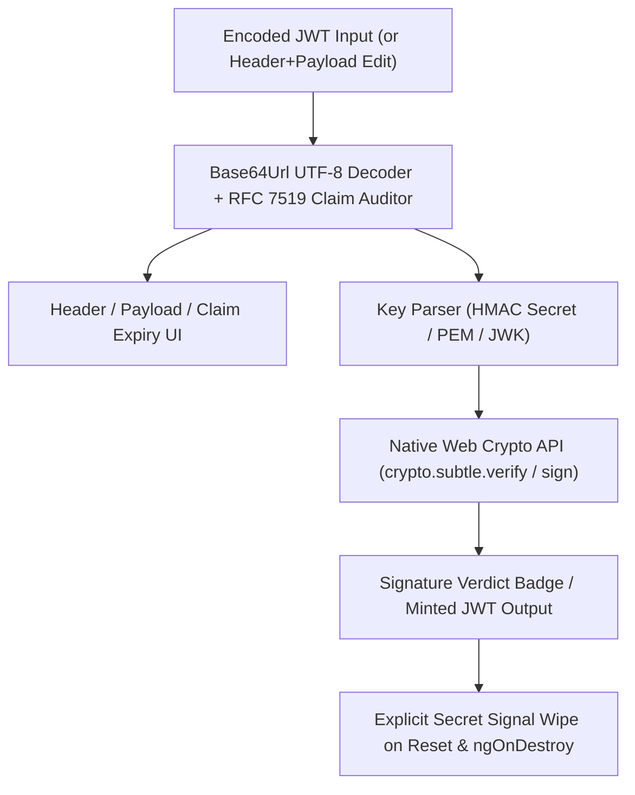

# JWT Debugger, Signature Verifier & Token Minting Studio

# Technical Specification & Architecture Blueprint

> **Spec Number**: 116  
> **Slug**: `jwt-debugger-studio`  
> **Category**: `dev`  
> **Inspired By**: Coddy.tech — *JWT Decoder*  
> **Target SEO Keyword**: `jwt decoder verifier debugger online free client side hs256 rs256 es256 no upload`  
> **Route**: `/tools/jwt-debugger-studio`  
> **Architecture**: 100% Client-Side Single Page Application (Zero Server Ingestion, Zero Telemetry)

---

## 1. MVP Generation Prompt (`/create-web-micro-saas`)

```text
/create-web-micro-saas

Act as a Principal Frontend Security Engineer. Build a high-performance, 100% client-side Angular Standalone tool for PrivKnife called "JWT Debugger, Signature Verifier & Token Minting Studio".

TECHNICAL CONSTRAINTS & STACK:
1. Pure Client-Side Architecture: Zero network calls, zero telemetry, zero remote JWKS fetches by default. Production OAuth/OIDC Bearer tokens, HMAC signing secrets, and RSA/ECDSA private/public keys MUST NEVER leave ephemeral browser RAM.
2. Core Technologies: Native Web Crypto API (`window.crypto.subtle`) for standards-compliant cryptographic signature verification & minting (`HS256`, `HS384`, `HS512`, `RS256`, `RS384`, `RS512`, `ES256`, `ES384`, `PS256`), plus pure TypeScript Base64Url and PEM/JWK key parsers (zero heavy crypto polyfills!).
3. Thread Safety & Memory Hygiene: Never write JWTs or signing secrets to `localStorage`, `sessionStorage`, or URL hashes; clear all secret/key Signals on Reset and `ngOnDestroy` (Directives 1, 2 & 4).
4. Export Deliverables: Verified/minted JWT string, decoded Header/Payload `.json`, and copy-ready `Authorization: Bearer <token>` / `curl` snippet.

KEY FEATURES & USER INTERACTION:
- Color-Coded 3-Part JWT Inspector: Visualizes `<Header>.<Payload>.<Signature>` in distinct accessible hues (Red/Purple/Teal) with live syntax-validated JSON editors.
- Standard Claim Intelligence: Automatically annotates RFC 7519 registered claims (`exp`, `iat`, `nbf`, `iss`, `sub`, `aud`, `jti`) with human-readable local & UTC dates, live expiration countdown (`Expired 2h 14m ago` or `Valid for 45m 12s`), and security warnings (e.g., `alg: "none"` vulnerability alert, missing `exp` claim warning).
- Real Local Cryptographic Verification:
  - HMAC (`HS256`/`384`/`512`): Enter UTF-8 secret or toggle "Secret is Base64/Base64Url encoded".
  - Asymmetric (`RS256`/`384`/`512`, `PS256`, `ES256`/`384`): Paste PEM public key (`-----BEGIN PUBLIC KEY-----`) OR raw JWK JSON directly to verify signature cryptographically via `crypto.subtle.verify()`.
- Token Minting / Signing Mode: Edit Header & Payload JSON, supply an HMAC secret or PKCS#8 private key (or click "Generate Ephemeral Dev Keypair" via `crypto.subtle.generateKey`), and sign a valid test JWT locally for development/testing!
- Privacy & Local Execution Assurance: Prominent trust badge reading "🛡️ 100% In-Browser • Never Leaves Your Device".
```

---

## 2. Concept Overview & Value Proposition

Pasting a live production JWT or HMAC signing secret into an unknown online JWT decoder is one of the most frequent accidental credential leaks in software engineering—many web decoders run analytics scripts, session replay tools, or server-side endpoints. **JWT Debugger, Signature Verifier & Token Minting Studio** leverages the browser's native **Web Crypto API** under PrivKnife's strict CSP (`connect-src 'self' blob: data:`) so developers can decode, cryptographically verify, and mint tokens with mathematical certainty that zero secrets leave their browser.

### Elevator Pitch
> "Decode, inspect, cryptographically verify (`HS256`/`RS256`/`ES256`), and mint JWT tokens using your browser's native Web Crypto engine—with zero secrets ever leaving RAM."

### Core Value Drivers
1. **Zero-Leak Security Guarantee**: No analytics, no session replay, no `localStorage` persistence, and strict CSP blocking outbound requests.
2. **Real Signature Verification**: Supports HMAC secrets, SPKI PEM public keys, and JWK JSON keys natively via `crypto.subtle`.
3. **Proactive Security Warnings**: Immediately flags insecure `"alg": "none"` tokens, expired `exp` / premature `nbf` claims, and malformed Base64Url padding.
4. **Built-In Dev Keypair Generator**: Generate fresh ephemeral RSA-2048 or ECDSA P-256 test keypairs (PEM + JWK) locally to mint mock JWTs for local API testing.

---

## 3. Technical Feasibility, Dependencies & Difficulty Score

### Difficulty Score: 5.0 / 10 (Moderate — Base64Url UTF-8 handling, PEM SPKI/PKCS#8 DER decoding, and ECDSA raw-R||S signature format for Web Crypto)

| Architectural Component | Implementation Technology | Installed in Repo? | Client-Side Feasibility |
|---|---|---|---|
| Cryptographic Sign & Verify | Native Web Crypto API (`crypto.subtle`) | Native Browser API | 100% In-Browser |
| Base64Url + UTF-8 Codec | Pure TS `TextEncoder`/`TextDecoder` + RFC 4648 §5 | Pure TypeScript | 100% In-Browser |
| PEM ↔ ArrayBuffer & JWK Importer | Pure TS PEM strip + `crypto.subtle.importKey` | Pure TypeScript | 100% In-Browser |
| Ephemeral Keypair Generator | `crypto.subtle.generateKey` + `exportKey` | Native Browser API | 100% In-Browser |

### Known Technical Nuances & Mitigations
- **Web Crypto ECDSA Signature Format**: RFC 7518 JWS uses concatenated raw `(R || S)` big-endian bytes for `ES256` (64 bytes) / `ES384` (96 bytes), which matches Web Crypto `ECDSA` `sign`/`verify` output directly—no ASN.1 conversion needed! Verify exact byte lengths and surface clean errors on truncated signatures.
- **Unicode in JWT Payloads**: Naive `atob()` corrupts multi-byte UTF-8 names (e.g., `"José García"`, `"東京"`).
  - *Mitigation*: Always decode Base64Url bytes into `Uint8Array` and pass through `new TextDecoder('utf-8', { fatal: true })`, and encode with `new TextEncoder()`.
- **Whitespace / `"Bearer "` Prefix**: Developers routinely paste `"Bearer eyJhbG..."` copied straight from DevTools Network headers. Automatically strip leading `"Bearer "` prefix and surrounding whitespace seamlessly!

---

## 4. Competitive Landscape & Market Positioning

| Feature / Metric | PrivKnife (`jwt-debugger-studio`) | Coddy.tech JWT Decoder | jwt.io |
|---|---|---|---|
| **Zero Analytics / Zero Telemetry** | **Guaranteed (Directive 2)** | Standard web analytics | Auth0/Okta telemetry |
| **Verify RS256 / ES256 / PS256 Locally** | **Native Web Crypto (PEM + JWK)** | Decode only | Supported |
| **1-Click Ephemeral Test Keypair Mint** | **Built-in Local Generator** | Not available | Manual external OpenSSL |
| **Security Audit Warnings (`alg:none`)** | **Automatic Risk Badges** | None | Basic |

---

## 5. Functional Requirements & Processing Algorithms

### 5.1. JWT Decoding & Claim Audit (`decodeJwt`)
1. Strip optional `"Bearer "` prefix and trim whitespace.
2. Split on `.` — validate exactly 3 segments (`headerB64`, `payloadB64`, `signatureB64`).
3. Decode `header` and `payload` JSON via UTF-8 safe Base64Url decoder.
4. Run Claim & Security Audit:
   - Flag `alg === 'none'` as **Critical Security Warning**.
   - Evaluate `exp` (Expired / Valid + relative delta), `nbf` (Not Yet Valid if `now < nbf`), and `iat` (Issued At).
   - Detect non-standard clock skew (`iat > now + 300`).

### 5.2. Signature Verification (`verifyJwtSignature`)
- Supported algorithms mapped cleanly to Web Crypto params:
  - `HS256` / `HS384` / `HS512` → `{ name: 'HMAC', hash: 'SHA-256|384|512' }`
  - `RS256` / `RS384` / `RS512` → `{ name: 'RSASSA-PKCS1-v1_5', hash: 'SHA-256|384|512' }`
  - `PS256` → `{ name: 'RSA-PSS', hash: 'SHA-256', saltLength: 32 }`
  - `ES256` / `ES384` → `{ name: 'ECDSA', namedCurve: 'P-256|P-384', hash: 'SHA-256|384' }`
- Signing input bytes: `new TextEncoder().encode(headerB64 + '.' + payloadB64)`.
- Import key from raw HMAC string/Base64, PEM SPKI (`-----BEGIN PUBLIC KEY-----`), or JWK JSON object, then call `crypto.subtle.verify(...)`.

### 5.3. Local Token Minting (`mintJwt`)
- Accept editable Header JSON, Payload JSON (with quick buttons like `+15m exp`, `+1h exp`, `+24h exp`, `Set iat=now`, `Generate jti UUID`), and HMAC secret or PKCS#8 private key.
- Sign via `crypto.subtle.sign(...)` and output canonical `<headerB64>.<payloadB64>.<signatureB64>`.

---

## 6. UI/UX Layout Specification (BEM Architecture)

- **Localization (`i18n`)**: Keys under `tools.jwtDebuggerStudio.*` (`en`, `es`).
- **Two-Column Workspace**:
  - **Left Column**: Color-highlighted Encoded JWT textarea + Status Banner (`Valid Signature` / `Invalid Signature` / `Unverified — Enter Key` / `Expired`) + Quick Actions (`Copy Token`, `Copy Bearer Header`, `Load Sample HS256/RS256`, `Clear All Secrets`).
  - **Right Column**: Stacked cards for **Header**, **Payload & Claim Timestamps Table**, and **Signature Verification / Minting Key Panel** (with Ephemeral Keypair Generator button).

---

## 7. Technical Architecture & Client-Side Pipeline



---

## 8. Input/Output Data Contracts (TypeScript Interfaces)

```typescript
export type SupportedJwtAlgorithm =
  | 'HS256' | 'HS384' | 'HS512'
  | 'RS256' | 'RS384' | 'RS512'
  | 'PS256' | 'ES256' | 'ES384';

export type KeyInputFormat = 'hmac_utf8' | 'hmac_base64url' | 'pem' | 'jwk';

export interface JwtClaimAnnotation {
  claim: string;
  labelKey: string;
  rawValue: unknown;
  formattedValue: string;
  status?: 'valid' | 'expired' | 'not_yet_valid' | 'warning';
}

export interface DecodedJwtResult {
  validStructure: boolean;
  headerRaw: string;
  payloadRaw: string;
  signatureRaw: string;
  header?: Record<string, unknown>;
  payload?: Record<string, unknown>;
  algorithm?: string;
  claims: JwtClaimAnnotation[];
  securityWarnings: string[];
  error?: string;
}

export interface JwtVerificationResult {
  verified: boolean;
  status: 'valid' | 'invalid' | 'missing_key' | 'unsupported_alg' | 'key_error';
  algorithm: string;
  error?: string;
}
```

---

## 9. Security, Sandboxing & Verification Acceptance Criteria

- **Directive 1 & 2**: Zero network calls (`fetch`/`XHR` call count === 0); verify zero writes to `localStorage`/`sessionStorage`.
- **Directive 4**: Verify all secret, key, and token Signals are reset to `''` on Reset and `ngOnDestroy`.
- **Directive 5**: Lazy-loaded via `loadComponent`.
- **Functional Test Vectors**:
  1. Known RFC 7519 `HS256` vector verifies `true` with exact secret and `false` when a single payload character or secret byte is altered.
  2. Ephemeral `ES256` and `RS256` keypairs generated via `crypto.subtle.generateKey` mint a token that passes `verifyJwtSignature` with the corresponding public PEM/JWK.
  3. UTF-8 payload (`{"name": "Sofía Müller 🚀"}`) round-trips without mojibake.
  4. Token with `"alg": "none"` triggers a prominent security warning and NEVER reports `verified: true`.
