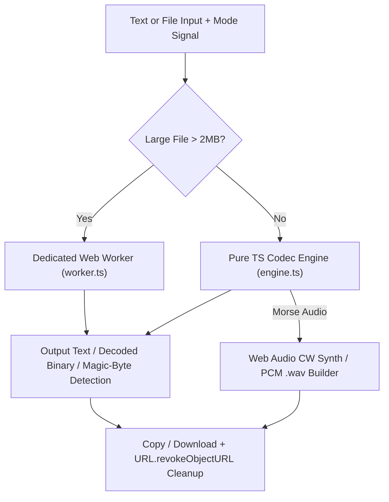

# Universal Encoder / Decoder Workbench (Base64, URL, Hex, Binary & Morse)

# Technical Specification & Architecture Blueprint

> **Spec Number**: 117  
> **Slug**: `encoder-decoder-workbench`  
> **Category**: `dev`  
> **Inspired By**: Coddy.tech — *Base64 Encoder/Decoder* + *URL Encoder/Decoder* + *Binary Translator* + *Morse Code Translator*  
> **Target SEO Keyword**: `base64 encoder decoder url encode hex binary morse code translator client side`  
> **Route**: `/tools/encoder-decoder-workbench`  
> **Architecture**: 100% Client-Side Single Page Application (Zero Server Ingestion, Zero Telemetry)

---

## 1. MVP Generation Prompt (`/create-web-micro-saas`)

```text
/create-web-micro-saas

Act as a Principal Frontend Engineer and Developer Tools Architect. Build a high-performance, 100% client-side Angular Standalone tool for PrivKnife called "Universal Encoder / Decoder Workbench".

TECHNICAL CONSTRAINTS & STACK:
1. Pure Client-Side Architecture: Zero backend endpoints, zero telemetry. Basic Auth credentials, Base64 API keys, binary blobs, and callback URLs stay strictly in local browser RAM.
2. Core Technologies: Native `TextEncoder` / `TextDecoder`, RFC 4648 Base64 & Base64Url codec, `URL` / `URLSearchParams`, pure TypeScript Hex/Binary/HTML-Entity/Morse codecs, and native Web Audio API (`AudioContext` + `OscillatorNode`) for real-time Morse Code CW audio playback!
3. Thread Safety: Offload large file-to-Base64 / Base64-to-Binary conversions (> 2 MB) to a Web Worker (`worker.ts`) to maintain 60 FPS responsiveness (Directive 3).
4. Memory Hygiene: Close `AudioContext` on stop and `ngOnDestroy`, revoke file download/preview ObjectURLs immediately, and terminate workers cleanly (Directive 4).
5. Export Deliverables: Copy-ready encoded/decoded text, Data URI (`data:image/png;base64,...`), decoded binary file download (auto-detecting MIME magic bytes like PNG/JPG/PDF/ZIP!), and downloadable Morse CW `.wav` audio file.

KEY FEATURES & USER INTERACTION:
- 6 Focused Encoding Modes (Instant Bidirectional Encode ↔ Decode + "Swap Input/Output" button):
  1. **Base64 / Base64Url**: Standard RFC 4648, URL-safe (`-_`, optional padding strip), MIME 76-char line wrap, plus **File ↔ Base64 / Data URI** dropzone with magic-byte preview when decoding Base64 back to an image or PDF!
  2. **URL & Query String Inspector**: `encodeURIComponent` vs `encodeURI`, plus an interactive **Query Parameter Key/Value Table** where developers can edit, add, or delete URL parameters and copy the rebuilt URL cleanly.
  3. **HTML Entities & Unicode Escapes**: Encode/decode named & numeric HTML entities (`&amp;`, `&#x1F680;`) and JS/JSON `\uXXXX` / `\u{XXXXX}` escapes.
  4. **Hexadecimal & Byte Inspector**: UTF-8 text ↔ Hex (`48 65 6C 6C 6F`, `0x48`, `\x48`, continuous) with live byte-count display.
  5. **Binary / Octal / Decimal Translator**: UTF-8 text ↔ 8-bit space-separated binary (`01001000 ...`), Octal, or ASCII decimal codes.
  6. **International Morse Code Translator + Audio Synth**: Bidirectional text ↔ ITU Morse (`.- / -...`) with live Web Audio CW tone player (configurable WPM speed `5–35 WPM` and pitch `400–900 Hz`) and downloadable `.wav` export!
- Privacy & Local Execution Assurance: Prominent trust badge reading "🛡️ 100% In-Browser • Never Leaves Your Device".
```

---

## 2. Concept Overview & Value Proposition

Every developer bookmarks half a dozen single-purpose encoder websites (Base64, URL decode, HTML entities, Hex, Binary, Morse) that are littered with ads, popups, and server-side logging. Worse, developers frequently Base64-encode Basic Auth credentials (`user:pass`) or decode sensitive OAuth callback URLs containing access codes. **Universal Encoder / Decoder Workbench** unifies all six encoding tools into one blazing-fast, zero-upload Angular workbench with genuinely useful upgrades like interactive URL query-parameter editing, Base64 file magic-byte detection, and Web Audio Morse playback.

### Elevator Pitch
> "Encode and decode Base64, files/Data URIs, URL query strings, HTML entities, Hex, Binary, and playable Morse code—100% locally in your browser with zero credential leaks."

### Core Value Drivers
1. **Zero-Trust Credential Safety**: Basic Auth tokens, webhook URLs, and Base64 certificates stay completely inside client memory.
2. **UTF-8 & Emoji Safe**: Proper `Uint8Array` `TextEncoder`/`TextDecoder` pipelines avoid the classic `btoa()` `InvalidCharacterError` crash on Unicode strings.
3. **Smart Binary & URL Ergonomics**: Visually inspect/edit URL query parameters as a table, and auto-detect PNG/JPEG/PDF/WebP magic bytes when decoding raw Base64 strings.
4. **Playable & Exportable Morse CW**: Synthesizes clean envelope-shaped sine-wave Morse audio (zero click artifacts!) right in the browser with `.wav` download.

---

## 3. Technical Feasibility, Dependencies & Difficulty Score

### Difficulty Score: 3.5 / 10 (Low-Moderate — Pure TypeScript RFC-compliant codecs, magic-byte sniffing, and Web Audio Morse synthesis)

| Architectural Component | Implementation Technology | Installed in Repo? | Client-Side Feasibility |
|---|---|---|---|
| Base64 / Base64Url / Hex / Binary / Entities | Pure TS + Native `TextEncoder`/`TextDecoder` | Native Browser API | 100% In-Browser (0 extra deps) |
| URL & Query Parameter Table | Native `URL` & `URLSearchParams` | Native Browser API | 100% In-Browser |
| Morse CW Audio Playback & WAV Export | Web Audio API + Pure TS PCM WAV Encoder | Native Browser API | 100% In-Browser |
| Large File Base64 Worker | Dedicated Web Worker (`worker.ts`) | Native Browser API | 60 FPS for multi-MB files |

### Known Technical Nuances & Mitigations
- **Huge Base64 String Memory Spikes**: Converting a 25 MB file to Base64 generates a ~33 MB string.
  - *Mitigation*: Cap live textarea rendering at 1 MB (show truncated preview + full Copy/Download buttons) and process file chunks in `worker.ts` to avoid UI stalls.
- **Audio Pop/Click Artifacts in Morse Synth**: Hard-switching an oscillator gain from `0` to `1` causes audible clicks.
  - *Mitigation*: Apply a 5ms cosine/linear ramp (`linearRampToValueAtTime`) on every dot/dash onset and release, both in live `AudioContext` playback and offline `.wav` synthesis.
- **Malformed Input Feedback**: Invalid Base64 padding, truncated percent-encoding (`%E0%A4%A`), or non-binary characters should surface exact inline validation messages without throwing unhandled errors.

---

## 4. Competitive Landscape & Market Positioning

| Feature / Metric | PrivKnife (`encoder-decoder-workbench`) | Coddy.tech (4 Separate Tools) | CyberChef |
|---|---|---|---|
| **All-in-One Speed & Simplicity** | **6 Modes in 1 Clean UI** | 4 Separate Pages | Steep learning curve |
| **File ↔ Base64 + Magic-Byte Preview** | **Built-in Dropzone + Auto-MIME** | Text only | Manual recipe |
| **Interactive URL Query Table** | **Visual Key/Value Editor** | Raw string only | Raw string |
| **Morse Audio Playback + WAV Export** | **Built-in Web Audio Synth** | Text only | Text only |

---

## 5. Functional Requirements & Processing Algorithms

### 5.1. Base64 & File Data URI Codec
- UTF-8 encode/decode supporting standard (`+/=`), URL-safe (`-_`, optional omit `=`), and optional 76-column MIME line wrapping.
- When decoding Base64, strip optional `data:<mime>;base64,` prefix and sniff first 12 bytes for common signatures (`%PDF-`, PNG `89 50 4E 47`, JPEG `FF D8 FF`, GIF, WebP, ZIP `50 4B 03 04`) to offer instant "Download Decoded File (`.png`/`.pdf`/`.bin`)".

### 5.2. URL & Query String Workbench
- Support `encodeURIComponent`, `encodeURI`, and `application/x-www-form-urlencoded` (`+` for spaces).
- When a valid URL with query parameters is pasted, parse `protocol`, `host`, `pathname`, `hash`, and `searchParams[]` into an editable grid that bi-directionally synchronizes with the URL string.

### 5.3. Hex, Binary & HTML Entities
- **Hex**: Select delimiter (`space`, `none`, `0x`, `\x`, `:`) and case (`UPPER` / `lower`).
- **Binary**: 8-bit zero-padded binary octets per UTF-8 byte; tolerant decoder strips spaces/newlines and validates multiples of 8 bits.
- **HTML Entities**: Safe lookup table for common named entities (`&amp;`, `&lt;`, `&gt;`, `&quot;`, `&#39;`, `&nbsp;`, `&copy;`) plus numeric `&#DDD;` / `&#xHHH;` decoding WITHOUT using `innerHTML` (preventing accidental XSS!).

### 5.4. ITU Morse Code & CW Audio Engine
- Support A–Z, 0–9, and standard punctuation (`. , ? ' ! / ( ) & : ; = + - _ " $ @`).
- Standard PARIS timing unit: `dotMs = 1200 / wpm`, `dash = 3*dot`, intra-char gap = `1*dot`, letter gap = `3*dot`, word gap = `7*dot`.
- Synthesize both live `AudioContext` playback (with Stop button & progress bar) and 16-bit mono PCM `.wav` Blob export.

---

## 6. UI/UX Layout Specification (BEM Architecture)

- **Localization (`i18n`)**: Keys under `tools.encoderDecoderWorkbench.*` (`en`, `es`).
- **Layout**:
  - Top Mode Selector Pills (`Base64`, `URL`, `HTML / Unicode`, `Hex`, `Binary`, `Morse`).
  - Bidirectional Direction Toggle (`Encode` / `Decode`) + `Swap ⇄` button + Mode-specific mini-options bar.
  - Responsive 2-column Input / Output editors (`.l-columns--2`) with live byte/character counter badges and 1-click Copy / Download buttons.

---

## 7. Technical Architecture & Client-Side Pipeline



---

## 8. Input/Output Data Contracts (TypeScript Interfaces)

```typescript
export type CodecMode = 'base64' | 'url' | 'html_unicode' | 'hex' | 'binary' | 'morse';
export type CodecDirection = 'encode' | 'decode';

export interface EncoderWorkbenchOptions {
  mode: CodecMode;
  direction: CodecDirection;
  base64UrlSafe: boolean;
  base64OmitPadding: boolean;
  base64Wrap76: boolean;
  urlMode: 'component' | 'full_uri' | 'form_plus';
  hexDelimiter: 'space' | 'none' | 'colon' | '0x' | 'backslash_x';
  hexUppercase: boolean;
  htmlEncodeMode: 'minimal' | 'all_non_ascii' | 'js_unicode';
  morseWpm: number;           // 5..35
  morseFrequencyHz: number;   // 400..900
}

export interface DetectedBinaryInfo {
  mimeType: string;
  extension: string;
  byteLength: number;
}

export interface EncoderWorkbenchResult {
  success: boolean;
  outputText: string;
  inputBytes: number;
  outputBytes: number;
  detectedBinary?: DetectedBinaryInfo;
  decodedBytes?: Uint8Array;
  parsedUrlParams?: Array<{ key: string; value: string }>;
  error?: string;
}
```

---

## 9. Security, Sandboxing & Verification Acceptance Criteria

- **Directive 1–5**: Zero network calls; HTML entity decoding implemented purely in TypeScript (NEVER assigns untrusted strings to `innerHTML`); `AudioContext.close()` and `URL.revokeObjectURL()` verified in `ngOnDestroy`; lazy route loading.
- **Functional Test Vectors**:
  1. Base64 UTF-8 round-trip of `"PrivKnife 🔐 Español 日本語"` matches exact RFC 4648 bytes in both Standard and Base64Url modes.
  2. Decoding a Base64-encoded PNG header (`iVBORw0KGgo...`) auto-detects `{ mimeType: 'image/png', extension: 'png' }`.
  3. URL parser decomposes `https://example.com/search?q=hello%20world&tag=a&tag=b` into editable key/value pairs and reconstructs cleanly.
  4. Morse encoder translates `"SOS 2026"` → `"... --- ... / ..--- ----- ..--- -...."` and generates a valid RIFF `WAVE` Blob with non-zero duration.
