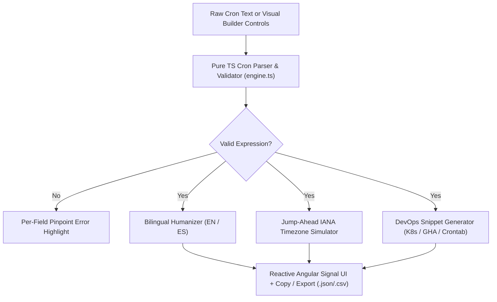

# Cron Expression Builder, Human Explainer & Schedule Simulator

# Technical Specification & Architecture Blueprint

> **Spec Number**: 118  
> **Slug**: `cron-expression-studio`  
> **Category**: `dev`  
> **Inspired By**: Coddy.tech — *Cron Expression Generator / Parser*  
> **Target SEO Keyword**: `cron expression generator parser explainer next run times timezone client side`  
> **Route**: `/tools/cron-expression-studio`  
> **Architecture**: 100% Client-Side Single Page Application (Zero Server Ingestion, Zero Telemetry)

---

## 1. MVP Generation Prompt (`/create-web-micro-saas`)

```text
/create-web-micro-saas

Act as a Principal Frontend Engineer and DevOps UX Architect. Build a high-performance, 100% client-side Angular Standalone tool for PrivKnife called "Cron Expression Builder, Human Explainer & Schedule Simulator".

TECHNICAL CONSTRAINTS & STACK:
1. Pure Client-Side Architecture: Zero backend endpoints, zero telemetry. All cron expression parsing, natural-language explanation (English & Spanish!), and timezone-aware next-execution simulation run 100% in the browser.
2. Core Technologies: Pure TypeScript Cron Parser, Natural-Language Explainer (EN + ES), and `Intl.DateTimeFormat` IANA Timezone Schedule Simulator (zero heavy moment.js/luxon bloat!).
3. Thread Safety: Bounded deterministic next-run iteration loop (max step cap to prevent infinite loops on impossible dates like Feb 31!) executes in < 5ms on every keystroke (Directive 3).
4. Memory Hygiene: Zero persistent leaks; clean Signal reactivity and ObjectURL disposal on `.ics` / `.json` schedule export (Directive 4).
5. Export Deliverables: Copy-ready Cron expression, GitHub Actions YAML / Kubernetes `CronJob` / Linux `crontab` / AWS EventBridge snippets, and exportable upcoming-runs `.json` / `.csv`.

KEY FEATURES & USER INTERACTION:
- Bidirectional Visual Builder ↔ Raw Expression Editor:
  - Edit raw 5-field UNIX cron (`* * * * *`) OR 6-field extended cron with seconds (`0 */15 * * * *`) with color-coded per-field validation and instant highlighting of the focused field!
  - Visual interactive tabs for Seconds (optional), Minute, Hour, Day of Month, Month, and Day of Week (Every / Interval `*/N` / Specific multi-select chips / Range `A-B`).
- Natural-Language Human Explainer (EN & ES): Translates any valid cron expression into crystal-clear prose (e.g., `"At 02:30 AM, every Monday through Friday"` / `"A las 02:30, de lunes a viernes"`).
- IANA Timezone Schedule Simulator: Preview the next `10 / 20 / 50` exact execution dates in any chosen IANA timezone (defaulting to local browser timezone + UTC comparison column), including relative deltas (`in 14m`, `in 1d 2h`) and Daylight Saving Time (DST) transition warnings!
- One-Click Presets & DevOps Snippets: Common presets (`Every 5 min`, `Hourly`, `Daily Midnight`, `Weekdays 9 AM`, `First of Month`, `@daily`, `@weekly`) plus copy-ready snippets for Linux `crontab`, GitHub Actions `schedule:`, and Kubernetes `CronJob`.
- Privacy & Local Execution Assurance: Prominent trust badge reading "🛡️ 100% In-Browser • Never Leaves Your Device".
```

---

## 2. Concept Overview & Value Proposition

One mistyped asterisk in a production cron expression (`* 3 * * *` instead of `0 3 * * *`) can accidentally trigger a heavy database backup 60 times in one hour or misfire across a Daylight Saving Time shift. **Cron Expression Builder, Human Explainer & Schedule Simulator** turns cryptic cron strings into human-readable English/Spanish schedules, lets engineers build expressions visually, simulates exact future timestamps across any IANA timezone (with DST awareness), and outputs ready-to-paste DevOps snippets—100% offline.

### Elevator Pitch
> "Build, decode, and simulate 5-field and 6-field cron schedules across any timezone—with plain-English/Spanish explanations, DST warnings, and Kubernetes/GitHub Actions snippets completely offline."

### Core Value Drivers
1. **Zero-Mistake Visual Validation**: Color-coded fields (`Minute | Hour | Day | Month | Weekday`) with exact out-of-range error messages and impossible-date alerts (e.g., `0 0 31 2 *` — Feb 31 never occurs!).
2. **Timezone & DST Clarity**: Uses native browser `Intl.DateTimeFormat` with IANA timezones (`UTC`, `America/New_York`, `Europe/Madrid`, `Asia/Tokyo`) to show exact local + UTC execution times side-by-side.
3. **Bilingual Human Translation**: Built-in pure-TS humanizer supporting both English and Spanish natively (matching PrivKnife's localization standard!).
4. **DevOps Snippet Generator**: Instantly wraps the verified expression into `crontab`, GitHub Actions YAML, Kubernetes `CronJob`, or Node `node-cron` boilerplate.

---

## 3. Technical Feasibility, Dependencies & Difficulty Score

### Difficulty Score: 4.0 / 10 (Low-Moderate — Pure TypeScript POSIX cron parser with DOM/DOW OR-semantics, fast jump-ahead next-run iterator, and IANA timezone formatting)

| Architectural Component | Implementation Technology | Installed in Repo? | Client-Side Feasibility |
|---|---|---|---|
| 5-Field & 6-Field Cron Parser | Pure TypeScript Cron AST Parser (`engine.ts`) | Pure TypeScript (0 external deps) | 100% In-Browser |
| Human-Readable Explainer (EN/ES) | Pure TypeScript Phrase Generator | Pure TypeScript | 100% In-Browser |
| Timezone Schedule Simulator | Native `Intl.DateTimeFormat` + Jump-Ahead Date Walker | Native Browser API | 100% In-Browser |
| DevOps Snippet Formatter | Pure TypeScript Templates | Pure TypeScript | 100% In-Browser |

### Known Technical Nuances & Mitigations
- **Standard POSIX DOM + DOW Union Semantics**: When *both* Day-of-Month and Day-of-Week are restricted (not `*`), POSIX cron runs if **either** matches (OR), not both (AND)! Many naive web parsers get this wrong.
  - *Mitigation*: Implement true POSIX union semantics and display an informative hint badge whenever both DOM and DOW are simultaneously restricted so engineers are never surprised.
- **Impossible Date Infinite Loops**: An expression like `0 0 31 4 *` (April 31) or `0 0 30 2 *` (Feb 30) can never match any calendar date.
  - *Mitigation*: Enforce a strict search horizon (`maxYearsAhead = 8`, covering leap years like Feb 29!) and iteration guard; return an explicit `"No matching dates exist within the next 8 years (impossible calendar date)"` diagnostic cleanly.
- **Aliases & Nicknames**: Support standard shortcuts (`@yearly`, `@annually`, `@monthly`, `@weekly`, `@daily`, `@midnight`, `@hourly`), month names (`JAN`–`DEC`), and weekday names (`SUN`–`SAT`, with both `0` and `7` accepted as Sunday).

---

## 4. Competitive Landscape & Market Positioning

| Feature / Metric | PrivKnife (`cron-expression-studio`) | Coddy.tech / crontab.guru | Cloud Monitoring Consoles |
|---|---|---|---|
| **5-Field + 6-Field (Seconds)** | **Both Supported** | 5-field only on most sites | Platform-specific |
| **Visual Interactive Builder** | **Bidirectional Tabs ↔ Raw Input** | Raw input only on crontab.guru | Forms only |
| **Multi-Timezone + DST Simulation** | **Any IANA Zone + UTC Column** | Local browser time only | Single account zone |
| **K8s / GitHub Actions Snippets** | **Built-in Copy Templates** | None | None |

---

## 5. Functional Requirements & Processing Algorithms

### 5.1. Cron Field Parsing (`parseCronExpression`)
- Expand nicknames (`@daily` → `0 0 * * *`, etc.).
- Split whitespace tokens: validate length `5` (standard) or `6` (extended seconds).
- Parse each field's comma-separated sub-expressions supporting `*`, `*/step`, `N`, `A-B`, `A-B/step`, named months (`JAN..DEC`), named weekdays (`SUN..SAT`), normalizing weekday `7 → 0`.
- Validate strict bounds: Seconds `0–59`, Minute `0–59`, Hour `0–23`, Day of Month `1–31`, Month `1–12`, Day of Week `0–6`.

### 5.2. Fast Jump-Ahead Next-Run Simulator (`simulateNextRuns`)
- Rather than stepping second-by-second (slow!), jump directly to the next matching Month → Day → Hour → Minute → Second in the selected IANA timezone using `Intl.DateTimeFormat.formatToParts()`.
- Detect whether any simulated run falls on a DST spring-forward skipped hour or fall-back ambiguous hour and attach a `dstNote` badge.
- Return `count` (`10`, `20`, or `50`) upcoming timestamps with ISO UTC string, localized timezone string, and relative human delta.

### 5.3. Bilingual Humanizer (`describeCronExpression(ast, locale)`)
- Generate idiomatic natural-language summaries in `'en'` and `'es'` for intervals, ranges, lists, weekdays, and monthly patterns.

---

## 6. UI/UX Layout Specification (BEM Architecture)

- **Localization (`i18n`)**: Keys under `tools.cronExpressionStudio.*` (`en`, `es`).
- **Hero Expression Bar**: Large monospace interactive expression editor with live focus-highlight indicators beneath each field (`min`, `hour`, `dom`, `mon`, `dow`) + bold Human-Readable Summary Card directly underneath.
- **Lower Grid (`.l-columns--2`)**:
  - Left Card: Visual Field Builder Tabs + Preset Chips (`Every 5 min`, `Daily 00:00`, `Weekdays 09:00`, `Monthly 1st`).
  - Right Card: IANA Timezone Selector + Next Executions Timeline Table (Local/Selected TZ vs UTC vs Delta) + DevOps Snippet Copy Tabs (`crontab`, `GitHub Actions`, `Kubernetes`, `Node`).

---

## 7. Technical Architecture & Client-Side Pipeline



---

## 8. Input/Output Data Contracts (TypeScript Interfaces)

```typescript
export type CronFormatMode = 'standard_5' | 'extended_6';

export interface ParsedCronField {
  raw: string;
  isWildcard: boolean;
  values: number[];
}

export interface ParsedCronAst {
  format: CronFormatMode;
  seconds: ParsedCronField;
  minutes: ParsedCronField;
  hours: ParsedCronField;
  daysOfMonth: ParsedCronField;
  months: ParsedCronField;
  daysOfWeek: ParsedCronField;
  usesDomDowUnion: boolean;
}

export interface SimulatedCronRun {
  index: number;
  epochMs: number;
  isoUtc: string;
  formattedTargetTz: string;
  relativeDelta: string;
  dstWarning?: boolean;
}

export interface CronStudioOptions {
  expression: string;
  format: CronFormatMode;
  timezone: string;             // IANA zone e.g. 'UTC', 'Europe/Madrid'
  simulationCount: 10 | 20 | 50;
  locale: 'en' | 'es';
  referenceDateMs?: number;     // Deterministic anchor for unit testing
}

export interface CronStudioResult {
  valid: boolean;
  ast?: ParsedCronAst;
  humanDescription: string;
  runs: SimulatedCronRun[];
  impossibleDateWarning: boolean;
  snippets: {
    crontab: string;
    githubActions: string;
    kubernetes: string;
    nodeCron: string;
  };
  fieldErrors: Array<{ field: string; message: string }>;
}
```

---

## 9. Security, Sandboxing & Verification Acceptance Criteria

- **Directive 1–5**: Zero network calls verified; deterministic bounded iteration loop prevents browser hangs; full ObjectURL cleanup on CSV/JSON export; lazy route loading.
- **Functional Test Vectors**:
  1. `"*/15 9-17 * * MON-FRI"` anchored at a known UTC timestamp produces exact 15-minute weekday intervals skipping Saturday/Sunday.
  2. `"0 0 29 2 *"` correctly jumps forward to February 29 of the next leap year (`2028-02-29T00:00:00.000Z`).
  3. `"0 0 31 2 *"` terminates cleanly in `< 50ms` with `impossibleDateWarning: true` and `runs: []`.
  4. Weekday `7` (`"0 12 * * 7"`) normalizes to Sunday (`0`) and matches identical runs as `"0 12 * * 0"`.
  5. Nicknames (`@daily`, `@weekly`, `@hourly`) parse and simulate accurately.
