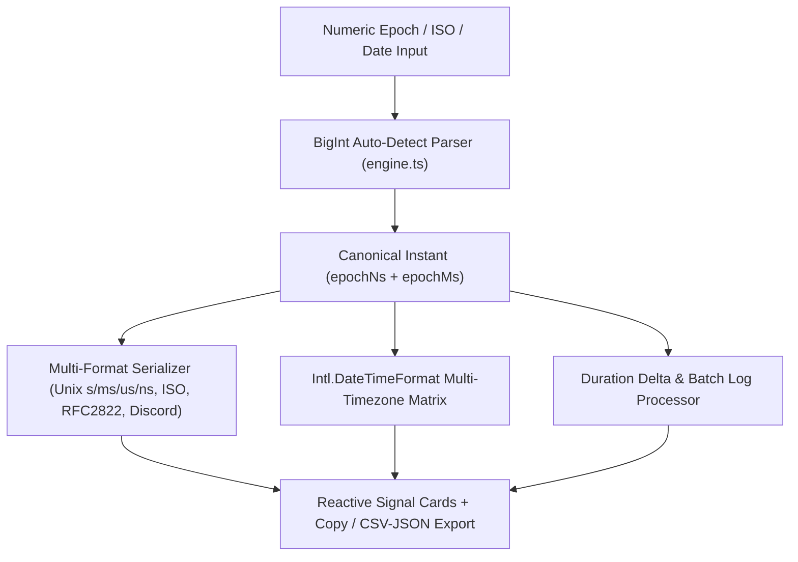

# Unix Epoch, ISO-8601 & Multi-Timezone Timestamp Converter

# Technical Specification & Architecture Blueprint

> **Spec Number**: 119  
> **Slug**: `timestamp-timezone-converter`  
> **Category**: `dev`  
> **Inspired By**: Coddy.tech — *Timestamp Converter*  
> **Target SEO Keyword**: `unix timestamp converter epoch to iso 8601 timezone discord timestamp batch log client side`  
> **Route**: `/tools/timestamp-timezone-converter`  
> **Architecture**: 100% Client-Side Single Page Application (Zero Server Ingestion, Zero Telemetry)

---

## 1. MVP Generation Prompt (`/create-web-micro-saas`)

```text
/create-web-micro-saas

Act as a Principal Frontend Engineer and Developer Tools Architect. Build a high-performance, 100% client-side Angular Standalone tool for PrivKnife called "Unix Epoch, ISO-8601 & Multi-Timezone Timestamp Converter".

TECHNICAL CONSTRAINTS & STACK:
1. Pure Client-Side Architecture: Zero backend endpoints, zero telemetry. Production audit log timestamps, database epoch columns, and incident timelines stay 100% inside local browser RAM.
2. Core Technologies: Native `Date`, `BigInt` (for exact microsecond/nanosecond precision without IEEE-754 float truncation!), `Intl.DateTimeFormat` (`Intl.supportedValuesOf('timeZone')` with safe fallback list), and `Intl.RelativeTimeFormat`.
3. Thread Safety & Memory Hygiene: Clear the live clock `setInterval` strictly inside `ngOnDestroy` (or `DestroyRef`), revoke CSV/JSON export ObjectURLs immediately, and keep updates lightweight at 60 FPS (Directives 3 & 4).
4. Export Deliverables: Copy-ready Unix (`s`/`ms`/`μs`/`ns`), ISO-8601, RFC-2822, SQL `TIMESTAMP`, Discord dynamic tags (`<t:1763551200:R>`), and batch-converted `.csv` / `.json` tables.

KEY FEATURES & USER INTERACTION:
- Live Current Epoch Banner: Real-time ticking Unix seconds/milliseconds clock with Pause/Resume toggle and 1-click Copy buttons.
- Smart Auto-Detect Single Converter: Paste ANY timestamp format—Unix seconds (`1763551200`), milliseconds (`1763551200000`), microseconds, nanoseconds (via `BigInt`!), ISO-8601 (`2026-11-19T12:00:00+01:00`), RFC-2822, or human date—and automatically detect its unit & convert to every format simultaneously!
- Multi-Timezone World Matrix: Compare the chosen instant simultaneously across pinned IANA timezones (e.g., `UTC`, `Local`, `America/New_York`, `America/Los_Angeles`, `Europe/London`, `Europe/Madrid`, `Asia/Tokyo`) with UTC offset & DST indicator.
- Duration / Delta Calculator: Enter two timestamps (or Start + Offset `+/- N days/hours/minutes`) to compute exact elapsed duration (`2d 14h 32m 10s`, total seconds, total ms, business days).
- Batch Log Timestamp Converter: Paste a list of epochs or raw server log lines and translate every epoch into human ISO-8601 / chosen timezone in bulk, with `.csv` / `.json` export.
- Discord & Markdown Tag Generator: Instant copyable Discord dynamic timestamps (`<t:EPOCH:F>`, `:R`, `:t`, `:D`).
- Privacy & Local Execution Assurance: Prominent trust badge reading "🛡️ 100% In-Browser • Never Leaves Your Device".
```

---

## 2. Concept Overview & Value Proposition

Debugging distributed microservices, inspecting JWT `exp` values, correlating cloud incident logs across UTC/PST/CET, or converting nanosecond Go/Kubernetes epochs happens constantly in engineering workflows. Legacy epoch converters clutter the screen with ads, truncate nanosecond precision with 64-bit floats, and lack batch log conversion. **Unix Epoch, ISO-8601 & Multi-Timezone Timestamp Converter** delivers exact `BigInt` precision, multi-timezone comparison, duration arithmetic, and bulk log translation—completely offline.

### Elevator Pitch
> "Auto-detect and convert Unix seconds, milliseconds, nanoseconds, ISO-8601, and multi-timezone timestamps—plus calculate deltas and batch-convert log epochs 100% offline in your browser."

### Core Value Drivers
1. **Exact Sub-Millisecond Precision (`BigInt`)**: Preserves microsecond and nanosecond remainders (common in Go, Rust, Kafka, and Prometheus logs) without IEEE-754 rounding loss.
2. **Instant Unit Auto-Detection**: Automatically distinguishes seconds (10 digits), milliseconds (13 digits), microseconds (16 digits), and nanoseconds (19 digits), with manual unit override when converting historical dates (e.g., year 1970).
3. **Batch Log Triage**: Paste 500 lines of raw logs or CSV epoch values and instantly get a clean, aligned timestamp table ready for incident postmortems.
4. **Zero-Trust Incident Safety**: Production audit logs and incident timestamps stay exclusively on the engineer's machine.

---

## 3. Technical Feasibility, Dependencies & Difficulty Score

### Difficulty Score: 3.0 / 10 (Low-Moderate — `BigInt` nanosecond precision math, IANA timezone conversion without external date libraries, and batch regex timestamp extraction)

| Architectural Component | Implementation Technology | Installed in Repo? | Client-Side Feasibility |
|---|---|---|---|
| Sub-Millisecond Epoch Engine | Native `BigInt` + `Date` | Native Browser API | 100% In-Browser (0 extra deps) |
| Timezone & Relative Formatter | Native `Intl.DateTimeFormat` + `Intl.RelativeTimeFormat` | Native Browser API | 100% In-Browser |
| Batch Export | Pure TS CSV / JSON Builder | Pure TypeScript | 100% In-Browser |

### Known Technical Nuances & Mitigations
- **Negative Pre-1970 Epochs & Year-2038 / 10000 Bounds**: `Date` accepts timestamps within `±8.64e15 ms` (`±100,000,000` days from epoch).
  - *Mitigation*: Validate `BigInt` range before passing to `new Date(Number(ms))` so extreme 25-digit numbers return a friendly out-of-range error instead of `"Invalid Date"`.
- **Browser `Intl.supportedValuesOf` Compatibility**: Modern Chromium/Firefox/Safari support `Intl.supportedValuesOf('timeZone')`; older test runners (like minimal jsdom) may omit it.
  - *Mitigation*: Feature-detect `typeof Intl.supportedValuesOf === 'function'` and fall back to a curated 60-zone canonical IANA list cleanly.
- **Interval Cleanup**: The live ticking epoch clock must clear its timer via `DestroyRef.onDestroy` (or `ngOnDestroy`) and respect a Pause button so users can copy a stable value without jumping numbers.

---

## 4. Competitive Landscape & Market Positioning

| Feature / Metric | PrivKnife (`timestamp-timezone-converter`) | Coddy.tech / EpochConverter | Terminal `date` CLI |
|---|---|---|---|
| **Nanosecond `BigInt` Precision** | **Exact (No Float Truncation)** | Rounds/drops nanoseconds | Platform-inconsistent (macOS vs GNU) |
| **Multi-Timezone Matrix** | **Pinned Side-by-Side IANA Zones** | Local + UTC only | Manual `TZ=` calls |
| **Batch Log Epoch Converter** | **Bulk Paste + `.csv`/`.json` Export** | Single value or basic list | Custom `awk`/`jq` script |
| **Discord Dynamic Tags + Delta Math** | **Built-in Tabs** | Separate sites | Manual |

---

## 5. Functional Requirements & Processing Algorithms

### 5.1. Smart Auto-Detect Parser (`parseTimestampInput`)
1. Trim input. Check if purely numeric (`^-?\d+$`):
   - If `unitOverride === 'auto'`:
     - `absDigits <= 11` → `seconds`
     - `12..14` → `milliseconds`
     - `15..17` → `microseconds`
     - `>= 18` → `nanoseconds`
   - Convert via `BigInt` to canonical `epochNs: bigint` and `epochMs: number` plus exact `subMsRemainderNs: bigint`.
2. Else attempt ISO-8601 / RFC-2822 / SQL `YYYY-MM-DD HH:mm:ss` parsing (preserving fractional seconds up to 9 digits via regex before passing to `Date.parse`).
3. Output all representations: Unix `s`, `ms`, `μs`, `ns`, ISO-8601 UTC, ISO-8601 with selected timezone offset, RFC-2822, SQL `TIMESTAMP`, Relative Time (`Intl.RelativeTimeFormat`), Day-of-Year, ISO Week Number, Leap Year flag, and Discord tags (`:t`, `:T`, `:d`, `:D`, `:f`, `:F`, `:R`).

### 5.2. Duration & Offset Arithmetic (`computeTimestampDelta`)
- Compute exact difference `deltaMs = endMs - startMs` broken down into `{ sign, days, hours, minutes, seconds, milliseconds, totalSeconds, totalHours, totalDays, weekdaysCount }`.
- Support adding/subtracting `{ years, months, days, hours, minutes, seconds }` to any base timestamp.

### 5.3. Batch Converter (`convertBatchTimestamps`)
- Process line-by-line (up to 10,000 lines); for each line, parse either the full line as a timestamp or extract inline 10/13-digit epoch tokens from structured log lines, returning aligned `{ lineNumber, raw, detectedUnit, isoUtc, targetTimezone, valid }` records.

---

## 6. UI/UX Layout Specification (BEM Architecture)

- **Localization (`i18n`)**: Keys under `tools.timestampTimezoneConverter.*` (`en`, `es`).
- **Layout**:
  - Top Live Epoch Clock Bar (`Now: 1763551200` | `Copy s` | `Copy ms` | `Pause` | `Use Now`).
  - Tab Switcher: **Single Converter & World Clocks**, **Duration & Offset Calculator**, **Batch Log Converter**.
  - Clean monospace result grid with 1-click Copy button on every row and instant `"Copied!"` accessible announcement.

---

## 7. Technical Architecture & Client-Side Pipeline



---

## 8. Input/Output Data Contracts (TypeScript Interfaces)

```typescript
export type EpochUnit = 'auto' | 'seconds' | 'milliseconds' | 'microseconds' | 'nanoseconds';

export interface ParsedTimestampOutput {
  valid: boolean;
  detectedUnit: Exclude<EpochUnit, 'auto'> | 'date_string';
  epochSeconds: string;
  epochMilliseconds: string;
  epochMicroseconds: string;
  epochNanoseconds: string;
  isoUtc: string;
  rfc2822: string;
  sqlTimestampUtc: string;
  relativeTime: string;
  isoWeekNumber: number;
  dayOfYear: number;
  isLeapYear: boolean;
  discordTags: Record<'t' | 'T' | 'd' | 'D' | 'f' | 'F' | 'R', string>;
  timezoneViews: Array<{ timezone: string; formatted: string; offsetLabel: string }>;
  error?: string;
}

export interface TimestampDeltaResult {
  sign: 1 | -1 | 0;
  totalMilliseconds: number;
  totalSeconds: number;
  totalMinutes: number;
  totalHours: number;
  totalDays: number;
  breakdown: { days: number; hours: number; minutes: number; seconds: number; ms: number };
}

export interface BatchTimestampRow {
  line: number;
  rawInput: string;
  valid: boolean;
  detectedUnit?: string;
  isoUtc?: string;
  targetTzFormatted?: string;
  error?: string;
}
```

---

## 9. Security, Sandboxing & Verification Acceptance Criteria

- **Directive 1–5**: Zero network calls verified; live clock timer strictly cleared on `ngOnDestroy`; ObjectURLs revoked after CSV/JSON batch export; lazy route loading.
- **Functional Test Vectors**:
  1. Nanosecond input `"1763551200123456789"` preserves exact trailing `123456789` nanoseconds without IEEE-754 precision loss.
  2. Negative epoch `"-86400"` resolves accurately to `1969-12-31T00:00:00.000Z`.
  3. Out-of-bounds epoch `"999999999999999999999999999"` returns `{ valid: false }` cleanly without crashing.
  4. Batch mode parses mixed seconds, milliseconds, ISO strings, and 1 malformed line cleanly without halting remaining rows.
