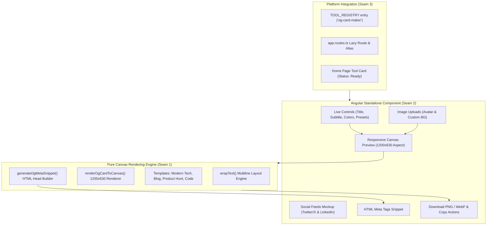

# Implementation Plan: Social Share (Open Graph) Card Maker

> **Tool**: `12 - Social Share (Open Graph) Card Maker`  
> **Target Directory**: `src/app/tools/media/og-card-maker/`  
> **Route**: `/tools/og-card-maker` (alias `/tools/social-share-card`)  
> **Key Directives**: 100% Client-Side Canvas 2D rendering, zero telemetry, instant PNG/WebP exports, BEM architecture, strict memory hygiene.

---

## 📐 Architecture & Seam Design

---

## 🧪 Vertical Slices & TDD Seams

### Seam 1: Core Canvas 2D Engine (`engine.ts` & `engine.spec.ts`)
- **Domain Types**:
  - `OgCardTemplate`: `'modern-tech' | 'article-blog' | 'product-hunt' | 'code-snippet'`
  - `BackgroundStyle`: `'solid' | 'gradient' | 'mesh' | 'custom-image'`
  - `OgCardConfig`: Complete configuration model (title, subtitle, author, domain, badge, colors, font, template, etc.)
- **Engine Functions**:
  - `wrapText(ctx, text, maxWidth, maxLines)`: Computes line breaks accurately without overflowing boundaries.
  - `renderOgCardToCanvas(config, targetCanvas?)`: Draws 1200×630 canvas composite based on template, backgrounds, typography, and badges.
  - `exportCanvasBlob(canvas, mimeType, quality)`: Generates image Blob (PNG / WebP).
  - `generateOgMetaSnippet(config, imageUrl)`: Builds clean, valid HTML `<meta>` tags for Open Graph and Twitter summary_large_image.
- **Unit Tests (`engine.spec.ts`)**:
  - Verify multiline text wrapping handles long sentences and ellipsis truncation.
  - Verify meta snippet generator contains standard Open Graph and Twitter tags.
  - Verify card rendering succeeds across all 4 templates ('modern-tech', 'article-blog', 'product-hunt', 'code-snippet').
  - Verify PNG and WebP blob export outputs with correct MIME types and non-zero byte length.

### Seam 2: UI Component & State Signals (`og-card-maker.component.ts` & `.spec.ts`)
- **Component Features**:
  - Signals for `config`, `previewBlobUrl`, `activeMockupTab`, `copiedSnippet`, `copiedImage`, `isExporting`.
  - Re-rendering canvas in real-time as user modifies title, subtitle, colors, and layout presets.
  - Interactive social mockup preview tabs (Canvas Editor, Twitter/X card mockup, LinkedIn card mockup).
  - Download buttons for 1200×630 PNG and WebP with immediate `URL.revokeObjectURL()`.
  - "Copy HTML Meta Tags" with visual feedback.
  - Drag-and-drop support for avatar and background photos.
  - Lifecycle cleanup (`ngOnDestroy`) disposing of all created object URLs.
  - Zero-network privacy assertion verifying 0 requests to `fetch` or `XMLHttpRequest`.

### Seam 3: Tool Registration & Route Wiring
- Export `ogCardMakerTool` in `src/app/tools/media/og-card-maker/index.ts`.
- Register in `src/app/tools/tool-registry.ts` and add tests in `tool-registry.spec.ts`.
- Configure lazy routes in `app.routes.ts` with metadata.
- Update catalog in `src/app/pages/home/home.ts` setting status to `'ready'`.
- Mark Spec 12 as completed in `specs/README.md`.
