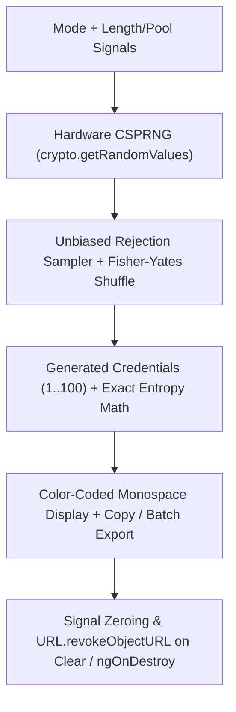

# Cryptographic Password, Passphrase & API Key Generator

# Technical Specification & Architecture Blueprint

> **Spec Number**: 120  
> **Slug**: `password-passphrase-generator`  
> **Category**: `dev`  
> **Inspired By**: Coddy.tech — *Password Generator*  
> **Target SEO Keyword**: `secure password generator diceware passphrase api key entropy calculator client side csprng`  
> **Route**: `/tools/password-passphrase-generator`  
> **Architecture**: 100% Client-Side Single Page Application (Zero Server Ingestion, Zero Telemetry)

---

## 1. MVP Generation Prompt (`/create-web-micro-saas`)

```text
/create-web-micro-saas

Act as a Principal Frontend Security Engineer. Build a high-performance, 100% client-side Angular Standalone tool for PrivKnife called "Cryptographic Password, Passphrase & API Key Generator".

TECHNICAL CONSTRAINTS & STACK:
1. Pure Client-Side Architecture: Zero network calls, zero telemetry, zero `localStorage`/`sessionStorage` persistence of generated credentials. Every random byte MUST come exclusively from the browser's hardware-backed CSPRNG (`window.crypto.getRandomValues`)—NEVER `Math.random()`!
2. Core Technologies: Native Web Crypto CSPRNG (`crypto.getRandomValues`) with **rejection sampling** (eliminating modulo bias completely!), bundled EFF Short/Long Diceware wordlist (local static TS array — zero remote fetches), and pure-TS Shannon entropy & offline crack-time estimator.
3. Thread Safety & Memory Hygiene: Clear all generated password/key Signals on Reset and `ngOnDestroy`; revoke exported `.txt` / `.env` / `.csv` ObjectURLs immediately; never log secrets to `console` (Directives 1, 2 & 4).
4. Export Deliverables: Copy-ready individual passwords/passphrases/API keys, plus optional bulk batch export (`.txt`, `.csv`, `.env` template) up to 100 entries.

KEY FEATURES & USER INTERACTION:
- Four Generator Modes:
  1. **Random Password**: Length slider (`8–128`), toggles for Uppercase (`A-Z`), Lowercase (`a-z`), Numbers (`0-9`), Symbols (`!@#$%^&*...`), custom symbol subset, "Exclude Ambiguous Characters (`0 O o 1 l I |`)", and "Guarantee At Least 1 From Each Selected Class" (using unbiased Fisher-Yates CSPRNG shuffle).
  2. **Diceware Passphrase (Memorable & High-Entropy)**: Word count (`3–12` words), separator (`-`, `_`, `.`, space, random digit), capitalization (`lowercase`, `TitleCase`, `UPPERCASE`, `Random Word Upper`), and optional append-number/symbol.
  3. **Developer Secrets & API Keys**: Presets for Hex 256-bit (`64 chars`), Base64Url 256-bit (`.env` `JWT_SECRET` / `SESSION_SECRET`), Prefixed API Keys (`pk_live_<32_base62>`), WPA2/WPA3 Wi-Fi Pre-Shared Key (63 chars), and Recovery Code Sets (`XXXX-XXXX-XXXX` × 10).
  4. **Local Password Strength Auditor (Optional Sandbox Tab)**: Paste any existing password locally to inspect character-pool entropy bits, dictionary/pattern weakness warnings (keyboard walks, repeated chars, common years), and estimated crack times under slow Argon2id vs fast offline GPU hashing—100% locally!
- Live Cryptographic Telemetry: Displays exact mathematical entropy (`bits = length * log2(poolSize)` or `words * log2(wordlistSize)`), NIST/OWASP strength grade, and honest crack-time estimate.
- Privacy & Local Execution Assurance: Prominent trust badge reading "🛡️ 100% In-Browser • Never Leaves Your Device".
```

---

## 2. Concept Overview & Value Proposition

Online password generators are notoriously risky: many use insecure `Math.random()`, biased modulo arithmetic (`rand % charset.length`), or run third-party analytics/ad scripts on the same page where users generate root credentials. **Cryptographic Password, Passphrase & API Key Generator** uses strictly unbiased CSPRNG rejection sampling via `crypto.getRandomValues()`, bundles a local Diceware wordlist, generates developer `.env` secrets and recovery codes, and never touches the network or browser storage.

### Elevator Pitch
> "Generate mathematically unbiased passwords, memorable Diceware passphrases, and 256-bit `.env` API keys using your browser's hardware CSPRNG—with zero modulo bias, zero storage, and zero network calls."

### Core Value Drivers
1. **True Cryptographic Uniformity**: Implements rejection sampling (`maxValid = Math.floor(0x100000000 / range) * range`) so every character and word is selected with mathematically identical probability—zero modulo bias!
2. **Developer-First Secret Formats**: Goes beyond basic passwords to produce 256-bit Base64Url JWT secrets, prefixed Base62 API tokens, WPA2 keys, and formatted backup recovery codes.
3. **Zero Persistence Guarantee**: Generated credentials exist strictly in ephemeral component Signals and are wiped cleanly on Clear and `ngOnDestroy`.
4. **Honest Entropy Math**: Reports exact combinatorial entropy bits (`H = L * log2(N)`) and realistic GPU offline attack estimates rather than arbitrary fake "100% Strong" bars.

---

## 3. Technical Feasibility, Dependencies & Difficulty Score

### Difficulty Score: 3.0 / 10 (Low — Rejection-sampled CSPRNG primitives, unbiased Fisher-Yates shuffle, and bundled EFF short Diceware wordlist)

| Architectural Component | Implementation Technology | Installed in Repo? | Client-Side Feasibility |
|---|---|---|---|
| Unbiased CSPRNG Sampling | `crypto.getRandomValues(new Uint32Array(...))` + Rejection Sampling | Native Browser API | 100% In-Browser (0 extra deps) |
| Diceware Wordlist | Bundled EFF Short Wordlist (`1,296` words, ~12 KB gzipped in lazy chunk!) | Static local TS module | 100% In-Browser |
| Entropy & Crack-Time Estimator | Pure TypeScript Combinatorial Math | Pure TypeScript | 100% In-Browser |

### Known Technical Nuances & Mitigations
- **Eliminating Modulo Bias**: Doing `randomUint32 % charset.length` skews lower indices slightly when `2^32` is not divisible by `charset.length`.
  - *Mitigation*: Implement `secureRandomInt(maxExclusive: number): number` using `const limit = 0x100000000 - (0x100000000 % maxExclusive);` and resample whenever `value >= limit`.
- **Biased Requirement Enforcement**: Placing mandatory uppercase/digit/symbol characters always at indices `0, 1, 2` weakens security!
  - *Mitigation*: Fill mandatory class slots, fill remaining length from the combined pool, then apply an unbiased **CSPRNG Fisher-Yates shuffle** across the entire character array.
- **No `Math.random()` Anywhere**: Add a dedicated static/unit verification assertion confirming `Math.random` is never called during generation (spying on `Math.random` and asserting `0` calls!).

---

## 4. Competitive Landscape & Market Positioning

| Feature / Metric | PrivKnife (`password-passphrase-generator`) | Coddy.tech Password Gen | Password Manager Web Tools |
|---|---|---|---|
| **Unbiased CSPRNG Rejection Sampling** | **Guaranteed & Unit-Tested** | Often naive `Math.random` / `%` | Varies |
| **Diceware Passphrases + Dev `.env` Keys** | **4 Specialized Modes** | Random password only | Password + passphrase |
| **Zero Telemetry & Zero Storage** | **Enforced by CSP + Audit Tests** | Analytics present | Brand tracking |
| **Batch Generation (up to 100) + `.env` Export** | **Built-in** | Single password | Single password |

---

## 5. Functional Requirements & Processing Algorithms

### 5.1. Unbiased CSPRNG Core (`secureRandomInt`, `secureShuffle`)
- `secureRandomInt(maxExclusive)`: Uses `Uint32Array(1)` + rejection sampling for exact uniform distribution on `[0, maxExclusive - 1]`.
- `secureShuffle(items)`: In-place Fisher-Yates from `i = n - 1` down to `1`, swapping `i` with `secureRandomInt(i + 1)`.

### 5.2. Generator Pipelines
1. **Random Password**: Build deduplicated character pool from enabled sets minus ambiguous set (`0Oo1lI|`) if toggled. Enforce at least 1 character from each enabled set when `requireEachClass: true` and `length >= enabledSets.length`, then `secureShuffle`.
2. **Diceware Passphrase**: Sample `wordCount` words uniformly from bundled EFF wordlist (`1296` words = `10.34 bits/word`), apply case transform + optional random number/symbol injection, join with separator.
3. **Developer Secret Presets**:
   - `hex_256`: 32 random bytes → 64 lowercase hex chars (`256 bits`).
   - `base64url_256`: 32 random bytes → 43 Base64Url chars (`256 bits`).
   - `api_key_prefixed`: Custom prefix (e.g., `pk_live_`) + 32 Base62 chars (`~190.5 bits`).
   - `recovery_codes`: 10 formatted `XXXX-XXXX-XXXX` Base32 Crockford codes (excludes confusing `I, L, O, U`!).
4. **Entropy & Crack-Time Audit**:
   - Compute exact bits of entropy for generated outputs (`L * Math.log2(poolSize)` or `W * Math.log2(1296)`).
   - For the optional Local Strength Auditor, evaluate effective character pool, penalize repeated sequences / sequential keyboard runs (`qwerty`, `12345`), and compute time to exhaust `50%` of search space at `10^10 guesses/sec` (offline fast hash GPU rig) and `10^4 guesses/sec` (Argon2id).

---

## 6. UI/UX Layout Specification (BEM Architecture)

- **Localization (`i18n`)**: Keys under `tools.passwordPassphraseGenerator.*` (`en`, `es`).
- **Hero Output Card**: Large high-contrast monospace display with color-coded character classes (letters / digits / symbols subtly distinguished for easy manual transcription!), Entropy Badge (`128.4 bits • Unbreakable`), `Regenerate` (`Space` / button), and `Copy` button.
- **Mode Tabs & Sliders**: `Password`, `Passphrase`, `Dev API Keys`, `Strength Auditor`; batch count selector (`1`, `5`, `10`, `25`, `50`) with bulk Copy / Download `.txt`/`.env`.

---

## 7. Technical Architecture & Client-Side Pipeline



---

## 8. Input/Output Data Contracts (TypeScript Interfaces)

```typescript
export type GeneratorMode = 'password' | 'passphrase' | 'dev_secret' | 'auditor';
export type DevSecretPreset = 'hex_256' | 'base64url_256' | 'api_key_prefixed' | 'wpa2_63' | 'recovery_codes';

export interface PasswordGeneratorOptions {
  mode: GeneratorMode;
  batchCount: number;              // 1..100
  // Password mode
  length: number;                  // 8..128
  includeUppercase: boolean;
  includeLowercase: boolean;
  includeNumbers: boolean;
  includeSymbols: boolean;
  customSymbols: string;
  excludeAmbiguous: boolean;
  requireEachClass: boolean;
  // Passphrase mode
  wordCount: number;               // 3..12
  separator: string;
  wordCase: 'lower' | 'title' | 'upper' | 'random_upper';
  appendNumber: boolean;
  // Dev secret mode
  devPreset: DevSecretPreset;
  apiKeyPrefix: string;
  envVariableName: string;
}

export interface EntropyReport {
  bits: number;
  grade: 'very_weak' | 'weak' | 'fair' | 'strong' | 'excellent';
  crackTimeFastGpu: string;
  crackTimeArgon2: string;
  warnings: string[];
}

export interface PasswordGeneratorResult {
  success: boolean;
  items: string[];
  entropy: EntropyReport;
  error?: string;
}
```

---

## 9. Security, Sandboxing & Verification Acceptance Criteria

- **Directive 1 & 2**: Zero network calls verified; zero `localStorage` / `sessionStorage` writes verified.
- **CSPRNG Verification Test**: Spy on `Math.random` and assert `expect(mathRandomSpy).not.toHaveBeenCalled()`, while verifying `crypto.getRandomValues` IS called.
- **Directive 4**: Verify generated `items` Signal is cleared (`[]`) and all ObjectURLs revoked on Clear and `ngOnDestroy`.
- **Functional Test Vectors**:
  1. Password with `length: 24`, `excludeAmbiguous: true`, `requireEachClass: true` contains 0 characters from `0Oo1lI|` and >= 1 char from each enabled class across 200 randomized runs.
  2. `hex_256` matches `/^[0-9a-f]{64}$/` and reports `256` bits entropy.
  3. `passphrase` with `wordCount: 6` produces 6 valid EFF wordlist tokens joined by configured separator.
  4. All character sets disabled returns graceful validation error `{ success: false }` instead of infinite loop.
