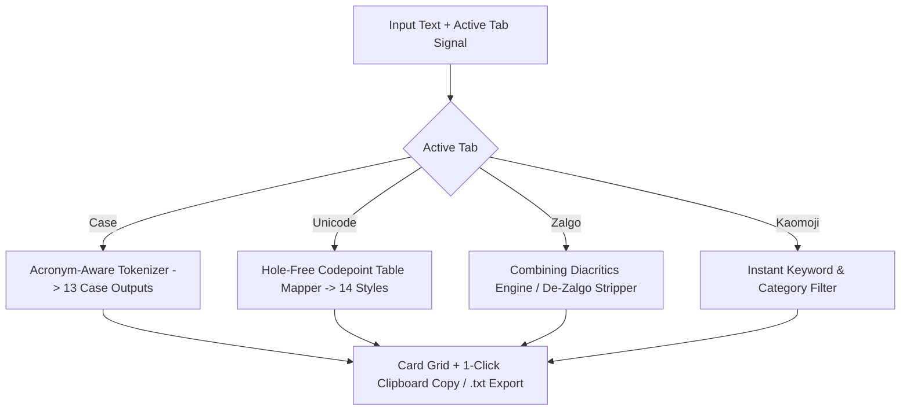

# String Case, Text Transform & Unicode Typography Studio

# Technical Specification & Architecture Blueprint

> **Spec Number**: 121  
> **Slug**: `case-unicode-text-studio`  
> **Category**: `dev`  
> **Inspired By**: Coddy.tech — *Case Converter* + *Fancy Text / Font Generator* + *Glitch Text Generator (Zalgo)* + *Kaomoji & Text Faces*  
> **Target SEO Keyword**: `case converter camelcase snake case unicode font generator zalgo glitch text kaomoji client side`  
> **Route**: `/tools/case-unicode-text-studio`  
> **Architecture**: 100% Client-Side Single Page Application (Zero Server Ingestion, Zero Telemetry)

---

## 1. MVP Generation Prompt (`/create-web-micro-saas`)

```text
/create-web-micro-saas

Act as a Principal Frontend Engineer and UX Designer. Build a high-performance, 100% client-side Angular Standalone tool for PrivKnife called "String Case, Text Transform & Unicode Typography Studio".

TECHNICAL CONSTRAINTS & STACK:
1. Pure Client-Side Architecture: Zero backend endpoints, zero telemetry. Source code identifiers, copywriting drafts, and multi-line lists stay strictly inside local browser memory.
2. Core Technologies: Pure TypeScript Unicode-aware tokenizer (grapheme & word-boundary splitting handling acronyms like `XMLHttpRequest` → `xml_http_request`!), Unicode Mathematical Alphanumeric Symbol codepoint mapper, deterministic PRNG Zalgo combining-diacritic engine, and curated categorized Kaomoji directory.
3. Thread Safety & Memory Hygiene: Lightweight O(n) transformations execute instantaneously (< 10ms) with clean Signal state and immediate ObjectURL revocation on `.txt` download (Directives 3 & 4).
4. Export Deliverables: 1-click Copy for every case/style card, multi-line batch conversion output, and `.txt` export.

KEY FEATURES & USER INTERACTION:
- Tab 1 — Developer Case Converter & Text Transformer:
  - Simultaneous live preview grid converting input into **12 formats at once**: `camelCase`, `PascalCase`, `snake_case`, `SCREAMING_SNAKE_CASE`, `kebab-case`, `COBOL-CASE`, `dot.case`, `path/case`, `Title Case (AP/APA)`, `Sentence case`, `UPPERCASE`, `lowercase`, and `URL Slug (ASCII diacritic-stripped)`.
  - Multi-line Batch Mode toggle: Convert 50 variable names or CSV headers line-by-line simultaneously!
  - Quick Text Utilities: Trim whitespace, Deduplicate lines, Sort A–Z / Z–A, Remove empty lines, Reverse text, and live Statistics bar (Characters, Words, Lines, UTF-8 Bytes, Reading Time).
- Tab 2 — Unicode Typography & Fancy Text Studio:
  - Live preview cards mapping Latin/digits into **14 copyable Unicode Mathematical & Enclosed styles** (Bold Serif, Bold Sans, Italic, Script/Cursive, Fraktur/Gothic, Double-Struck, Monospace, Small Caps, Circled ⒶⒷⒸ, Squared 🄰🄱🄲, Fullwidth, Upside-Down Flipped, Strikethrough, Underline) with an **Accessibility Advisory Note** reminding users that Unicode math fonts aren't read cleanly by screen readers for essential UI copy!
- Tab 3 — Zalgo / Glitch Text Generator:
  - Configurable combining-diacritic intensity slider (`Subtle`, `Medium`, `Chaotic`) and directional toggles (`Up`, `Middle`, `Down` marks), plus a "De-Zalgo / Strip Combining Marks" cleaner button!
- Tab 4 — Searchable Kaomoji & Text Faces Library:
  - 150+ categorized Japanese emoticons (`Happy`, `Shrug`, `Table Flip`, `Love`, `Confused`, `Coding / Work`, `Animals`, `Sparkles & Dividers`) with instant keyword search and 1-click copy.
- Privacy & Local Execution Assurance: Prominent trust badge reading "🛡️ 100% In-Browser • Never Leaves Your Device".
```

---

## 2. Concept Overview & Value Proposition

This studio consolidates four high-traffic Coddy.tech text utilities (*Case Converter*, *Fancy Text Generator*, *Glitch/Zalgo Text*, and *Kaomoji Picker*) into one cohesive, zero-ad PrivKnife workspace. Developers use the batch identifier case converter daily when refactoring JSON keys, SQL columns, CSS BEM classes, and URL slugs; creators and social media managers use the Unicode typography, Zalgo, and Kaomoji studios for bios, README headers, and posts.

### Elevator Pitch
> "Convert code identifiers across 12 naming conventions in bulk, transform text into 14 Unicode styles or Zalgo glitch art, and browse 150+ instant-copy Kaomojis—100% offline with zero ads."

### Core Value Drivers
1. **Smart Acronym-Aware Identifier Splitting**: Properly decomposes `getHTTPResponse2URL` → `get_http_response_2_url`, `XMLParser` → `xml-parser`, and `user_firstName` → `UserFirstName`.
2. **Multi-Line Bulk Refactoring**: Paste 100 database column names and convert every line to `camelCase` or `kebab-case` in one click.
3. **Reversible De-Zalgo & Diacritic Slugifier**: Not only creates Zalgo glitch text, but also strips combining diacritics (`NFD` normalization) to clean messy copy-pasted text or generate crisp ASCII URL slugs (`"Café & Niño 2026!"` → `"cafe-nino-2026"`).
4. **Honest Accessibility Transparency**: Includes a helpful note in the Unicode Fancy Fonts tab explaining screen-reader compatibility best practices.

---

## 3. Technical Feasibility, Dependencies & Difficulty Score

### Difficulty Score: 2.5 / 10 (Low — Pure TypeScript string tokenization, Unicode codepoint offset tables, and curated static Kaomoji catalog; zero external dependencies)

| Architectural Component | Implementation Technology | Installed in Repo? | Client-Side Feasibility |
|---|---|---|---|
| Identifier Case Tokenizer & Slugifier | Pure TypeScript RegExp + `String.prototype.normalize('NFD')` | Native / Pure TS | 100% In-Browser (0 extra deps) |
| Unicode Typography Mapper | Pure TS Codepoint Lookup Tables (`String.fromCodePoint`) | Pure TypeScript | 100% In-Browser |
| Zalgo Generator & Cleaner | Pure TS Unicode Combining Diacritics (`\u0300–\u036F`) | Pure TypeScript | 100% In-Browser |
| Kaomoji Catalog | Static Local TypeScript Array (~8 KB) | Pure TypeScript | 100% In-Browser |

### Known Technical Nuances & Mitigations
- **Unicode Mathematical Block Holes**: Unicode Mathematical Alphanumeric Symbols (U+1D400–U+1D7FF) have historic "holes" (e.g., Script `B`, `E`, `F`, `H`, `I`, `L`, `M`, `R`, Double-Struck `C`, `H`, `N`, `P`, `Q`, `R`, `Z`, Italic `h` at `U+210E`) that reside in the Letterlike Symbols block (`U+2100–U+214F`) rather than sequentially!
  - *Mitigation*: Map each style using explicit complete character lookup arrays (or exception overrides for every Unicode hole) verified by unit tests across all 26 uppercase + 26 lowercase letters so zero missing `□` tofu glyphs ever appear!
- **Surrogate Pair Safety**: Never reverse or slice strings containing astral Unicode codepoints (`U+1D400+` or emoji) with `.split('').reverse()`. Always iterate with `Array.from(str)` (codepoint-safe!).

---

## 4. Competitive Landscape & Market Positioning

| Feature / Metric | PrivKnife (`case-unicode-text-studio`) | Coddy.tech (4 Separate Tools) | Ad-Heavy Text Converters |
|---|---|---|---|
| **4-in-1 Unified Workbench** | **Case + Unicode + Zalgo + Kaomoji** | 4 Separate Pages | Single-purpose popup sites |
| **Acronym-Safe Code Case Splitting** | **Handles `XMLHttp`, `v2API`, etc.** | Basic space/underscore split | Basic |
| **Multi-Line Bulk Mode + Line Utilities** | **Built-in Sort/Dedup/Slugify** | Single block | Rarely included |
| **Hole-Free Unicode Math Mapping** | **100% Complete Verified Tables** | Often drops `h`, `C`, `R` | Often renders tofu `□` |

---

## 5. Functional Requirements & Processing Algorithms

### 5.1. Smart Word Tokenizer (`tokenizeIdentifier`)
- Split on separators (`_`, `-`, `.`, `/`, whitespace) AND camelCase/acronym transitions (`([a-z0-9])([A-Z])`, `([A-Z]+)([A-Z][a-z])`, `([a-zA-Z])(\d)`, `(\d)([a-zA-Z])`).
- Preserve multi-line independence when `batchLineByLine: true`.
- Implement all 13 transformations (`camel`, `pascal`, `snake`, `screaming_snake`, `kebab`, `cobol`, `dot`, `path`, `title`, `sentence`, `upper`, `lower`, `slug`).

### 5.2. Unicode Style Mapping (`transformUnicodeStyle`)
- Verified hole-free mapping tables for all 14 styles (`bold_serif`, `bold_sans`, `italic_serif`, `bold_italic`, `script`, `bold_script`, `fraktur`, `double_struck`, `monospace`, `small_caps`, `circled`, `squared`, `fullwidth`, `upside_down`).
- `upside_down` maps characters via flipped Unicode table AND reverses codepoint order via `Array.from(...).reverse()`.

### 5.3. Zalgo Engine & Cleaner (`applyZalgo`, `stripZalgo`)
- Distribute `upMarks`, `midMarks`, and `downMarks` combining characters (`U+0300..U+036F`) per non-whitespace codepoint controlled by `intensity` (`1..15`) and optional deterministic `seed` (making unit testing 100% deterministic!).
- `stripZalgo(text)` removes combining diacritical range `[\u0300-\u036f\u0489]` cleanly via `NFC` restoration.

---

## 6. UI/UX Layout Specification (BEM Architecture)

- **Localization (`i18n`)**: Keys under `tools.caseUnicodeTextStudio.*` (`en`, `es`).
- **Layout**:
  - 4 Tab Pills (`Case Converter`, `Unicode Styles`, `Zalgo Glitch`, `Kaomoji Library`).
  - Persistent Top Input Box (for Tabs 1–3) with Live Stats Strip (`Chars | Words | Lines | UTF-8 Bytes`) and Quick Transform Toolbar (`Trim`, `Dedup Lines`, `Sort A-Z`, `Clear`).
  - Responsive Card Grid (`.l-columns--2` / `.l-columns--3`) where every output style has its own 1-click Copy button.

---

## 7. Technical Architecture & Client-Side Pipeline



---

## 8. Input/Output Data Contracts (TypeScript Interfaces)

```typescript
export type StudioTab = 'case' | 'unicode' | 'zalgo' | 'kaomoji';

export type CaseFormatId =
  | 'camel' | 'pascal' | 'snake' | 'screaming_snake'
  | 'kebab' | 'cobol' | 'dot' | 'path'
  | 'title' | 'sentence' | 'upper' | 'lower' | 'slug';

export interface CaseTransformOptions {
  batchLineByLine: boolean;
  stripDiacriticsForSlug: boolean;
}

export interface ZalgoOptions {
  intensity: number;            // 1..15
  includeUp: boolean;
  includeMid: boolean;
  includeDown: boolean;
  seed?: number;                // Optional deterministic seed for testing
}

export interface KaomojiEntry {
  id: string;
  emoticon: string;
  category: 'happy' | 'shrug' | 'flip' | 'love' | 'confused' | 'work' | 'animals' | 'dividers';
  tags: string[];
}

export interface TextStats {
  characters: number;
  codePoints: number;
  words: number;
  lines: number;
  utf8Bytes: number;
}
```

---

## 9. Security, Sandboxing & Verification Acceptance Criteria

- **Directive 1–5**: Zero network calls; pure text interpolation (zero `innerHTML`); clean ObjectURL revocation on `.txt` export; lazy route loading.
- **Functional Test Vectors**:
  1. `tokenizeIdentifier("XMLHttpRequest2Id")` → `["XML", "Http", "Request", "2", "Id"]`; `snake_case` → `"xml_http_request_2_id"`; `kebab-case` → `"xml-http-request-2-id"`.
  2. Slugifier transforms `"¡Hola España & Café 2026!"` → `"hola-espana-cafe-2026"`.
  3. All 14 Unicode styles map every letter `A–Z` and `a–z` with zero unassigned/hole codepoints (`U+1D455`, `U+1D49D`, `U+1D53A`, etc. properly redirected to valid Letterlike Symbols).
  4. `stripZalgo(applyZalgo("PrivKnife", { intensity: 5, includeUp: true, includeMid: true, includeDown: true, seed: 42 }))` returns `"PrivKnife"` exactly.
