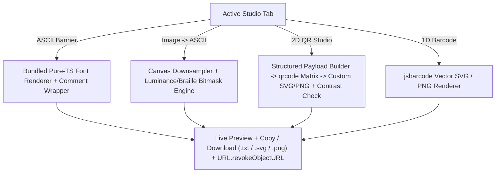

# ASCII Art Banner, Image-to-ASCII & 2D QR/Barcode Studio

# Technical Specification & Architecture Blueprint

> **Spec Number**: 122  
> **Slug**: `ascii-art-qr-studio`  
> **Category**: `dev`  
> **Inspired By**: Coddy.tech — *ASCII Art Generator* + *QR Code Generator*  
> **Target SEO Keyword**: `ascii art banner generator image to ascii braille qr code generator svg png client side`  
> **Route**: `/tools/ascii-art-qr-studio`  
> **Architecture**: 100% Client-Side Single Page Application (Zero Server Ingestion, Zero Telemetry)

---

## 1. MVP Generation Prompt (`/create-web-micro-saas`)

```text
/create-web-micro-saas

Act as a Principal Frontend Engineer and Creative Tooling Architect. Build a high-performance, 100% client-side Angular Standalone tool for PrivKnife called "ASCII Art Banner, Image-to-ASCII & 2D QR/Barcode Studio".

TECHNICAL CONSTRAINTS & STACK:
1. Pure Client-Side Architecture: Zero backend endpoints, zero dynamic tracking-link QR redirects! Every QR code generated is a **100% static, permanent, offline-scannable payload** (never routed through a shady URL shortener!).
2. Core Technologies:
   - `qrcode` (already installed `^1.5.4`) for crisp vector `.svg` & high-res `.png` 2D QR codes with custom error correction (`L`/`M`/`Q`/`H`), colors, dot/finder styling, and optional embedded center logo;
   - `jsbarcode` (already installed `^3.12.3`) for 1D developer barcodes (`CODE128`, `EAN13`, `UPC`, `CODE39`, `ITF14`);
   - Pure TypeScript FIGlet-style ASCII Banner Font Engine (bundling 6 classic open-source ASCII banner fonts locally: `Standard`, `Block`, `Slant`, `Shadow`, `Small`, `Banner3D` — zero remote font fetches!);
   - HTML5 Canvas pixel luminance & Braille dot-matrix (`U+2800–U+28FF`) Image-to-ASCII converter!
3. Thread Safety & Memory Hygiene: Decode/downsample uploaded images cleanly, revoke every `ObjectURL` and zero temporary canvases on Reset and `ngOnDestroy` (Directives 3 & 4).
4. Export Deliverables:
   - ASCII Banner / Image-to-ASCII: Copy plain text, Copy wrapped in code comment syntax (`//`, `/* */`, `#`, `<!-- -->`), Download `.txt`, or Export `.png` snapshot.
   - 2D QR Code & 1D Barcode: Crisp scalable `.svg`, high-resolution `.png` (up to `2048×2048px`), and Copy SVG / Copy Image to Clipboard.

KEY FEATURES & USER INTERACTION:
- Tab 1 — ASCII Banner Text Generator: Type CLI/README header text, pick from 6 built-in monospace fonts, adjust character spacing & max width, and wrap output in ready-to-paste comment blocks (`JS/TS`, `Python/Bash`, `HTML`, `SQL`, `Plain`).
- Tab 2 — Image to ASCII & Unicode Braille Art: Drop any local image, choose character ramp (`Standard Dense`, `Minimalist`, `Blocks ░▒▓█`, `High-Res Unicode Braille ⣿`), width in columns (`30–160`), invert brightness toggle (Dark vs Light terminal), contrast slider, and live monochrome/ANSI preview.
- Tab 3 — Static 2D QR Code Studio: Structured payload builders for **URL / Text**, **Wi-Fi Network** (`WIFI:T:WPA;S:...;P:...;;` — passwords stay 100% local!), **vCard Contact**, **Email**, **SMS**, and **Geo Coordinates**. Customize Error Correction (`L`/`M`/`Q`/`H`), Foreground/Background colors (with automatic **WCAG scan-contrast warning** if contrast is too low for cameras!), quiet-zone margin, module style (`Square` / `Rounded` / `Dots`), and optional centered PNG/SVG logo (auto-bumps EC to `H`).
- Tab 4 — Quick 1D Barcode Studio: Generate clean `CODE128`, `EAN13`, `UPC`, or `CODE39` vector `.svg`/`.png` barcodes for inventory, testing, and shipping tools.
- Privacy & Local Execution Assurance: Prominent trust badge reading "🛡️ 100% In-Browser • Never Leaves Your Device".
```

---

## 2. Concept Overview & Value Proposition

Developers frequently need crisp ASCII art headers for CLI tools/READMEs, quick terminal-friendly image-to-ASCII conversions, and **100% private static QR codes** (especially for Wi-Fi passwords, local network dev URLs, or personal vCards!). Most "free" online QR generators secretly wrap URLs in expiring tracking redirects or transmit your Wi-Fi password to a backend server. **ASCII Art Banner, Image-to-ASCII & 2D QR/Barcode Studio** reuses PrivKnife's already-installed `qrcode` and `jsbarcode` libraries alongside a pure-TS ASCII/Braille engine to deliver permanent, private assets completely offline.

### Elevator Pitch
> "Create CLI ASCII banners, convert images into crisp ASCII or Braille art, and generate permanent, tracker-free SVG/PNG QR codes (including offline Wi-Fi & vCards)—100% locally in your browser."

### Core Value Drivers
1. **Zero-Tracking Permanent QR Codes**: Generates direct, static QR payloads that never expire and never expose your Wi-Fi password or vCard contact info to a server.
2. **Built-In Scan-Contrast Verification**: Automatically calculates foreground/background luminance contrast ratio and warns if colors (e.g., light yellow on white or inverted dark-on-dark) will fail smartphone camera scanning.
3. **High-Resolution Unicode Braille Art**: Maps `2×4` pixel cells into Unicode Braille patterns (`U+2800..U+28FF`), yielding 8× the detail of ordinary ASCII art inside terminal READMEs!
4. **Zero New Heavy Dependencies**: Leverages `qrcode` and `jsbarcode` already bundled in PrivKnife's `package.json` plus lightweight pure-TS ASCII/Braille engines.

---

## 3. Technical Feasibility, Dependencies & Difficulty Score

### Difficulty Score: 4.0 / 10 (Low-Moderate — Bundled ASCII banner font glyphs, 2×4 Braille dot-matrix dithering, and custom SVG QR module styling with logo safe-zone)

| Architectural Component | Implementation Technology | Installed in Repo? | Client-Side Feasibility |
|---|---|---|---|
| 2D QR Matrix & Vector SVG/PNG | `qrcode` (`QRCode.create()` matrix API + custom SVG/Canvas renderer) | Yes (`^1.5.4`) | 100% In-Browser |
| 1D Barcode Generator | `jsbarcode` | Yes (`^3.12.3`) | 100% In-Browser |
| ASCII Banner Engine | Pure TypeScript Bundled Font Map (6 fonts, ~18 KB lazy chunk) | Pure TypeScript | 100% In-Browser |
| Image-to-ASCII & Braille Converter | HTML5 Canvas `getImageData` + Luminance / Floyd-Steinberg Dithering | Native Browser API | 100% In-Browser |

### Known Technical Nuances & Mitigations
- **Wi-Fi QR Special Character Escaping**: Wi-Fi SSIDs or passwords containing `;`, `,`, `:`, `"`, or `\` break naive `WIFI:T:WPA;S:...` strings.
  - *Mitigation*: Implement strict ZXing-standard escaping (`escapeWifiField`) replacing `\`, `;`, `,`, `:`, `"` with `\\`, `\;`, `\,`, `\:`, `\"`, verified by unit tests.
- **QR Logo Center Cutout Readability**: Overlaying a logo larger than ~22% of QR width or using Error Correction `L` makes QR codes unscannable.
  - *Mitigation*: When a logo is attached, clamp logo size to `<= 22%` of canvas width, automatically switch Error Correction to `H` (30% recovery), and paint a clean background padding halo around the logo.
- **Character Aspect Ratio in Image-to-ASCII**: Terminal monospace glyphs are roughly twice as tall as they are wide (`~0.5` aspect ratio).
  - *Mitigation*: Apply a `0.50` vertical height compensation factor for standard ASCII ramps (and exact `2×4` pixel cell mapping for Braille) so converted portraits and logos never look stretched vertically!

---

## 4. Competitive Landscape & Market Positioning

| Feature / Metric | PrivKnife (`ascii-art-qr-studio`) | Coddy.tech (ASCII + QR) | Commercial QR Sites (QR-Code-Generator, etc.) |
|---|---|---|---|
| **Static Non-Expiring QR (Zero Redirects)** | **100% Permanent Static** | Static | Often hijack URLs with expiring paywall redirects |
| **Wi-Fi / vCard Privacy** | **Zero Server Ingestion** | Browser | Server-logged |
| **SVG + 2048px PNG + Custom Modules & Logo** | **Free Built-in** | Basic PNG only | Paid subscription |
| **ASCII Banners + Image-to-ASCII + Braille** | **All 3 + Code Comment Wrappers** | Text banner only | N/A |

---

## 5. Functional Requirements & Processing Algorithms

### 5.1. ASCII Banner Engine (`renderAsciiBanner`)
- Render uppercase/lowercase ASCII (`0x20..0x7E`) across 6 bundled bitmap/FIGlet-compatible fonts (`standard`, `block`, `slant`, `shadow`, `small`, `banner3d`).
- Support configurable `letterSpacing` (`0..3` spaces) and comment wrapper formatting (`none`, `js_block` `/* ... */`, `js_line` `// `, `hash` `# `, `html` `<!-- ... -->`, `sql` `-- `).

### 5.2. Image-to-ASCII & Braille Converter (`convertImageDataToAscii`)
- **Character Ramp Mode**: Downsample source image to `(cols, Math.round(cols * (srcH / srcW) * 0.5))`, compute luminance `L = 0.299R + 0.587G + 0.114B`, apply contrast curve & optional invert, map to ramp index (`@%#*+=-:. `, `█▓▒░ `, or custom ramp).
- **Unicode Braille Mode**: Downsample to `(cols * 2, rows * 4)`, optionally apply Floyd-Steinberg error-diffusion dithering into a binary bitmap, and pack each `2×4` block into Braille bitmask (`0x2800 | bits`) following ISO/IEC 10646 dot bit order (`dot1=0x01, dot2=0x02, dot3=0x04, dot4=0x08, dot5=0x10, dot6=0x20, dot7=0x40, dot8=0x80`).

### 5.3. Static 2D QR Code & Payload Builders (`buildQrPayload`, `renderQrSvg`)
- Structured payload formatters:
  - `text_url`: raw string
  - `wifi`: `WIFI:T:${encryption};S:${esc(ssid)};P:${esc(password)};H:${hidden};;`
  - `vcard`: RFC 6350 `BEGIN:VCARD\nVERSION:3.0\n...END:VCARD`
  - `email`: `mailto:${to}?subject=...&body=...`
  - `geo`: `geo:${lat},${lng}`
- Use `QRCode.create(payload, { errorCorrectionLevel })` to obtain the raw boolean module matrix, then render clean vector `<svg>` supporting `square`, `rounded`, and `dots` module shapes + WCAG luminance contrast check (`contrastRatio >= 3.0` warning threshold).

---

## 6. UI/UX Layout Specification (BEM Architecture)

- **Localization (`i18n`)**: Keys under `tools.asciiArtQrStudio.*` (`en`, `es`).
- **Layout**:
  - Top 4-Tab Bar: `ASCII Banner`, `Image → ASCII / Braille`, `2D QR Studio`, `1D Barcode`.
  - Desktop `.l-columns--2` layout: Controls on left, crisp monospace / SVG / Canvas preview on right with instant Copy & Download (`.txt`, `.svg`, `.png`) footer buttons.

---

## 7. Technical Architecture & Client-Side Pipeline



---

## 8. Input/Output Data Contracts (TypeScript Interfaces)

```typescript
export type AsciiQrTab = 'ascii_banner' | 'image_ascii' | 'qr_studio' | 'barcode_1d';
export type AsciiBannerFont = 'standard' | 'block' | 'slant' | 'shadow' | 'small' | 'banner3d';
export type CommentWrapper = 'none' | 'js_line' | 'js_block' | 'hash' | 'html' | 'sql';
export type QrPayloadType = 'text_url' | 'wifi' | 'vcard' | 'email' | 'sms' | 'geo';

export interface AsciiBannerOptions {
  text: string;
  font: AsciiBannerFont;
  letterSpacing: number;        // 0..3
  commentWrapper: CommentWrapper;
}

export interface ImageAsciiOptions {
  mode: 'ramp_dense' | 'ramp_simple' | 'blocks' | 'braille';
  columns: number;              // 30..160
  contrast: number;             // 0.5..2.0
  invertLuminance: boolean;
  ditherBraille: boolean;
}

export interface QrStudioOptions {
  payloadType: QrPayloadType;
  rawText: string;
  wifi?: { ssid: string; password: string; encryption: 'WPA' | 'WEP' | 'nopass'; hidden: boolean };
  vcard?: { fullName: string; phone: string; email: string; organization: string; website: string };
  errorCorrection: 'L' | 'M' | 'Q' | 'H';
  moduleStyle: 'square' | 'rounded' | 'dots';
  foregroundHex: string;
  backgroundHex: string;
  quietZoneModules: number;     // 1..8
  exportSizePx: number;         // 256..2048
  logoDataUrl?: string;
  logoScalePercent: number;     // 10..22
}

export interface QrContrastCheck {
  ratio: number;
  isScannable: boolean;
  warningKey?: string;
}
```

---

## 9. Security, Sandboxing & Verification Acceptance Criteria

- **Directive 1–5**: Zero network calls verified (including zero remote FIGlet font fetches and zero external QR APIs!); SVG output built deterministically via pure template/DOM without executing user scripts; all preview/download ObjectURLs and logo bitmaps revoked on Reset and `ngOnDestroy`; lazy route loading.
- **Functional Test Vectors**:
  1. `buildQrPayload({ payloadType: 'wifi', wifi: { ssid: 'Home;Net', password: 'p:a\\s,s', encryption: 'WPA', hidden: false } })` outputs exact escaped string `WIFI:T:WPA;S:Home\;Net;P:p\:a\\s\,s;H:false;;`.
  2. `computeQrContrast('#EEEEEE', '#FFFFFF')` flags `isScannable: false` with low-contrast warning; `#000000` on `#FFFFFF` returns `ratio: 21`, `isScannable: true`.
  3. Braille converter on a solid-black `2×4` pixel patch emits `U+28FF` (`⣿`), and on a solid-white `2×4` patch emits `U+2800` (`⠀`).
  4. ASCII banner with `commentWrapper: 'hash'` prefixes every line cleanly with `# ` and produces non-empty multi-line output.
