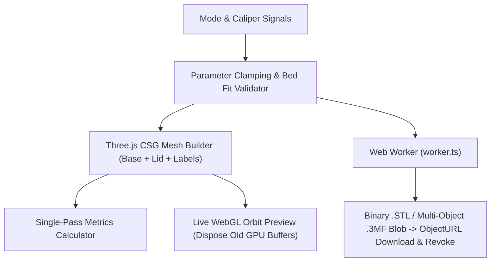

# Parametric Battery Dispenser & Memory Card Case Maker

# Technical Specification & Architecture Blueprint

> **Spec Number**: 123  
> **Slug**: `battery-sdcard-case-maker`  
> **Category**: `3d`  
> **Inspired By**: High-utility Printables / MakerWorld Parametric EDC & Bench Organizers  
> **Target SEO Keyword**: `parametric 3d print battery dispenser sd card case stl 3mf generator`  
> **Route**: `/tools/battery-sdcard-case-maker`  
> **Architecture**: 100% Client-Side Single Page Application (Zero Server Ingestion, Zero Telemetry)

---

## 1. MVP Generation Prompt (`/create-web-micro-saas`)

```text
/create-web-micro-saas

Act as a Principal Computational Geometry Engineer and Angular Architect. Build a 100% client-side 3D parametric generator for PrivKnife called "Parametric Battery Dispenser & Memory Card Case Maker".

TECHNICAL CONSTRAINTS & STACK:
1. Pure Client-Side Architecture: Zero backend endpoints, zero telemetry, zero remote CAD APIs. All parametric mesh generation, CSG operations, STL/3MF serialization, and 3D WebGL viewport preview run locally in the browser.
2. Core Technologies: Already-installed `three` (`^0.186.1`), `three-bvh-csg` (`^0.0.18`), `jszip` (`^3.10.2`), pure-TS binary `.STL` + multi-object `.3MF` serializers, and procedural vector stroke geometry for dual-color `.3mf` cell/card labels.
3. Thread Safety & Memory Hygiene (Directives 3 & 4): Heavy mesh CSG/boolean builds and `.STL`/`.3MF` serialization MUST run in a dedicated Web Worker (`worker.ts`) with transferable `ArrayBuffer` payloads and `.onerror`/`.terminate()` teardown. Dispose replaced `BufferGeometry`, `Material`, `WebGLRenderer`, and `OrbitControls` in `ngOnDestroy()`, and revoke every `.stl`/`.3mf`/`.png` `ObjectURL` cleanly.
4. Export Deliverables: Print-ready manifold binary `.stl` (dispenser/base or tray+lid assembly) and multi-object dual-color `.3mf` archive, plus high-DPI WebGL canvas `.png` snapshot.

KEY FEATURES & USER INTERACTION:
- Two Generator Families:
  1. **Gravity-Fed Battery Dispenser**: Standard cell presets (`AAA` Ø10.5×44.5mm, `AA` Ø14.5×50.5mm, `C` Ø26.2×50mm, `CR2032` Ø20×3.2mm, `9V` 26.5×17.5×48.5mm, `18650` Ø18.6×65.2mm, `21700` Ø21.7×70.5mm), stack height (`4–24` cells), configurable chute ramp angle (`12°–30°`), front dispensing trough lip height, side viewing slot, and mount style (`Desk Stand`, `Wall Keyhole`, `IKEA Skadis Hook`, `Magnetic Bottom`).
  2. **Rugged Memory Card & EDC Media Case**: Configure exact slot counts for `SD` (24×32×2.1mm), `MicroSD` (11×15×1mm), `CFexpress Type B` (38.5×29.6×3.8mm), `Nintendo Switch Cartridge`, `USB-A`, and `USB-C` drives. Choose `Sliding Dovetail Tray`, `Print-in-Place Clamshell Snap Case`, or `Gridfinity 1xN Insert`.
- Dual-Color `.3MF` Embossed / Recessed Labels: Automatically place cell type (`AA`, `18650`) or slot icon labels (`SD`, `µSD`, `USB`) as a separate `.3mf` object body for AMS/MMU printing.
- Support-Free Printability & Tolerance Calibration: Adjustable fit clearance (`0.15–0.60mm`), bridging chamfer overhangs (`>= 45°`), and build-plate printability warning when assembly exceeds typical 220×220mm beds.
- Privacy & Local Execution Assurance: Prominent trust badge reading "🛡️ 100% In-Browser • Never Leaves Your Device".
```

---

## 2. Concept Overview & Value Proposition

Makers and photographers constantly waste hours searching STL repositories for a battery dispenser matching their exact cell count (`18650`, `21700`, `AA`) or a memory card case combining their specific mix of `SD`, `MicroSD`, and `USB-C` drives. Static STL downloads cannot adapt to printer tolerances, mount types (desk vs. IKEA Skadis vs. wall keyhole), or custom slot counts. **Parametric Battery Dispenser & Memory Card Case Maker** computes support-free, caliper-accurate meshes directly inside browser memory with dual-color `.3mf` size labeling.

### Elevator Pitch
> "Generate support-free gravity battery dispensers (`AA`–`21700`) and custom-slot `SD`/`MicroSD`/`USB` EDC cases as calibrated `.STL` and multi-color `.3MF` files—100% locally in your browser."

### Core Value Drivers
1. **Exact Cell & Card Caliper Physics**: Enforces per-side radial/axial tolerance clearances so batteries roll smoothly without jamming sideways in chutes and memory cards seat firmly without snapping fragile plastic dividers.
2. **Support-Free FDM Print Orientation**: Models chute overhangs (`>= 45°` bridge/slope angles) and dovetail sliding grooves (`45°` chamfered walls) to print cleanly without support material.
3. **Single-Pass Live Viewport & Manufacturing Telemetry**: Computes exact millimeter `W × D × H`, triangle count, volume (`cm³`), PLA/PETG gram weight (`volumeCm3 * 1.24`), and estimated print time from a single generated geometry pass.

---

## 3. Technical Feasibility, Dependencies & Nuances

### Difficulty Score: 5.5 / 10 (Moderate — CSG boolean slot arrays, gravity chute spline geometry, and sliding dovetail clearances)

| Architectural Component | Implementation Technology | Installed in Repo? | Client-Side Feasibility |
|---|---|---|---|
| Parametric Dispenser & Case Meshes | `three` (`^0.186.1`) + `three-bvh-csg` (`^0.0.18`) | Yes | 100% In-Browser |
| Dual-Color Embossed Typography | Pure-TS Vector Stroke Polygon Extruder | Built in Tool Engine | 100% In-Browser |
| Binary `.STL` & Multi-Object `.3MF` | Pure-TS Binary Serializer + `jszip` (`^3.10.2`) | Yes | 100% In-Browser |
| Off-Thread CSG Export | Web Worker (`worker.ts`) | Native Browser API | Zero Main-Thread Freeze |

### Known Engineering Nuances & Mitigations
- **Battery Jamming / Bridging in Chutes**: If chute inner width `< cellLength + 2 * tolerance`, cylindrical cells bind laterally on Z-seam blobs.
  - *Mitigation*: Enforce `innerChuteWidth = nominalLength + 2 * Math.max(toleranceMm, 0.35)` and `chuteChannelDepth = nominalDiameter + 2 * Math.max(toleranceMm, 0.45)`, plus chamfered bottom exit transition.
- **Thin Card Divider Breakage (`MicroSD` = 1.0mm thick)**: Printing narrow `0.8mm` dividers between MicroSD slots delaminates with `0.4mm` nozzles unless multiples of 2+ perimeters.
  - *Mitigation*: Clamp `slotWallThicknessMm >= Math.max(1.2, nozzleDiameterMm * 3)` and add vertical chamfered finger-grab relief cutouts along outer case margins.
- **Sliding Lid Dovetail Binding**: Zero-clearance dovetails weld shut when squished on first layers or over-extruded.
  - *Mitigation*: Apply `0.25–0.45mm` configurable XY sliding clearance and `45°` tapered rail geometry so sliding lids print cleanly without supports and break free effortlessly.

---

## 4. Competitive Landscape & Market Positioning

| Feature / Metric | PrivKnife (`battery-sdcard-case-maker`) | Thingiverse Customizer (OpenSCAD) | Static STL Sites |
|---|---|---|---|
| **Latency & Availability** | **Instant Local (< 250ms preview)** | Broken / Queue timeouts | Manual search, non-editable |
| **Mixed Memory Card Combinations** | **Custom `SD`+`µSD`+`CFx`+`USB` grid** | Fixed hardcoded counts | Rarely matches user gear |
| **Dual-Color `.3MF` Multi-Body Labels** | **Built-in Native `.3MF`** | Monochrome STL only | Rare |
| **Privacy & Telemetry** | **100% Offline, Zero Tracking** | Account & server logs | Ads & tracking |

---

## 5. Functional Requirements & Parametric Algorithms

### 5.1. Gravity Battery Dispenser Pipeline
- Compute internal envelope from preset `(diameterMm, lengthMm)` + `fitToleranceMm`:
  - Vertical magazine stack height `= stackCount * diameterMm + wallMm * 2`.
  - Lower exit ramp sloped by `rampAngleDeg` (`12°–30°`) leading to extended retrieval tray of depth `1.6 * diameterMm` and raised front stop lip (`0.42 * diameterMm`) preventing accidental roll-out while keeping thumb access clear.
  - Subtract central vertical viewing slot (`width = 0.22 * cellLengthMm`) and optional rear keyhole slots or IKEA Skadis T-hooks (`5mm` width × `15mm` spacing compatibility).

### 5.2. Memory Card Case & Tray Assembly
- Compute deterministic packing layout for requested slot counts:
  - `SD`: `24.0 × 2.1 × 20.0 mm` socket + `toleranceMm`.
  - `MicroSD`: `11.0 × 1.0 × 10.5 mm` socket + `toleranceMm`.
  - `CFexpress Type B`: `29.6 × 3.8 × 24.0 mm`.
  - `Switch Game`: `21.2 × 3.2 × 20.0 mm`.
  - `USB-A` / `USB-C`: `12.0 × 4.5 × 16.0 mm` / `8.5 × 3.2 × 12.0 mm`.
- Generate `baseMesh`, optional `lidMesh` (`sliding_dovetail` with thumb detent nib or `snap_clamshell` print-in-place hinge), and `labelMesh` (raised/recessed `0.6mm` vector strokes for `.3MF` Object 2).

### 5.3. Single-Pass Metrics & Exports
- Reuse already-generated preview geometries in `calculateMetrics(options, parts)` (never rebuild twice).
- Export valid binary `.STL` (80-byte header + uint32 triangle count + 50 bytes/triangle) and valid `.3MF` (`[Content_Types].xml`, `_rels/.rels`, `3D/3dmodel.model` with separate `<object>` elements for Body, Lid, and Label).

---

## 6. UI/UX Layout Specification (BEM Architecture)

- **Localization (`i18n`)**: Keys under `tools.batterySdcardCaseMaker.*` across all 8 locales.
- **Layout**:
  - `.l-columns--2` desktop (controls left, sticky Three.js WebGL viewport + metrics HUD right) stacking cleanly `< 900px` with viewport ordered first on mobile.
  - Inputs strictly use `.c-input__control` (`<select>`) and `.c-input__slider` (`<input type="range">`).
  - Viewport HUD uses responsive flex bar `.c-battery-case__viewport-hud` with dark-surface high-contrast buttons (`>= 38px` touch targets) preventing badge collision.

---

## 7. Technical Architecture & Client-Side Pipeline



---

## 8. Input/Output Data Contracts (TypeScript Interfaces)

```typescript
export type BatteryCaseMode = 'battery_dispenser' | 'memory_card_case';
export type BatteryCellPreset = 'aaa' | 'aa' | 'c' | 'cr2032' | '9v' | '18650' | '21700';
export type DispenserMountStyle = 'desk' | 'wall_keyhole' | 'skadis' | 'magnetic';
export type CardCaseStyle = 'sliding_dovetail' | 'snap_clamshell' | 'open_tray';

export interface BatterySdcardCaseOptions {
  mode: BatteryCaseMode;
  // Battery Dispenser
  cellPreset: BatteryCellPreset;
  stackCount: number;              // 4..24
  rampAngleDeg: number;            // 12..30
  mountStyle: DispenserMountStyle;
  includeViewSlot: boolean;
  // Memory Card Case
  cardCaseStyle: CardCaseStyle;
  sdSlots: number;                 // 0..16
  microSdSlots: number;            // 0..24
  cfExpressSlots: number;          // 0..8
  switchCartSlots: number;         // 0..12
  usbASlots: number;               // 0..8
  usbCSlots: number;               // 0..8
  // Common Fabrication
  wallThicknessMm: number;         // 1.4..4.0
  fitToleranceMm: number;          // 0.15..0.60
  labelText: string;
  includeEmbossedLabel: boolean;
  bodyColorHex: string;
  accentColorHex: string;
}

export interface BatteryCaseMetrics {
  widthMm: number;
  depthMm: number;
  heightMm: number;
  triangleCount: number;
  estimatedVolumeCm3: number;
  estimatedWeightG: number;
  estimatedPrintTimeHours: number;
  exceedsStandardBed: boolean;
}
```

---

## 9. Security, Memory Hygiene & Functional Test Vectors

- **Directives 1–5**: Zero network calls; Web Worker `.onerror` + `.terminate()`; complete Three.js `.geometry.dispose()`, `.material.dispose()`, `renderer.dispose()`, `controls.dispose()` in `ngOnDestroy()`; ObjectURL array tracked and revoked on reset & destroy.
- **Functional Test Vectors**:
  1. `aa` dispenser (`stackCount: 10, wallThicknessMm: 2.0, fitToleranceMm: 0.4`) produces non-empty manifold `body` geometry with zero `NaN` vertices, inner chute span `>= 50.5 + 0.8 = 51.3 mm`, and valid single-pass `BatteryCaseMetrics`.
  2. Memory card case with all slot counts `= 0` returns `{ valid: false }` validation error instead of empty/broken zero-width geometry.
  3. Mixed case (`sdSlots: 4, microSdSlots: 8, usbCSlots: 2`) in `sliding_dovetail` mode outputs separate `body`, `lid`, and `label` meshes into multi-object `.3MF` (`3D/3dmodel.model` contains `<object` count `>= 2`).
  4. Binary `.STL` export byte length equals exactly `84 + triangleCount * 50` and matches `ASCII` header safety checks.
