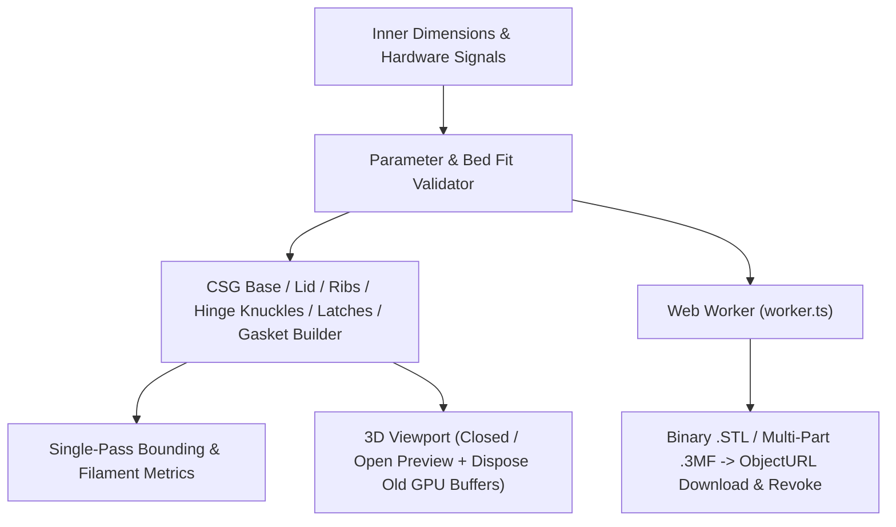

# Parametric Rugged Hinged Storage Box & Parts Organizer

# Technical Specification & Architecture Blueprint

> **Spec Number**: 124  
> **Slug**: `rugged-hinged-box-maker`  
> **Category**: `3d`  
> **Inspired By**: High-utility Printables / MakerWorld Parametric Rugged Carry Cases  
> **Target SEO Keyword**: `parametric 3d printed rugged storage box hinged parts organizer stl 3mf`  
> **Route**: `/tools/rugged-hinged-box-maker`  
> **Architecture**: 100% Client-Side Single Page Application (Zero Server Ingestion, Zero Telemetry)

---

## 1. MVP Generation Prompt (`/create-web-micro-saas`)

```text
/create-web-micro-saas

Act as a Principal Mechanical CAD Engineer and Frontend Architect. Build a 100% client-side 3D parametric generator for PrivKnife called "Parametric Rugged Hinged Storage Box & Parts Organizer".

TECHNICAL CONSTRAINTS & STACK:
1. Pure Client-Side Architecture: Zero backend endpoints, zero telemetry. All internal box cavities, knuckle hinges, snap latches, and TPU gasket channels are computed in the browser.
2. Core Technologies: Already-installed `three` (`^0.186.1`), `three-bvh-csg` (`^0.0.18`), `jszip` (`^3.10.2`), pure-TS binary `.STL` and multi-object `.3MF` serializers.
3. Thread Safety & Memory Hygiene (Directives 3 & 4): Heavy CSG boolean shell/divider generation and export serialization execute in a dedicated Web Worker (`worker.ts`). Dispose all `BufferGeometry`, `Material`, `WebGLRenderer`, and `OrbitControls` in `ngOnDestroy()`, and revoke every exported `ObjectURL` cleanly.
4. Export Deliverables: Print-ready manifold `.stl` (full plate or single part), multi-object `.3mf` separating Bottom Shell, Hinged Lid, Compliant Latches, Removable Dividers, and optional TPU Gasket Seal into independent slicer objects.

KEY FEATURES & USER INTERACTION:
- Exact Internal Dimensions (`L × W × H`): Configure inner length (`60–240mm`), inner width (`50–200mm`), lower depth (`18–110mm`), and upper lid cavity depth (`10–60mm`).
- Structural Armor & Weatherproofing: Vertical exterior reinforcement ribs (`0–6` per face), rounded outer corner fillets (`3–14mm`), stackable alignment bottom feet/lid pockets, and optional `2.4mm` TPU filament gasket channel with matching printable TPU seal loop!
- Hinge & Latch Hardware Modes:
  - Hinge: `Print-in-Place Knuckle` (with configurable pin clearance `0.25–0.50mm`) OR `M3 Screw/Filament Pin Knuckle` (Ø3.2mm / Ø1.95mm through-bores).
  - Latch: `Compliant Front Snap Latches` (1 or 2 latches based on width) OR `Friction Slide Clips`.
- Internal Parts Divider Matrix: `X Columns × Y Rows` (`1×1` up to `8×6`) as either molded permanent ribs or lifted removable divider trays, plus dual-color `.3mf` embossed front nameplate (`e.g. M3 SCREWS`).
- Privacy & Local Execution Assurance: Prominent trust badge reading "🛡️ 100% In-Browser • Never Leaves Your Device".
```

---

## 2. Concept Overview & Value Proposition

Makers use rugged hinged boxes constantly for small fasteners, multimeters, first-aid kits, camera filters, and field electronics—yet downloading fixed STL boxes almost never fits the exact internal object or build-plate size. **Parametric Rugged Hinged Storage Box & Parts Organizer** builds a watertight, reinforced, snap-latch case around any caliper measurement (`L × W × H`) and separates latches and gasket seals into separate `.3mf` bodies so PETG boxes and TPU gaskets can be sliced with optimal per-part materials.

### Elevator Pitch
> "Design custom rugged hinged parts boxes with external ribs, print-in-place or M3 hinges, snap latches, TPU gasket channels, and divider grids as `.STL` and multi-material `.3MF`—100% in-browser."

### Core Value Drivers
1. **True Internal Fit Guarantees**: Computes outer dimensions cleanly around the specified usable inner volume plus wall thickness and reinforcement rib relief.
2. **Material-Aware Multi-Object `.3MF`**: Exports Body, Lid, Snap Latches, Internal Tray, and Gasket Seal Loop as distinct objects inside one `.3mf` archive.
3. **Configurable Knuckle Tolerances**: Lets users tune print-in-place hinge gap (`0.25–0.50mm`) or switch to Ø3.2mm M3 machine screw knuckles for heavy field loads.

---

## 3. Technical Feasibility, Dependencies & Nuances

### Difficulty Score: 6.0 / 10 (Moderate — Multi-knuckle alternating hinge boolean alignment, compliant latch snap detents, and gasket lip mates)

| Architectural Component | Implementation Technology | Installed in Repo? | Client-Side Feasibility |
|---|---|---|---|
| Rounded Shell, Ribs & Gasket Channel | `three` ExtrudeGeometry + Lathe/Sweep | Yes (`^0.186.1`) | 100% In-Browser |
| Alternating Hinge & Latch Booleans | `three-bvh-csg` (`^0.0.18`) | Yes (`^0.0.18`) | 100% In-Browser |
| Binary `.STL` & Multi-Object `.3MF` | Pure-TS Binary STL + `jszip` (`^3.10.2`) | Yes | 100% In-Browser |

### Known Engineering Nuances & Mitigations
- **Knuckle Collision When Rotating / Closing**: Naive cylindrical knuckles overlap when the lid opens `180°` against external reinforcement ribs.
  - *Mitigation*: Offset hinge axis center to `Z = baseTopZ`, `Y = -(outerDepth / 2 + hingeClearanceMm + hingeRadiusMm)` so both halves rotate cleanly without interfering with exterior ribs.
- **Compliant Latch Snap Fatigue in PLA**: PLA creeps if latch hook undercut depth is excessive.
  - *Mitigation*: Constrain snap undercut engagement to `1.1–1.4mm` with `45°` lead-in chamfer and smooth cantilever flex arm length `>= 18mm` (plus separate `.3MF` latch body so users can print latches in PETG/ABS).
- **Empty Plate / Bed Overrun**: Large boxes with wide open lids placed flat exceed `220×220mm` build plates.
  - *Mitigation*: Compute combined flat footprint and flag `exceedsStandardBed = plateWidthMm > 220 || plateDepthMm > 220` cleanly in telemetry.

---

## 4. Competitive Landscape & Market Positioning

| Feature / Metric | PrivKnife (`rugged-hinged-box-maker`) | Printables Remix Hunting | OpenSCAD Desktop Scripts |
|---|---|---|---|
| **Setup & Ease of Use** | **Zero Install, Instant WebGL** | Hours browsing fixed sizes | Requires local OpenSCAD + syntax |
| **Gasket Loop Auto-Generation** | **Matching TPU Seal Mesh Included** | Rarely matched accurately | Manual boolean extraction |
| **Material Split (`.3MF`)** | **Native 5-Part `.3MF` Archive** | Often single merged STL | Manual multi-file export |

---

## 5. Functional Requirements & Parametric Algorithms

### 5.1. Base, Lid & Reinforcement Ribs
- Outer envelope: `outerW = innerLengthMm + 2 * wallThicknessMm`, `outerD = innerWidthMm + 2 * wallThicknessMm`.
- Extrude rounded rectangle perimeter (`cornerRadiusMm`) for Base (`baseHeightMm`) and Lid (`lidHeightMm`), subtracting inner fillet cavity.
- Add `ribCountPerSide` (`0–6`) exterior vertical ribs (`ribWidthMm = 4.5mm`, `ribProtrusionMm = 2.5mm`) tapered `45°` at top and bottom so zero overhangs require support!

### 5.2. Hinge Knuckles & Compliant Latches
- Alternate odd/even hinge knuckles along `X` axis attached to Base (`1, 3, 5...`) and Lid (`2, 4...`) separated by `hingeClearanceMm`.
- Cut exact bore (`pinDiameterMm + 0.25mm` for M3/filament pins) OR generate concentric print-in-place cone pin pairs with `hingeClearanceMm`.
- Generate `latchCount` (`1` when `innerLengthMm < 125`, `2` otherwise) front catch ridges + matching separate snap latch clips with pivot arms.

### 5.3. Internal Divider Matrix & Gasket Channel
- If `dividerCols > 1 || dividerRows > 1`, construct intersecting interior partition grid (`1.4mm` wall thickness, top lowered `-2.0mm` below rim for clean lid closure or exported separately as removable insert).
- When `includeGasketChannel: true`, subtract `2.4mm` wide × `1.2mm` deep groove around Base rim (`meanPerimeter`) and generate matching separate `Gasket Seal Loop` geometry.

---

## 6. UI/UX Layout Specification (BEM Architecture)

- **Localization (`i18n`)**: Keys under `tools.ruggedHingedBoxMaker.*` across 8 locales.
- **Layout**: `.l-columns--2` desktop (`c-rugged-box__viewport-hud` top flex bar with Exploded / Closed preview toggle, Wireframe toggle, Reset View, PNG, `.STL`, `.3MF`). All inputs use `.c-input__control` & `.c-input__slider` (`>= 38px` mobile touch targets).

---

## 7. Technical Architecture & Client-Side Pipeline



---

## 8. Input/Output Data Contracts (TypeScript Interfaces)

```typescript
export type HingeType = 'print_in_place' | 'm3_screw' | 'filament_pin';
export type LatchType = 'snap_compliant' | 'friction_slide';
export type DividerMode = 'none' | 'molded_fixed' | 'removable_tray';

export interface RuggedHingedBoxOptions {
  innerLengthMm: number;           // 60..240
  innerWidthMm: number;            // 50..200
  baseDepthMm: number;             // 18..110
  lidDepthMm: number;              // 10..60
  wallThicknessMm: number;         // 2.0..5.0
  cornerRadiusMm: number;          // 3.0..14.0
  ribCountPerSide: number;         // 0..6
  hingeType: HingeType;
  hingeClearanceMm: number;        // 0.25..0.50
  latchType: LatchType;
  includeGasketChannel: boolean;
  dividerMode: DividerMode;
  dividerCols: number;             // 1..8
  dividerRows: number;             // 1..6
  frontLabelText: string;
  bodyColorHex: string;
  accentColorHex: string;
  previewOpen: boolean;
}

export interface RuggedBoxMetrics {
  outerWidthMm: number;
  outerDepthMm: number;
  closedHeightMm: number;
  flatPlateWidthMm: number;
  flatPlateDepthMm: number;
  triangleCount: number;
  estimatedVolumeCm3: number;
  estimatedWeightG: number;
  estimatedPrintTimeHours: number;
  exceedsStandardBed: boolean;
}
```

---

## 9. Security, Memory Hygiene & Functional Test Vectors

- **Directives 1–5**: Zero network calls; Web Worker lifecycle & ObjectURL cleanup paired; complete Three.js disposal in `ngOnDestroy()`.
- **Functional Test Vectors**:
  1. Box with `innerLengthMm: 120, innerWidthMm: 80, baseDepthMm: 35, wallThicknessMm: 3.0` yields `outerWidthMm >= 126`, `innerCavityVolumeCm3` preserving exact `120 × 80 × 35`, zero `NaN` vertices across Base, Lid, and Latches.
  2. `m3_screw` hinge mode cuts through-pin bores along the rear knuckle centerline (`y < -outerDepth / 2`).
  3. `includeGasketChannel: true` outputs an extra separate `gasket` mesh object in multi-object `.3MF` (`3D/3dmodel.model`).
  4. Invalid bounds (`innerLengthMm: 20` < 60, `wallThicknessMm: 0.5` < 2.0) fail validation gracefully (`{ valid: false }`).
