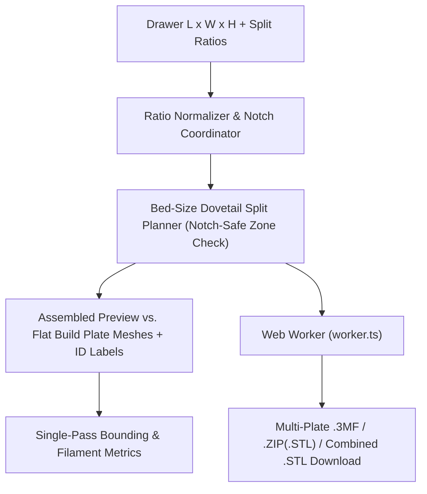

# Parametric Custom Drawer Divider & Interlocking Grid Maker

# Technical Specification & Architecture Blueprint

> **Spec Number**: 125  
> **Slug**: `drawer-divider-grid-maker`  
> **Category**: `3d`  
> **Inspired By**: Caliper-Exact Kitchen, Toolbox & Desk Drawer Interlocking Partitions  
> **Target SEO Keyword**: `parametric 3d print drawer divider grid generator interlocking dovetail stl`  
> **Route**: `/tools/drawer-divider-grid-maker`  
> **Architecture**: 100% Client-Side Single Page Application (Zero Server Ingestion, Zero Telemetry)

---

## 1. MVP Generation Prompt (`/create-web-micro-saas`)

```text
/create-web-micro-saas

Act as a Principal Computational Geometry Engineer and Angular Architect. Build a 100% client-side 3D parametric generator for PrivKnife called "Parametric Custom Drawer Divider & Interlocking Grid Maker".

TECHNICAL CONSTRAINTS & STACK:
1. Pure Client-Side Architecture: Zero backend endpoints, zero telemetry. Every slat, half-lap notch, and dovetail joint is generated locally in the browser.
2. Core Technologies: Already-installed `three` (`^0.186.1`), `three-bvh-csg` (`^0.0.18`), `jszip` (`^3.10.2`), and pure-TS `.STL` / multi-plate `.3MF` serializers.
3. Thread Safety & Memory Hygiene (Directives 3 & 4): Multi-slat grid CSG notches and bed-splitting run inside a dedicated Web Worker (`worker.ts`) with transferable buffers. Dispose replaced WebGL geometries/materials and `renderer` on `ngOnDestroy()`, and revoke all download `ObjectURL`s cleanly.
4. Export Deliverables: Complete multi-part `.stl` pack (or `.zip` of individually printable plates), plus organized build-plate `.3mf` where every slat lays flat (`Z = 0`) for rapid zero-support printing.

KEY FEATURES & USER INTERACTION:
- Exact Wall-to-Wall Drawer Caliper Inputs:
  - Internal Drawer Width (`80–900mm`), Internal Drawer Depth (`80–700mm`), Divider Height (`20–140mm`), Blade Thickness (`2.4–5.0mm`), and Edge Fit Clearance (`0.5–3.0mm`).
- Asymmetric Column & Row Split Ratios:
  - Specify number of Columns (`1–10`) and Rows (`1–10`) OR enter comma-separated width ratios (e.g. `25, 25, 50`) for uneven cutlery/wrench compartments!
- Precision Half-Lap Cross Notches:
  - Top-half & bottom-half mating slots cut to exact `slotWidth = bladeThickness + notchClearanceMm` (`0.15–0.40mm`) with slight chamfered lead-ins for tool-free snap assembly.
- Automatic Build-Plate Bed Splitting & Dovetail Joints:
  - Configure user's Printer Bed Size (`180×180` Prusa Mini, `220×220` Ender 3, `256×256` Bambu, `300×300`). Any slat longer than `bedWidth - 15mm` automatically splits into interlocking chamfered **Dovetail Segments** laid flat on numbered build plates!
- Optional Anti-Tip Base Flanges / Corner T-Feet & Dual-Color Size Embossing: Toggle stabilizing bottom T-feet (`8mm` flange) and auto-embossed piece IDs (`X1-A`, `Y2-B`) on one side of each slat for puzzle-free assembly.
- Privacy & Local Execution Assurance: Prominent trust badge reading "🛡️ 100% In-Browser • Never Leaves Your Device".
```

---

## 2. Concept Overview & Value Proposition

Gridfinity (`gridfinity-bin-generator`) uses fixed 42mm increments, leaving frustrating dead strips around non-multiple drawers—and standard `500mm` kitchen or toolbox drawers simply don't fit on a `256mm` build plate. **Parametric Custom Drawer Divider & Interlocking Grid Maker** eliminates dead space: users measure exact wall-to-wall drawer dimensions, choose custom compartment widths, and automatically receive flat-lying half-lap interlocking slats split cleanly into printable dovetail segments that fit their exact printer bed.

### Elevator Pitch
> "Turn exact wall-to-wall drawer measurements into half-lap interlocking divider grids with automatic dovetail bed-splitting for oversized kitchen, office, and tool drawers—100% client-side."

### Core Value Drivers
1. **Zero Wasted Perimeter Margin**: Fits arbitrary metric/imperial drawers down to `0.5mm` edge clearance without leaving gaps.
2. **Oversized Drawer Dovetail Auto-Split**: Splits `600mm` slats cleanly into rigid friction-fit dovetail segments matched to user bed size (`180–350mm`).
3. **Rapid Flat-Print Layout**: Orienting every slat horizontally keeps layer lines along tension directions and finishes an entire drawer grid cleanly without support material.

---

## 3. Technical Feasibility, Dependencies & Nuances

### Difficulty Score: 5.5 / 10 (Moderate — Parametric asymmetric ratio parser, mating half-lap slot geometry, and printable flat dovetail male/female joints)

| Architectural Component | Implementation Technology | Installed in Repo? | Client-Side Feasibility |
|---|---|---|---|
| Half-Lap & Dovetail Slat Meshes | `three` ExtrudeGeometry + `three-bvh-csg` | Yes | 100% In-Browser |
| Piece ID Embossing (`X1-A`) | Pure-TS Vector Stroke Extruder | Built in Engine | 100% In-Browser |
| Multi-Plate Pack (`3MF` / `.ZIP` / `.STL`) | `jszip` (`^3.10.2`) + Binary STL Writer | Yes | 100% In-Browser |

### Known Engineering Nuances & Mitigations
- **Half-Lap Notch Vertical Overlap Collision**: If X-axis and Y-axis slats both cut notches from the bottom, slats cannot interlock.
  - *Mitigation*: X-axis slats cut slots downward from the **top edge** (`height/2` to `height`), while Y-axis slats cut matching slots upward from the **bottom edge** (`0` to `height/2`), guaranteeing flush top and bottom planar mating.
- **T-Joint Strength Across Dovetail Seams**: Placing a dovetail joint directly on top of a cross-notch weakens the slat severely.
  - *Mitigation*: Constrain dovetail split search so joints never fall within `±12mm` of any cross-notch centerline (shifting split offset cleanly away from intersections).
- **Sloppy Half-Lap Wobble vs. Stuck Force Fit**: Exact `bladeThicknessMm` notches jam when walls over-extrude.
  - *Mitigation*: Expose `notchClearanceMm` (`0.15–0.40mm`) added cleanly across the slot width (`slotW = bladeThicknessMm + notchClearanceMm`) plus a `0.4mm` 45° top entry lead-in chamfer.

---

## 4. Competitive Landscape & Market Positioning

| Feature / Metric | PrivKnife (`drawer-divider-grid-maker`) | Fixed Gridfinity Bins | Buying Plastic Organizers |
|---|---|---|---|
| **Exact Drawer Utilization** | **100% Custom Wall-to-Wall** | Multiple of 42mm only | Gaps & sliding trays |
| **Oversized Drawers (`> 256mm`)** | **Auto Dovetail Split per Bed Size** | Small tiles only | Limited to store sizes |
| **Print Time & Filament** | **Ultra-Low (Thin Half-Lap Slats)** | Thick heavy bases & walls | Store markup + shipping |

---

## 5. Functional Requirements & Parametric Algorithms

### 5.1. Ratio Parser & Intersection Coordinates
- Parse `columnRatios` (`"1,1,2"` or `"25,25,50"`) and `rowRatios`, normalize to sum `1.0`, compute exact X and Y cross-notch coordinates along usable width `usableW = drawerWidthMm - 2 * edgeClearanceMm` and depth `usableD = drawerDepthMm - 2 * edgeClearanceMm`.

### 5.2. Half-Lap Slat & Dovetail Split Generation
- For each X-slat: slice spans exceeding `usableBedLimitMm = bedWidthMm - 16`, avoiding `[notchX - 12, notchX + 12]` zones.
- Generate trapezoidal sliding dovetail male tenon & female mortise (`baseNeckW = max(8, heightMm * 0.28)`, `headW = baseNeckW * 1.45`, `length = 12mm`, `clearance = notchClearanceMm`).
- Lay every generated segment flat (`heightMm` along Y or Z rotated into build plane `Z = 0..bladeThicknessMm`) neatly packed onto virtual build plates.

---

## 6. UI/UX Layout Specification (BEM Architecture)

- **Localization (`i18n`)**: Keys under `tools.drawerDividerGridMaker.*` across all 8 locales.
- **Layout**: `.l-columns--2` desktop (`Assembled Drawer View` vs. `Flat Print Plate View` toggle in `.c-drawer-grid__viewport-hud`), `.c-input__control`/`.c-input__slider` bindings, and plate-count telemetry badge (`e.g. 6 slats • 2 dovetail joints • 2 print plates`).

---

## 7. Technical Architecture & Client-Side Pipeline



---

## 8. Input/Output Data Contracts (TypeScript Interfaces)

```typescript
export type DividerViewMode = 'assembled' | 'flat_plates';

export interface DrawerDividerGridOptions {
  drawerWidthMm: number;           // 80..900
  drawerDepthMm: number;           // 80..700
  dividerHeightMm: number;         // 20..140
  bladeThicknessMm: number;        // 2.4..5.0
  edgeClearanceMm: number;         // 0.5..3.0
  notchClearanceMm: number;        // 0.15..0.40
  colCount: number;                // 1..10
  rowCount: number;                // 1..10
  customColRatios: string;         // e.g. '1,2,1'
  customRowRatios: string;         // e.g. '1,1'
  printerBedMm: number;            // 180..350
  includeBaseFeet: boolean;
  includePieceLabels: boolean;
  viewMode: DividerViewMode;
  filamentColorHex: string;
}

export interface DrawerGridMetrics {
  usableWidthMm: number;
  usableDepthMm: number;
  totalSlatsCount: number;
  dovetailSplitCount: number;
  buildPlateCount: number;
  triangleCount: number;
  estimatedVolumeCm3: number;
  estimatedWeightG: number;
  estimatedPrintTimeHours: number;
}
```

---

## 9. Security, Memory Hygiene & Functional Test Vectors

- **Directives 1–5**: Zero network calls; Web Worker lifecycle & ObjectURL cleanup paired; Three.js `.dispose()` in `ngOnDestroy()`.
- **Functional Test Vectors**:
  1. `drawerWidthMm: 500, printerBedMm: 220, colCount: 3, rowCount: 3` triggers `dovetailSplitCount >= 2`, keeping every individual segment length `<= 220 - 16 = 204 mm`.
  2. No dovetail joint centerline falls closer than `12mm` to any half-lap intersection notch.
  3. Assembled X-slat top notch Z-span `[dividerHeightMm/2, dividerHeightMm]` and Y-slat bottom notch Z-span `[0, dividerHeightMm/2]` sum to full non-overlapping interlocking height `dividerHeightMm`.
  4. Invalid `drawerWidthMm: 20` or empty ratios fall back/validate cleanly without crashing or producing `NaN` vertices.
