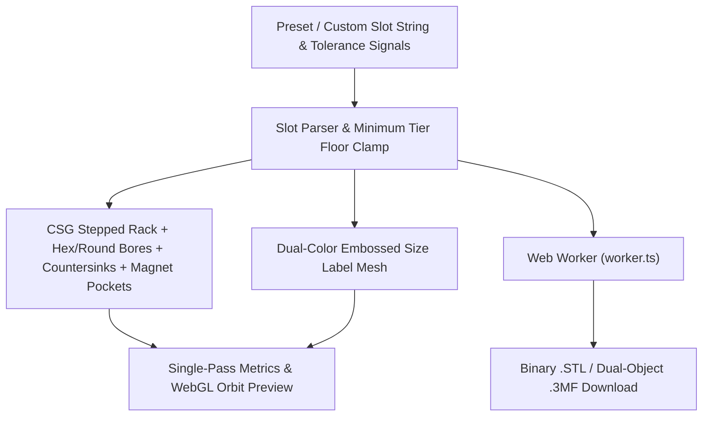

# Parametric Tool, Drill Bit, Hex Key & Nozzle Organizer Maker

# Technical Specification & Architecture Blueprint

> **Spec Number**: 126  
> **Slug**: `tool-bit-holder-maker`  
> **Category**: `3d`  
> **Inspired By**: Caliper-Exact Stepped Workshop Racks for Drills, Hex Bits, Allen Keys & Nozzles  
> **Target SEO Keyword**: `parametric 3d print drill bit holder hex key rack nozzle organizer stl 3mf`  
> **Route**: `/tools/tool-bit-holder-maker`  
> **Architecture**: 100% Client-Side Single Page Application (Zero Server Ingestion, Zero Telemetry)

---

## 1. MVP Generation Prompt (`/create-web-micro-saas`)

```text
/create-web-micro-saas

Act as a Principal Mechanical CAD Engineer and Angular Architect. Build a 100% client-side 3D parametric generator for PrivKnife called "Parametric Tool, Drill Bit, Hex Key & Nozzle Organizer Maker".

TECHNICAL CONSTRAINTS & STACK:
1. Pure Client-Side Architecture: Zero backend endpoints, zero telemetry. All rack profiles, stepped hole arrays, magnetic pockets, and dual-color embossed size text run locally in the browser.
2. Core Technologies: Already-installed `three` (`^0.186.1`), `three-bvh-csg` (`^0.0.18`), `jszip` (`^3.10.2`), pure-TS procedural stroke text geometry, and pure-TS `.STL` / `.3MF` serializers.
3. Thread Safety & Memory Hygiene (Directives 3 & 4): Heavy CSG stepped block hole subtraction and text extrusion run inside a dedicated Web Worker (`worker.ts`) with transferable buffers. Dispose all `BufferGeometry`, `Material`, `WebGLRenderer`, and `OrbitControls` in `ngOnDestroy()`, and revoke every download `ObjectURL` cleanly.
4. Export Deliverables: Print-ready manifold `.stl` and dual-color `.3mf` separating Rack Body and High-Contrast Size Legend Labels (`1.5, 2, 2.5...`) for crisp AMS/MMU visibility.

KEY FEATURES & USER INTERACTION:
- Tool Set Presets + Custom Comma-Separated List:
  1. **Metric Drill Bits** (`1.0mm–10.0mm` by `0.5mm`, round bores + fit tolerance)
  2. **Imperial Drill Bits** (`1/16"`–`3/8"` fraction labels rendered automatically)
  3. **1/4" Hex Screwdriver Bits** (6.35mm across-flats hexagonal socket cutouts `× 10–40` slots + optional `Ø6×3mm` bottom magnet hold pockets!)
  4. **Metric / SAE Allen Hex Key Set** (`1.5, 2, 2.5, 3, 4, 5, 6, 8, 10 mm` with open front L-bend relief slots!)
  5. **3D Printer Nozzles Rack** (`M6` E3D V6 / MK8 / Bambu brass sockets + labels `0.2, 0.4, 0.6, 0.8`)
  6. **Precision Micro Screwdrivers / Tweezers Rack** (`custom` diameters)
- Configurable Rack Form Factors:
  - `Stepped Bench Stadium` (angled tiers so rear rows stay readable), `Flat Drawer Tray`, `Gridfinity Compatible Base`, or `IKEA Skadis / French Cleat Wall Mount`.
- Precision Hole Tolerance & Labeling: Independent `holeToleranceMm` (`0.15–0.60mm`), configurable `holeDepthMm`, tilted front chamfered label shelf (`35°`), and optional `6×2mm` / `8×3mm` neodymium base magnet pockets (with 0.6mm encapsulated floor skin).
- Privacy & Local Execution Assurance: Prominent trust badge reading "🛡️ 100% In-Browser • Never Leaves Your Device".
```

---

## 2. Concept Overview & Value Proposition

Every shop has mismatched drill bits, incomplete metric/imperial Allen key sets, or loose `0.2–0.8mm` 3D printer nozzles. Generic organizers either waste slots for sizes you don't own or omit the `5.5mm` / `T15` slot you actually use daily. **Parametric Tool, Drill Bit, Hex Key & Nozzle Organizer Maker** parses your exact comma-separated tool diameters and labels, lays out a compact stepped rack with accurate hole tolerances and optional magnet retention, and stamps bold dual-color size labels cleanly on a forward-tilted shelf.

### Elevator Pitch
> "Enter your exact drill, hex bit, Allen key, or printer nozzle sizes to generate stepped, labeled workshop organizers with optional magnet retention as `.STL` and dual-color `.3MF`."

### Core Value Drivers
1. **Exact Custom Size Lists**: Supports arbitrary diameter lists (`1.5, 2, 2.5, 3, 4, 5, 6, 8`) with zero wasted empty slots.
2. **True Hexagonal & Slotted Pockets**: Cuts flat-to-flat `6.35mm + tolerance` hex sockets for 1/4" bits (rotating hex circumradius `r = AF / Math.sqrt(3)`) and open front key slots for L-shaped Allen wrenches.
3. **High-Contrast Angled Dual-Color Labels**: Places 3D stroke labels on a tilted front lip as a distinct `.3MF` object so sizes remain readable even in dim workshop corners.

---

## 3. Technical Feasibility, Dependencies & Nuances

### Difficulty Score: 5.5 / 10 (Moderate — CSG boolean multi-row stepped pockets, circumradius hex bore alignment, and tilted vector label placement)

| Architectural Component | Implementation Technology | Installed in Repo? | Client-Side Feasibility |
|---|---|---|---|
| Stepped Rack & Skadis Hooks | `three` ExtrudeGeometry + CSG | Yes (`^0.186.1`) | 100% In-Browser |
| Round/Hex Holes & Magnet Pockets | `three-bvh-csg` (`^0.0.18`) | Yes (`^0.0.18`) | 100% In-Browser |
| Multi-Color Size Labels & `.3MF` | Pure-TS Vector Font + `jszip` | Yes (`^3.10.2`) | 100% In-Browser |

### Known Engineering Nuances & Mitigations
- **Vertical Print Bore Shrinkage**: FDM holes printed vertically on XY planes shrink `0.2–0.35mm` due to inward polygon cord tension.
  - *Mitigation*: Default `holeToleranceMm = 0.35mm` (`boreDiameter = nominalMm + holeToleranceMm`), plus subtle `0.6mm` top entry countersink chamfer (`45°`) so drill shanks drop in smoothly.
- **Hex Bit Tightness (`1/4" = 6.35mm`)**: Measuring cylinder diameter instead of circumradius makes hex bits impossible to insert!
  - *Mitigation*: Compute circumradius accurately: `hexRadius = ((6.35 + holeToleranceMm) / 2) / Math.cos(Math.PI / 6)` (i.e. across-flats `AF / sqrt(3)`).
- **Floor Puncture on Deep Bores**: Users entering `holeDepthMm >= rackHeightMm` punch through the base floor.
  - *Mitigation*: Guarantee minimum floor thickness below every bore (`minFloorMm = includeBottomMagnets ? 3.8 : 2.5`) by elevating stepped tier height `>= boreDepth + minFloorMm`.

---

## 4. Competitive Landscape & Market Positioning

| Feature / Metric | PrivKnife (`tool-bit-holder-maker`) | Static Thingiverse Racks | Commercial Foam/Plastic Racks |
|---|---|---|---|
| **Exact Subset Support** | **Custom CSV Diameters & Labels** | Fixed sizes (missing your bits) | Unused slots waste space |
| **Dual-Color Embossed Size Text** | **Included Native `.3MF`** | Hard-to-read engraved monochrome | Printed ink rubs off |
| **Built-In Magnet Pockets** | **Optional Encapsulated Magnets** | Rare | Costly magnetic trays |

---

## 5. Functional Requirements & Parametric Algorithms

### 5.1. Tool Slot Spec Parser (`parseToolSlots`)
- Accepts preset token list or custom spec (`"1.5, 2, 2.5, 3, 4"` or `"M6:8, T15:7.5"`), returning normalized `{ label, diameterMm, shape }` entries clamped to safe limits (`1–60` slots, `0.8–30.0mm`).

### 5.2. Stepped Tier Geometry, Bores & Labels
- Group slots into `rowCount` (`1–4`), ascending diameter back-to-front or arranged evenly left-to-right across `stepped` tiers (`stepRiseMm = 10–16mm` per tier).
- Subtract CSG round cylinders (`segments = 32`), 6-sided circumradius hex prisms, and `0.6mm` countersink cones along hole axes; optionally subtract `Ø8×3.2mm` bottom neodymium pockets inset `0.6mm` or flush from `Z = 0`.
- Generate `labelMesh` along angled front lip (`width >= slotPitch - 1.2mm`) as independent `.3MF` object 2.

---

## 6. UI/UX Layout Specification (BEM Architecture)

- **Localization (`i18n`)**: Keys under `tools.toolBitHolderMaker.*` across 8 locales.
- **Layout**: `.l-columns--2` desktop (`c-tool-rack__viewport-hud` top flex bar), `.c-input__control` / `.c-input__slider` controls, preset quick-fill chips, and live bed-fit + hole-count telemetry.

---

## 7. Technical Architecture & Client-Side Pipeline



---

## 8. Input/Output Data Contracts (TypeScript Interfaces)

```typescript
export type ToolHolderPreset =
  | 'metric_drills'
  | 'imperial_drills'
  | 'hex_bits_quarter'
  | 'allen_keys'
  | 'printer_nozzles'
  | 'custom';

export type RackFormFactor = 'stepped_bench' | 'flat_tray' | 'skadis_wall';

export interface ToolSlotItem {
  label: string;
  diameterMm: number;
  shape: 'round' | 'hex' | 'allen_slot';
}

export interface ToolBitHolderOptions {
  preset: ToolHolderPreset;
  formFactor: RackFormFactor;
  customSpecText: string;
  hexBitCount: number;             // 6..40 (used in hex_bits_quarter)
  rows: number;                    // 1..4
  holeToleranceMm: number;         // 0.15..0.60
  holeDepthMm: number;             // 10..40
  slotSpacingMm: number;           // 3.0..12.0
  stepRiseMm: number;              // 0..18
  includeBottomMagnets: boolean;
  includeEmbossedLabels: boolean;
  bodyColorHex: string;
  labelColorHex: string;
}

export interface ToolHolderMetrics {
  slotCount: number;
  widthMm: number;
  depthMm: number;
  heightMm: number;
  triangleCount: number;
  estimatedWeightG: number;
  estimatedPrintTimeHours: number;
  exceedsStandardBed: boolean;
}
```

---

## 9. Security, Memory Hygiene & Functional Test Vectors

- **Directives 1–5**: Zero network calls; Web Worker `.onerror`/`.terminate()` & ObjectURL cleanup; full Three.js disposal in `ngOnDestroy()`.
- **Functional Test Vectors**:
  1. `parseToolSlots("1.5, 2, 2.5, 3, 4", "allen_keys")` yields 5 entries with `shape: 'allen_slot'`; malformed entries (`"abc, -2"`) are safely ignored or return validation error if 0 valid slots remain.
  2. `hex_bits_quarter` (`hexBitCount: 12, holeToleranceMm: 0.35`) generates flat-to-flat `6.70mm` hexagonal cavities (`circumradius ~= 3.868mm`).
  3. Every tier guarantees `tierHeightMm >= effectiveHoleDepthMm + 2.5mm` (no accidental punctured bottom floor!).
  4. `includeEmbossedLabels: true` exports 2+ distinct `<object>` blocks in `.3MF` (`Rack Body` + `Size Labels`).
