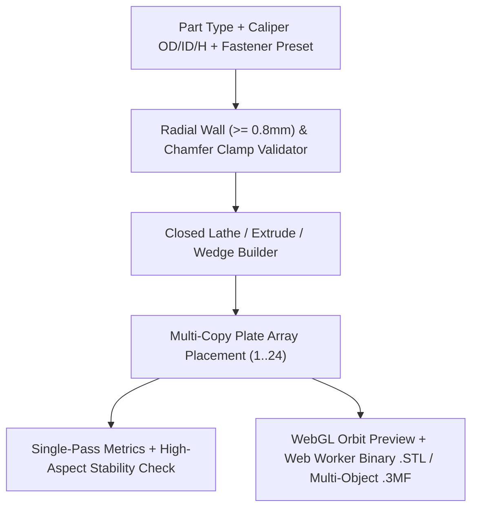

# Parametric Washer, Spacer, Standoff, Shim & Bushing Maker

# Technical Specification & Architecture Blueprint

> **Spec Number**: 127  
> **Slug**: `washer-spacer-shim-maker`  
> **Category**: `3d`  
> **Inspired By**: On-Demand Caliper Hardware — Washers, Stepped Bushings, Standoffs & Leveling Shims  
> **Target SEO Keyword**: `parametric 3d print washer spacer standoff bushing leveling shim stl 3mf`  
> **Route**: `/tools/washer-spacer-shim-maker`  
> **Architecture**: 100% Client-Side Single Page Application (Zero Server Ingestion, Zero Telemetry)

---

## 1. MVP Generation Prompt (`/create-web-micro-saas`)

```text
/create-web-micro-saas

Act as a Principal Mechanical CAD Engineer and Frontend Architect. Build a 100% client-side 3D parametric generator for PrivKnife called "Parametric Washer, Spacer, Standoff, Shim & Bushing Maker".

TECHNICAL CONSTRAINTS & STACK:
1. Pure Client-Side Architecture: Zero backend endpoints, zero telemetry. All cylindrical/lathe profiles, sloped shims, build-plate arrays, and STL/3MF meshes are generated locally in browser memory.
2. Core Technologies: Already-installed `three` (`^0.186.1`), `jszip` (`^3.10.2`), pure-TS binary `.STL` + multi-object `.3MF` serializers, and procedural stroke text for embossed dimension tags (`Ø8x3`).
3. Thread Safety & Memory Hygiene (Directives 3 & 4): Multi-copy array CSG/mesh merges and `.STL`/`.3MF` export run inside a dedicated Web Worker (`worker.ts`). Dispose all Three.js geometries, materials, and `WebGLRenderer` in `ngOnDestroy()`, and revoke every download `ObjectURL`.
4. Export Deliverables: Instant print-ready binary `.stl` and multi-object `.3mf` build-plate array (`1–24` identical parts neatly spaced on one plate).

KEY FEATURES & USER INTERACTION:
- Five Everyday Precision Part Profiles:
  1. **Flat Washer / Cylindrical Spacer**: Exact Outer Diameter (`OD 6–120mm`), Inner Hole Diameter (`ID 2–90mm`), Height (`0.4–80mm`), plus optional `45°` top/bottom edge chamfers!
  2. **Flanged / Shoulder Bushing**: Base Flange OD (`OD2`), Flange Height, Barrel OD (`OD1`), Continuous Inner Bore (`ID`), and step shoulder chamfer.
  3. **Stepped PCB / VESA / Hex Standoff**: Choice of Hexagonal or Round outer body, optional press-fit countersink end, and metric bolt quick-presets (`M2`, `M2.5`, `M3`, `M4`, `M5`, `M6`, `M8`, `M10`).
  4. **Tapered Furniture / Door / Cabinet Leveling Wedge**: Rectangular wedge with start height (`hMin 0.5–10mm`), end height (`hMax 2–35mm`), length (`25–150mm`), width (`15–80mm`), and anti-slip top ribs or center screw slot!
  5. **Stepped / U-Slot Tile & Framing Shim**: Horse-shoe slotted shim (`slotWidth = boltDiameter + tolerance`) so it slides around installed bolts without unbolting!
- Caliper Bore Compensation & Multi-Copy Plate Array: Automatic XY hole expansion (`holeToleranceMm 0–0.50mm`), array quantity (`1–24` parts arranged neatly in a grid), and optional embossed dimension label (`ID×OD×H`) or base brim tabs for tiny M2/M3 parts.
- Privacy & Local Execution Assurance: Prominent trust badge reading "🛡️ 100% In-Browser • Never Leaves Your Device".
```

---

## 2. Concept Overview & Value Proposition

This is arguably the fastest "printer pays for itself" workflow in 3D printing: instead of driving to a hardware store for an odd `Ø18mm × Ø8.2mm × 4.5mm` spacer, a `VESA M4` standoff, a U-slot cabinet door shim, or a furniture leveling wedge, makers measure with calipers and print a plate of 4 in 8 minutes. **Parametric Washer, Spacer, Standoff, Shim & Bushing Maker** generates exact revolved and extruded parts cleanly in seconds without opening Fusion 360 or FreeCAD.

### Elevator Pitch
> "Print exact caliper-dimensioned washers, flanged bushings, PCB/VESA standoffs, and tapered leveling shims—complete with bore tolerance compensation and multi-copy plate tiling—in under 30 seconds."

### Core Value Drivers
1. **Geometric Guards Against Impossible Parts**: Validates `outerDiameterMm > innerDiameterMm + 1.6mm` (ensuring >= `0.8mm` minimum printable radial wall!).
2. **Instant Build-Plate Array**: Lets users multiply tiny spacers (`×1` to `×24`) onto a single aligned plate so small layers have sufficient cooling time between nozzle passes.
3. **Bolt & Fastener Clearance Presets**: One-click `M2`..`M10` bolt clearance presets apply tested through-hole + FDM shrinkage offsets automatically.

---

## 3. Technical Feasibility, Dependencies & Nuances

### Difficulty Score: 4.0 / 10 (Low-Moderate — Closed revolved LatheGeometry rings, slotted extrusions, and grid array cloning)

| Architectural Component | Implementation Technology | Installed in Repo? | Client-Side Feasibility |
|---|---|---|---|
| Closed Revolved Washers/Bushings | `three` `LatheGeometry` (`phiSegments = 64`) | Yes (`^0.186.1`) | 100% In-Browser |
| Wedges, Hex Standoffs & U-Slot Shims | `three` `ExtrudeGeometry` with `Shape.holes` | Yes (`^0.186.1`) | 100% In-Browser |
| Multi-Copy Array `.STL` & `.3MF` | `jszip` (`^3.10.2`) + Binary STL Serializer | Yes | 100% In-Browser |

### Known Engineering Nuances & Mitigations
- **Self-Intersecting `LatheGeometry` Profiles on `ID == 0` or Overlapping Chamfers**: If `chamferMm * 2 > radialWallWidth`, inner and outer bevel vertices cross, breaking manifold normals.
  - *Mitigation*: Clamp `effectiveChamfer = Math.min(chamferMm, radialWallMm * 0.42, heightMm * 0.42)` cleanly inside `generateHardwareParts()`.
- **Tiny Tall Spacers Tipping Over During Print**: Printing a `Ø8mm × 40mm` tall tube fails bed adhesion halfway up.
  - *Mitigation*: Expose optional `includePrintableBrimTab: boolean` (`0.4mm` thin breakaway brim skirt) OR array tiling + high-aspect stability warning when `heightMm / outerDiameterMm > 3.0`.
- **Non-Manifold Seams in Closed Lathe Rings**: Default Three.js `LatheGeometry` leaves open start/end caps unless profile path closes smoothly from `(rIn, 0)` → `(rOut, 0)` → `(rOut, h)` → `(rIn, h)` → `(rIn, 0)`.
  - *Mitigation*: Always construct closed cross-section polylines (`LatheGeometry` 64 radial steps + `mergeVertices` epsilon weld), guaranteeing 100% manifold shells!

---

## 4. Competitive Landscape & Market Positioning

| Feature / Metric | PrivKnife (`washer-spacer-shim-maker`) | Searching Printables | Full Parametric CAD (Fusion/FreeCAD) |
|---|---|---|---|
| **Time to STL** | **< 15 Seconds (Metric Sliders)** | Only if exact millimeter matches | 5–10 min launch, sketch, extrude |
| **Radial Wall Safety Guards** | **Auto-Clamps Chamfers & Thin Walls** | None | Manual constraint errors |
| **U-Slot Shims & Leveling Wedges** | **Built-in Alongside Cylindrical Parts** | Separate random files | Requires manual sketch rebuild |

---

## 5. Functional Requirements & Parametric Algorithms

### 5.1. Cylindrical Lathe Solver (`washer_spacer`, `flanged_bushing`)
- Compute `boreRadius = (innerDiameterMm + holeToleranceMm) / 2`, `outerRadius = outerDiameterMm / 2`.
- Reject via validation error if `outerRadius - boreRadius < 0.8`.
- Clamp top/bottom `45°` bevel `c`, trace closed 2D `Vector2[]` cross-section in clockwise manifold order, and revolve `64` segments.

### 5.2. Polygonal / Wedge Solvers (`hex_standoff`, `leveling_wedge`, `u_slot_shim`)
- **`hex_standoff`**: Extrude regular hexagon of across-flats `AF` (circumradius `AF / Math.sqrt(3)`) with centered bore `Shape.holes`.
- **`leveling_wedge`**: Extrude trapezoidal side profile `(0,0) -> (L,0) -> (L, hMax) -> (0, hMin)` across `wedgeWidthMm` with optional transverse triangular anti-slip teeth (`pitch = 4mm`, `depth = 0.6mm`) and optional centered mounting screw slot!
- **`u_slot_shim`**: Rectangular plate `W × L × H` subtracting centered rounded U-slot extending cleanly from one edge (`width = slotWidthMm + holeToleranceMm`).

### 5.3. Build-Plate Grid Array
- Arrange `quantity` (`1–24`) clones in square-ish `cols × rows` centered on `Z = 0` with `partGapMm = 6mm`.

---

## 6. UI/UX Layout Specification (BEM Architecture)

- **Localization (`i18n`)**: Keys under `tools.washerSpacerShimMaker.*` across 8 locales.
- **Layout**: `.l-columns--2` desktop, M2–M10 quick fastener chips, instability aspect-ratio advisory badge, `.c-input__control`/`.c-input__slider` controls, and non-overlapping `.c-hardware-part__viewport-hud`.

---

## 7. Technical Architecture & Client-Side Pipeline



---

## 8. Input/Output Data Contracts (TypeScript Interfaces)

```typescript
export type HardwarePartType =
  | 'washer_spacer'
  | 'flanged_bushing'
  | 'hex_standoff'
  | 'leveling_wedge'
  | 'u_slot_shim';

export type MetricBoltPreset = 'custom' | 'M2' | 'M2.5' | 'M3' | 'M4' | 'M5' | 'M6' | 'M8' | 'M10';

export interface WasherSpacerShimOptions {
  partType: HardwarePartType;
  boltPreset: MetricBoltPreset;
  outerDiameterMm: number;         // 6..120 (or width for shim/wedge)
  flangeDiameterMm: number;        // 8..140 (flanged_bushing only)
  flangeHeightMm: number;          // 0.8..20 (flanged_bushing only)
  innerDiameterMm: number;         // 1.8..90
  heightMm: number;                // 0.4..80
  chamferMm: number;               // 0..3.0
  wedgeLengthMm: number;           // 25..150
  wedgeMinHeightMm: number;        // 0.4..10
  includeWedgeRibs: boolean;
  includeScrewSlot: boolean;
  holeToleranceMm: number;         // 0..0.50
  quantity: number;                // 1..24
  includeBrimTabs: boolean;
  partColorHex: string;
}

export interface HardwarePartMetrics {
  widthMm: number;
  depthMm: number;
  heightMm: number;
  radialWallMm: number;
  highAspectWarning: boolean;
  triangleCount: number;
  estimatedWeightG: number;
  estimatedPrintTimeHours: number;
  exceedsStandardBed: boolean;
}
```

---

## 9. Security, Memory Hygiene & Functional Test Vectors

- **Directives 1–5**: Zero network calls; Web Worker `.onerror`/`.terminate()`; complete Three.js disposal & paired ObjectURL revocation.
- **Functional Test Vectors**:
  1. `washer_spacer` with `outerDiameterMm: 10, innerDiameterMm: 9` (radial wall `0.5mm < 0.8mm`) fails validation cleanly (`{ valid: false }`).
  2. Large chamfer `chamferMm: 3.0` on `washer_spacer` (`OD: 12, ID: 6, H: 1.5`) auto-clamps bevel so zero vertices cross inside the ring (`zero NaN`).
  3. `quantity: 9` produces exact 9-copy build-plate mesh (`3×3` grid), keeping `Z_min === 0` cleanly seated on build plane.
  4. `leveling_wedge` (`wedgeMinHeightMm: 1.0, heightMm: 12.0`) increases monotonically from `zMax >= 1.0` at one edge to `zMax >= 12.0` at the opposite edge.
