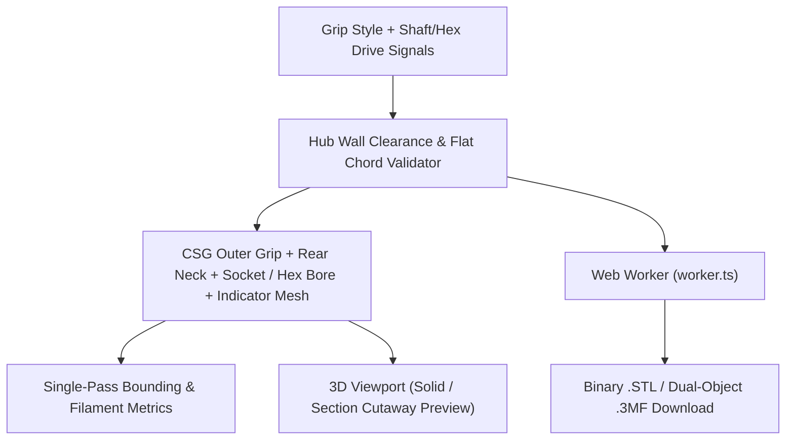

# Parametric Replacement Knob, Dial & Captive-Nut Thumbscrew Maker

# Technical Specification & Architecture Blueprint

> **Spec Number**: 128  
> **Slug**: `knob-dial-handwheel-maker`  
> **Category**: `3d`  
> **Inspired By**: Caliper-Exact Appliance Dials, Potentiometer Knobs & Star Handwheels  
> **Target SEO Keyword**: `parametric 3d print knob dial replacement d-shaft m4 m6 thumbscrew stl 3mf`  
> **Route**: `/tools/knob-dial-handwheel-maker`  
> **Architecture**: 100% Client-Side Single Page Application (Zero Server Ingestion, Zero Telemetry)

---

## 1. MVP Generation Prompt (`/create-web-micro-saas`)

```text
/create-web-micro-saas

Act as a Principal Mechanical CAD Engineer and Angular Architect. Build a 100% client-side 3D parametric generator for PrivKnife called "Parametric Replacement Knob, Dial & Captive-Nut Thumbscrew Maker".

TECHNICAL CONSTRAINTS & STACK:
1. Pure Client-Side Architecture: Zero backend endpoints, zero telemetry. Every grip lobe, D-shaft bore, splined socket, DIN 934 hex pocket, and dual-color indicator mark is generated locally in browser memory.
2. Core Technologies: Already-installed `three` (`^0.186.1`), `three-bvh-csg` (`^0.0.18`), `jszip` (`^3.10.2`), pure-TS binary `.STL` and multi-object `.3MF` serializers.
3. Thread Safety & Memory Hygiene (Directives 3 & 4): Multi-lobe CSG bore/hex-pocket subtractions run in a dedicated Web Worker (`worker.ts`) with transferable buffers. Dispose all `BufferGeometry`, `Material`, `WebGLRenderer`, and `OrbitControls` in `ngOnDestroy()`, and revoke every download `ObjectURL`.
4. Export Deliverables: Print-ready manifold `.stl` and dual-color `.3mf` separating Knob Body and High-Contrast Top/Side Position Indicator Marker Line/Dot!

KEY FEATURES & USER INTERACTION:
- Ergonomic Grip Styles:
  1. **Diamond / Straight Knurled Cylinder**: Configurable diameter (`14–90mm`), height (`10–45mm`), knurl ridge count (`16–48`), top chamfer bevel.
  2. **Fluted Scalloped Appliance Dial**: Rounded finger scallops (`4–12` flutes) for stove/dryer/amp controls.
  3. **5-Lobe / 3-Lobe Star Clamping Handwheel**: High-torque clamping star lobes for jig fixtures and camera tripods.
  4. **Winged Pointer / Bar Dial**: Asymmetric pointer lever with optional skirted bezel ring.
- Five Precision Shaft & Fastener Drive Sockets:
  1. **D-Shaft (Potentiometer / Appliance)**: Configurable shaft diameter (`3–12mm`) + exact chord flat distance (`flatThicknessMm`).
  2. **Splined / Knurled T18 / Servo Shaft**: Radial tooth splines (`12–24` teeth) around bore diameter.
  3. **M2–M8 Captive Hex Nut Thumbscrew Pocket**: Recessed standard `DIN 934` hex pocket (printed opening down with sacrificial `0.2mm` bridge or pause-at-height drop-in nut!) + through-bolt clearance bore!
  4. **Captive Hex Bolt Head Thumbwheel**: Hex socket sized directly from Bolt Head across-flats (`M4=7mm`, `M5=8mm`, `M6=10mm`, `M8=13mm`, `1/4"-20=11.1mm`).
  5. **Round Bore + Lateral M3 Brass Heat-Set / Set-Screw Radial Hole**: Horizontal M3 radial tap hole into center shaft.
- Bottom Neck / Skirt Offset & Dual-Color Indicator: Configurable rear standoff skirt (`neckHeightMm 0–15mm`) clearing panel nuts, plus separate `.3MF` high-contrast indicator tick on top & front edge!
- Privacy & Local Execution Assurance: Prominent trust badge reading "🛡️ 100% In-Browser • Never Leaves Your Device".
```

---

## 2. Concept Overview & Value Proposition

Broken plastic stove knobs, missing workshop jig star-nuts, stripped tripod wing-screws, and tiny bare potentiometer shafts are among the highest-value functional household repairs a 3D printer can solve in 20 minutes—yet measuring an exact D-shaft flat or dropping a `M6` stainless hex nut inside a thumbscrew knob requires precise parametric CAD math. **Parametric Replacement Knob, Dial & Captive-Nut Thumbscrew Maker** turns a single pair of caliper numbers into a contoured, knurled, shaft-matched `.STL` / dual-color `.3MF`.

### Elevator Pitch
> "Design custom D-shaft dials, splined pot knobs, and captive M3–M8 hex-nut clamping thumbscrews with fluted grips and dual-color pointer indicators—100% client-side."

### Core Value Drivers
1. **Exact Caliper D-Shaft & Hex Standards**: Ships built-in `6.0mm` potentiometer D-shaft, T18 spline, DIN 934 `M3–M8` hex-nut, and `1/4"-20` tripod bolt head presets with independent clearance tuning.
2. **High-Torque Star & Knurled Grips**: Synthesizes smooth contoured star-lobe profiles, recessed finger flutes, and chamfered knurls with zero fragile overhang angles.
3. **Panel Clearance Neck + Dual-Color Pointer**: Optional rear stand-off collar keeps the knob off front-panel washers, while an independent `.3MF` pointer bar marks zero alignment cleanly.

---

## 3. Technical Feasibility, Dependencies & Nuances

### Difficulty Score: 6.0 / 10 (Moderate — Parametric radial star/flute extrusion, chordal D-shaft key profiles, and CSG lateral set-screw/hex sockets)

| Architectural Component | Implementation Technology | Installed in Repo? | Client-Side Feasibility |
|---|---|---|---|
| Grip Profiles (Knurl/Flute/Star/Pointer) | `three` ExtrudeGeometry + CSG | Yes (`^0.186.1`) | 100% In-Browser |
| D-Shaft, T18 Spline, DIN 934 & Set-Screw | `three-bvh-csg` (`^0.0.18`) | Yes (`^0.0.18`) | 100% In-Browser |
| Indicator Marker `.3MF` & Binary `.STL` | `jszip` (`^3.10.2`) + Binary Writer | Yes | 100% In-Browser |

### Known Engineering Nuances & Mitigations
- **Potentiometer D-Shaft Split-Torque Cracking**: Printing a super-tight D-shaft directly in brittle PLA splits the hub radially when pushed onto a stiff metal shaft.
  - *Mitigation*: Guarantee minimum hub wall around shaft (`hubOuterDiameterMm >= shaftDiameterMm + 5.0mm`) and include configurable `shaftToleranceMm` (`0.10–0.45mm`) added cleanly to both bore radius and flat chord offset!
- **Stepped Bore Overhangs (Through-Hole Meets Wider Hex Pocket)**: Printing a wide hex nut pocket opening downwards with a smaller bolt through-hole creates an unsupported circular ring overhang inside.
  - *Mitigation*: Optionally insert a 1-layer (`0.20mm`) sacrificial bridging membrane (`sacrificialBridgeLayer: boolean`) across the small bolt transition that drills/punches out in 2 seconds for razor-clean overhangs!
- **Pointer Zeroing Angle Relative to D-Shaft Flat**: Half of appliances put the D-flat pointing toward `0°`, while others face `180°` or `90°`.
  - *Mitigation*: Expose `flatRotationDeg` (`0°`, `90°`, `180°`, `270°`) rotating the internal D-flat independently of the top indicator bar!

---

## 4. Competitive Landscape & Market Positioning

| Feature / Metric | PrivKnife (`knob-dial-handwheel-maker`) | Thingiverse Knobs | Commercial Replacement Knobs |
|---|---|---|---|
| **Custom Shaft Flat & Tolerance** | **Metric Caliper + `0/90/180/270°` Flat Angle** | Rarely adjustable | Fixed sizes; $8–$20 shipping |
| **Captive DIN 934 Hex & 1/4"-20 Hardware** | **Preset Pockets + Sacrificial Bridge** | Guesswork tolerances | N/A |
| **Dual-Color Position Indicator** | **Multi-Object `.3MF` Native** | Requires manual paint | Painted (wears off) |

---

## 5. Functional Requirements & Parametric Algorithms

### 5.1. Outer Knob Grip Profile Generation
- Construct closed 2D radial curve across `segments = 144`:
  - `knurled`: base circle modulated by triangular serration `amplitude = 0.85mm` across `knurlCount` ridges.
  - `fluted`: sinusoidal inward finger scallops (`depth = 2.6mm`).
  - `star_handwheel`: `starLobes` (`3` or `5`) smooth rounded convex lobes (`R_min = 0.62 * R`, `R_max = R`).
  - `pointer_wing`: symmetric cylinder with tapered front nose lever `length = 1.6 * R`.

### 5.2. Shaft Socket & Hex Fastener Subtraction
- **`d_shaft`**: Union circular cylinder with flat chord cutter intersecting at signed offset `d = (flatThicknessMm + shaftToleranceMm) - (shaftDiameterMm / 2)` rotated by `flatRotationDeg`.
- **`captive_hex_nut` / `captive_hex_bolt`**: Standard across-flats table (`M3: 5.5, M4: 7.0, M5: 8.0, M6: 10.0, M8: 13.0, 1/4"-20: 11.1`) converted via circumradius `((AF + hexToleranceMm) / 2) / Math.cos(Math.PI / 6)` rotated cleanly inside `knobBody`, plus through-bolt clearance hole.

---

## 6. UI/UX Layout Specification (BEM Architecture)

- **Localization (`i18n`)**: Keys under `tools.knobDialHandwheelMaker.*` across 8 locales.
- **Layout**: `.l-columns--2` desktop (Cutaway X-Ray Section toggle in `.c-knob-maker__viewport-hud` so users can inspect inside the D-shaft / captive nut pocket before printing!), `.c-input__control`/`.c-input__slider` bindings, and real-time hub wall safety check.

---

## 7. Technical Architecture & Client-Side Pipeline



---

## 8. Input/Output Data Contracts (TypeScript Interfaces)

```typescript
export type KnobGripStyle = 'knurled' | 'fluted' | 'star_handwheel' | 'pointer_wing';
export type ShaftDriveType =
  | 'd_shaft'
  | 'splined'
  | 'captive_hex_nut'
  | 'captive_hex_bolt'
  | 'set_screw_round';

export type KnobHardwarePreset = 'custom' | 'M3' | 'M4' | 'M5' | 'M6' | 'M8' | 'quarter_20';

export interface KnobDialHandwheelOptions {
  gripStyle: KnobGripStyle;
  gripDiameterMm: number;          // 14..90
  gripHeightMm: number;            // 10..45
  neckDiameterMm: number;          // 10..40
  neckHeightMm: number;            // 0..15
  knurlOrLobeCount: number;        // 3..48
  topBevelMm: number;              // 0.4..4.0
  driveType: ShaftDriveType;
  hardwarePreset: KnobHardwarePreset;
  shaftDiameterMm: number;         // 3.0..12.0
  dFlatThicknessMm: number;        // 2.0..10.0
  flatRotationDeg: 0 | 90 | 180 | 270;
  splineTeethCount: number;        // 12..24
  socketDepthMm: number;           // 6..35
  fitToleranceMm: number;          // 0.10..0.45
  sacrificialBridgeLayer: boolean;
  includeIndicatorMark: boolean;
  bodyColorHex: string;
  indicatorColorHex: string;
  sectionCutaway: boolean;
}

export interface KnobDialMetrics {
  outerDiameterMm: number;
  totalHeightMm: number;
  minHubWallMm: number;
  triangleCount: number;
  estimatedWeightG: number;
  estimatedPrintTimeHours: number;
}
```

---

## 9. Security, Memory Hygiene & Functional Test Vectors

- **Directives 1–5**: Zero network calls; Web Worker lifecycle & ObjectURL cleanup paired; Three.js `.dispose()` in `ngOnDestroy()`.
- **Functional Test Vectors**:
  1. `d_shaft` with `gripDiameterMm: 10, neckDiameterMm: 10, shaftDiameterMm: 8` (insufficient hub wall `< 2.5mm`) triggers graceful validation error (`{ valid: false }`).
  2. `captive_hex_nut` preset `M6` calculates exact across-flats `10.0mm + fitToleranceMm` circumradius hex socket + centered `Ø6.4mm` through-bore.
  3. Rotating `flatRotationDeg` (`0°` vs `90°`) changes internal D-flat bore vertices while keeping outer grip silhouette symmetric/constant.
  4. `includeIndicatorMark: true` outputs separate `body` and `indicator` `<object>` resources inside exported `.3MF`.
