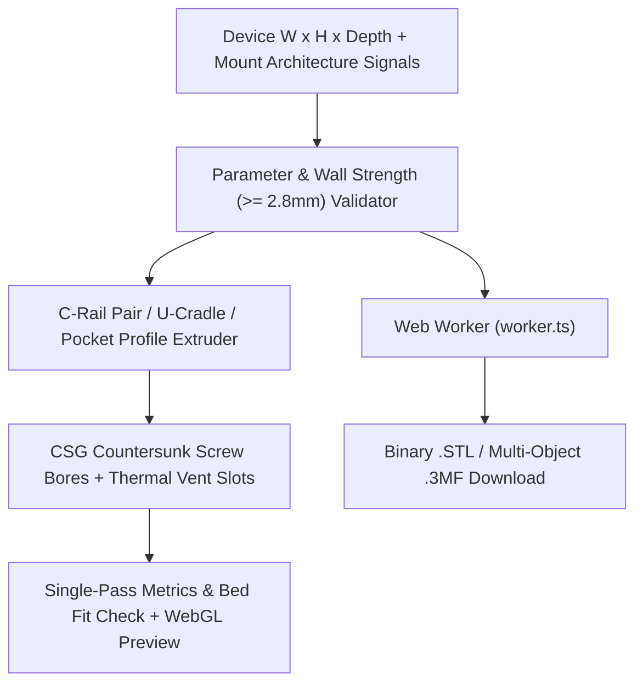

# Parametric Device Wall Mount & Power-Brick Cradle Maker

# Technical Specification & Architecture Blueprint

> **Spec Number**: 129  
> **Slug**: `device-wall-cradle-maker`  
> **Category**: `3d`  
> **Inspired By**: Caliper-Exact Under-Desk Cradles for Mini-PCs, Routers, USB Hubs & Power Bricks  
> **Target SEO Keyword**: `parametric 3d print under desk mount router mini pc power brick cradle stl`  
> **Route**: `/tools/device-wall-cradle-maker`  
> **Architecture**: 100% Client-Side Single Page Application (Zero Server Ingestion, Zero Telemetry)

---

## 1. MVP Generation Prompt (`/create-web-micro-saas`)

```text
/create-web-micro-saas

Act as a Principal Mechanical CAD Engineer and Angular Architect. Build a 100% client-side 3D parametric generator for PrivKnife called "Parametric Device Wall Mount & Power-Brick Cradle Maker".

TECHNICAL CONSTRAINTS & STACK:
1. Pure Client-Side Architecture: Zero backend endpoints, zero telemetry. All cradle brackets, ventilation cutouts, countersunk flanges, and cable reliefs run locally in browser memory.
2. Core Technologies: Already-installed `three` (`^0.186.1`), `three-bvh-csg` (`^0.0.18`), `jszip` (`^3.10.2`), pure-TS binary `.STL` and multi-object `.3MF` serializers.
3. Thread Safety & Memory Hygiene (Directives 3 & 4): Heavy CSG countersunk mount holes and honeycomb vent subtractions run in a dedicated Web Worker (`worker.ts`) with transferable buffers. Dispose all Three.js GPU buffers, `WebGLRenderer`, and `OrbitControls` in `ngOnDestroy()`, and revoke every download `ObjectURL`.
4. Export Deliverables: Print-ready support-free binary `.stl` (either pair of left/right L-rails or full pocket sleeve) and `.3mf` plate assembly.

KEY FEATURES & USER INTERACTION:
- Three Practical Bracket Architectures:
  1. **Open Under-Desk Slide Rails (Pair)**: Left & right C-channel/L-rails that mount symmetrically under a desk (`0` maximum width constraint—even mounts full-size Xbox/PS5 or Wide NAS!) with an optional rear backstop lip so sliding the unit in stops cleanly!
  2. **U-Channel Wrap Cradle (Single Bridge Mount)**: Rigid U-shaped wrap sleeve holding laptop power bricks (`USB-C GaN`, `Dell/Lenovo 180W`, `MacBook brick`), Raspberry Pi cases, Apple TV, or USB-C docks horizontally under a desk or vertically on drywall!
  3. **Remote Control / Thermostat Wall Pocket**: Open-front tall pocket with bottom charging cable slot + finger scoop front cutout!
- Exact Device Caliper Dimensions: Inner Width (`30–280mm`), Inner Thickness/Height (`14–90mm`), Cradle Strap Span/Depth (`25–180mm`), Wall Thickness (`2.8–6.0mm`), Device Clearance (`0.4–2.0mm`), and Internal Corner Fillet (`1–10mm`).
- Cooling & Wiring Access: Toggle `Airflow Vent Cutouts` (`hex / capsule` side & floor vents for hot laptop GaN bricks and routers) and `Front/Back End Cable Relief Slots` (`10–40mm`).
- Mounting Hardware Options: Left & Right external flanges OR concealed internal floor holes (`Ø4.2mm` countersunk #8 wood screws with `9mm` tool-access clearance head bore or VHB tape recessed flat backs).
- Privacy & Local Execution Assurance: Prominent trust badge reading "🛡️ 100% In-Browser • Never Leaves Your Device".
```

---

## 2. Concept Overview & Value Proposition

Every desk setup accumulates awkward black rectangles: USB hubs, fiber ONTs, Intel NUCs, KVM switches, Mac mini / mini-PCs, and scorching hot laptop power bricks dangling mid-air. Off-the-shelf mounts fit only one SKU. **Parametric Device Wall Mount & Power-Brick Cradle Maker** lets anyone measure any box with a ruler (`W × H × Depth`) and generate heavy-duty, ventilated under-desk rails or wall cradles with countersunk wood-screw flanges in seconds.

### Elevator Pitch
> "Measure any router, mini-PC, USB hub, or laptop power brick and print ventilated under-desk slide rails or countersunk wall cradles as support-free `.STL` and `.3MF`—100% offline."

### Core Value Drivers
1. **Two Universal Solutions (Under-Desk Slide Rails + Single U-Cradle)**: Wide boxes exceeding `220mm` build plates switch cleanly to a compact left+right C-rail pair!
2. **Thermal Airflow Ventilation**: Auto-cuts airflow vent slots cleanly across base straps so hot 140W GaN bricks and routers stay cool under desks.
3. **True Wood-Screw Countersinks**: Models `90°` conical `#6/#8` screw head seats so drywall/desk screw heads sit dead-flush and never scratch the mounted aluminum device.

---

## 3. Technical Feasibility, Dependencies & Nuances

### Difficulty Score: 5.0 / 10 (Moderate — Parametric U/C profile extrusions, vent slot CSG arrays, and flush 90° screw countersinks)

| Architectural Component | Implementation Technology | Installed in Repo? | Client-Side Feasibility |
|---|---|---|---|
| C-Channel Rails & U-Wrap Sleeves | `three` ExtrudeGeometry (`Shape` profiles) | Yes (`^0.186.1`) | 100% In-Browser |
| Vent Slots & Countersunk Screw Bores | `three-bvh-csg` (`^0.0.18`) | Yes (`^0.0.18`) | 100% In-Browser |
| `.STL` & `.3MF` Pair Packing | Pure-TS STL Writer + `jszip` (`^3.10.2`) | Yes | 100% In-Browser |

### Known Engineering Nuances & Mitigations
- **Cantilever Flex Under Heavy 1.5kg Power Bricks / Mini-PCs**: Thin `2mm` L-flanges bend under constant desk gravity.
  - *Mitigation*: Enforce `wallThicknessMm >= 2.8mm` + gusseted `45°` support fillets connecting side walls to mounting ears (`flangeThicknessMm >= Math.max(wallThicknessMm, 3.6mm)`).
- **Screwdriver Access Blocking Inside Narrow U-Channels**: Internal bottom screw holes cannot be driven with a drill if `cradleSpan` and side walls block the chuck.
  - *Mitigation*: When `mountHolePlacement === 'external_ears'`, extend side tabs outward symmetrically (`16mm` wide) with full open vertical screwdriver access; when `'internal_floor'`, check `innerWidthMm >= 40` and leave open top U-clearance!
- **Print Orientation Without Supports**: Printing U-cradles upright (`Z` along device length) keeps layer lines wrapping continuously around the U-channel (maximum hoop strength!) with zero overhang support needed.
  - *Mitigation*: Orient generated cradles on their flat rear/end extrusion face (`Z = 0`) so C-rails and U-bridges print support-free!

---

## 4. Competitive Landscape & Market Positioning

| Feature / Metric | PrivKnife (`device-wall-cradle-maker`) | Amazon Metal Brackets | Printables Fixed Router Mounts |
|---|---|---|---|
| **Fits Any Custom Brick / Hub** | **Exact Caliper `W × H × Depth`** | Generic adjustable straps | Only matches exact model # |
| **Thermal Vents & Screw Countersinks** | **Parametric Built-In** | Solid blocking plates | Often missing or wrong screw gauge |
| **Cost** | **Free (~$0.40 filament)** | $15–$35 per mount | Free only if SKU exists |

---

## 5. Functional Requirements & Parametric Algorithms

### 5.1. Profile Extrusion Geometry
- **`slide_rails_pair`**: Construct C-profile cross-section with lower shelf lip (`railShelfWidthMm = 14mm`), vertical wall (`innerHeightMm + deviceClearanceMm`), upper screw ear (`18mm`), and optional rear end stop wall (`endStopThicknessMm = 3.2mm`); clone symmetric left + right rails placed cleanly side-by-side (`Z = 0`).
- **`u_wrap_cradle` / `remote_pocket`**: Extrude full U-bracket enclosing bottom & both sides (`width = innerWidthMm + 2 * deviceClearanceMm`), with optional front lip retention bar or remote finger U-notch.

### 5.2. Countersunk Screw & Airflow Cutouts
- Subtract `Ø4.2mm` shank bores + `Ø8.4mm` × `90°` conical countersinks on mounting ears/flanges.
- Subtract stadium-slot cooling cutouts spaced along flat bottom and side faces (preserving `>= 8mm` perimeter strength margin around edges and screw bores).

---

## 6. UI/UX Layout Specification (BEM Architecture)

- **Localization (`i18n`)**: Keys under `tools.deviceWallCradleMaker.*` across 8 locales.
- **Layout**: `.l-columns--2` desktop (`c-device-cradle__viewport-hud` top flex bar with Wireframe / Reset / `.STL` / `.3MF` / `.PNG`), quick presets (`Mini-PC`, `140W USB-C Brick`, `Apple TV / Router`, `Remote Control`), `.c-input__control`/`.c-input__slider` bindings.

---

## 7. Technical Architecture & Client-Side Pipeline



---

## 8. Input/Output Data Contracts (TypeScript Interfaces)

```typescript
export type CradleStyle = 'slide_rails_pair' | 'u_wrap_cradle' | 'remote_pocket';
export type MountFlangePlacement = 'external_ears' | 'internal_floor' | 'adhesive_flat';

export interface DeviceWallCradleOptions {
  cradleStyle: CradleStyle;
  deviceWidthMm: number;           // 30..280
  deviceThicknessMm: number;       // 14..90
  mountSpanMm: number;             // 25..180
  wallThicknessMm: number;         // 2.8..6.0
  fitClearanceMm: number;          // 0.4..2.0
  railShelfWidthMm: number;        // 10..28 (used in slide_rails_pair)
  includeBackstop: boolean;
  includeThermalVents: boolean;
  mountFlangePlacement: MountFlangePlacement;
  screwDiameterMm: number;         // 3.2..5.5
  filamentColorHex: string;
}

export interface DeviceCradleMetrics {
  partCount: number;
  widthMm: number;
  depthMm: number;
  heightMm: number;
  innerOpeningWidthMm: number;
  innerOpeningHeightMm: number;
  triangleCount: number;
  estimatedWeightG: number;
  estimatedPrintTimeHours: number;
  exceedsStandardBed: boolean;
}
```

---

## 9. Security, Memory Hygiene & Functional Test Vectors

- **Directives 1–5**: Zero network calls; Web Worker lifecycle & ObjectURL cleanup paired; Three.js `.dispose()` in `ngOnDestroy()`.
- **Functional Test Vectors**:
  1. `u_wrap_cradle` with `deviceWidthMm: 75, deviceThicknessMm: 32, fitClearanceMm: 0.8` yields `innerOpeningWidthMm === 76.6` and `innerOpeningHeightMm === 32.8`.
  2. `slide_rails_pair` generates `partCount: 2` symmetric Left + Right meshes inside multi-object `.3MF` even when `deviceWidthMm === 260`.
  3. `mountFlangePlacement: 'external_ears'` adds `>= 2` countersunk bore holes through ear flanges while keeping `Z_min === 0`.
  4. Invalid `wallThicknessMm: 1.0` (< 2.8) or `deviceWidthMm: 10` returns `{ valid: false }` validation error cleanly.
