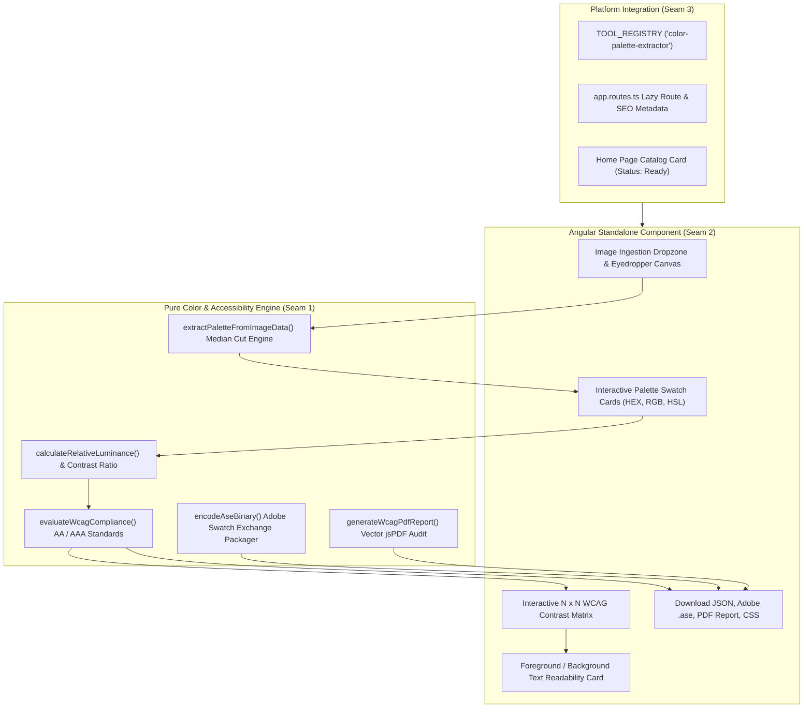

# Implementation Plan: Color Palette Extractor & Contrast Checker

> **Tool**: `13 - Color Palette Extractor & Contrast Checker`  
> **Target Directory**: `src/app/tools/dev/color-palette-extractor/`  
> **Route**: `/tools/color-palette-extractor` (alias `/tools/palette-contrast`)  
> **Key Directives**: 100% Client-Side execution, zero telemetry, Median-cut pixel quantization, W3C WCAG 2.1 relative luminance math, binary Adobe ASE & PDF compliance reports, BEM architecture, strict memory hygiene.

---

## 📐 Architecture & Seam Design

---

## 🧪 Vertical Slices & TDD Seams

### Seam 1: Core Color Engine & Accessibility Math (`engine.ts` & `engine.spec.ts`)
- **Domain Types (`types.ts`)**:
  - `ExtractedColor`: RGB, HEX, HSL, luminance.
  - `WcagCompliance`: ratio, passAaNormal, passAaLarge, passAaaNormal, passAaaLarge, passUi.
  - `ContrastMatrixCell`: foreground, background, compliance.
- **Engine Functions (`engine.ts`)**:
  - `rgbToHex(r, g, b)`, `hexToRgb(hex)`, `rgbToHsl(r, g, b)`
  - `calculateRelativeLuminance(rgb)`: W3C sRGB formula ($0.2126 \times R + 0.7152 \times G + 0.0722 \times B$)
  - `calculateContrastRatio(colorA, colorB)`: $(L_1 + 0.05) / (L_2 + 0.05)$
  - `evaluateWcagCompliance(colorA, colorB)`: Exact AA/AAA evaluation
  - `buildContrastMatrix(palette)`: $N \times N$ cross-table
  - `extractPaletteFromImageData(data, width, height, count)`: Pure client-side median-cut color clustering
  - `encodeAseBinary(palette, name)`: Valid Adobe Swatch Exchange binary file with `ASEF` header
  - `generateJsonTokens(palette)` & `generateCssVariables(palette)`
  - `generateWcagPdfReport(palette, matrix)`: Multi-page vector PDF compliance audit
- **Unit Tests (`engine.spec.ts`)**:
  - Assert luminance and contrast ratio matches known W3C test pairs (black on white = 21:1, identical = 1:1, #2563eb on #ffffff = 4.67:1).
  - Assert WCAG compliance flags pass/fail correctly for Normal (4.5:1), Large (3.0:1), and AAA (7.0:1).
  - Assert median-cut quantization extracts specified count of distinct colors.
  - Assert Adobe ASE binary encoder starts with `ASEF` signature (0x41, 0x53, 0x45, 0x46) and matches block lengths.
  - Assert JSON and CSS tokens produce valid strings.
  - Assert PDF report produces non-empty Blob.

### Seam 2: UI Component & State Signals (`color-palette-extractor.component.ts` & `.spec.ts`)
- **Component Features**:
  - Signals for `palette`, `imageFile`, `imagePreviewUrl`, `colorCount`, `activeCell`, `isProcessing`, `showExportModal`.
  - Dropping an image downsamples onto offscreen canvas and triggers extraction.
  - Clicking on the image canvas samples exact pixel color (interactive eyedropper).
  - Swatch management (edit hex, copy, delete, add custom swatch).
  - Interactive $N \times N$ matrix grid with badges. Clicking a cell displays live foreground/background readability preview.
  - Export buttons for JSON tokens, Adobe `.ase`, PDF report, and CSS variables with immediate `URL.revokeObjectURL()`.
  - Component cleanup (`ngOnDestroy`) revoking object URLs.
  - Privacy test verifying 0 network requests to `fetch` or `XMLHttpRequest`.

### Seam 3: Tool Registration, Routing & Roadmap Check
- Export `colorPaletteExtractorTool` in `index.ts`.
- Register in `src/app/tools/tool-registry.ts` and test in `tool-registry.spec.ts`.
- Add lazy route in `app.routes.ts` with metadata.
- Update `home.ts` setting status to `'ready'`.
- Mark Spec 13 as completed in `specs/README.md`.
