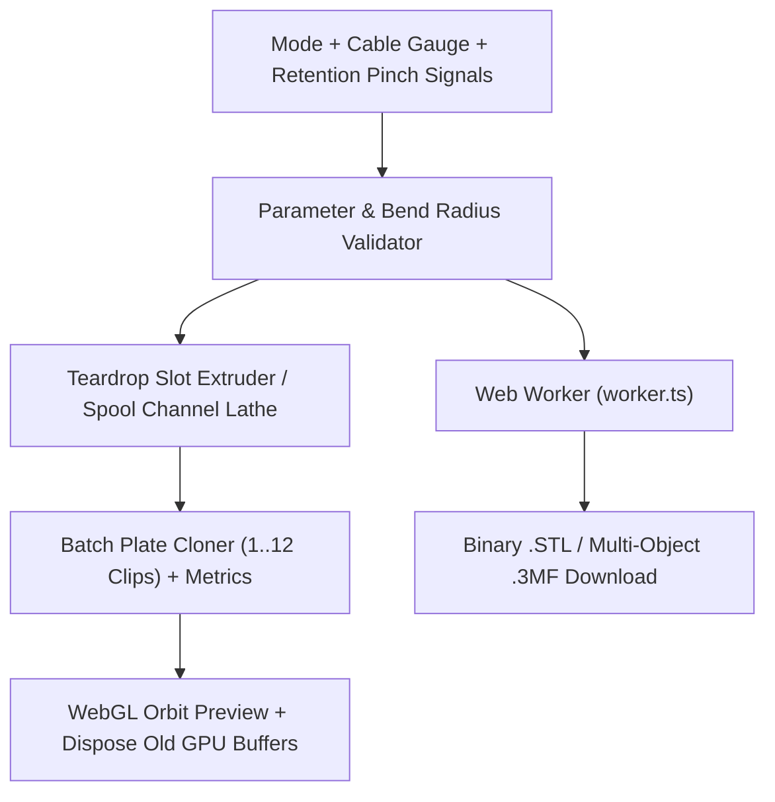

# Parametric Cable Comb, Travel Cord Winder & Wall Clip Maker

# Technical Specification & Architecture Blueprint

> **Spec Number**: 130  
> **Slug**: `cable-comb-clip-maker`  
> **Category**: `3d`  
> **Inspired By**: Wire-Gauge Calibrated Desk Combs, Travel USB Cord Winders & P-Clips  
> **Target SEO Keyword**: `parametric 3d print cable comb cord winder wall clip stl 3mf`  
> **Route**: `/tools/cable-comb-clip-maker`  
> **Architecture**: 100% Client-Side Single Page Application (Zero Server Ingestion, Zero Telemetry)

---

## 1. MVP Generation Prompt (`/create-web-micro-saas`)

```text
/create-web-micro-saas

Act as a Principal Mechanical CAD Engineer and Angular Architect. Build a 100% client-side 3D parametric generator for PrivKnife called "Parametric Cable Comb, Travel Cord Winder & Wall Clip Maker".

TECHNICAL CONSTRAINTS & STACK:
1. Pure Client-Side Architecture: Zero backend endpoints, zero telemetry. Every cable slot retention lip, travel spool hub, and P-clip fastener tab runs locally in browser memory.
2. Core Technologies: Already-installed `three` (`^0.186.1`), `three-bvh-csg` (`^0.0.18`), `jszip` (`^3.10.2`), pure-TS binary `.STL` + multi-object `.3MF` serializers.
3. Thread Safety & Memory Hygiene (Directives 3 & 4): Batch clip/comb arrays and `.STL`/`.3MF` export run inside a dedicated Web Worker (`worker.ts`) with transferable buffers. Dispose all GPU geometries, materials, and `WebGLRenderer` in `ngOnDestroy()`, and revoke every download `ObjectURL`.
4. Export Deliverables: Support-free `.stl` and multi-copy `.3mf` plate arrays (`1–12` wall clips or matching upper/lower travel cord winder shells).

KEY FEATURES & USER INTERACTION:
- Three Practical Cable Organization Modes:
  1. **Desk-Edge / Under-Desk Cable Comb**: Calibrated U-slots with flexible teardrop retention nibs (`slotCount 3–14`, customizable wire gauge presets `3.0mm USB`, `5.0mm HDMI/Cat6`, `7.5mm Thick AC Power`, or mixed ascending slots!) + rear screw/Command-strip flange!
  2. **Pocket Travel Cord Winder**: Compact rounded oval/circular two-piece snap or open-channel spool (`outerDiameterMm 45–95mm`) sized for USB-C/Lightning cables (`cordLengthM 1–3m`), complete with plug-head pass-through notch and outer snap collar!
  3. **Baseboard / Wall / Desk-Leg Multi-Channel P-Clip Array**: Single or 2/3-channel rounded cable saddles with flat mounting foot (`#6` screw bore or `3M VHB` pad backing) — generate `1–12` matching clips in one print!
- Wire Retention Detent Physics: Narrow entry pinch (`entryGapRatio = 0.82 * cableDiameterMm`) opening into a full `1.04 * cableDiameterMm` circular cavity so cords snap in positively and never fall out when unplugged!
- Privacy & Local Execution Assurance: Prominent trust badge reading "🛡️ 100% In-Browser • Never Leaves Your Device".
```

---

## 2. Concept Overview & Value Proposition

Generic desk cable clips either squeeze thick braided USB-C/DisplayPort cords until they fray or let skinny `3.2mm` charging leads slip right back onto the floor. **Parametric Cable Comb, Travel Cord Winder & Wall Clip Maker** sizes every slot cavity and teardrop retention entry directly from real cord diameters (`2.5–12.0mm`), letting users print calibrated cable combs, snag-free travel winders, and multi-channel P-clips cleanly in one run.

### Elevator Pitch
> "Size wire-gauge-calibrated desk cable combs, compact travel cord winders, and snap-in wall P-clip arrays as support-free `.STL` and `.3MF` prints—100% locally in your browser."

### Core Value Drivers
1. **Teardrop Retention Detent Geometry**: Uses a narrower flex mouth (`0.82 * Ø`) widening to a stress-free circular seat (`1.04 * Ø`) so cables click in cleanly and stay put.
2. **Plug-Head Strain Relief on Travel Winders**: Includes side exit notches wide enough to seat molded USB-A/USB-C boots flush inside the spool profile.
3. **One-Click Multi-Clip Plate Export**: Automatically spaces `1–12` identical wall P-clips in a tidy grid on `Z = 0` for batch printing.

---

## 3. Technical Feasibility, Dependencies & Nuances

### Difficulty Score: 4.5 / 10 (Low-Moderate — Teardrop cross-section spline extrusions, snapspool channels, and batch clip placement)

| Architectural Component | Implementation Technology | Installed in Repo? | Client-Side Feasibility |
|---|---|---|---|
| Cable Comb & P-Clip Extrusions | `three` `ExtrudeGeometry` (`Shape` contours) | Yes (`^0.186.1`) | 100% In-Browser |
| Travel Winder Channel & Boot Slots | `three` `LatheGeometry` + `three-bvh-csg` | Yes (`^0.186.1`) | 100% In-Browser |
| Batch Plate `.STL` & `.3MF` | Pure-TS STL Writer + `jszip` (`^3.10.2`) | Yes | 100% In-Browser |

### Known Engineering Nuances & Mitigations
- **Snap-Mouth Cracking on Rigid PLA Combs**: If entry slot fingers (`tines`) are too stiff/thick (`> 4mm`) and gap pinch is tight (`0.70 * Ø`), pressing a stiff `7mm` AC cord snaps a PLA tine off.
  - *Mitigation*: Constrain entry neck opening ratio cleanly (`0.80–0.90` × `cableDiameterMm`) with `45°` lead-in funnel jaws and long flexible tines (`tineWallThicknessMm = 2.0–2.8mm`).
- **Sharp Cord Chafing Edges**: Printing square sharp slot corners wears braided insulation over time.
  - *Mitigation*: Round interior cavity profile (`circular radius = (cableDiameterMm + clearanceMm) / 2`) + curved top/bottom bevel chamfer (`0.5mm`).
- **Undersized Cord Winder Channel Volume**: Guessing spool thickness for a `2.0m × 4.0mm` USB-C cord leaves 30cm sticking out.
  - *Mitigation*: Check annulus capacity mathematically (`maxTurns * PI * meanDiameter >= cordLengthM * 1000`) and automatically adjust channel width/depth or surface a `cordFitCapacityWarning` flag!

---

## 4. Competitive Landscape & Market Positioning

| Feature / Metric | PrivKnife (`cable-comb-clip-maker`) | Pack of Sticky Amazon Clips | Static STL Cable Clips |
|---|---|---|---|
| **Exact Wire Gauge Mix (`3–12mm`)** | **Tuned Mixed Slots or Custom Presets** | One tiny size (breaks/drops) | Fixed single cord width |
| **Travel Spool Capacity Calc** | **Auto-Checks Length vs. Annulus Volume** | Too tiny for braided cables | Trial & error |
| **Cost** | **~$0.15 PETG / PLA locally** | $12 plastic waste pack | N/A |

---

## 5. Functional Requirements & Parametric Algorithms

### 5.1. Teardrop Retention Slot Profile (`cable_comb`, `p_clip_array`)
- Given slot `cableDiameterMm` (`2.5–12.0mm`), build upper funnel V-mouth (`entryWidth = cableDiameterMm * entryPinchRatio`), smoothly tangentially meeting full circle cavity `radius = (cableDiameterMm + 0.3) / 2` centered below.
- Extrude comb block horizontally (`flat on desk mount`) or extruded across clip width (`14–22mm`), adding rear screw bore (`Ø4.0mm`) or flat adhesive tab.

### 5.2. Travel Cord Winder Solver (`travel_winder`)
- Compute core hub radius `>= 12mm` (respecting USB-C cable minimum bend radius so copper strands never kink!), outer flange diameter (`outerDiameterMm 45–95mm`), winding trough width (`channelWidthMm`), plus dual opposing radial plug-exit slots (`width = 11mm` for USB-C housing clearance).

---

## 6. UI/UX Layout Specification (BEM Architecture)

- **Localization (`i18n`)**: Keys under `tools.cableCombClipMaker.*` across 8 locales.
- **Layout**: `.l-columns--2` desktop (`c-cable-maker__viewport-hud`), cable gauge quick chips (`3.5mm USB`, `5.5mm HDMI/Cat6`, `8.0mm AC Mains`), `.c-input__control`/`.c-input__slider` controls, and spool cord-length capacity badge.

---

## 7. Technical Architecture & Client-Side Pipeline



---

## 8. Input/Output Data Contracts (TypeScript Interfaces)

```typescript
export type CableToolMode = 'cable_comb' | 'travel_winder' | 'p_clip_array';
export type ClipMountStyle = 'screw_hole' | 'adhesive_flat';

export interface CableCombClipOptions {
  mode: CableToolMode;
  cableDiameterMm: number;         // 2.5..12.0
  slotCount: number;               // 3..14 (cable_comb) or 1..3 (p_clip_array channels)
  ascendingSlotGradation: boolean; // Scale slots progressively -15% to +25%
  entryPinchRatio: number;         // 0.78..0.92
  mountStyle: ClipMountStyle;
  // Travel Winder
  winderOuterDiameterMm: number;   // 45..95
  winderCordLengthM: number;       // 0.5..3.0
  winderCoreDiameterMm: number;    // 22..40
  // Plate Batch (p_clip_array / comb)
  clipQuantity: number;            // 1..12
  clipDepthMm: number;             // 10..28
  filamentColorHex: string;
}

export interface CableToolMetrics {
  entryMouthWidthMm: number;
  cavityDiameterMm: number;
  maxRecommendedCordM: number;
  cordCapacityOk: boolean;
  widthMm: number;
  depthMm: number;
  heightMm: number;
  triangleCount: number;
  estimatedWeightG: number;
  estimatedPrintTimeHours: number;
}
```

---

## 9. Security, Memory Hygiene & Functional Test Vectors

- **Directives 1–5**: Zero network calls; Web Worker lifecycle & ObjectURL cleanup paired; Three.js `.dispose()` in `ngOnDestroy()`.
- **Functional Test Vectors**:
  1. `cable_comb` with `cableDiameterMm: 6.0, entryPinchRatio: 0.82` sets `entryMouthWidthMm === 4.92` (`< cavityDiameterMm = 6.30`).
  2. `travel_winder` enforcing bend-radius protection rejects `winderCoreDiameterMm: 10` (< 22mm) or oversized `winderCoreDiameterMm >= winderOuterDiameterMm - 10` cleanly.
  3. `p_clip_array` with `clipQuantity: 6` arranges 6 disjoint clips on `Z = 0` inside `.STL`/`.3MF`.
  4. `cordCapacityOk` accurately returns `false` when `winderCordLengthM: 3.0` exceeds annulus volume for tiny `45mm` winder + thick `8.0mm` cable.
