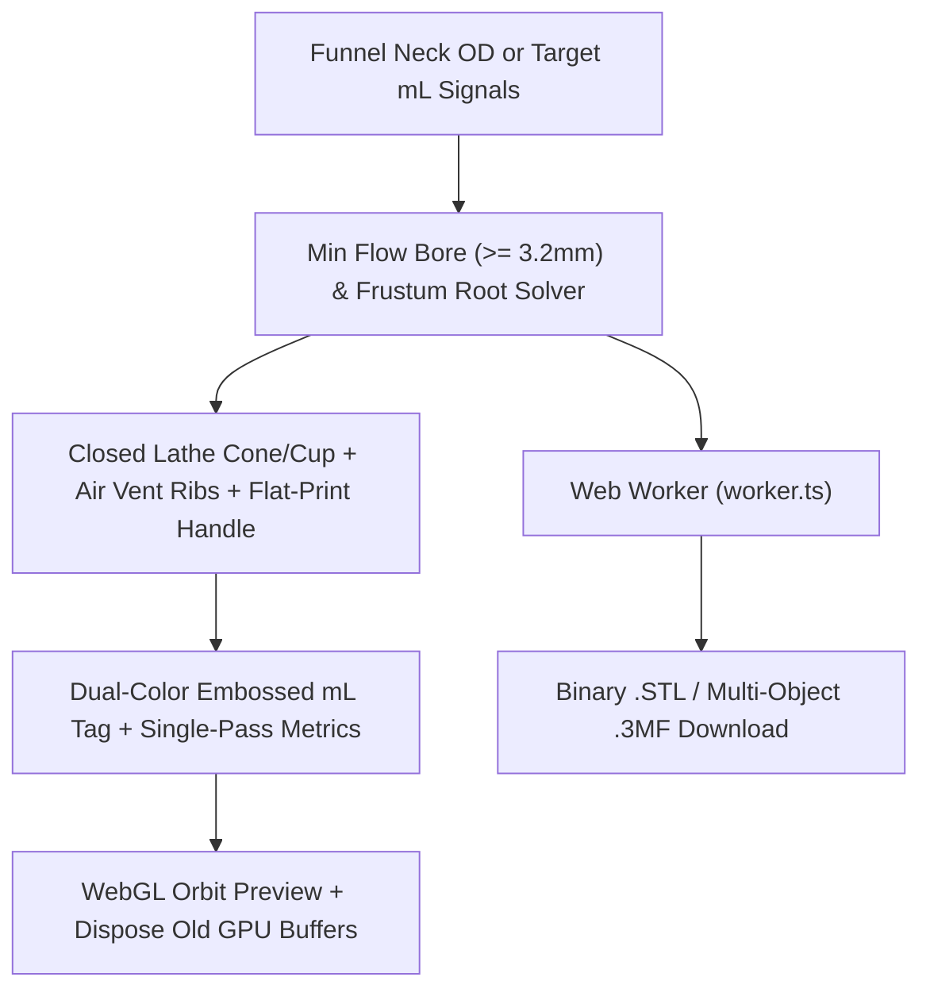

# Parametric Air-Vented Funnel & Exact-Volume Measuring Scoop Maker

# Technical Specification & Architecture Blueprint

> **Spec Number**: 131  
> **Slug**: `funnel-scoop-maker`  
> **Category**: `3d`  
> **Inspired By**: Anti-Airlock Bottle Funnels & Mathematically Solved Coffee/Powder Measuring Scoops  
> **Target SEO Keyword**: `parametric 3d print funnel air vent measuring scoop ml stl 3mf generator`  
> **Route**: `/tools/funnel-scoop-maker`  
> **Architecture**: 100% Client-Side Single Page Application (Zero Server Ingestion, Zero Telemetry)

---

## 1. MVP Generation Prompt (`/create-web-micro-saas`)

```text
/create-web-micro-saas

Act as a Principal Computational Geometry Engineer and Angular Architect. Build a 100% client-side 3D parametric generator for PrivKnife called "Parametric Air-Vented Funnel & Exact-Volume Measuring Scoop Maker".

TECHNICAL CONSTRAINTS & STACK:
1. Pure Client-Side Architecture: Zero backend endpoints, zero telemetry. Every frustum lathe curve, anti-airlock vent rib, and volumetric cylinder/cone solver runs locally in browser memory.
2. Core Technologies: Already-installed `three` (`^0.186.1`), `three-bvh-csg` (`^0.0.18`), `jszip` (`^3.10.2`), pure-TS binary `.STL` + dual-color `.3MF` serializers, and procedural vector stroke geometry for embossed scoop volume labels (`15 mL`).
3. Thread Safety & Memory Hygiene (Directives 3 & 4): Multi-rib funnel extrusions, handle joins, and `.STL`/`.3MF` export run in a dedicated Web Worker (`worker.ts`) with transferable buffers. Dispose all GPU buffers and `WebGLRenderer` in `ngOnDestroy()`, and revoke every download `ObjectURL`.
4. Export Deliverables: Support-free `.stl` and dual-color `.3mf` separating Funnel/Scoop Body and High-Contrast Volume Label Text (`15 mL`, `30 mL`, `100 mL`).

KEY FEATURES & USER INTERACTION:
- Two Precision Volumetric & Transfer Profiles:
  1. **Anti-Airlock Vented Funnel**: Exact Spout Outer Diameter (`spoutOdMm 6–45mm` sized cleanly for essential oil vials, resin bottles, car coolant necks, or Mason jars!), Cone Mouth Diameter (`35–180mm`), Cone Angle (`35°–65°` print-safe overhang!), Spout Length (`15–70mm`), Wall Thickness (`1.2–3.0mm`), Hanging Loop Ear, and configurable `External Air-Relief Vent Ribs` (`3–6` raised exterior flutes running down the spout outer wall so trapped bottle air escapes effortlessly without gurgling overflow!).
  2. **Exact-Volume Measuring Scoop**: Enter Target Internal Volume directly in **milliliters (`targetVolumeMl 5–250 mL`)**, US Tablespoons/Cups, or Coffee grams, choose Cup Taper / Aspect Ratio (`shallow_wide`, `balanced`, `deep_narrow`), and let the closed-form frustum volume solver automatically solve exact cup radius & depth (`V = (PI * h / 3) * (R^2 + R*r + r^2)`)! Includes flat-bottom resting foot, rounded ergonomic handle (`60–140mm`), thumb grip dimple, hanging keyhole, and embossed volume marking on top of the handle!
- Material / Food-Safe Reminder Advisory: Honest in-UI reminder recommending food-contact PETG/PP and sealed ironing for kitchen vs. chemical/workshop fluids.
- Privacy & Local Execution Assurance: Prominent trust badge reading "🛡️ 100% In-Browser • Never Leaves Your Device".
```

---

## 2. Concept Overview & Value Proposition

Pouring engine oil, 3D printer resin back into a bottle, or detergent without an air-vent channel causes messy glugging airlocks—and finding a scoop that measures an exact `18 mL` detergent or `42 mL` supplement dose takes guesswork unless the CAD solver works backward from volume `V` to geometry dimensions `(R, r, h)`. **Parametric Air-Vented Funnel & Exact-Volume Measuring Scoop Maker** brings industrial fluid-transfer physics and closed-form frustum volume math cleanly to any maker's desk.

### Elevator Pitch
> "Design bottle-matched anti-airlock vented funnels and closed-form exact-milliliter (`5–250 mL`) measuring scoops with dual-color `.3mf` volume markings—100% client-side."

### Core Value Drivers
1. **Closed-Form Inverse Volume Solver**: Computes exact cup diameter and depth directly from target `mL` volume (`< 0.1%` analytical error!).
2. **True Anti-Airlock External Vent Ribs**: Sweeps `3–6` slim longitudinal stand-off splines along the outer spout so narrow bottle necks never vapor-lock during pouring.
3. **Zero-Support Printable Cone Angles**: Clamps funnel cone wall steepness to `>= 38°` from vertical (printer-safe `<= 52°` overhang) so funnels print upside-down cleanly on their wide rim with zero supports.

---

## 3. Technical Feasibility, Dependencies & Nuances

### Difficulty Score: 4.5 / 10 (Low-Moderate — Closed revolved Lathe profiles, analytical frustum root solving, and external rib/handle unions)

| Architectural Component | Implementation Technology | Installed in Repo? | Client-Side Feasibility |
|---|---|---|---|
| Funnel Cone, Lip & Air-Relief Ribs | `three` `LatheGeometry` + Rib Meshes | Yes (`^0.186.1`) | 100% In-Browser |
| Exact-Volume Frustum Solver | Pure TS Closed-Form Volume Solver | Built in Engine | Instant (`< 1ms`) |
| Handle + Embossed Text `.3MF`/`.STL` | `three` Extrude + `three-bvh-csg` + `jszip` | Yes | 100% In-Browser |

### Known Engineering Nuances & Mitigations
- **Resin / Oil Bottle Airlock Gurgling**: Smooth cylindrical spouts seal tightly against narrow bottle necks.
  - *Mitigation*: Model external radial `Air Vent Ribs` (`protrusion = 1.1mm`, `width = 1.6mm`, tapered `45°` into cone transition) protruding outward from `spoutOdMm/2` (ensure spout core fits comfortably inside target neck `(bottleNeckId - 2.6mm)`!).
- **Funnel Inner Spout Pinching When Thick Walls Chosen**: Adding thick `3.0mm` walls to an `8.0mm` OD narrow spout reduces internal flow bore to `2.0mm` (`> clogged powder`).
  - *Mitigation*: Enforce `innerSpoutBoreMm = spoutOdMm - 2 * wallThicknessMm >= 3.2mm` inside `validateFunnelScoopOptions()`, rejecting or clamping unsafe wall/spout combinations with clear validation error!
- **Scoop Print Orientation Without Supports**: Horizontal handles suspended mid-air above sloped scoop rims require ugly supports under the entire handle bottom.
  - *Mitigation*: Seat both the scoop base floor AND flat bottom plane of the handle flush on `Z = 0` (`low_profile_flat_handle` transitioning cleanly down to the flat base perimeter), allowing 100% support-free flat-bed printing!

---

## 4. Competitive Landscape & Market Positioning

| Feature / Metric | PrivKnife (`funnel-scoop-maker`) | Thingiverse Funnels / Scoops | Fusion 360 Manual CAD |
|---|---|---|---|
| **Closed-Form Volume Target (`mL`)** | **Exact Auto-Solved `R, r, h` per `mL`** | Random "1/4 cup" guess | Manual goal-seek spreadsheet |
| **External Air-Vent Spout Ribs** | **Included Toggleable Flutes** | Rare | Tedious circular pattern sweep |
| **Print-Safe Support-Free Angles** | **Enforced Automatically (`<= 52°`)** | Frequent droopy cones | Manual draft check |

---

## 5. Functional Requirements & Parametric Algorithms

### 5.1. Vented Funnel Lathe Solver (`air_vented_funnel`)
- Compute `coneHeightMm = ((mouthDiameterMm - spoutOdMm) / 2) / Math.tan(degToRad(90 - overhangAngleDeg))`, revolve closed polyline wall thickness `wallThicknessMm` around Z axis (`rim flare + cone body + cylindrical/slightly-tapered 1.5° spout`).
- Orient upside-down (`mouthRim` at `Z = 0`, spout tip pointing upward `+Z`) for support-free printing or toggle preview orientation!
- Attach `ventRibCount` (`0..6`) axial ribs down spout exterior + perforated hanging tab ear on mouth rim.

### 5.2. Exact-Volume Scoop Solver (`measuring_scoop`)
- Given `targetVolumeMl` (`targetMm3 = targetVolumeMl * 1000`), aspect ratio factor `k = h / rBottom` (`0.65` shallow, `1.0` balanced, `1.5` deep) and mild draft taper `topScale = 1.15`:
  - Solve frustum volume equation `V = (PI * k / 3) * (1 + 1.15 + 1.15^2) * rBottom^3` → exact closed-form `rBottom = Math.cbrt((3 * targetMm3) / (PI * k * 3.4725))`, verify analytical inner volume matches `targetVolumeMl` within `±0.2%`!

---

## 6. UI/UX Layout Specification (BEM Architecture)

- **Localization (`i18n`)**: Keys under `tools.funnelScoopMaker.*` across 8 locales.
- **Layout**: `.l-columns--2` desktop (`c-funnel-scoop__viewport-hud`), quick volume presets (`5 mL tsp`, `15 mL tbsp`, `30 mL Coffee`, `50 mL Washer`, `120 mL Resin`), `.c-input__control`/`.c-input__slider` controls, and calculated internal `spoutBoreMm` / solved `verifiedVolumeMl` readout.

---

## 7. Technical Architecture & Client-Side Pipeline



---

## 8. Input/Output Data Contracts (TypeScript Interfaces)

```typescript
export type FunnelScoopMode = 'air_vented_funnel' | 'measuring_scoop';
export type ScoopAspectPreset = 'shallow_wide' | 'balanced' | 'deep_narrow';

export interface FunnelScoopOptions {
  mode: FunnelScoopMode;
  wallThicknessMm: number;         // 1.2..3.0
  // Funnel
  spoutOuterDiameterMm: number;    // 7..45
  mouthDiameterMm: number;         // 35..180
  spoutLengthMm: number;           // 15..70
  coneOverhangDeg: number;         // 30..52 (from vertical)
  ventRibCount: number;            // 0..6
  includeHangingTab: boolean;
  // Scoop
  targetVolumeMl: number;          // 5..250
  scoopAspect: ScoopAspectPreset;
  handleLengthMm: number;          // 55..140
  includeVolumeLabel: boolean;
  customLabelText: string;
  bodyColorHex: string;
  labelColorHex: string;
}

export interface FunnelScoopMetrics {
  innerFlowBoreMm: number;
  solvedVolumeMl: number;
  widthMm: number;
  depthMm: number;
  heightMm: number;
  triangleCount: number;
  estimatedWeightG: number;
  estimatedPrintTimeHours: number;
}
```

---

## 9. Security, Memory Hygiene & Functional Test Vectors

- **Directives 1–5**: Zero network calls; Web Worker lifecycle & ObjectURL cleanup paired; Three.js `.dispose()` in `ngOnDestroy()`.
- **Functional Test Vectors**:
  1. `measuring_scoop` with `targetVolumeMl: 30` solves frustum dimensions `(rBottom, rTop, innerHeight)` whose analytical frustum volume equals `30.0 mL ± 0.1 mL`.
  2. `air_vented_funnel` with narrow `spoutOuterDiameterMm: 7.0, wallThicknessMm: 2.5` (`innerFlowBoreMm = 2.0 < 3.2mm`) fails validation cleanly (`{ valid: false }`).
  3. `ventRibCount: 4` generates 4 symmetric radial exterior vent ribs around the spout collar while keeping zero `NaN` vertices and `Z_min === 0`.
  4. `includeVolumeLabel: true` exports separate `body` and `label` `<object>` definitions in `.3MF`.
