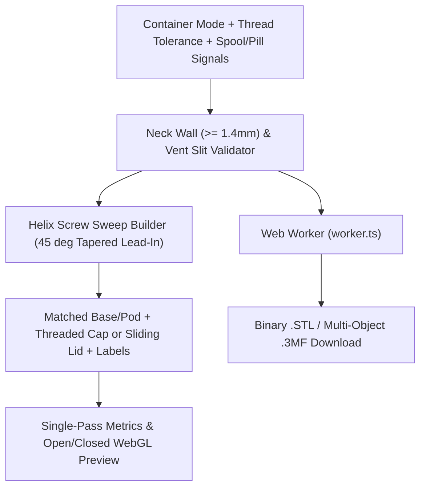

# Parametric Threaded Storage Tube, Pill Organizer & Desiccant Pod Maker

# Technical Specification & Architecture Blueprint

> **Spec Number**: 132  
> **Slug**: `threaded-tube-pill-organizer`  
> **Category**: `3d`  
> **Inspired By**: Knurled Screw-Top Canisters, Spool-Hub Silica Gel Pods & Sliding 7-Day Pill Cases  
> **Target SEO Keyword**: `parametric 3d print threaded screw jar silica desiccant canister pill organizer stl`  
> **Route**: `/tools/threaded-tube-pill-organizer`  
> **Architecture**: 100% Client-Side Single Page Application (Zero Server Ingestion, Zero Telemetry)

---

## 1. MVP Generation Prompt (`/create-web-micro-saas`)

```text
/create-web-micro-saas

Act as a Principal Mechanical CAD Engineer and Angular Architect. Build a 100% client-side 3D parametric generator for PrivKnife called "Parametric Threaded Storage Tube, Pill Organizer & Desiccant Pod Maker".

TECHNICAL CONSTRAINTS & STACK:
1. Pure Client-Side Architecture: Zero backend endpoints, zero telemetry. Every swept 45° printable helix thread, perforated desiccant vent wall, and dovetail pill lid runs locally in browser memory.
2. Core Technologies: Already-installed `three` (`^0.186.1`), `three-bvh-csg` (`^0.0.18`), `jszip` (`^3.10.2`), pure-TS binary `.STL` + multi-object `.3MF` serializers, and procedural stroke typography for embossed day/dosage labels (`M T W T F S S`).
3. Thread Safety & Memory Hygiene (Directives 3 & 4): Helical thread mesh sweeping and perforated CSG canister exports execute in a dedicated Web Worker (`worker.ts`) with transferable buffers. Dispose all GPU geometries/materials and `WebGLRenderer` in `ngOnDestroy()`, and revoke all `ObjectURL`s cleanly.
4. Export Deliverables: Two-part matched Base + Threaded Screw Cap `.stl` or `.3mf` plate (including dual-color `.3mf` embossed day letters on pill organizers).

KEY FEATURES & USER INTERACTION:
- Three Practical Container Modes:
  1. **Knurled Screw-Top Cylindrical Canister / Coin / Drill Tube**: Outer Diameter (`20–120mm`), Usable Internal Height (`25–180mm`), Wall Thickness (`1.8–4.5mm`), Printable 45° Trapezoidal Thread Pitch (`2.5–5.0mm`), Radial Thread Clearance (`0.15–0.45mm`), and exterior diamond/vertical knurling!
  2. **Filament Spool-Hub Perforated Silica Gel Desiccant Pod**: Exact Spool Bore Hub presets (`Bambu 52–54mm`, `Prusament 51mm`, `eSun/Sunlu 53mm`, `Generic 55mm`, or `Custom`) + ventilated floor/wall silica gel bead slits (`slitWidthMm 1.0–1.8mm` — guaranteed `< 2.0mm` so standard silica beads NEVER spill out!) + knurled end cap so dry boxes stay crystal dry!
  3. **7-Day / AM-PM Dovetail Sliding-Lid Pill Organizer**: Linear 7-compartment box (`M T W T F S S`) with curved finger-scoop compartment bottoms (no sharp 90° bottom corners trapping pills!), chamfered sliding lid with ball-detent click stop, and high-contrast embossed/dual-color day initials!
- Printable Thread Physics & Lead-In: Automatic `90°` thread start/end fade-out chamfer (`blunt thread start`) preventing cross-threading when twisting caps shut!
- Privacy & Local Execution Assurance: Prominent trust badge reading "🛡️ 100% In-Browser • Never Leaves Your Device".
```

---

## 2. Concept Overview & Value Proposition

Every 3D printer owner accumulates damp filament rolls requiring silica gel canisters that fit inside specific spool center hubs—plus travelers and makers constantly need durable screw-top storage tubes (drill bits, SD cards, AA batteries, emergency cash) and easy-scoop weekly pill organizers. **Parametric Threaded Storage Tube, Pill Organizer & Desiccant Pod Maker** synthesizes 45°-overhang printable helical threads with calibrated clearance, spool-safe silica vent slits (`<= 1.8mm`), and curved finger-scoop pill bins in seconds.

### Elevator Pitch
> "Print silky-smooth knurled screw-top tubes, spool-hub silica gel desiccant canisters, and finger-scoop 7-day pill organizers with tunable thread tolerances as `.STL` and dual-color `.3MF`."

### Core Value Drivers
1. **Printer-Native 45° Helical Threads**: Uses truncated `45°` trapezoidal thread profiles instead of steep `60°` metal machine threads, eliminating drooping internal overhangs!
2. **Spill-Proof Desiccant Slits (`<= 1.8mm`)**: Enforces silica-safe perforated vent width caps (`1.0–1.8mm`) so small desiccant beads stay trapped inside the pod.
3. **Curved Finger-Scoop Pill Cavities**: Rounds compartment front-bottom walls cleanly so small tablets slide effortlessly onto a fingertip without shaking the whole case.

---

## 3. Technical Feasibility, Dependencies & Nuances

### Difficulty Score: 6.5 / 10 (Moderate-High — Procedural watertight trapezoidal helix sweep with blunt fade-in/out & multi-part tolerances)

| Architectural Component | Implementation Technology | Installed in Repo? | Client-Side Feasibility |
|---|---|---|---|
| Watertight Helical Screw Threads | Pure-TS Parametric Helix Indexed Geometry Builder | Native TS + `three` | 100% In-Browser |
| Spool-Hub Pod & Pill Organizer | `three` ExtrudeGeometry + `three-bvh-csg` | Yes (`^0.186.1`) | 100% In-Browser |
| Dual-Color Day Letters & `.STL`/`.3MF` | Vector Stroke Text + `jszip` (`^3.10.2`) | Yes | 100% In-Browser |

### Known Engineering Nuances & Mitigations
- **Helix Seam Binding & Sharp Cross-Threading Starts**: Untapered helix threads end abruptly at 100% tooth height, catching sideways on twist closure.
  - *Mitigation*: Ramp thread profile radial depth smoothly from `0 → 1.0` over the first `35°` and `1.0 → 0` over the final `35°` of angular sweep (`smoothstep`), producing factory-grade lead-ins!
- **Too-Small Silica Gel Vent Holes / Over-Wide Gaps**: Slits `> 2.2mm` drop standard `2–4mm` silica gel beads onto print beds, whereas `< 0.9mm` fuse shut with `0.4mm` nozzles.
  - *Mitigation*: Constrain `desiccantSlitWidthMm` strictly to `1.0–1.8mm` and add validation error if violated!
- **Cap Wall / Core Collision Inside Small Tubes**: Subtracting an internal cavity larger than outer body diameter minus thread depth leaves holes in the container neck!
  - *Mitigation*: Enforce `neckOuterRadius - threadDepthMm - internalRadius >= 1.4mm` inside validator so neck walls remain solidly watertight!

---

## 4. Competitive Landscape & Market Positioning

| Feature / Metric | PrivKnife (`threaded-tube-pill-organizer`) | Thingiverse Threaded Jars | Buying Pill / Desiccant Pods |
|---|---|---|---|
| **Thread Clearance Tuning** | **Calibrated `0.15–0.45mm` Ramp Lead-In** | Fixed (often fused or loose) | Fixed sizes |
| **Spool Hub Bore Presets** | **Bambu, Prusa, Sunlu & Custom Bore** | Only fits one brand spool | $15–$25 per set |
| **Curved-Bottom Pill Bins + `.3MF`** | **Built-in Finger Scoop + Dual-Color Day Text** | Sharp hard-to-empty corners | Flimsy latches snap off |

---

## 5. Functional Requirements & Parametric Algorithms

### 5.1. Trapezoidal Printable Helix Builder (`buildHelixThreadGeometry`)
- Generate swept watertight helical collar on `(theta, z)` grid:
  - Angle `0 .. turns * 2 * PI`, `segmentsPerTurn = 48`, pitch `P` (`2.5–5.0mm`), radial depth `d = 0.35 * P`.
  - Apply lead-in / lead-out taper envelope `w(u)` smoothly reaching `0` at helix start and end.
  - External male thread sits cleanly on Lower Jar Neck; mirrored internal female thread (expanded radially by `+ threadClearanceMm`) sits cleanly inside Screw Cap!

### 5.2. Perforated Spool Desiccant Pod & Pill Box
- **Desiccant Pod**: Cylinder sized cleanly to `spoolHubDiameterMm - 0.8mm` with `2.4mm` end flange rim, helical screw cap, and `16–24` vertical perimeter slits (`slitWidthMm 1.0–1.8mm`) + central circular airflow chimney option!
- **Pill Organizer**: Extrude curved-bottom chamber profile cleanly for `7` (`M..S`) or `14` (`AM`/`PM`) pockets with chamfered top dovetail lid slot + sliding lid (`clearanceMm`) + dual-color embossed day text mesh.

---

## 6. UI/UX Layout Specification (BEM Architecture)

- **Localization (`i18n`)**: Keys under `tools.threadedTubePillOrganizer.*` across 8 locales.
- **Layout**: `.l-columns--2` desktop (`c-container-maker__viewport-hud` with Closed Assembled vs. Flat Two-Part Print Plate preview toggle + Cutaway toggle!), spool hub quick-presets, `.c-input__control`/`.c-input__slider` bindings.

---

## 7. Technical Architecture & Client-Side Pipeline



---

## 8. Input/Output Data Contracts (TypeScript Interfaces)

```typescript
export type ContainerToolMode = 'knurled_tube' | 'desiccant_pod' | 'pill_organizer';
export type SpoolBrandPreset = 'bambu' | 'prusa' | 'sunlu' | 'custom';

export interface ThreadedTubePillOptions {
  mode: ContainerToolMode;
  spoolPreset: SpoolBrandPreset;
  outerDiameterMm: number;         // 20..120
  internalHeightMm: number;        // 25..180
  wallThicknessMm: number;         // 1.8..4.5
  threadPitchMm: number;           // 2.5..5.0
  threadClearanceMm: number;       // 0.15..0.45
  includeKnurling: boolean;
  desiccantSlitWidthMm: number;    // 1.0..1.8
  // Pill organizer
  pillDoubleAmPm: boolean;
  pillSlotWidthMm: number;         // 18..42
  pillSlotDepthMm: number;         // 16..38
  includeDayLabels: boolean;
  layoutFlatPlate: boolean;
  bodyColorHex: string;
  accentColorHex: string;
}

export interface ContainerToolMetrics {
  usableInternalDiameterMm: number;
  neckWallRemainingMm: number;
  internalVolumeMl: number;
  widthMm: number;
  depthMm: number;
  heightMm: number;
  triangleCount: number;
  estimatedWeightG: number;
  estimatedPrintTimeHours: number;
}
```

---

## 9. Security, Memory Hygiene & Functional Test Vectors

- **Directives 1–5**: Zero network calls; Web Worker lifecycle & ObjectURL cleanup paired; Three.js `.dispose()` in `ngOnDestroy()`.
- **Functional Test Vectors**:
  1. `knurled_tube` exports separated `base` and `cap` meshes whose cap inner thread diameter exceeds jar neck thread outer diameter by exact `+ 2 * threadClearanceMm`, with `neckWallRemainingMm >= 1.4`.
  2. `desiccant_pod` validates `1.0 <= desiccantSlitWidthMm <= 1.8`; passing `2.8mm` rejects cleanly (`{ valid: false }`).
  3. `pill_organizer` produces 7 (`pillDoubleAmPm: false`) or 14 (`pillDoubleAmPm: true`) curved-floor slots plus sliding lid + embossed day label `.3MF` object!
  4. Swept helix geometry produces finite, zero-`NaN` normals/vertices with non-zero bounding box across `threadPitchMm: 2.5..5.0`.
