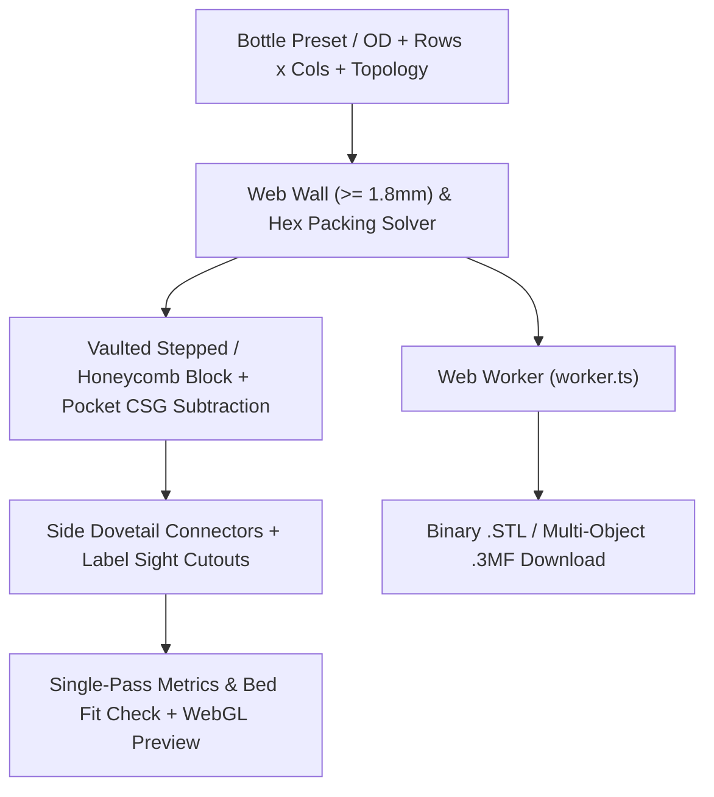

# Parametric Spice Jar, Paint Bottle & Coffee Pod Rack Maker

# Technical Specification & Architecture Blueprint

> **Spec Number**: 133  
> **Slug**: `jar-bottle-rack-maker`  
> **Category**: `3d`  
> **Inspired By**: Caliper-Exact Tiered Stadium Stands, Paint Bottle Grids & Coffee Pod Holders  
> **Target SEO Keyword**: `parametric 3d print spice rack paint bottle stand coffee pod holder stl`  
> **Route**: `/tools/jar-bottle-rack-maker`  
> **Architecture**: 100% Client-Side Single Page Application (Zero Server Ingestion, Zero Telemetry)

---

## 1. MVP Generation Prompt (`/create-web-micro-saas`)

```text
/create-web-micro-saas

Act as a Principal Mechanical CAD Engineer and Angular Architect. Build a 100% client-side 3D parametric generator for PrivKnife called "Parametric Spice Jar, Paint Bottle & Coffee Pod Rack Maker".

TECHNICAL CONSTRAINTS & STACK:
1. Pure Client-Side Architecture: Zero backend endpoints, zero telemetry. All cylindrical pocket tiers, staggered honeycomb wells, and interlocking dovetail side connectors execute locally inside browser memory.
2. Core Technologies: Already-installed `three` (`^0.186.1`), `three-bvh-csg` (`^0.0.18`), `jszip` (`^3.10.2`), pure-TS binary `.STL` + multi-object `.3MF` serializers.
3. Thread Safety & Memory Hygiene (Directives 3 & 4): Multi-well CSG pocket subtraction and interlocking side-tab arrays run inside a dedicated Web Worker (`worker.ts`) with transferable buffers. Dispose all GPU buffers and `WebGLRenderer` in `ngOnDestroy()`, and revoke every download `ObjectURL`.
4. Export Deliverables: Print-ready manifold `.stl` and multi-module `.3mf` plate sets.

KEY FEATURES & USER INTERACTION:
- Popular Bottle, Jar & Pod Quick-Presets + Caliper Diameter Input:
  1. **McCormick / Standard Glass Spice Jar** (`Ø44.5–52.0mm`, upright tiered stadium riser or drawer tray)
  2. **Vallejo / Army Painter Dropper Bottles (`17mL`)** (`Ø25.2mm` upright OR inverted tip-down stepped stand!)
  3. **Citadel / Games Workshop Paint Pots (`12/24mL`)** (`Ø33.0mm`)
  4. **Essential Oil Amber Bottles (`10–30mL`) / Nail Polish** (`Ø26.5–31.0mm`)
  5. **Nespresso Original / Vertuo / K-Cup Coffee Capsules** (tapered capsule rim rest slot `Ø37.2mm` / `Ø58.5mm` for slide-in wall/cabinet dispensers!)
  6. **Custom Bottle / Vial Diameter (`12–95mm`)**
- Three Support-Free Rack Topologies:
  - **Stepped Tiered Stadium Stand**: `1–4` elevated rows stacked cleanly vertically (`stepRiseMm 18–40mm`), keeping back labels visible on pantry shelves and paint desks.
  - **Staggered Honeycomb Tray**: Dense triangular hex-packed wells maximizing bottle count inside drawers or cabinets (`honeycombStagger: true` trims depth ~13%!).
  - **Wall / Magnetic Front-Access Capsule & Dropper Track**: Open front C-slot rails for slide-in coffee pods or hanging under cabinets.
- Modular Interlocking Dovetail Side Tabs: Add Male dovetail tabs (Right/Back) and Female slots (Left/Front) so narrow 220mm printers print seamless expandable tabletop racks!
- Privacy & Local Execution Assurance: Prominent trust badge reading "🛡️ 100% In-Browser • Never Leaves Your Device".
```

---

## 2. Concept Overview & Value Proposition

Every miniature painter (`25mm` Vallejo vs `33mm` Citadel vs `28mm` Tamiya), home cook (arbitrary glass spice jar brands), and coffee corner has bottles and pods of slightly different diameters that rattle loosely or won't fit retail tiered racks. **Parametric Spice Jar, Paint Bottle & Coffee Pod Rack Maker** calculates staggered honeycomb packing or stepped stadium risers straight from a caliper bottle measurement, complete with zero-support dovetail expansion tabs so modular sections clip tightly together across multiple plates.

### Elevator Pitch
> "Enter your exact bottle, spice jar, hobby paint, or coffee pod diameter to generate stepped stadium stands and interlocking honeycomb racks as `.STL` and `.3MF`—100% client-side."

### Core Value Drivers
1. **Staggered Hex Packing Geometry**: Automatically alternates row offsets by `0.5 * pitchX` with `pitchY = sqrt(3)/2 * pitchX`, cramming ~15% more bottles into the same shelf depth!
2. **Modular Endless Side Dovetails**: Lets users print two `3×3` racks on an Ender 3 / Bambu Mini and slide-lock them side-by-side into a seamless `6×3` organizer!
3. **Filament-Saver Front Sight Windows**: Optional U-shaped pocket front cutouts expose bottle labels and cut plastic usage cleanly by ~25%.

---

## 3. Technical Feasibility, Dependencies & Nuances

### Difficulty Score: 5.5 / 10 (Moderate — Staggered hexagonal pocket packing, stepped stadium CSG cavities, and matching dovetail side connectors)

| Architectural Component | Implementation Technology | Installed in Repo? | Client-Side Feasibility |
|---|---|---|---|
| Stepped Risers & Honeycomb Trays | `three` ExtrudeGeometry + CSG | Yes (`^0.186.1`) | 100% In-Browser |
| Dovetail Connectors & Sight Windows | `three-bvh-csg` (`^0.0.18`) | Yes (`^0.0.18`) | 100% In-Browser |
| Binary `.STL` & `.3MF` Export | Pure-TS STL Writer + `jszip` | Yes (`^3.10.2`) | 100% In-Browser |

### Known Engineering Nuances & Mitigations
- **Bottom-Heaviness / Front-Tipping Tiered Racks**: Tall `4`-tier stepped stadium racks could waste huge solid filament under the rear shelves or warp at the corners.
  - *Mitigation*: Automatically hollow out underneath elevated rear tiers (maintaining `45°` vaulted rib arches under rear wells for zero-support printing!) reducing filament mass ~45% and eliminating corner warping!
- **Too-Thin Bridging Walls Between Adjacent Pockets**: Setting `slotSpacingMm` near `0` causes pocket wells to overlap into ragged sharp edges.
  - *Mitigation*: Guarantee minimum inter-pocket web wall thickness `webWallMm >= 1.8mm` (`centerPitch = effectiveHoleDia + webWallMm`).
- **Tapered Capsule Slip-Through (Coffee Pods)**: Straight vertical bores let tapered Nespresso Original (`Ø37mm` rim, `Ø30mm` body) pods fall straight through bottomless tracks.
  - *Mitigation*: Add `lipRetentionRimMm` (`2.2mm` top rim ledge / stepped lower shelf diameter) in `capsule_track` mode so pods hang cleanly by their crimped foil flange!

---

## 4. Competitive Landscape & Market Positioning

| Feature / Metric | PrivKnife (`jar-bottle-rack-maker`) | Retail Acrylic Spice Tier | Random STL Paint Racks |
|---|---|---|---|
| **Exact Bottle Brand Matching** | **Vallejo (`25mm`), Citadel (`33mm`), Spice (`45–52mm`), Custom** | Wastes vertical/lateral space | Fails mixed bottle sizes |
| **Interlocking Side Tiling** | **Built-in Dovetail Clips** | Fixed one-piece width | Single fixed grid only |
| **Vaulted Support-Free Hollow Rear** | **45% Filament Savings + Zero Supports** | N/A | Often solid heavy blocks |

---

## 5. Functional Requirements & Parametric Algorithms

### 5.1. Well Center Grid & Staggered Honeycomb Solver
- Compute `effectiveHoleDiameterMm = bottleDiameterMm + fitClearanceMm`.
- Set `pitchX = effectiveHoleDiameterMm + webWallMm`.
- For `staggeredHex: true`, alternate odd row `xOffset = pitchX / 2`, compressing vertical row spacing to `pitchY = pitchX * (Math.sqrt(3) / 2)`.
- Reject grids cleanly if `columns * rows` produces footprints exceeding max bounds (`> 420mm`) unless split-friendly warning is flagged.

### 5.2. Vaulted Tiered Base & Dovetail Tabs
- Generate stepped tier blocks rising `+ stepRiseMm` per back row with vaulted `45°` underside hollow arch relief (`bottomWall >= 3.2mm`) + front semi-circular label sight notch when `includeLabelCutout: true`.
- Attach tapered trapezoidal male dovetail on `+X` side and subtract cleared female socket on `-X` side when `includeSideDovetails: true`.

---

## 6. UI/UX Layout Specification (BEM Architecture)

- **Localization (`i18n`)**: Keys under `tools.jarBottleRackMaker.*` across 8 locales.
- **Layout**: `.l-columns--2` desktop (`c-jar-rack__viewport-hud`), bottle/pod quick-presets, `.c-input__control`/`.c-input__slider` bindings, live bottle slot count + filament weight telemetry.

---

## 7. Technical Architecture & Client-Side Pipeline



---

## 8. Input/Output Data Contracts (TypeScript Interfaces)

```typescript
export type RackBottlePreset =
  | 'spice_jar'
  | 'vallejo_17ml'
  | 'citadel_pot'
  | 'essential_oil'
  | 'nespresso_original'
  | 'k_cup'
  | 'custom';

export type RackTopology = 'stepped_stadium' | 'honeycomb_tray' | 'capsule_track';

export interface JarBottleRackOptions {
  preset: RackBottlePreset;
  topology: RackTopology;
  bottleDiameterMm: number;        // 12..95
  fitClearanceMm: number;          // 0.3..1.5
  webWallThicknessMm: number;      // 1.8..6.0
  columns: number;                 // 1..10
  rows: number;                    // 1..6
  wellDepthMm: number;             // 8..55
  stepRiseMm: number;              // 0..40 (used in stepped_stadium)
  includeLabelCutout: boolean;
  includeSideDovetails: boolean;
  hollowVaultUnderside: boolean;
  filamentColorHex: string;
}

export interface JarRackMetrics {
  totalCapacityCount: number;
  widthMm: number;
  depthMm: number;
  heightMm: number;
  triangleCount: number;
  estimatedWeightG: number;
  estimatedPrintTimeHours: number;
  exceedsStandardBed: boolean;
}
```

---

## 9. Security, Memory Hygiene & Functional Test Vectors

- **Directives 1–5**: Zero network calls; Web Worker lifecycle & ObjectURL cleanup paired; Three.js `.dispose()` in `ngOnDestroy()`.
- **Functional Test Vectors**:
  1. `honeycomb_tray` (`columns: 4, rows: 3`) accommodates `totalCapacityCount === 12` pockets with row pitch compressed by `sqrt(3)/2` compared to square `rows: 3`.
  2. `vallejo_17ml` (`bottleDiameterMm: 25.2, fitClearanceMm: 0.6, webWallThicknessMm: 2.0`) spaces well centers `>= 27.8mm` cleanly with zero overlapping rims.
  3. `hollowVaultUnderside: true` on `stepped_stadium` (`rows: 3`) reduces calculated volume & estimated grams compared to `hollowVaultUnderside: false` solid block.
  4. Invalid `webWallThicknessMm: 0.4` (< 1.8) or `bottleDiameterMm: 5` (< 12) returns `{ valid: false }` validation error cleanly.
