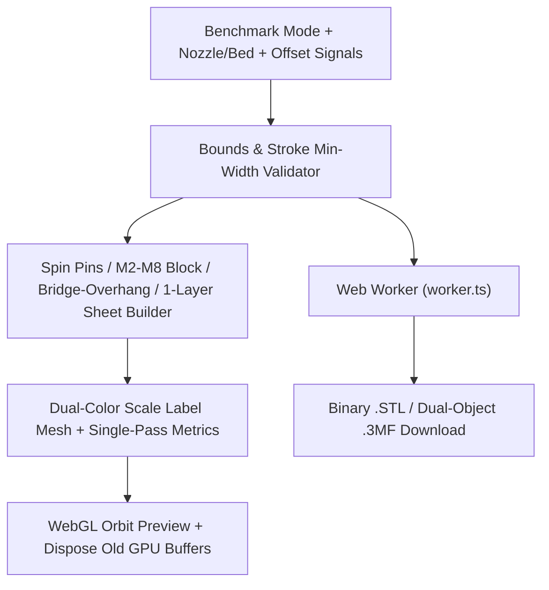

# Parametric 3D Printer Calibration, Clearance & Fastener Fit Suite

# Technical Specification & Architecture Blueprint

> **Spec Number**: 134  
> **Slug**: `calibration-tolerance-suite`  
> **Category**: `3d`  
> **Inspired By**: Calibrated Clearance Gauges, Fastener Fit Blocks & Bed First-Layer Tests  
> **Target SEO Keyword**: `parametric 3d printer tolerance clearance test m3 m4 m5 fit block bed level stl`  
> **Route**: `/tools/calibration-tolerance-suite`  
> **Architecture**: 100% Client-Side Single Page Application (Zero Server Ingestion, Zero Telemetry)

---

## 1. MVP Generation Prompt (`/create-web-micro-saas`)

```text
/create-web-micro-saas

Act as a Principal Additive Manufacturing Engineer and Angular Architect. Build a 100% client-side 3D parametric generator for PrivKnife called "Parametric 3D Printer Calibration, Clearance & Fastener Fit Suite".

TECHNICAL CONSTRAINTS & STACK:
1. Pure Client-Side Architecture: Zero backend endpoints, zero telemetry. All clearance bars, fastener gauges, overhang bridges, and first-layer bed sheets compile cleanly inside browser memory.
2. Core Technologies: Already-installed `three` (`^0.186.1`), `three-bvh-csg` (`^0.0.18`), `jszip` (`^3.10.2`), pure-TS vector stroke embossing for sharp raised/recessed numeric gauge markings (`0.15, 0.20, 0.30` / `M3, M4`), and pure-TS `.STL` / `.3MF` serializers.
3. Thread Safety & Memory Hygiene (Directives 3 & 4): Multi-feature CSG calibration plates run in a dedicated Web Worker (`worker.ts`) with transferable buffers. Dispose all GPU buffers and `WebGLRenderer` in `ngOnDestroy()`, and revoke every download `ObjectURL`.
4. Export Deliverables: Ultra-fast print-ready `.stl` and dual-color `.3mf` separating Calibration Base Block and High-Contrast Embossed Scale Numbers!

KEY FEATURES & USER INTERACTION:
- Four Essential Printer Calibration & Tolerance Benchmarks Tailored to Your Nozzle & Bed:
  1. **Print-in-Place Spinning Clearance Gauge**: Configurable range of radial pin-in-hole clearances (e.g. `0.10, 0.15, 0.20, 0.25, 0.30, 0.40 mm`), chamfered knurled twist-pins seated flush inside base sockets, plus dual-color/embossed numeric gap labels so users immediately discover their exact loose/snug printer offset!
  2. **Metric / SAE Bolt & Hex Nut Fit Test Block**: Pick fasteners (`M2`, `M2.5`, `M3`, `M4`, `M5`, `M6`, `M8`) with micro-stepped bore offsets (`-0.1, +0.0, +0.1, +0.2, +0.3, +0.4mm`) pairing round through-bores AND corresponding DIN 934 hex-nut pockets on one compact pocket reference block!
  3. **Custom Bridging & Overhang Angle Stress Torture Bar**: Stepped horizontal bridging spans (`20, 40, 60, 80, 100mm`) OR progressive overhang slope petals (`35°, 45°, 55°, 65°, 75°`) labeled cleanly underneath for testing cooling fan performance across filaments.
  4. **Exact Build-Plate First-Layer Z-Offset Sheet**: Generates 1-layer (`layerHeightMm 0.16–0.28mm`) `5-patch` / `9-patch` or full-bed diagnostic squares matched directly to user printer bed dimensions (`180×180`, `220×220`, `256×256`, `300×300`, `Custom`) with margin border!
- Material & Nozzle Profile Telemetry: Displays layer count, print time estimate (~12–25 min quick tests), and clear guidance on feeding discovered clearance offsets directly into Spec 123–133 parametric generators!
- Privacy & Local Execution Assurance: Prominent trust badge reading "🛡️ 100% In-Browser • Never Leaves Your Device".
```

---

## 2. Concept Overview & Value Proposition

Every time a maker switches filament (matte PLA vs PETG vs ASA), swaps a `0.4mm` → `0.6mm` nozzle, or tunes Input Shaping, static old STL calibration models either don't match their bed size (`180mm` vs `300mm`), lack the exact `M4`/`M5` fastener range they use, or waste 2 hours printing redundant toys. **Parametric 3D Printer Calibration, Clearance & Fastener Fit Suite** generates rapid `10–25 minute` engineering test blocks customized to the exact printer bed, layer height, clearance steps, and hardware bolts the maker needs right now—and lets them feed the winning clearance straight into PrivKnife's box, spacer, knob, and container generators!

### Elevator Pitch
> "Print rapid nozzle- and bed-matched clearance gauges (`0.10–0.40mm`), M2–M8 bolt/nut fit reference blocks, bridge/overhang stress bars, and first-layer sheets as `.STL` and dual-color `.3MF`."

### Core Value Drivers
1. **Closed-Loop Workflow With PrivKnife's 3D Suite**: Directly outputs exact radial/XY tolerance numbers (`e.g. 0.25mm` loose fit) to dial into hinge, dovetail, thread, and washer tools.
2. **Exact First-Layer Bed Geometry Calibration**: Matches user `bedWidthMm × bedDepthMm` and `firstLayerHeightMm` verbatim (`1-layer` uniform height = exact `Z_max === layerHeightMm`!) rather than resizing in a slicer (which ruins Z thickness!).
3. **Dual-Color Legible Labels**: Separates embossed millimeter/degree numbers into a second `.3MF` object so legends remain crisp at `0.15mm` resolution.

---

## 3. Technical Feasibility, Dependencies & Nuances

### Difficulty Score: 4.5 / 10 (Low-Moderate — Coaxial pin-in-socket clearance pairs, micro-stepped hex/round bores, stepped overhang geometry, and exact bed patch layout)

| Architectural Component | Implementation Technology | Installed in Repo? | Client-Side Feasibility |
|---|---|---|---|
| Spin Clearance Pins & Sockets | `three` Cylinder + Lathe + CSG | Yes (`^0.186.1`) | 100% In-Browser |
| Fastener Block & Overhang Petals | `three-bvh-csg` (`^0.0.18`) | Yes (`^0.0.18`) | 100% In-Browser |
| Embossed Gauge Labels & `.3MF`/`.STL` | Vector Stroke Font + `jszip` | Yes (`^3.10.2`) | 100% In-Browser |

### Known Engineering Nuances & Mitigations
- **Spinning Clearance Pins Fusing at Elephant's-Foot First Layer**: Even a `0.30mm` gap fuses cleanly at `Z = 0` if bottom bed squish flares the pin shoulder!
  - *Mitigation*: Model an external `0.6mm × 45°` bottom chamfer relief at `Z = 0` on both spinning pin bases AND top knob shafts (`captured captive hourglass waist`) so bottom elephant's-foot squish stays clear of the socket wall!
- **Slicer Scaling Destroys First-Layer Sheet Thickness**: Downloading a static `200×200×0.2mm` sheet and scaling `125%` uniformly to fit a `250mm` bed stretches Z height to `0.25mm`!
  - *Mitigation*: Export native exact `bedWidthMm × bedDepthMm` patches at `1.0×` scale while locking thickness strictly to `firstLayerHeightMm` (`Z_max === layerHeightMm`)!
- **Too-Small Text Strokes Dropping Thin Perimeters**: Micro `0.3mm` text strokes vanish in `0.4–0.6mm` nozzle slicers (`Arachne` warnings).
  - *Mitigation*: Scale stroke line width `>= Math.max(0.55, nozzleDiameterMm * 1.25)` so every `0.15` / `M4` gauge number slices reliably!

---

## 4. Competitive Landscape & Market Positioning

| Feature / Metric | PrivKnife (`calibration-tolerance-suite`) | Fixed Thingiverse Calibration Coins | Built-In Slicer Primitives |
|---|---|---|---|
| **Exact Bed & Layer-Height Locked First Layer** | **Exact 1-Layer `Z = layerHeightMm` Output** | Fixed sizes (scaling breaks Z) | Generic primitive cubes |
| **Bolt + Matching Hex Nut Fit Palette** | **Micro-Stepped `-0.1..+0.4mm` Reference Block** | Separate inconsistent files | None |
| **Paired `.3MF` Crisp Multi-Color Markings** | **Native 2-Object `.3MF`** | Monochrome | None |

---

## 5. Functional Requirements & Parametric Algorithms

### 5.1. Spinning Clearance Gauge (`clearance_gauge`)
- Given base array of clearances (`e.g. [0.10, 0.15, 0.20, 0.25, 0.30, 0.40]`), build rectangular housing (`height = 7.0mm`) with `N` circular stepped bores (`socketRadius = pinRadius + gapMm`) and matching concentric knurled twist pins (`pinRadius = 4.0mm` with central captured flared lip `0.5mm` preventing fallout upward or downward).

### 5.2. Bolt/Nut Palette, Bridging/Overhangs & First-Layer Sheet
- **`fastener_fit_block`**: Cut 5 micro-stepped offsets (`[-0.1, 0, 0.1, 0.2, 0.35]`) for selected `M2..M8` diameter (`round` bore on back row + `DIN 934` hex pocket on front row) with raised size & delta offset text!
- **`bridge_overhang_test`**: Build either suspended `2.0mm` thin bridges spanning `[20, 40, 60, 80, 100]` mm OR cantilevered slope steps (`[35°, 45°, 55°, 65°, 75°]`) from vertical.
- **`first_layer_sheet`**: Place `5` (`corners + center`) or `9` square `32×32mm` diagnostic patches inside `[bedWidthMm - 2*margin, bedDepthMm - 2*margin]` + outer `2.4mm` purge border frame, strictly `Z = 0..firstLayerHeightMm` (`+/- 0.001mm`)!

---

## 6. UI/UX Layout Specification (BEM Architecture)

- **Localization (`i18n`)**: Keys under `tools.calibrationToleranceSuite.*` across 8 locales.
- **Layout**: `.l-columns--2` desktop (`c-calibration-suite__viewport-hud`), quick bed & nozzle presets (`0.4mm` / `0.6mm`, `180/220/256/300mm`), `.c-input__control`/`.c-input__slider` bindings, and quick print-time estimate (`~15 min`).

---

## 7. Technical Architecture & Client-Side Pipeline



---

## 8. Input/Output Data Contracts (TypeScript Interfaces)

```typescript
export type CalibrationTestMode =
  | 'clearance_gauge'
  | 'fastener_fit_block'
  | 'bridge_overhang_test'
  | 'first_layer_sheet';

export type CalibrationBoltSize = 'M2' | 'M2.5' | 'M3' | 'M4' | 'M5' | 'M6' | 'M8';

export interface CalibrationToleranceOptions {
  mode: CalibrationTestMode;
  nozzleDiameterMm: number;        // 0.2..1.0
  layerHeightMm: number;           // 0.10..0.40
  // Clearance gauge
  clearanceValuesText: string;     // e.g. '0.10, 0.15, 0.20, 0.25, 0.30, 0.40'
  // Fastener block
  boltSize: CalibrationBoltSize;
  // Bridge / overhang
  includeBridges: boolean;
  includeOverhangs: boolean;
  // First-layer sheet
  bedWidthMm: number;              // 120..400
  bedDepthMm: number;              // 120..400
  bedMarginMm: number;             // 5..25
  patchCount: 5 | 9;
  includeGaugeLabels: boolean;
  bodyColorHex: string;
  labelColorHex: string;
}

export interface CalibrationMetrics {
  testFeatureCount: number;
  widthMm: number;
  depthMm: number;
  heightMm: number;
  triangleCount: number;
  estimatedWeightG: number;
  estimatedPrintTimeMinutes: number;
}
```

---

## 9. Security, Memory Hygiene & Functional Test Vectors

- **Directives 1–5**: Zero network calls; Web Worker lifecycle & ObjectURL cleanup paired; Three.js `.dispose()` in `ngOnDestroy()`.
- **Functional Test Vectors**:
  1. `first_layer_sheet` with `bedWidthMm: 256, bedDepthMm: 256, bedMarginMm: 10, layerHeightMm: 0.20` emits exact footprint `<= 236×236mm` and exact Z height `metrics.heightMm === 0.20` (`± 0.001mm`).
  2. `clearance_gauge` parses `"0.10, 0.15, 0.20, 0.25, 0.30, 0.40"` into `6` base sockets + `6` independent chamfered pins cleanly (`testFeatureCount === 6`, zero `NaN` vertices).
  3. `fastener_fit_block` with `boltSize: 'M4'` creates paired cylindrical bolt bores + DIN 934 (`7.0mm` nominal + offset) hex nut pockets cleanly across 5 stepped tolerances.
  4. Invalid/empty `clearanceValuesText: "   "` or `layerHeightMm: 0.9` returns `{ valid: false }` cleanly without crashing.
