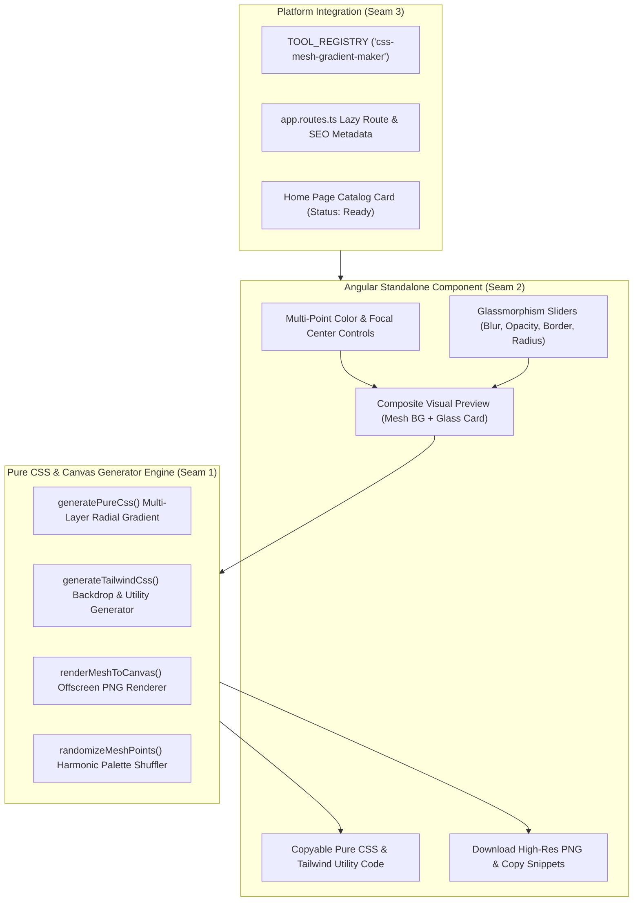

# Implementation Plan: CSS Mesh Gradient & Glassmorphism Code Maker

> **Tool**: `14 - CSS Mesh Gradient & Glassmorphism Code Maker`  
> **Target Directory**: `src/app/tools/dev/mesh-gradient-maker/`  
> **Route**: `/tools/css-mesh-gradient-maker` (alias `/tools/mesh-gradient`)  
> **Key Directives**: 100% Client-Side execution, zero telemetry, radial gradient compositing, CSS backdrop-filter math, Tailwind v3/v4 & Pure CSS exporters, high-res PNG download, BEM architecture, strict memory hygiene.

---

## 📐 Architecture & Seam Design

---

## 🧪 Vertical Slices & TDD Seams

### Seam 1: Core Mesh Engine & Code Exporters (`engine.ts` & `engine.spec.ts`)
- **Domain Types (`types.ts`)**:
  - `MeshPoint`: `{ id: string; x: number; y: number; color: string; radius: number }`
  - `GlassmorphismConfig`: `{ opacity: number; blur: number; borderOpacity: number; borderWidth: number; borderRadius: number; reflection: boolean; tint: 'light' | 'dark' }`
  - `MeshGradientConfig`: `{ baseColor: string; points: MeshPoint[]; noise: boolean; blurRadius: number; blendMode: string }`
  - `GradientPreset`: Name and point configurations.
- **Engine Functions (`engine.ts`)**:
  - `generatePureCss(meshConfig, glassConfig)`: Produces multi-radial-gradient background and backdrop-filter glass card CSS.
  - `generateTailwindCss(meshConfig, glassConfig)`: Produces Tailwind utility classes and arbitrary values.
  - `renderMeshToCanvas(meshConfig, canvas, width, height)`: Draws multi-radial composite with optional grain.
  - `exportMeshPngBlob(meshConfig, width, height)`: Generates high-res image Blob (PNG).
  - `randomizeMeshPoints()`: Generates harmonic color sets with varied coordinates.
- **Unit Tests (`engine.spec.ts`)**:
  - Verify Pure CSS output contains radial-gradient layers, backdrop-filter blur, border-radius, and valid syntax.
  - Verify Tailwind CSS output generates valid utility classes (backdrop-blur, bg-opacity, rounded, border).
  - Verify canvas renderer produces canvas with matching dimensions and no exceptions.
  - Verify PNG export outputs non-empty Blob.
  - Verify randomize helper produces points with coordinates bounded within 0–100%.

### Seam 2: UI Component & State Signals (`mesh-gradient-maker.component.ts` & `.spec.ts`)
- **Component Features**:
  - Signals for `meshConfig`, `glassConfig`, `activeCodeTab`, `copiedCode`, `isExporting`, `showDownloadModal`.
  - Visual live canvas / background with overlapping translucent Glassmorphism card.
  - Controls for mesh points (color picker, X%, Y%, radius), base background color, and noise toggle.
  - Glassmorphism sliders: opacity, blur radius, border opacity, border width, border radius, reflection shine.
  - One-click preset buttons (Sunset, Aurora, Cyberpunk, Cotton Candy, Dark Matter).
  - Randomize button.
  - Code panel switching between Pure CSS and Tailwind CSS with one-click copy and feedback toast.
  - Download high-res PNG with immediate `URL.revokeObjectURL()`.
  - Lifecycle cleanup (`ngOnDestroy`).
  - Zero-network privacy verification test.

### Seam 3: Tool Registration, Routing & Roadmap Check
- Export `cssMeshGradientMakerTool` in `index.ts`.
- Register in `src/app/tools/tool-registry.ts` and test in `tool-registry.spec.ts`.
- Add lazy route in `app.routes.ts` with metadata.
- Update `home.ts` setting status to `'ready'`.
- Mark Spec 14 as `[x]` in `specs/README.md`.
