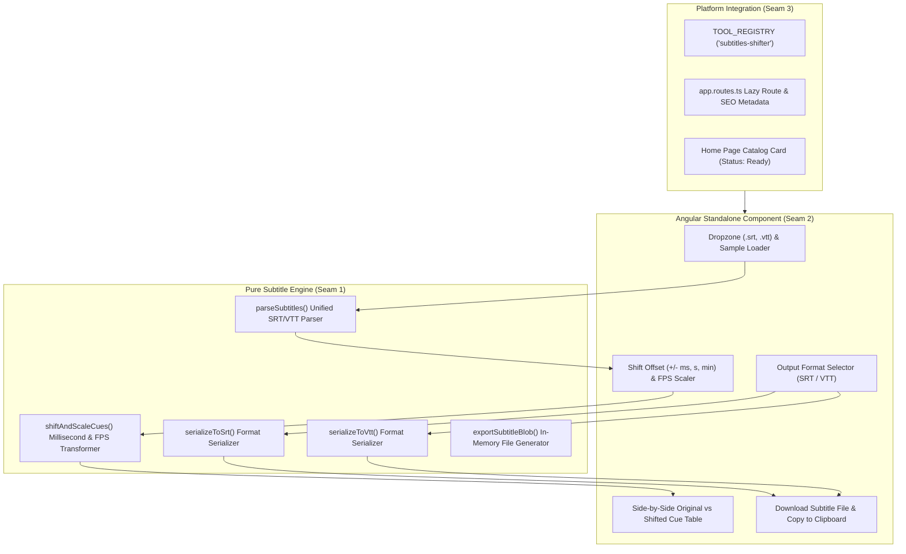

# Implementation Plan: Subtitles Timestamp Shifter & SRT/VTT Converter

> **Tool**: `15 - Subtitles Timestamp Shifter & SRT-VTT Converter`  
> **Target Directory**: `src/app/tools/media/subtitles-shifter/`  
> **Route**: `/tools/subtitles-shifter` (aliases `/tools/subtitle-shifter`, `/tools/srt-vtt-converter`)  
> **Key Directives**: 100% Client-Side execution, zero telemetry, high-precision regex time parsing, bidirectional SRT <-> VTT conversion, FPS scaling, side-by-side cue preview, memory hygiene.

---

## 📐 Architecture & Seam Design

---

## 🧪 Vertical Slices & TDD Seams

### Seam 1: Domain Models & Subtitle Engine (`engine.ts` & `engine.spec.ts`)
- **Domain Types (`types.ts`)**:
  - `SubtitleCue`: `{ index: number; id?: string; startMs: number; endMs: number; text: string; rawSettings?: string }`
  - `SubtitleFormat`: `'srt' | 'vtt'`
  - `ShiftOptions`: `{ offsetMs: number; fpsScale?: { fromFps: number; toFps: number } }`
  - `ParsedSubtitleFile`: `{ format: SubtitleFormat; cues: SubtitleCue[]; headerNote?: string }`
- **Engine Functions (`engine.ts`)**:
  - `parseSubtitles(content: string)`: Detects format (SRT vs VTT), extracts cues and timestamps accurately.
  - `formatTimestamp(ms: number, format: SubtitleFormat)`: Converts milliseconds to `HH:MM:SS,mmm` (SRT) or `HH:MM:SS.mmm` (VTT).
  - `parseTimestamp(timeStr: string)`: Converts time string to milliseconds.
  - `applyTimeShift(cues: SubtitleCue[], options: ShiftOptions)`: Offsets and scales cue times with non-negative lower bound guard.
  - `serializeSubtitles(cues: SubtitleCue[], format: SubtitleFormat)`: Outputs valid string for SRT or WebVTT.
  - `exportSubtitleBlob(content: string, format: SubtitleFormat)`: Creates Blob with correct MIME type.
- **Unit Tests (`engine.spec.ts`)**:
  - Parse standard multi-cue SRT files with comma timestamps.
  - Parse standard WebVTT files with dot timestamps and `WEBVTT` header.
  - Correctly shift timestamps forward (+) and backward (-).
  - Prevent negative timestamps (< 0ms clamped to 0ms).
  - Perform FPS scaling conversion (e.g., 23.976 to 25.000).
  - Convert SRT into valid WebVTT and WebVTT into valid SRT.
  - Output clean Blob.

### Seam 2: Component UI & Signals (`subtitles-shifter.component.ts` & `.spec.ts`)
- **Component Features**:
  - Signals for raw content, parsed cues, shifted cues, offset amount, unit (ms/s/min), direction (+/-), FPS conversion toggle, target format, copied state, exporting state.
  - Dropzone for `.srt` and `.vtt` file upload + "Load Demo Subtitles" button.
  - Quick-preset time buttons (+500ms, -500ms, +1s, -1s, +5s, -5s).
  - FPS scaling dropdowns (23.976 -> 25, 24 -> 25, 25 -> 29.97, etc.).
  - Side-by-side comparison table showing original vs shifted cues for verification.
  - Action bar: Download Re-synced Subtitle and Copy to Clipboard.
  - Immediate `URL.revokeObjectURL()` memory hygiene.
  - Zero-network privacy verification test.

### Seam 3: Tool Registry, Routing & Platform Integration
- Export `subtitlesShifterTool` in `index.ts`.
- Register in `TOOL_REGISTRY` and update `tool-registry.spec.ts`.
- Add `/tools/subtitles-shifter` and aliases in `app.routes.ts`.
- Update `home.ts` status to `'ready'`.
- Mark Spec 15 as `[x]` in `specs/README.md`.
