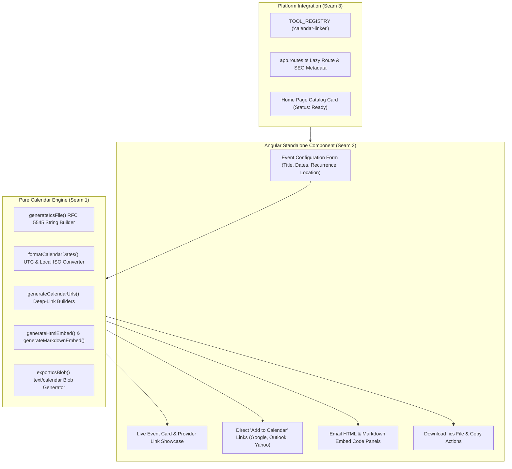

# Implementation Plan: Universal Event & .ics Calendar Linker

> **Tool**: `16 - Universal Event & .ics Calendar Linker`  
> **Target Directory**: `src/app/tools/dev/calendar-linker/`  
> **Route**: `/tools/calendar-linker` (aliases `/tools/event-calendar-linker`, `/tools/ics-calendar-linker`)  
> **Key Directives**: 100% Client-Side execution, zero telemetry, RFC 5545 .ics generation, universal web calendar links (Google, Outlook, Office 365, Yahoo), email HTML/Markdown embed snippets, memory hygiene, responsive BEM UI.

---

## 📐 Architecture & Seam Design

---

## 🧪 Vertical Slices & TDD Seams

### Seam 1: Domain Models & Calendar Engine (`engine.ts` & `engine.spec.ts`)
- **Domain Types (`types.ts`)**:
  - `RecurrenceFreq`: `'none' | 'DAILY' | 'WEEKLY' | 'MONTHLY' | 'YEARLY'`
  - `CalendarEvent`: `{ title: string; startDate: string; endDate: string; isAllDay?: boolean; timezone?: string; description?: string; location?: string; recurrence?: RecurrenceFreq; count?: number }`
  - `CalendarUrls`: `{ google: string; outlook: string; office365: string; yahoo: string; icsDownloadFilename: string }`
- **Engine Functions (`engine.ts`)**:
  - `formatUtcDateTime(date: Date | string, isAllDay?: boolean): string`: Formats into standard `YYYYMMDDTHHMMSSZ` or `YYYYMMDD`.
  - `generateIcsFile(event: CalendarEvent): string`: Builds RFC 5545 text block with VCALENDAR, VEVENT, UID, DTSTAMP, DTSTART, DTEND, SUMMARY, DESCRIPTION, LOCATION, RRULE.
  - `generateCalendarUrls(event: CalendarEvent): CalendarUrls`: Builds provider deep links for Google Calendar, Outlook Web, Office 365, and Yahoo Calendar.
  - `generateHtmlEmbed(event: CalendarEvent, urls: CalendarUrls): string`: Generates inline-styled cross-client email button table.
  - `generateMarkdownEmbed(event: CalendarEvent, urls: CalendarUrls): string`: Generates clean Markdown link list.
  - `exportIcsBlob(icsContent: string): Blob`: Exports `text/calendar;charset=utf-8` Blob.
- **Unit Tests (`engine.spec.ts`)**:
  - Verify RFC 5545 output matches specification (BEGIN:VCALENDAR, BEGIN:VEVENT, SUMMARY, DTSTART, DTEND, END:VEVENT).
  - Verify multiline descriptions and special characters are escaped properly (`\n`, `,`, `;`).
  - Verify recurrence rules (DAILY, WEEKLY, MONTHLY) are mapped to standard `RRULE:FREQ=...`.
  - Verify Google Calendar URL query parameters (`text`, `dates`, `details`, `location`).
  - Verify Outlook & Office 365 URL query parameters.
  - Verify Yahoo Calendar URL query parameters.
  - Verify HTML email snippet generates valid table markup with links.
  - Verify Blob export creates non-empty `text/calendar` Blob.

### Seam 2: Component UI & Signals (`calendar-linker.component.ts` & `.spec.ts`)
- **Component Features**:
  - Signals for `eventForm`, `activeTab` ('links' | 'html' | 'markdown' | 'ics'), `copiedState`, `showExportModal`.
  - Form controls for event title, start datetime, end datetime, all-day toggle, location/video link, description, recurrence.
  - Sample event loader ("Load Demo Webinar Event").
  - Live preview card displaying event summary and provider buttons.
  - One-click "Copy Link" buttons for Google, Outlook, Office 365, Yahoo.
  - One-click "Download .ics" button with instant `URL.revokeObjectURL()`.
  - Email embed snippet copy tab with instant clipboard copy.
  - Zero-network privacy verification test.

### Seam 3: Tool Registry, Routing & Platform Integration
- Export `calendarLinkerTool` in `index.ts`.
- Register in `TOOL_REGISTRY` and update `tool-registry.spec.ts`.
- Add `/tools/calendar-linker` and aliases in `app.routes.ts`.
- Update `home.ts` adding catalog tool status to `'ready'`.
- Mark Spec 16 as `[x]` in `specs/README.md`.
