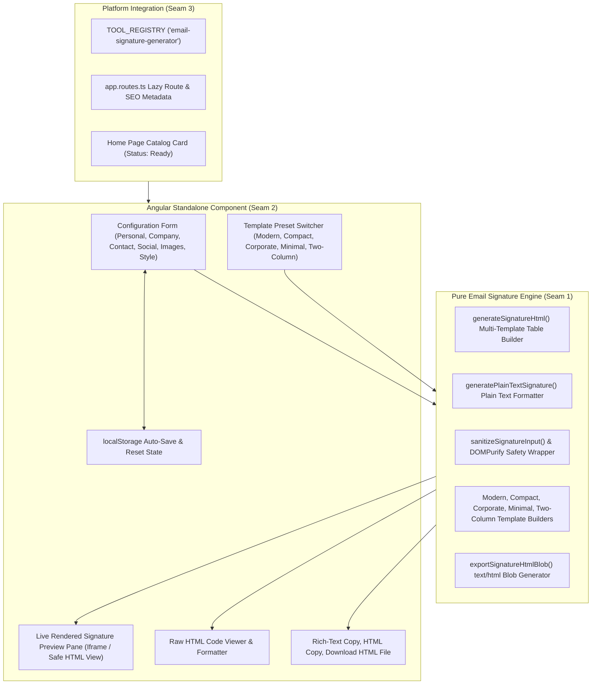

# Implementation Plan: HTML Email Signature Generator

> **Tool**: `17 - HTML Email Signature Generator`  
> **Target Directory**: `src/app/tools/dev/email-signature-generator/`  
> **Route**: `/tools/email-signature-generator` (aliases `/tools/html-email-signature`, `/tools/email-signature`)  
> **Key Directives**: 100% Client-Side execution, zero telemetry, RFC/Email-client compliant HTML table renderer with strict inline styles, DOMPurify sanitization, multi-template presets (Modern, Compact, Corporate, Minimal, Two-Column), dual clipboard export (Rich Text `text/html` + `text/plain` and raw HTML), client-side avatar/logo image upload to Data URI, localStorage auto-save, responsive BEM UI.

---

## 📐 Architecture & Seam Design

---

## 🧪 Vertical Slices & TDD Seams

### Seam 1: Domain Models & Email Signature Engine (`engine.ts` & `engine.spec.ts`)
- **Domain Types (`types.ts`)**:
  - `SignatureTemplate`: `'modern' | 'compact' | 'corporate' | 'minimal' | 'two-column'`
  - `SignatureFont`: `'Arial, sans-serif' | 'Helvetica, sans-serif' | 'Georgia, serif' | "'Times New Roman', serif" | 'Verdana, sans-serif' | "'Trebuchet MS', sans-serif"`
  - `SignatureFontSize`: `'sm' | 'md' | 'lg'`
  - `SignatureAvatarShape`: `'round' | 'square' | 'rounded'`
  - `SignatureConfig`:
    - `personal`: `{ fullName: string; jobTitle: string; department?: string; company: string; }`
    - `contact`: `{ email: string; phone?: string; mobile?: string; website?: string; address?: string; }`
    - `social`: `{ linkedin?: string; twitter?: string; github?: string; instagram?: string; facebook?: string; youtube?: string; }`
    - `images`: `{ avatarUrl?: string; avatarShape: SignatureAvatarShape; avatarSize: number; logoUrl?: string; logoSize: number; }`
    - `style`: `{ template: SignatureTemplate; primaryColor: string; secondaryColor: string; fontFamily: SignatureFont; fontSize: SignatureFontSize; disclaimerText?: string; }`
- **Engine Functions (`engine.ts`)**:
  - `generateSignatureHtml(config: SignatureConfig): string`: Generates bulletproof HTML `<table>` markup with inline styles matching chosen template.
  - `generatePlainTextSignature(config: SignatureConfig): string`: Formats clean ASCII text version for plain-text email clients.
  - `sanitizeSignatureConfig(config: SignatureConfig): SignatureConfig`: Sanitizes all URLs and strings (prevents `javascript:`, malformed tags, XSS).
  - `exportSignatureHtmlBlob(htmlContent: string): Blob`: Creates a `text/html;charset=utf-8` Blob.
- **Unit Tests (`engine.spec.ts`)**:
  - Verify all 5 templates (Modern, Compact, Corporate, Minimal, Two-Column) render standard `<table>` elements with inline styles.
  - Verify email client compliance: `cellpadding="0"`, `cellspacing="0"`, `border="0"`, `border-collapse: collapse;`, zero CSS grid, zero CSS flexbox in output.
  - Verify XSS vectors (e.g. `<script>`, `javascript:`, `onerror=`) are neutralized by sanitizer.
  - Verify plain text output produces formatted contact info and links.
  - Verify image dimensions and border-radius styles are applied properly.
  - Verify Blob export creates non-empty HTML Blob.

### Seam 2: Component UI & Signals (`email-signature-generator.component.ts` & `.spec.ts`)
- **Component Features**:
  - Signals for `config`, `activeView` ('preview' | 'html'), `copyFeedback`, `avatarUploadError`.
  - Tabbed or accordion form sections: Personal Info, Contact, Social Links, Images & Logos, Style & Colors.
  - Visual template selector with instant live update.
  - Local image file upload converting PNG/JPEG to base64 Data URI with file size checks (< 2 MB).
  - Live sanitized preview container (`SafeHtml` via DOMPurify + Angular `DomSanitizer`).
  - Action buttons: "Copy Signature (Rich Text)", "Copy HTML Code", "Download signature.html", "Reset Draft", "Load Demo".
  - Auto-save to `localStorage` on change and restore on init.
  - Zero-network privacy verification test.

### Seam 3: Tool Registry, Routing & Platform Integration
- Export `emailSignatureGeneratorTool` in `index.ts`.
- Register in `TOOL_REGISTRY` and update `tool-registry.spec.ts`.
- Add `/tools/email-signature-generator` and aliases in `app.routes.ts`.
- Update `home.ts` adding catalog tool status to `'ready'`.
- Mark Spec 17 as `[x]` in `specs/README.md`.
