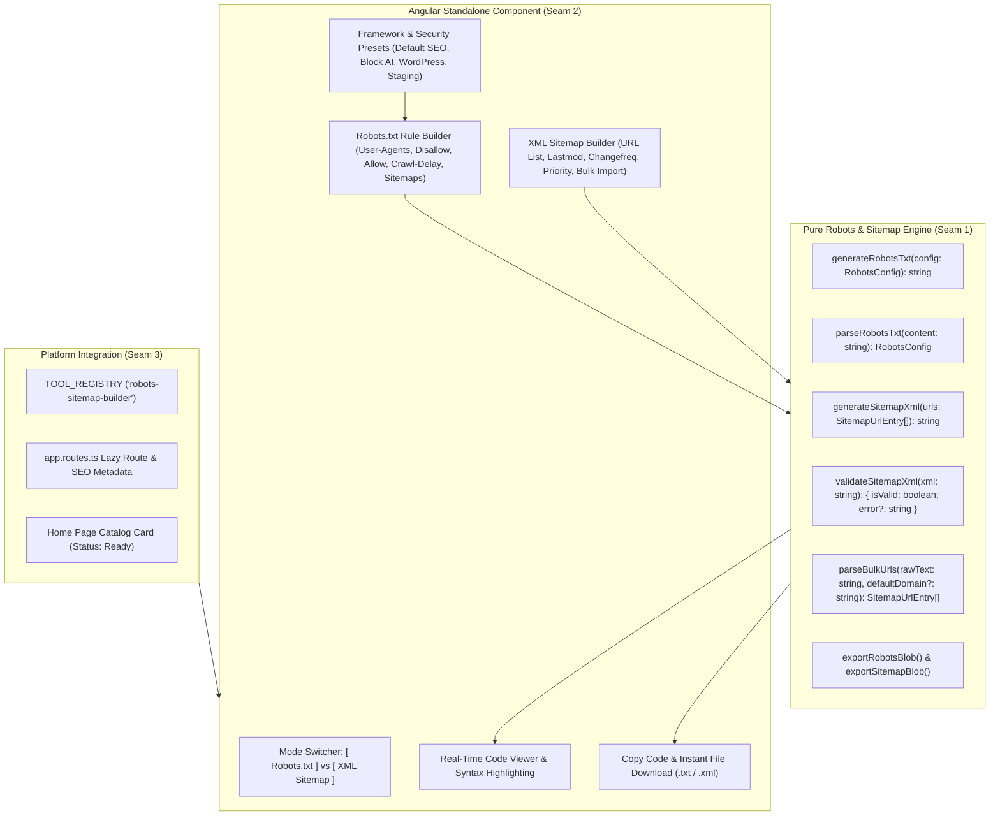

# Implementation Plan: Robots.txt & XML Sitemap Builder

> **Tool**: `18 - Robots.txt & XML Sitemap Builder`  
> **Target Directory**: `src/app/tools/dev/robots-sitemap-builder/`  
> **Route**: `/tools/robots-sitemap-builder` (aliases `/tools/robots-txt-generator`, `/tools/xml-sitemap-builder`)  
> **Key Directives**: 100% Client-Side execution, zero telemetry, dual-tab studio for both `robots.txt` and `sitemap.xml`, user-agent directives (Googlebot, Bingbot, AI crawlers, wildcard), Disallow/Allow/Crawl-delay rules, sitemap declarations, XML validation via DOMParser/XMLSerializer, bulk URL parsing (lines/CSV), download Blobs with immediate Object URL revocation, responsive BEM UI.

---

## 📐 Architecture & Seam Design

---

## 🧪 Vertical Slices & TDD Seams

### Seam 1: Domain Models & Core Engine (`engine.ts` & `engine.spec.ts`)
- **Domain Types (`types.ts`)**:
  - `RobotsUserAgentRule`: `{ userAgent: string; disallow: string[]; allow: string[]; crawlDelay?: number }`
  - `RobotsConfig`: `{ rules: RobotsUserAgentRule[]; sitemaps: string[]; host?: string }`
  - `ChangeFrequency`: `'always' | 'hourly' | 'daily' | 'weekly' | 'monthly' | 'yearly' | 'never'`
  - `SitemapUrlEntry`: `{ loc: string; lastmod?: string; changefreq?: ChangeFrequency; priority?: number }`
  - `RobotsPresetKey`: `'default' | 'block-ai' | 'wordpress' | 'staging' | 'ecommerce'`
- **Engine Functions (`engine.ts`)**:
  - `generateRobotsTxt(config: RobotsConfig): string`: Generates formatted, clean standard `robots.txt` text block.
  - `generateSitemapXml(entries: SitemapUrlEntry[]): string`: Generates standard `<urlset>` XML document with XML declaration and UTF-8 encoding.
  - `validateSitemapXml(xmlString: string): { isValid: boolean; error?: string }`: Validates XML using browser `DOMParser` and checks for `parsererror`.
  - `parseBulkUrls(rawText: string, defaultDomain?: string): SitemapUrlEntry[]`: Converts line-delimited or CSV URLs into structured `SitemapUrlEntry[]`.
  - `exportRobotsBlob(text: string): Blob`: Exports `text/plain;charset=utf-8` Blob for `robots.txt`.
  - `exportSitemapBlob(xml: string): Blob`: Exports `application/xml;charset=utf-8` Blob for `sitemap.xml`.
- **Unit Tests (`engine.spec.ts`)**:
  - Verify `generateRobotsTxt()` outputs correct `User-agent:`, `Disallow:`, `Allow:`, `Crawl-delay:`, and `Sitemap:` directives.
  - Verify preset configurations produce expected directives (e.g. Block AI includes GPTBot, ClaudeBot, etc.).
  - Verify `generateSitemapXml()` outputs valid `<urlset xmlns="...">` XML with `<loc>`, `<lastmod>`, `<changefreq>`, and `<priority>`.
  - Verify `validateSitemapXml()` detects valid XML and catches malformed XML.
  - Verify `parseBulkUrls()` handles multiline URLs and CSV with domain auto-prefix.
  - Verify Blob exports create non-empty Blobs with proper MIME types.

### Seam 2: Component UI & Signals (`robots-sitemap-builder.component.ts` & `.spec.ts`)
- **Component Features**:
  - Signals for `activeMode` ('robots' | 'sitemap'), `robotsConfig`, `sitemapEntries`, `bulkInputText`, `copiedState`.
  - Robots builder tab: user-agent selector / custom input, add/remove allow and disallow paths, crawl-delay input, sitemap URL inputs.
  - Sitemap builder tab: dynamic table of URLs, add/remove URL rows, bulk paste textarea with "Import URLs" button.
  - Quick presets: "Default SEO", "Block AI Scrapers", "WordPress", "Disallow All / Staging".
  - Code preview pane with syntax display, "Copy to Clipboard", and "Download File" buttons.
  - Zero-network privacy verification test.

### Seam 3: Tool Registry, Routing & Platform Integration
- Export `robotsSitemapBuilderTool` in `index.ts`.
- Register in `TOOL_REGISTRY` and update `tool-registry.spec.ts`.
- Add `/tools/robots-sitemap-builder` and aliases in `app.routes.ts`.
- Update `home.ts` adding catalog tool status to `'ready'`.
- Mark Spec 18 as `[x]` in `specs/README.md`.
