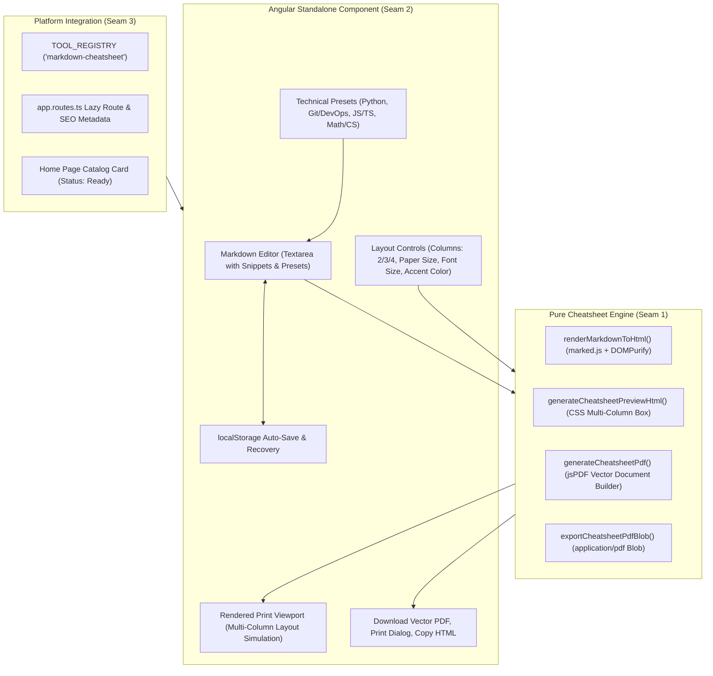

# Implementation Plan: Markdown to Academic / Tech PDF Cheatsheet

> **Tool**: `19 - Markdown to Academic - Tech PDF Cheatsheet`  
> **Target Directory**: `src/app/tools/documents/markdown-cheatsheet/`  
> **Route**: `/tools/markdown-cheatsheet` (aliases `/tools/markdown-to-pdf`, `/tools/cheatsheet-maker`)  
> **Key Directives**: 100% Client-Side execution, zero telemetry, marked.js Markdown parsing, DOMPurify sanitization, multi-column CSS & jsPDF vector engine (2, 3, 4 columns), paper size options (A4 / Letter), orientation (Portrait / Landscape), code syntax blocks, technical presets (Python, Git/DevOps, JS/TS, Data Structures), localStorage auto-save, print-ready output, responsive BEM UI.

---

## 📐 Architecture & Seam Design

---

## 🧪 Vertical Slices & TDD Seams

### Seam 1: Domain Models & Cheatsheet Engine (`engine.ts` & `engine.spec.ts`)
- **Domain Types (`types.ts`)**:
  - `PaperSize`: `'a4' | 'letter'`
  - `Orientation`: `'portrait' | 'landscape'`
  - `ColumnCount`: `2 | 3 | 4`
  - `CheatsheetConfig`:
    - `title: string`
    - `subtitle?: string`
    - `markdownContent: string`
    - `paperSize: PaperSize`
    - `orientation: Orientation`
    - `columns: ColumnCount`
    - `fontSizePt: number`
    - `accentColor: string`
    - `includeFooter: boolean`
- **Engine Functions (`engine.ts`)**:
  - `renderMarkdownToHtml(markdown: string): string`: Parses markdown via `marked` and sanitizes via `DOMPurify`.
  - `generateCheatsheetPreviewHtml(config: CheatsheetConfig): string`: Wraps parsed content with CSS column styles and page formatting.
  - `generateCheatsheetPdf(config: CheatsheetConfig): jsPDF`: Direct vector PDF generation with columns, headers, tables, code blocks, and page numbers.
  - `exportCheatsheetPdfBlob(config: CheatsheetConfig): Blob`: Exports PDF as `application/pdf` Blob.
- **Unit Tests (`engine.spec.ts`)**:
  - Verify markdown headings, code blocks, tables, bold/italic, and lists parse into clean HTML.
  - Verify dangerous tags (`<script>`, `onerror=`) are stripped during sanitization.
  - Verify preview HTML configures correct CSS column count and gap.
  - Verify jsPDF document creation for A4 portrait/landscape and Letter portrait/landscape.
  - Verify column layout math and page bounds.
  - Verify Blob export creates non-empty `application/pdf` Blob.

### Seam 2: Component UI & Signals (`markdown-cheatsheet.component.ts` & `.spec.ts`)
- **Component Features**:
  - Signals for `config`, `activePreset`, `copiedHtmlState`, `zoomLevel`.
  - Split-pane layout: Editor on left, real-time page preview on right.
  - Layout controls: Column switcher (2, 3, 4), Paper size (A4 / Letter), Orientation toggle, font size slider, accent color swatch.
  - Technical presets: Python Developer, Git & DevOps, JavaScript/TypeScript, Computer Science / Math.
  - Quick markdown snippet inserters: Add Table, Add Code Block, Add Note Callout.
  - Instant PDF Download with `URL.revokeObjectURL()`.
  - Print dialog trigger for browser native high-DPI printing.
  - LocalStorage draft auto-save and restore.
  - Zero-network privacy verification test.

### Seam 3: Tool Registry, Routing & Platform Integration
- Export `markdownCheatsheetTool` in `index.ts`.
- Register in `TOOL_REGISTRY` and update `tool-registry.spec.ts`.
- Add `/tools/markdown-cheatsheet` and aliases in `app.routes.ts`.
- Update `home.ts` adding catalog tool with status `'ready'`.
- Mark Spec 19 as `[x]` in `specs/README.md`.
