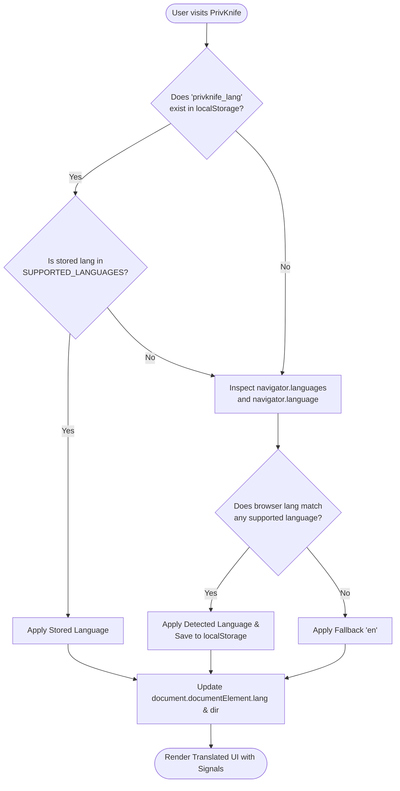

# MicroSaaS Business & Technical Specification: Multi-Language Internationalization (i18n) Suite

# 1. MVP Generation Prompt (/create-web-micro-saas)

Act as a Principal Frontend Architect and Internationalization Specialist. Build a modular, 100% client-side multi-language internationalization (i18n) engine for **PrivKnife: Private In-Browser Toolkit**.

Core Specifications:

### 1. Tech Stack:
Angular 22 (Standalone Components, Signals, and Control Flow), TypeScript (strict mode), SASS with DAW-2 BEM namespace architecture (`c-`, `l-`, `g--`), and Vite/Vitest.

### 2. Primary Functionality:
- **Intelligent OS/Browser Language Auto-Detection**:
  - Automatically detect the user's preferred language on initial visit by inspecting `navigator.languages` and `navigator.language`.
  - Normalize regional locale tags (e.g., `es-ES`, `es-MX`, `es-AR` &rarr; `es`; `en-US`, `en-GB` &rarr; `en`).
  - Honor user manual selections saved in `localStorage` (`privknife_lang`) as the highest-priority source of truth.
  - Gracefully fallback to English (`en`) if no supported match is detected.
- **Header Language Selector UI**:
  - Positioned directly in the main `<app-header>` adjacent to the Light/Dark mode theme toggle button.
  - Single-option trigger button displaying `🌐`, uppercase language code (`EN` / `ES`), and a dropdown chevron.
  - Accessible floating popover/listbox presenting available languages with their **native names** (e.g., `🇺🇸 English`, `🇪🇸 Español`) and flag indicators so international visitors can immediately recognize their native tongue.
  - Instant runtime switching via Angular Signals reactivity with **zero page reloads**.
- **Plug-and-Play Zero-Touch Extensibility**:
  - Engineered so adding any future language (e.g., Chinese `zh`, French `fr`, German `de`, Portuguese `pt`, Arabic `ar`) requires **zero modifications** to component templates, routing, or application layout.
  - Adding a language is accomplished purely by registering a new entry in `SUPPORTED_LANGUAGES` and providing a typed dictionary file in `src/app/core/i18n/locales/`.
- **Lightweight Dynamic Loading**:
  - Locale dictionaries are split into lazy-loaded chunks via standard dynamic imports (`import(...)`). Non-active language dictionaries never bloat the initial application bundle (< 200KB initial JS maintained).
- **Graceful Key Fallback & Interpolation**:
  - Robust dot-notation path traversal (e.g., `t('home.heroTitle')`).
  - Hierarchical fallback: if a key is missing in Spanish, the engine automatically resolves the English equivalent without throwing errors or displaying blank spaces.
  - Token interpolation for dynamic parameters: `t('home.filterCount', { count: 29 })` &rarr; `"29 tools available"` / `"29 herramientas disponibles"`.
- **Document & Accessibility Synchronization**:
  - Dynamically updates `document.documentElement.lang` (e.g. `lang="es"`) and text directionality `document.documentElement.dir` (`ltr` / `rtl`).
  - Full WCAG 2.1 AA keyboard support (`ArrowDown`, `ArrowUp`, `Enter`, `Escape`).

### 3. Security & Privacy Assurance:
- **Zero Cloud Translation APIs**: 100% of translations are pre-compiled and served locally. Zero text, queries, or user inputs are transmitted over the network.
- **Zero Telemetry**: Language selections are stored strictly in `localStorage` without analytics tracking.

---

# 2. Concept Overview & Value Proposition

PrivKnife provides everyday utility tools built on the absolute guarantee of client-side privacy. Digital privacy is a universal human right, not restricted to English speakers. 

English and Spanish are two of the most widely spoken languages globally (encompassing over 1.8 billion native and secondary speakers across North America, Latin America, Europe, and worldwide). By delivering a native Spanish translation alongside English, PrivKnife dramatically expands its addressable audience while maintaining its uncompromising zero-server architecture.

### Product Concept:
A zero-overhead, signal-reactive client-side internationalization system that seamlessly adapts the entire PrivKnife application to the user's native language.

### Deliverables:
1. `I18nService`: Core reactive service managing detection, active language signals, dynamic dictionary loading, and key resolution.
2. `TranslatePipe`: Standalone template pipe for declarative string translation with interpolation support.
3. Language Selector Component: Header dropdown menu adhering to BEM styling (`.c-lang-selector`).
4. English (`en.ts`) & Spanish (`es.ts`) complete dictionaries covering navigation, shell, home catalog, and all 29 tools.

### Core Value Proposition:
- **Zero-Friction Localization**: Users immediately see the interface in their native OS language without having to search for configuration menus.
- **Universal Privacy**: Complete parity between English and Spanish tool documentation, privacy badges, and security indicators.
- **Future-Proof Extensibility**: Future expansion into Chinese (`zh`), French (`fr`), or German (`de`) is architected as a drop-in file addition.

---

# 3. Technical Feasibility & Architecture

## Overall Feasibility: Very High | Difficulty Score: 2.0 / 5

The implementation leverages native modern Angular (Signals, Standalone Components) without heavy external dependencies like `@ngx-translate` or Transloco, minimizing bundle weight and maximizing performance.

| Architectural Layer | Technical Implementation Details |
|---|---|
| **Language Detection** | Tiered resolver: `localStorage('privknife_lang')` &rarr; `navigator.languages` &rarr; fallback `'en'`. |
| **Reactivity Engine** | Angular Signals (`signal<LanguageDefinition>`, `computed()`) providing instantaneous O(1) template updates. |
| **Dictionary Bundling** | Dynamic ES imports (`import('./locales/es')`) compiled into separate lazy chunks by Vite/esbuild. |
| **Key Resolution** | Recursive object traversal with automated fallback to default locale (`en`) for missing keys. |
| **Template Binding** | Standalone `TranslatePipe` (`{{ 'key' \| translate:params }}`) and direct service injection (`i18n.t('key')`). |
| **DOM Synchronization** | Dynamic update of `<html lang="..." dir="...">` and page `<title>` / `<meta name="description">`. |

---

# 4. Language Detection & Selection Algorithm



### Normalization Logic:
```typescript
function detectBrowserLanguage(supportedCodes: string[], defaultCode: string): string {
  if (typeof navigator === 'undefined') return defaultCode;
  
  const browserLangs = navigator.languages || [navigator.language || ''];
  for (const lang of browserLangs) {
    const primaryCode = lang.toLowerCase().split('-')[0];
    if (supportedCodes.includes(primaryCode)) {
      return primaryCode;
    }
  }
  return defaultCode;
}
```

---

# 5. Header Language Selector UI & UX Specification

### 5.1. Visual Placement in Header
The language selector is placed in `<app-header>` directly to the left of the Light/Dark mode theme toggle button:

```
+-----------------------------------------------------------------------------------------------+
| 🇨🇭 PrivKnife  Private In-Browser Toolkit        [🛡️ 100% In-Browser]  [🌐 EN ▾]  [☀️ Light]  |
+-----------------------------------------------------------------------------------------------+
```

### 5.2. UI Design & BEM Styling
- Follows DAW-2 BEM namespace guidelines:
  - Block: `.c-lang-selector`
  - Elements:
    - `.c-lang-selector__button`: Compact trigger button displaying `🌐`, language code, and chevron.
    - `.c-lang-selector__menu`: Floating dropdown listbox with smooth enter animation.
    - `.c-lang-selector__item`: Interactive row with flag emoji, native language name, and checkmark.
    - `.c-lang-selector__flag`: Native flag emoji (`🇺🇸`, `🇪🇸`).
    - `.c-lang-selector__name`: Native name formatted in bold (`English`, `Español`).
  - Modifiers:
    - `.c-lang-selector__item--active`: Highlighted state for the currently active language.
    - `.c-lang-selector--open`: Open state for the dropdown container.

### 5.3. Accessibility (WCAG 2.1 AA)
- `aria-haspopup="listbox"`
- `[attr.aria-expanded]="isOpen()"`
- `role="listbox"` with `role="option"` and `aria-selected`
- Full keyboard navigation: `Escape` closes menu, `ArrowUp`/`ArrowDown` navigates options, `Enter` activates selection.

---

# 6. Extensible Language Registry & Translation Schema

### 6.1. Language Registry (`languages.config.ts`)
```typescript
export interface LanguageDefinition {
  code: string;            // ISO 639-1 code ('en', 'es', 'zh')
  name: string;            // English name ('Spanish')
  nativeName: string;      // Native name ('Español')
  flag: string;            // Emoji flag ('🇪🇸')
  direction: 'ltr' | 'rtl';// Directionality
}

export const SUPPORTED_LANGUAGES: LanguageDefinition[] = [
  {
    code: 'en',
    name: 'English',
    nativeName: 'English',
    flag: '🇺🇸',
    direction: 'ltr',
  },
  {
    code: 'es',
    name: 'Spanish',
    nativeName: 'Español',
    flag: '🇪🇸',
    direction: 'ltr',
  },
  // Future languages are plugged here with ZERO architectural changes:
  // { code: 'zh', name: 'Chinese', nativeName: '简体中文', flag: '🇨🇳', direction: 'ltr' },
  // { code: 'fr', name: 'French', nativeName: 'Français', flag: '🇫🇷', direction: 'ltr' },
];

export const DEFAULT_LANGUAGE_CODE = 'en';
```

### 6.2. Hierarchical Translation Schema (`locales/en.ts`)
```typescript
export const en = {
  common: {
    inBrowserBadge: '100% In-Browser',
    privacyBadge: '🛡️ 100% In-Browser • Never Leaves Your Device',
    download: 'Download',
    copy: 'Copy',
    copied: '✓ Copied!',
    reset: 'Reset',
    clear: 'Clear',
    cancel: 'Cancel',
    processing: 'Processing...',
    done: 'Done',
    error: 'Error',
    dropFilesPrompt: 'Drop your files here, or browse',
    themeLight: '☀️ Light',
    themeDark: '🌙 Dark',
  },
  header: {
    title: 'PrivKnife',
    tagline: 'Private In-Browser Toolkit',
    languageSelectAria: 'Select application language',
  },
  home: {
    heroTitle: 'Consolidated Everyday Tools.',
    heroSubtitle: 'No Backend Servers. Zero Telemetry. 100% Client-Side.',
    searchPlaceholder: 'Search 29+ private tools (PDF, images, 3D, crypto, dev)...',
    categories: {
      all: 'All Tools',
      privacy: 'Privacy & Security',
      documents: 'Documents & PDF',
      media: 'Media & Graphics',
      audioVideo: 'Audio & Video',
      dev: 'Developer Utilities',
      '3d': '3D Printing & CAD',
    },
    filterCount: '{count} tools available',
    noResultsTitle: 'No matching tools found',
    noResultsHint: 'Try a different search query or select a category above.',
  },
  footer: {
    mission: 'PrivKnife runs completely in your web browser with zero server data ingestion and zero analytics tracking.',
    privacyNotice: 'Privacy by Architecture, Not by Policy.',
    allRightsReserved: 'All processing occurs locally in browser memory.',
  },
  tools: {
    // 29 localized tool entries (name, description, keywords)
    exifStripper: {
      name: 'EXIF & Privacy Metadata Stripper',
      description: 'Remove GPS coordinates, camera models, and private metadata from photos before sharing online.',
    },
    tableTentMaker: {
      name: 'Foldable Table Tent & Counter Sign Maker',
      description: 'Generate double-sided inverted PDF table tents with QR codes for menus, events, and WiFi signs.',
    },
    // ... all tools
  },
};

export type TranslationSchema = typeof en;
```

---

# 7. Zero-Touch Extensibility Workflow for New Languages

To introduce any future language (e.g. German `de`, French `fr`, or Simplified Chinese `zh`):

1. **Step 1: Create the Dictionary File**:
   Create `src/app/core/i18n/locales/<code >.ts` translating the keys defined in `TranslationSchema`.
2. **Step 2: Add Entry in `languages.config.ts`**:
   Add `{ code: 'de', name: 'German', nativeName: 'Deutsch', flag: '🇩🇪', direction: 'ltr' }`.
   Register the dynamic import in `I18nService.loadDictionary()`.

**Zero other files need to be modified**:
- The header language dropdown dynamically renders all registered languages via `@for (lang of supportedLanguages; track lang.code)`.
- The auto-detection engine automatically detects visitors with German OS/browser settings.
- All templates reactively update without any code changes.

---

# 8. Implementation Checklist & Phased Roadmap

- [x] **Phase 1: Core i18n Engine & Types**:
  - Implement `types.ts`, `languages.config.ts`, `I18nService`, and `TranslatePipe` in `src/app/core/i18n/`.
  - Implement English (`en.ts`) and Spanish (`es.ts`) dictionaries.
  - Implement fallback and interpolation engines.
- [x] **Phase 2: Header Language Switcher**:
  - Update `Header` component in `src/app/components/header/` with accessible BEM language menu.
  - Test OS language detection and `localStorage` persistence.
- [ ] **Phase 3: Catalog & Home Localization**:
  - Update `Home` component and `Showcase` component templates to use `TranslatePipe` or `I18nService`.
  - Localize search input, category filters, tool counters, and footer.
- [ ] **Phase 4: Tool Registry Metadata Localization**:
  - Integrate reactive localized names, descriptions, and category labels in `TOOL_REGISTRY`.
- [ ] **Phase 5: Verification & Zero-Exfiltration Tests**:
  - Write unit tests verifying detection, persistence, fallback, interpolation, and zero-network assertion.
  - Run full test suite and verify clean production build.
