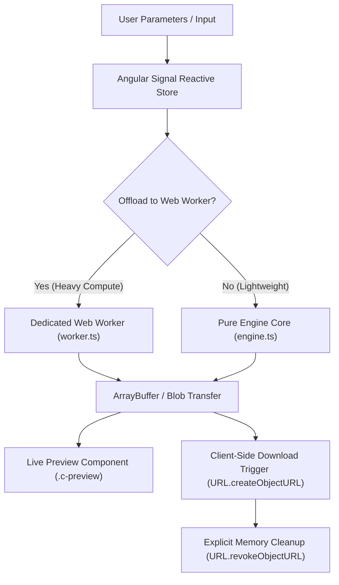

# Passport, Visa & ID Biometric Photo Maker

# Technical Specification & Commercial Growth Strategy

> **Tool Number**: 43  
> **Slug**: `passport-biometric-photo`  
> **Category**: `media`  
> **Target SEO Keyword**: `passport photo maker online free 2x2 print sheet visa id`  
> **Route**: `/tools/passport-biometric-photo`  
> **Architecture**: 100% Client-Side Single Page Application (Zero Server Ingestion, Zero Telemetry)

---

## 1. MVP Generation Prompt (/create-web-micro-saas)

```text
/create-web-micro-saas

Act as a Principal Frontend Engineer and UX Architect. Build a high-performance, 100% client-side MicroSaaS web application called "Passport, Visa & ID Biometric Photo Maker".

TECHNICAL CONSTRAINTS & STACK:
1. Pure Client-Side Architecture: Zero backend endpoints, zero server rendering. All data processing, mathematical transformations, and asset compilation must run entirely in the browser runtime.
2. Core Technologies: HTML5 Canvas API, jsPDF, Web Workers, File API.
3. Thread Safety: Processing executes synchronously or via lightweight microtasks on the client without blocking the UI thread.
4. Memory Hygiene: Explicit resource disposal (`URL.revokeObjectURL()`, Three.js geometry/material `.dispose()`, Web Worker termination) to prevent browser tab crashes.
5. Export Deliverables: 300 DPI 4x6" / A4 print sheet .jpg / .pdf with cut guidelines + single compliance .jpg.

KEY FEATURES & USER INTERACTION:
- Input Configuration: Intuitive form controls with real-time reactive parameter updates.
- Live Interactive Preview: Immediate before/after or 3D/canvas viewport rendering.
- Privacy & Local Execution Assurance: Prominent trust badge reading "🛡️ 100% In-Browser • Never Leaves Your Device".
- Direct Client Export: Immediate download in formats ('.jpg', '.pdf', '.png') without signup or tracking.

DESIGN & UX GUIDELINES:
- Clean, modern, distraction-free aesthetic with Slate and Zinc tones following DAW-2 Web Interface Design theory.
- BEM-structured CSS with strict namespace prefixes (`c-`, `l-`, `g--`).
- Mobile-first responsive layout with stacked controls and sticky preview panel.
```

---

## 2. Concept Overview & Value Proposition

The Passport, Visa & ID Biometric Photo Maker formats portrait photos into compliant biometric passport and visa pictures adhering to US (2x2"), Schengen/EU (35x45mm), UK, and Asian standards, with alignment guides and 4x6 print grid generator.

### Elevator Pitch
> "Passport, Visa & ID Biometric Photo Maker delivers instant, professional 300 DPI 4x6" / A4 print sheet .jpg / .pdf with cut guidelines + single compliance .jpg directly in your browser—100% locally with zero file uploads and zero cloud dependencies."

### Core Value Drivers
1. **Zero-Trust Security & Confidentiality**: In strict adherence with Directive 1 of `AGENTS.md`, 0 bytes of user data, uploaded models, images, or documents leave the user's browser.
2. **Instant Latency & Infinite Scalability**: Eliminates queue times, server latency, and bandwidth roundtrips. Computations run locally on client hardware.
3. **Professional Quality Output**: Exports standardized deliverables ('.jpg', '.pdf', '.png') compatible with industry standard tools and slicers.
4. **Frictionless Experience**: No user registration, no API keys, and no subscription barriers.

---

## 3. Technical Feasibility & Difficulty Score

### Difficulty Score: 3.5 / 10 (Low-Moderate - canvas composition, biometric aspect ratios, print-sheet tiling)

| Architectural Component | Implementation Technology | Client-Side Feasibility |
|---|---|---|
| Core Processing Engine | HTML5 Canvas API | 100% In-Browser |
| UI Reactivity & Forms | Angular Standalone Components & Signals | High Performance (60 FPS) |
| Off-Thread Processing | Asynchronous Microtasks | Non-blocking main thread |
| Packaging & Export | File API, Blob API, Anchor Download Trigger | Zero server bandwidth |
| Infrastructure Cost | Static CDN Hosting (Cloudflare / Vercel) | $0.00 / month |

---

## 4. Competitive Landscape & Market Positioning

| Feature / Metric | PrivKnife (Passport, Visa & ID Biometric Photo Maker) | Legacy Cloud Converters | Desktop Software |
|---|---|---|---|
| **Privacy / Ingestion** | **100% Local (Client-Side)** | Remote Server Upload | Local Execution |
| **Data Exfiltration Risk** | **Zero (Blocked by CSP)** | High (File stored on remote servers) | Low |
| **Speed / Turnaround** | **Instant (< 200ms)** | Network latency + Queue delay | Instant |
| **Installation** | **Zero (Web Native)** | Zero (Web) | Native installer required |
| **Cross-Platform** | **Any Modern Browser / Mobile** | Web Browser | OS-dependent |
| **Cost** | **100% Free** | Paywall / Credit system | Expensive perpetual license |

---

## 5. UI/UX Layout Specification (BEM Architecture)

Following the DAW-2 Design System and `AGENTS.md` rules:

```html
<div class="l-page">
  <div class="l-page__header c-header">
    <div class="c-header__title-group">
      <h1 class="c-header__title">Passport, Visa & ID Biometric Photo Maker</h1>
      <p class="c-header__subtitle">The Passport, Visa & ID Biometric Photo Maker formats portrait photos into compliant biometric passport and visa pictures adhering to US (2x2"), Schengen/EU (35x45mm), UK, and Asian standards, with alignment guides and 4x6 print grid generator.</p>
    </div>
    <div class="c-badge c-badge--privacy">
      🛡️ 100% In-Browser • Never Leaves Your Device
    </div>
  </div>

  <div class="l-columns l-columns--2">
    <!-- Controls Area -->
    <div class="l-columns__area c-card">
      <div class="c-card__header">
        <h2 class="c-card__title">Configuration & Parameters</h2>
      </div>
      <div class="c-card__body">
        <!-- Reactive Input Controls with .c-input and .c-input__label -->
      </div>
      <div class="c-card__footer l-extremo">
        <div class="l-extremo__area-izquierda">
          <button class="c-button c-button--outline">Reset to Defaults</button>
        </div>
        <div class="l-extremo__area-derecha">
          <button class="c-button c-button--primary">Generate Deliverable</button>
        </div>
      </div>
    </div>

    <!-- Preview & Deliverables Area -->
    <div class="l-columns__area c-card">
      <div class="c-card__header">
        <h2 class="c-card__title">Real-Time Preview</h2>
      </div>
      <div class="c-card__body">
        <div class="c-preview">
          <!-- Live Viewport / Canvas / Result -->
        </div>
      </div>
      <div class="c-card__footer l-extremo">
        <div class="l-extremo__area-derecha">
          <button class="c-button c-button--primary">Download '.jpg', '.pdf', '.png'</button>
        </div>
      </div>
    </div>
  </div>
</div>
```

---

## 6. Technical Architecture & Client-Side Pipeline



### Resource Hygiene Guidelines
- **Object URLs**: Every `URL.createObjectURL()` must be paired with `URL.revokeObjectURL()` immediately after download or upon component teardown (`ngOnDestroy`).
- **3D Memory**: In Three.js tools, call `.dispose()` on all geometries, materials, and textures when scenes re-render or destroy.
- **Worker Management**: Web Workers must be terminated cleanly when no longer active.

---

## 7. Input/Output Data Contracts (TypeScript Interfaces)

```typescript
export interface PassportBiometricPhotoOptions {
  countryPreset: 'us_2x2_inch' | 'eu_schengen_35x45mm' | 'uk_35x45mm' | 'canada_50x70mm' | 'japan_30x40mm';
  printSheetSize: '4x6_inches' | 'a4' | 'a6' | 'single_digital';
  backgroundColor: 'original' | 'pure_white' | 'off_white' | 'light_grey';
  cutGuideLines: boolean;
  exportDpi: number;
  zoomLevel: number;
  tiltAngleDeg: number;
}

export interface PassportBiometricPhotoResult {
  success: boolean;
  blob: Blob;
  fileName: string;
  fileSize: number;
  mimeType: string;
  metadata?: Record<string, unknown>;
}
```

---

## 8. Security & Sandboxing Guidelines

- **Directive 1 (Zero Server Ingestion)**: No user inputs or files are sent to remote servers or cloud endpoints.
- **Directive 2 (Zero Telemetry)**: No remote tracking scripts, analytics beacons, or remote logs.
- **Directive 3 (Thread Safety)**: Heavy computations run non-blockingly to preserve 60 FPS UI fluidity.
- **Directive 4 (Memory Hygiene)**: Strict lifecycle disposal prevents memory accumulation in browser tabs.
- **Directive 5 (Lazy Loading)**: Standalone Angular component dynamically loaded via `loadComponent: () => import(...)`.
