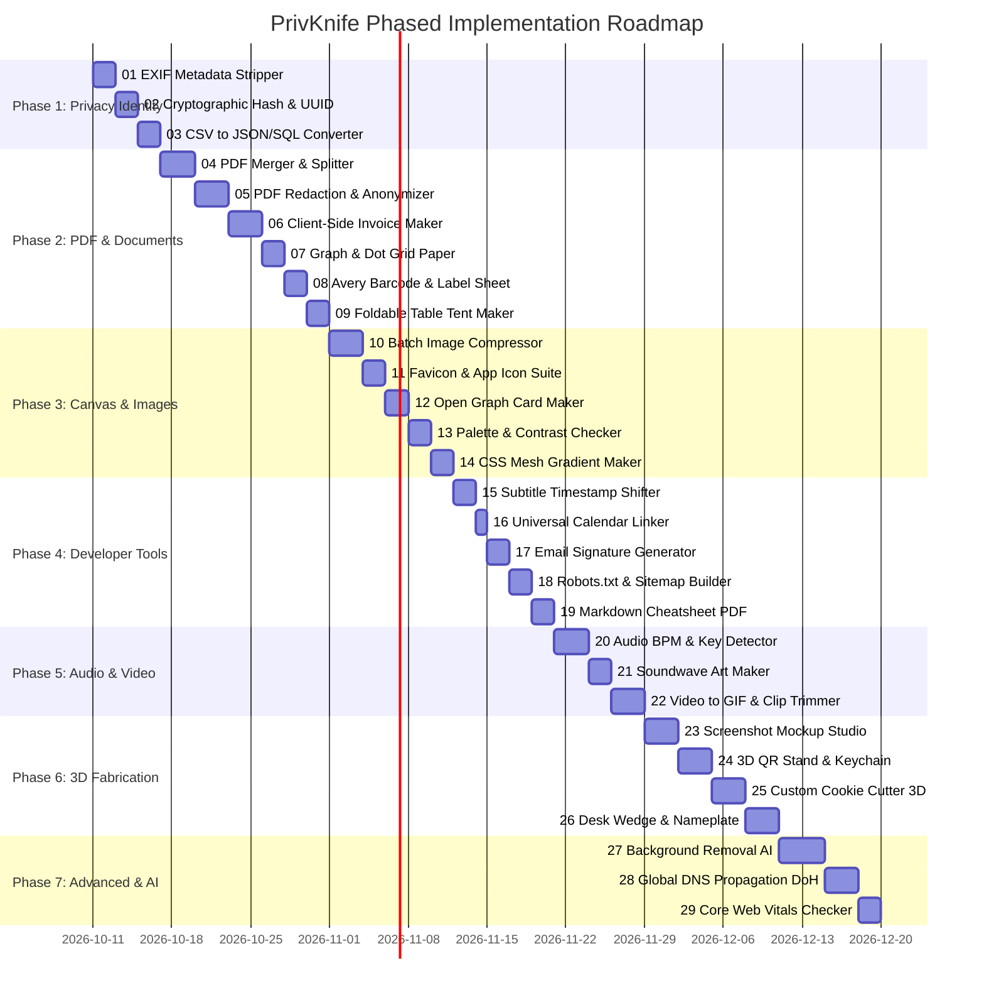

# PrivKnife Specifications & Roadmap Index

> **Directory Purpose**: This directory contains the complete technical specifications and blueprints for all tools planned in **PrivKnife**, structured in their exact recommended implementation order.

Each subfolder contains:
- **`spec.md`**: Complete markdown technical specification (product strategy, MVP prompts, UI layout specifications, data pipelines, client-side libraries, and algorithms).
- **`*.docx`**: Original reference blueprint.

---

## 📅 The Implementation Calendar

---

## 🗂️ Master Specifications Catalog

| # | Spec Folder | Category | Deliverable | Client-Side Tech Stack | Status |
| **00** | [00 - Platform, SEO & Production Readiness](00%20-%20Platform,%20SEO%20&%20Production%20Readiness/spec.md) | Core / SEO | 404, Meta/OG, Sitemap, Legal | Angular Services, WCAG 2.1 AA | [x] |
| **01** | [01 - EXIF & Privacy Metadata Stripper](01%20-%20EXIF%20&%20Privacy%20Metadata%20Stripper/spec.md) | Privacy | Metadata-free `.jpg` / `.png` | `piexifjs`, Canvas API, File API | [x] |
| **02** | [02 - Cryptographic Hash & UUID Batch Generator](02%20-%20Cryptographic%20Hash%20&%20UUID%20Batch%20Generator/spec.md) | Privacy / Dev | Bulk SHA-256, MD5, UUIDv4 | Native `crypto.subtle` (Web Crypto) | [x] |
| **03** | [03 - CSV - Excel to JSON, SQL & Markdown Converter](03%20-%20CSV%20-%20Excel%20to%20JSON,%20SQL%20&%20Markdown%20Converter/spec.md) | Dev / Data | `.sql`, `.json`, `.md` exports | `PapaParse`, pure JavaScript | [x] |
| **04** | [04 - PDF Merger, Splitter & Page Organizer](04%20-%20PDF%20Merger,%20Splitter%20&%20Page%20Organizer/spec.md) | Documents | Reordered / merged `.pdf` | `pdf-lib`, `PDF.js` | [x] |
| **05** | [05 - PDF Redaction & Anonymizer](05%20-%20PDF%20Redaction%20&%20Anonymizer/spec.md) | Privacy | Flattened sanitized `.pdf` | `PDF.js`, Canvas 2D Redaction | [x] |
| **06** | [06 - Instant Client-Side Invoice & Receipt Maker](06%20-%20Instant%20Client-Side%20Invoice%20&%20Receipt%20Maker/spec.md) | Documents | Clean vector `.pdf` | `jspdf`, `localStorage` | [x] |
| **07** | [07 - Custom Printable Graph & Dot Grid Paper](07%20-%20Custom%20Printable%20Graph%20&%20Dot%20Grid%20Paper/spec.md) | Documents | Precision vector grid `.pdf` | `jspdf` vector lines | [x] |
| **08** | [08 - Avery Barcode & Label Sheet Generator](08%20-%20Avery%20Barcode%20&%20Label%20Sheet%20Generator/spec.md) | Documents | Grid sticker sheet `.pdf` | `JsBarcode`, `jspdf` | [x] |
| **09** | [09 - Foldable Table Tent & Counter Sign Maker](09%20-%20Foldable%20Table%20Tent%20&%20Counter%20Sign%20Maker/spec.md) | Documents | Foldable A4/Letter `.pdf` | `jspdf`, SVG DOM rendering | [x] |
| **10** | [10 - Batch Image Compressor & WebP Converter](10%20-%20Batch%20Image%20Compressor%20&%20WebP%20Converter/spec.md) | Media | Compressed `.webp` / `.zip` | Canvas API, WASM / Worker, `JSZip` | [x] |
| **11** | [11 - App Icon & Favicon Suite Generator](11%20-%20App%20Icon%20&%20Favicon%20Suite%20Generator/spec.md) | Media | Icon bundle `.zip` + manifest | Canvas API, `JSZip` | [x] |
| **12** | [12 - Social Share (Open Graph) Card Maker](12%20-%20Social%20Share%20(Open%20Graph)%20Card%20Maker/spec.md) | Media | 1200×630 `.png` / `.webp` | Canvas API, SVG rendering | [x] |
| **13** | [13 - Color Palette Extractor & Contrast Checker](13%20-%20Color%20Palette%20Extractor%20&%20Contrast%20Checker/spec.md) | Design | Palette `.json` + WCAG report | `ColorThief`, Canvas pixel sampling | [x] |
| **14** | [14 - CSS Mesh Gradient & Glassmorphism Code Maker](14%20-%20CSS%20Mesh%20Gradient%20&%20Glassmorphism%20Code%20Maker/spec.md) | Dev / Design | Copy-ready CSS / Tailwind | Canvas shader, CSS backdrop-filter | [x] |
| **15** | [15 - Subtitles Timestamp Shifter & SRT-VTT Converter](15%20-%20Subtitles%20Timestamp%20Shifter%20&%20SRT-VTT%20Converter/spec.md) | Media | Re-synced `.srt` / `.vtt` | Regex time parsing, File API | [x] |
| **16** | [16 - Universal Event & .ics Calendar Linker](16%20-%20Universal%20Event%20&%20.ics%20Calendar%20Linker/spec.md) | Dev | `.ics` file + calendar URLs | RFC 5545 format, Blob API | [x] |
| **17** | [17 - HTML Email Signature Generator](17%20-%20HTML%20Email%20Signature%20Generator/spec.md) | Dev | Raw HTML + Rich-text copy | DOM Table renderer, Clipboard API | [x] |
| **18** | [18 - Robots.txt & XML Sitemap Builder](18%20-%20Robots.txt%20&%20XML%20Sitemap%20Builder/spec.md) | Dev | `robots.txt` / `sitemap.xml` | `DOMParser`, `XMLSerializer` | [x] |
| **19** | [19 - Markdown to Academic - Tech PDF Cheatsheet](19%20-%20Markdown%20to%20Academic%20-%20Tech%20PDF%20Cheatsheet/spec.md) | Documents | Multi-column cheatsheet `.pdf` | `marked.js`, `highlight.js`, `jspdf` | [x] |
| **20** | [20 - Audio BPM, Pitch & Key Tap Detector](20%20-%20Audio%20BPM,%20Pitch%20&%20Key%20Tap%20Detector/spec.md) | Audio | Real-time BPM readout | Web Audio API (`AudioContext`) | [x] |
| **21** | [21 - Spotify Code & Soundwave Art Maker](21%20-%20Spotify%20Code%20&%20Soundwave%20Art%20Maker/spec.md) | Audio | Scalable `.svg` / `.pdf` | Web Audio API, SVG rendering | [x] |
| **22** | [22 - Video to GIF & Clip Trimmer](22%20-%20Video%20to%20GIF%20&%20Clip%20Trimmer/spec.md) | Video | Animated `.gif` / `.mp4` | GIF89a LZW, HTML5 Canvas, MediaRecorder | [x] |
| **23** | [23 - App Screenshot Mockup Studio](23%20-%20App%20Screenshot%20Mockup%20Studio/spec.md) | Media | 3D device frame `.png` | HTML5 2.5D Canvas, Perspective Affine Math | [x] |
| **24** | [24 - 3D QR Stand & Keychain Generator](24%20-%203D%20QR%20Stand%20&%20Keychain%20Generator/spec.md) | 3D | Dual-color `.3mf` / `.stl` | `Three.js`, `three-bvh-csg`, `qrcode` | [x] |
| **25** | [25 - Custom Cookie Cutter & Stamp 3D Maker](25%20-%20Custom%20Cookie%20Cutter%20&%20Stamp%203D%20Maker/spec.md) | 3D | Cutter / stamp `.stl` / `.3mf` | `ClipperLib` (2D offset), `Three.js` | [ ] |
| **26** | [26 - Parametric Desk Wedge & Nameplate Maker](26%20-%20Parametric%20Desk%20Wedge%20&%20Nameplate%20Maker/spec.md) | 3D | Multi-color `.3mf` | `Three.js` CSG, `FontLoader` | [ ] |
| **27** | [27 - Automated Background Removal (High Quality)](27%20-%20Automated%20Background%20Removal%20(High%20Quality)/spec.md) | Media | Transparent cutout `.png` | ONNX Runtime Web (`WebGPU` / WASM) | [ ] |
| **28** | [28 - Global DNS Propagation & WHOIS Checker](28%20-%20Global%20DNS%20Propagation%20&%20WHOIS%20Checker/spec.md) | Dev | DNS records table | Browser DNS-over-HTTPS (DoH) | [ ] |
| **29** | [29 - Website Performance - Core Web Vitals Checker](29%20-%20Website%20Performance%20-%20Core%20Web%20Vitals%20Checker/spec.md) | Dev | Audit score & diagnostic tips | Direct PageSpeed API / Navigation Timing | [ ] |

---

## 📖 How to Use These Specs

When implementing any tool:
1. Navigate to its numbered directory: `specs/<number> - <Tool Name>/`.
2. Review **`spec.md`** for:
   - The **MVP Generation Prompt**
   - Target client-side libraries and APIs
   - Input configuration controls & state parameters
   - Processing pipeline algorithms
   - Deliverable export formats
3. Follow the implementation checklist in [`AGENTS.md`](file:///home/deivision/Projects/Programming/PrivKnife/AGENTS.md).
