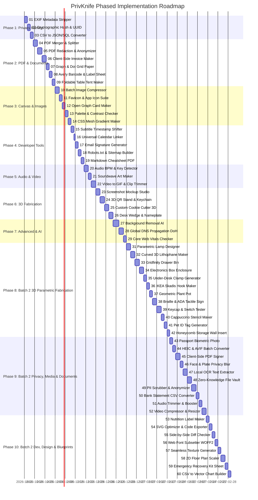

# PrivKnife Specifications & Roadmap Index

> **Directory Purpose**: This directory contains the complete technical specifications and blueprints for all tools planned in **PrivKnife**, structured in their exact recommended implementation order.

Each subfolder contains:
- **`spec.md`**: Complete markdown technical specification (product strategy, MVP prompts, UI layout specifications, data pipelines, client-side libraries, and algorithms).
- **`*.docx`**: Original reference blueprint.

---

## 📅 The Implementation Calendar

---

## 🗂️ Master Specifications Catalog

| # | Spec Folder | Category | Deliverable | Client-Side Tech Stack | Status |
| **00** | [00 - Platform, SEO & Production Readiness](00%20-%20Platform,%20SEO%20&%20Production%20Readiness/spec.md) | Core / SEO | 404, Meta/OG, Sitemap, Legal | Angular Services, WCAG 2.1 AA | [x] |
| **01** | [01 - EXIF & Privacy Metadata Stripper](01%20-%20EXIF%20&%20Privacy%20Metadata%20Stripper/spec.md) | Privacy | Metadata-free `.jpg` / `.png` | `piexifjs`, Canvas API, File API | [x] |
| **02** | [02 - Cryptographic Hash & UUID Batch Generator](02%20-%20Cryptographic%20Hash%20&%20UUID%20Batch%20Generator/spec.md) | Privacy / Dev | Bulk SHA-256, MD5, UUIDv4 | Native `crypto.subtle` (Web Crypto) | [x] |
| **03** | [03 - CSV - Excel to JSON, SQL & Markdown Converter](03%20-%20CSV%20-%20Excel%20to%20JSON,%20SQL%20&%20Markdown%20Converter/spec.md) | Dev / Data | `.sql`, `.json`, `.md` exports | `PapaParse`, pure JavaScript | [x] |
| **04** | [04 - PDF Merger, Splitter & Page Organizer](04%20-%20PDF%20Merger,%20Splitter%20&%20Page%20Organizer/spec.md) | Documents | Reordered / merged `.pdf` | `pdf-lib`, `PDF.js` | [x] |
| **05** | [05 - PDF Redaction & Anonymizer](05%20-%20PDF%20Redaction%20&%20Anonymizer/spec.md) | Privacy | Flattened sanitized `.pdf` | `PDF.js`, Canvas 2D Redaction | [x] |
| **06** | [06 - Instant Client-Side Invoice & Receipt Maker](06%20-%20Instant%20Client-Side%20Invoice%20&%20Receipt%20Maker/spec.md) | Documents | Clean vector `.pdf` | `jspdf`, `localStorage` | [x] |
| **07** | [07 - Custom Printable Graph & Dot Grid Paper](07%20-%20Custom%20Printable%20Graph%20&%20Dot%20Grid%20Paper/spec.md) | Documents | Precision vector grid `.pdf` | `jspdf` vector lines | [x] |
| **08** | [08 - Avery Barcode & Label Sheet Generator](08%20-%20Avery%20Barcode%20&%20Label%20Sheet%20Generator/spec.md) | Documents | Grid sticker sheet `.pdf` | `JsBarcode`, `jspdf` | [x] |
| **09** | [09 - Foldable Table Tent & Counter Sign Maker](09%20-%20Foldable%20Table%20Tent%20&%20Counter%20Sign%20Maker/spec.md) | Documents | Foldable A4/Letter `.pdf` | `jspdf`, SVG DOM rendering | [x] |
| **10** | [10 - Batch Image Compressor & WebP Converter](10%20-%20Batch%20Image%20Compressor%20&%20WebP%20Converter/spec.md) | Media | Compressed `.webp` / `.zip` | Canvas API, WASM / Worker, `JSZip` | [x] |
| **11** | [11 - App Icon & Favicon Suite Generator](11%20-%20App%20Icon%20&%20Favicon%20Suite%20Generator/spec.md) | Media | Icon bundle `.zip` + manifest | Canvas API, `JSZip` | [x] |
| **12** | [12 - Social Share (Open Graph) Card Maker](12%20-%20Social%20Share%20(Open%20Graph)%20Card%20Maker/spec.md) | Media | 1200×630 `.png` / `.webp` | Canvas API, SVG rendering | [x] |
| **13** | [13 - Color Palette Extractor & Contrast Checker](13%20-%20Color%20Palette%20Extractor%20&%20Contrast%20Checker/spec.md) | Design | Palette `.json` + WCAG report | `ColorThief`, Canvas pixel sampling | [x] |
| **14** | [14 - CSS Mesh Gradient & Glassmorphism Code Maker](14%20-%20CSS%20Mesh%20Gradient%20&%20Glassmorphism%20Code%20Maker/spec.md) | Dev / Design | Copy-ready CSS / Tailwind | Canvas shader, CSS backdrop-filter | [x] |
| **15** | [15 - Subtitles Timestamp Shifter & SRT-VTT Converter](15%20-%20Subtitles%20Timestamp%20Shifter%20&%20SRT-VTT%20Converter/spec.md) | Media | Re-synced `.srt` / `.vtt` | Regex time parsing, File API | [x] |
| **16** | [16 - Universal Event & .ics Calendar Linker](16%20-%20Universal%20Event%20&%20.ics%20Calendar%20Linker/spec.md) | Dev | `.ics` file + calendar URLs | RFC 5545 format, Blob API | [x] |
| **17** | [17 - HTML Email Signature Generator](17%20-%20HTML%20Email%20Signature%20Generator/spec.md) | Dev | Raw HTML + Rich-text copy | DOM Table renderer, Clipboard API | [x] |
| **18** | [18 - Robots.txt & XML Sitemap Builder](18%20-%20Robots.txt%20&%20XML%20Sitemap%20Builder/spec.md) | Dev | `robots.txt` / `sitemap.xml` | `DOMParser`, `XMLSerializer` | [x] |
| **19** | [19 - Markdown to Academic - Tech PDF Cheatsheet](19%20-%20Markdown%20to%20Academic%20-%20Tech%20PDF%20Cheatsheet/spec.md) | Documents | Multi-column cheatsheet `.pdf` | `marked.js`, `highlight.js`, `jspdf` | [x] |
| **20** | [20 - Audio BPM, Pitch & Key Tap Detector](20%20-%20Audio%20BPM,%20Pitch%20&%20Key%20Tap%20Detector/spec.md) | Audio | Real-time BPM readout | Web Audio API (`AudioContext`) | [x] |
| **21** | [21 - Spotify Code & Soundwave Art Maker](21%20-%20Spotify%20Code%20&%20Soundwave%20Art%20Maker/spec.md) | Audio | Scalable `.svg` / `.pdf` | Web Audio API, SVG rendering | [x] |
| **22** | [22 - Video to GIF & Clip Trimmer](22%20-%20Video%20to%20GIF%20&%20Clip%20Trimmer/spec.md) | Video | Animated `.gif` / `.mp4` | GIF89a LZW, HTML5 Canvas, MediaRecorder | [x] |
| **23** | [23 - App Screenshot Mockup Studio](23%20-%20App%20Screenshot%20Mockup%20Studio/spec.md) | Media | 3D device frame `.png` | HTML5 2.5D Canvas, Perspective Affine Math | [x] |
| **24** | [24 - 3D QR Stand & Keychain Generator](24%20-%203D%20QR%20Stand%20&%20Keychain%20Generator/spec.md) | 3D | Dual-color `.3mf` / `.stl` | `Three.js`, `three-bvh-csg`, `qrcode` | [x] |
| **25** | [25 - Custom Cookie Cutter & Stamp 3D Maker](25%20-%20Custom%20Cookie%20Cutter%20&%20Stamp%203D%20Maker/spec.md) | 3D | Cutter / stamp `.stl` / `.3mf` | `ClipperLib` (2D offset), `Three.js` | [x] |
| **26** | [26 - Parametric Desk Wedge & Nameplate Maker](26%20-%20Parametric%20Desk%20Wedge%20&%20Nameplate%20Maker/spec.md) | 3D | Multi-color `.3mf` | `Three.js` CSG, `FontLoader` | [x] |
| **27** | [27 - Automated Background Removal (High Quality)](27%20-%20Automated%20Background%20Removal%20(High%20Quality)/spec.md) | Media | Transparent cutout `.png` | ONNX Runtime Web (`WebGPU` / WASM) | [x] |
| **28** | [28 - Global DNS Propagation & WHOIS Checker](28%20-%20Global%20DNS%20Propagation%20&%20WHOIS%20Checker/spec.md) | Dev | DNS records table | Browser DNS-over-HTTPS (DoH) | [x] |
| **29** | [29 - Website Performance - Core Web Vitals Checker](29%20-%20Website%20Performance%20-%20Core%20Web%20Vitals%20Checker/spec.md) | Dev | Audit score & diagnostic tips | Direct PageSpeed API / Navigation Timing | [x] |
| **30** | [30 - Multi-Language Internationalization (i18n)](30%20-%20Multi-Language%20Internationalization%20(i18n)/spec.md) | Platform / i18n | Client-side i18n engine & Spanish locale | Angular Signals, Dynamic ES Imports, LocalStorage | [ ] |
| **31** | [31 - QA Logic Audit & Defect Remediation](31%20-%20QA%20Logic%20Audit%20&%20Defect%20Remediation/spec.md) | Quality Assurance | Cross-Tool Logic Audit, Card Header Projection & Privacy Fixes | Chromium Headless, Angular Signals, CSP & Error Boundaries | [x] |
| **32** | [32 - Mobile First UX & Responsive Remediation](32%20-%20Mobile%20First%20UX%20&%20Responsive%20Remediation/spec.md) | UX / Responsive | Mobile Audit, Zero Horizontal Overflow, 3D Grid Breakpoint & Touch Targets | BEM SASS, Mobile Breakpoints, CSS Grid `min-width: 0`, Touch Targets | [x] |

---

### 🚀 Batch 2 Specifications Catalog (Tools 31–60)

| # | Spec Folder | Category | Deliverable | Client-Side Tech Stack | Status |
|---|---|---|---|---|:---:|
| **31** | [31 - 3D Parametric Lamp & Lampshade Designer](31%20-%203D%20Parametric%20Lamp%20%26%20Lampshade%20Designer/spec.md) | 3D Fabrication | Manifold .stl & multi-component .3mf (socket collar + shade body) + 3D rendering preview | Three.js, three-bvh-csg, STLExporter, 3MFExporter, JSZip, Web Workers | [ ] |
| **32** | [32 - Curved & Flat 3D Lithophane Maker](32%20-%20Curved%20%26%20Flat%203D%20Lithophane%20Maker/spec.md) | 3D Fabrication | Precision .stl / .3mf lithophane mesh + real-time backlit preview simulation | HTML5 Canvas (luminance mapping 0.299R+0.587G+0.114B), Three.js (custom displacement heightmap), STLExporter, 3MFExporter | [ ] |
| **33** | [33 - Gridfinity & Modular Drawer Bin Generator](33%20-%20Gridfinity%20%26%20Modular%20Drawer%20Bin%20Generator/spec.md) | 3D Fabrication | Gridfinity-compliant manifold .stl and multi-material .3mf bin meshes | Three.js, three-bvh-csg, STLExporter, 3MFExporter | [ ] |
| **34** | [34 - Parametric Electronics Box & Snap-Fit Enclosure](34%20-%20Parametric%20Electronics%20Box%20%26%20Snap-Fit%20Enclosure/spec.md) | 3D Fabrication | 2-part .stl or multi-part .3mf (base enclosure + lid) with 0.2mm clearance tolerances | Three.js, three-bvh-csg, STLExporter, 3MFExporter | [ ] |
| **35** | [35 - Under-Desk Clamp & Cable Management Generator](35%20-%20Under-Desk%20Clamp%20%26%20Cable%20Management%20Generator/spec.md) | 3D Fabrication | Clamp body .stl + threaded clamping bolt knob .stl / .3mf assembly | Three.js (parametric helix threads & extruded C-profile), three-bvh-csg, STLExporter, 3MFExporter | [ ] |
| **36** | [36 - IKEA Skadis & Pegboard Hook_Holder Maker](36%20-%20IKEA%20Skadis%20%26%20Pegboard%20Hook_Holder%20Maker/spec.md) | 3D Fabrication | Manifold .stl / .3mf with built-in IKEA Skådis prongs or standard pegboard lugs | Three.js, three-bvh-csg, STLExporter, 3MFExporter | [ ] |
| **37** | [37 - Geometric Plant Pot & Self-Watering Planter](37%20-%20Geometric%20Plant%20Pot%20%26%20Self-Watering%20Planter/spec.md) | 3D Fabrication | Outer decorative pot .stl, inner drainage reservoir liner .stl, and multi-part .3mf | Three.js (procedural polygon lathe & twist geometry, CSG), STLExporter, 3MFExporter | [ ] |
| **38** | [38 - Braille & ADA Tactile Door Sign Generator](38%20-%20Braille%20%26%20ADA%20Tactile%20Door%20Sign%20Generator/spec.md) | 3D Fabrication | Multi-color .3mf (base plate + tactile raised text + Braille spheres) + standalone .stl | Three.js, FontLoader, Grade 2 Braille Unicode transliteration algorithm, three-bvh-csg, 3MFExporter | [ ] |
| **39** | [39 - Custom Mechanical Keycap & Switch Tester Maker](39%20-%20Custom%20Mechanical%20Keycap%20%26%20Switch%20Tester%20Maker/spec.md) | 3D Fabrication | Multi-color .3mf keycap (shell + legend + MX cross stem) and switch tester tray .stl | Three.js, three-bvh-csg, FontLoader, STLExporter, 3MFExporter | [ ] |
| **40** | [40 - Cappuccino Stencil & Airbrush Template Maker](40%20-%20Cappuccino%20Stencil%20%26%20Airbrush%20Template%20Maker/spec.md) | 3D Fabrication | Food-safe 3D printable .stl stencil + laser-ready vector .svg | HTML5 Canvas, Potrace/ClipperLib (island bridging algorithm), Three.js (2.5D extrusion), STLExporter, SVG DOM | [ ] |
| **41** | [41 - Pet ID Tag & Collar Slide-On Generator](41%20-%20Pet%20ID%20Tag%20%26%20Collar%20Slide-On%20Generator/spec.md) | 3D Fabrication | Dual-color .3mf (base plate + embossed high-contrast typography) + standalone .stl | Three.js, three-bvh-csg, FontLoader, STLExporter, 3MFExporter | [ ] |
| **42** | [42 - Honeycomb Storage Wall (HSW) Insert & Adapter](42%20-%20Honeycomb%20Storage%20Wall%20%28HSW%29%20Insert%20%26%20Adapter/spec.md) | 3D Fabrication | Dimensionally accurate HSW-compatible manifold .stl and .3mf insert files | Three.js (parametric HSW hexagonal prisms and retention click-tabs), three-bvh-csg, STLExporter, 3MFExporter | [ ] |
| **43** | [43 - Passport, Visa & ID Biometric Photo Maker](43%20-%20Passport%2C%20Visa%20%26%20ID%20Biometric%20Photo%20Maker/spec.md) | Media / Images | 300 DPI 4x6" / A4 print sheet .jpg / .pdf with cut guidelines + single compliance .jpg | HTML5 Canvas API, jsPDF, Web Workers, File API | [ ] |
| **44** | [44 - HEIC & AVIF to JPG_PNG Batch Converter](44%20-%20HEIC%20%26%20AVIF%20to%20JPG_PNG%20Batch%20Converter/spec.md) | Media / Images | Converted .jpg / .png image files or packaged .zip archive | heic2any / libheif WASM, HTML5 Canvas / ImageBitmap (native AVIF decoding), JSZip, Web Workers | [ ] |
| **45** | [45 - Client-Side PDF Signer, Date Stamper & Initials](45%20-%20Client-Side%20PDF%20Signer%2C%20Date%20Stamper%20%26%20Initials/spec.md) | Documents / PDF | Flattened, digitally embedded .pdf document with vector signatures & stamps | pdf-lib, PDF.js, HTML5 Canvas (smooth signature drawing with quadratic Bezier curves), File API | [ ] |
| **46** | [46 - Face & License Plate Privacy Blur Tool](46%20-%20Face%20%26%20License%20Plate%20Privacy%20Blur%20Tool/spec.md) | Privacy / Security | Privacy-sanitized .jpg / .png image with irreversible pixelation/blur and stripped EXIF | HTML5 Canvas API (mosaic pixelation, box blur, blackout censor blocks), FaceDetector API, File API | [ ] |
| **47** | [47 - Local OCR Image & Scanned PDF to Text_Word](47%20-%20Local%20OCR%20Image%20%26%20Scanned%20PDF%20to%20Text_Word/spec.md) | Documents / PDF | Extracted Plain Text (.txt), formatted Markdown (.md), or Word document (.docx) | tesseract.js (client-side WebAssembly Web Worker), PDF.js (rendering scanned pages to canvas), Blob API | [ ] |
| **48** | [48 - Zero-Knowledge File Encryptor & Vault](48%20-%20Zero-Knowledge%20File%20Encryptor%20%26%20Vault/spec.md) | Privacy / Security | Encrypted authenticated container (.priv / .enc) or decrypted original source file | Web Crypto API (window.crypto.subtle: AES-256-GCM, PBKDF2 with 600,000 iterations, SHA-256), Streams API | [ ] |
| **49** | [49 - PII Log & CSV Scrubber _ Data Anonymizer](49%20-%20PII%20Log%20%26%20CSV%20Scrubber%20_%20Data%20Anonymizer/spec.md) | Privacy / Security | Sanitized server log text / masked CSV / JSON + redaction audit report | Pure TypeScript regex pattern matching engine, PapaParse (CSV streaming), Web Crypto (salted pseudonymization) | [ ] |
| **50** | [50 - Bank Statement CSV _ OFX to Excel & QIF Converter](50%20-%20Bank%20Statement%20CSV%20_%20OFX%20to%20Excel%20%26%20QIF%20Converter/spec.md) | Dev / Data | Standardized .csv, Excel .xlsx, or Quicken .qif file | Pure TypeScript financial parser, PapaParse, XMLParser (OFX/QFX SGML & XML parsing), SheetJS / XLSX builder | [ ] |
| **51** | [51 - Audio Trimmer, Volume Booster & Ringtone Maker](51%20-%20Audio%20Trimmer%2C%20Volume%20Booster%20%26%20Ringtone%20Maker/spec.md) | Audio / Video | Trimmed & volume-boosted .mp3, .wav, or .m4r (iPhone ringtone) audio file | Web Audio API (AudioContext, OfflineAudioContext, GainNode, DynamicsCompressorNode), pure JS WAV encoder, lamejs MP3 encoder | [ ] |
| **52** | [52 - Client-Side Video Compressor & Social Resizer](52%20-%20Client-Side%20Video%20Compressor%20%26%20Social%20Resizer/spec.md) | Audio / Video | Compressed .mp4 / .webm video guaranteed to satisfy target byte constraints | WebCodecs API / MediaRecorder or ffmpeg.wasm in Web Worker, HTML5 Video & Canvas API | [ ] |
| **53** | [53 - FDA _ EU Nutrition Facts & Supplement Label Maker](53%20-%20FDA%20_%20EU%20Nutrition%20Facts%20%26%20Supplement%20Label%20Maker/spec.md) | Documents / PDF | Pixel-perfect vector .svg, 300 DPI print-ready .png, and vector .pdf | SVG vector DOM generator, HTML5 Canvas API (rasterization at 300 DPI), jsPDF | [ ] |
| **54** | [54 - SVG Optimizer, Path Cleaner & React_Vue Exporter](54%20-%20SVG%20Optimizer%2C%20Path%20Cleaner%20%26%20React_Vue%20Exporter/spec.md) | Dev / Data | Clean minified .svg, ready-to-paste React JSX/TSX or Vue 3 component code | SVGO-browser (client-side SVG optimization plugins), DOMParser, XMLSerializer, Canvas visual diff | [ ] |
| **55** | [55 - Side-by-Side Code & Contract Diff Checker](55%20-%20Side-by-Side%20Code%20%26%20Contract%20Diff%20Checker/spec.md) | Dev / Data | Visual split/inline comparison, exportable HTML diff report, unified .diff / .patch file | jsdiff (Myers diff algorithm), highlight.js syntax highlighting, DOM virtualization | [ ] |
| **56** | [56 - Web Font Subsetter & TTF_OTF to WOFF2 Converter](56%20-%20Web%20Font%20Subsetter%20%26%20TTF_OTF%20to%20WOFF2%20Converter/spec.md) | Dev / Data | Ultra-compact .woff2 font file + copy-ready @font-face CSS snippet | opentype.js / fontkit, Google Brotli / WOFF2 WASM encoder, Blob API | [ ] |
| **57** | [57 - Seamless Tileable Texture & Pattern Generator](57%20-%20Seamless%20Tileable%20Texture%20%26%20Pattern%20Generator/spec.md) | Media / Images | Seamless diffuse .png, normal map .png, and CSS background-repeat snippet | HTML5 Canvas API (frequency domain / wrap-around synthesis / Sobel filters), Three.js (interactive 3D preview) | [ ] |
| **58** | [58 - Interactive 2D Floor Plan & Room Furniture Scaler](58%20-%20Interactive%202D%20Floor%20Plan%20%26%20Room%20Furniture%20Scaler/spec.md) | Documents / PDF | Dimensioned architectural blueprint .pdf, scalable vector .svg, and .json project file | HTML5 Canvas 2D / SVG vector canvas, geometric snapping, jsPDF (blueprint vector layout with scale bar) | [ ] |
| **59** | [59 - Printable Emergency Recovery & Password Kit Sheet](59%20-%20Printable%20Emergency%20Recovery%20%26%20Password%20Kit%20Sheet/spec.md) | Privacy / Security | Vector .pdf emergency kit sheet with tamper seals, fillable grids, and offline integrity QR | jsPDF, qrcode, Web Crypto (ephemeral checksum hashing), strictly 0 persistence | [ ] |
| **60** | [60 - CSV_Paste to Vector Chart & Infographic Builder](60%20-%20CSV_Paste%20to%20Vector%20Chart%20%26%20Infographic%20Builder/spec.md) | Dev / Data | Resolution-independent vector .svg, 300 DPI .png, and presentation-ready .pdf | Pure SVG vector chart renderer, PapaParse, HTML5 Canvas API, jsPDF | [ ] |

---

## 📖 How to Use These Specs

When implementing any tool:
1. Navigate to its numbered directory: `specs/<number> - <Tool Name>/`.
2. Review **`spec.md`** for:
   - The **MVP Generation Prompt**
   - Target client-side libraries and APIs
   - Input configuration controls & state parameters
   - Processing pipeline algorithms
   - Deliverable export formats
3. Follow the implementation checklist in [`AGENTS.md`](file:///home/deivision/Projects/Programming/PrivKnife/AGENTS.md).
